# 宾夕法尼亚大学《人工智能和机器学习基础（AI、数据科学、机器学习）AI and Machine Learning Essentials with Python》 p35 35_04_02_A搜索的特性.zh_en -BV16f421Q72q_p35-

Let's say a few more things about what a star is useful for and how it behaves。

 some of the properties of a star search are it expands nodes into different order than uniform cost search does。

 You can think of uniform cost search as。In instance of a star search。

 but where the H of N always equals 0， the uniform cost search is just looking at the path cost so far。

 And that has the weird effect of sometimes traveling down paths that are going in the wrong direction。

 we saw in our little navigate the galaxy idea that we would end up sometimes。

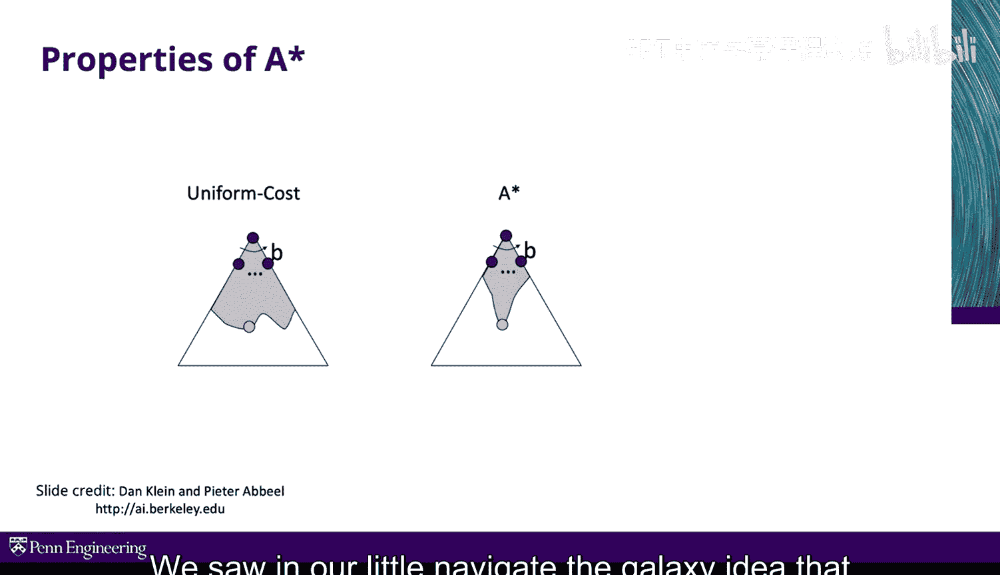

Exploring things in the wrong direction， our goal was to get from Kesel all the way up to Al Zand。

 we will be going in this wrong direction for several expansions。Before we end up。Finding our goal。

 Chiband， you can visualize that either as the nodes that it's exploring in a search tree。

 or also as this notion of contours， we talked about visualizing how nodes in a graph gets expanded by taking these contours into account for uniform cost search the contours were basically everything less than or equal to 50 would be on one contour。

 everything less than or equal to 100 would be on another contour。

 everything with a path cost of less than or equal to 200 would be on the gradually expanding one。

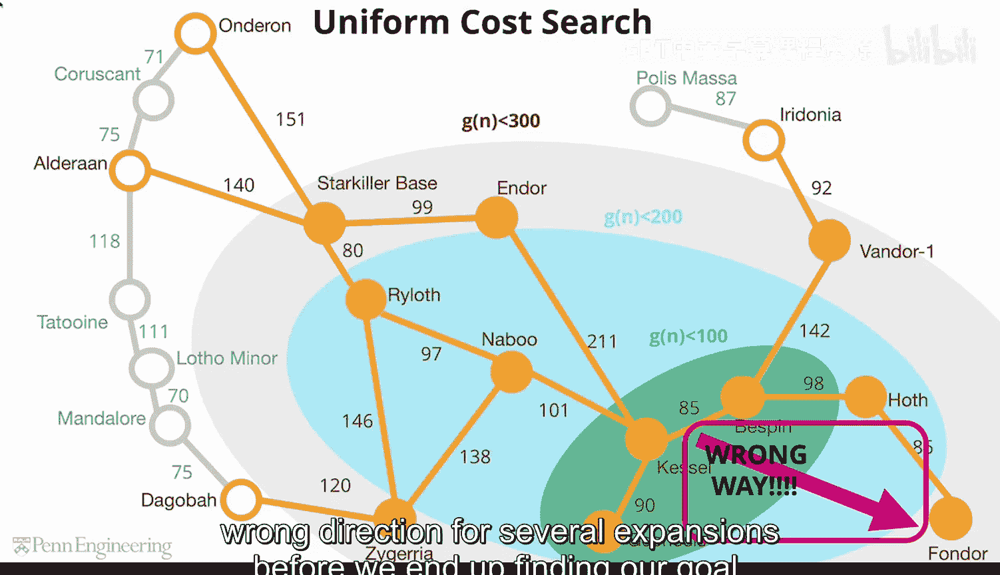

That's all with the path cost， the current cost from the initial state to the nodes that are being expanded taken into account。

But with A star， we're also adding in these heuristic costs。

 we end up stretching out our expansions on directions that point towards the goal。

But it's still going to hedge a bit， so it's still going to explore some path that it。

Doesn't need to because in order to guarantee optimality。What do I mean by hedge at bes。

 we saw one other type of best first search algorithm。

 which was a greedy best first search algorithm if uniform cost search。Has f of n equals to G of n。

 it just sorts your frontier only by the path cost far。

The greedy best first search means F of n equals H of n。

 totally ignores the path costs so far and just expanding the options that they're closest to their goal。

And a star is a little bit more conservative than that。 It's still going to expand things。

 taking this combination of both H of N and G of N into account。 It's not just going to。

Blindly rush straight towards the nose that look like they're the closest to the goal。

 it's also going to take the distance into account so far。

That's what I mean my head at bets Star is used in all sorts of super cool applications。

 you will definitely have encountered a star before。

 even though you may not know it's used for path finding and route finding。

 but if you use a maps application on your smartphone while you're driving under the hood。

 it's using a star search in order to find the best path from where you are now to where you're going to。

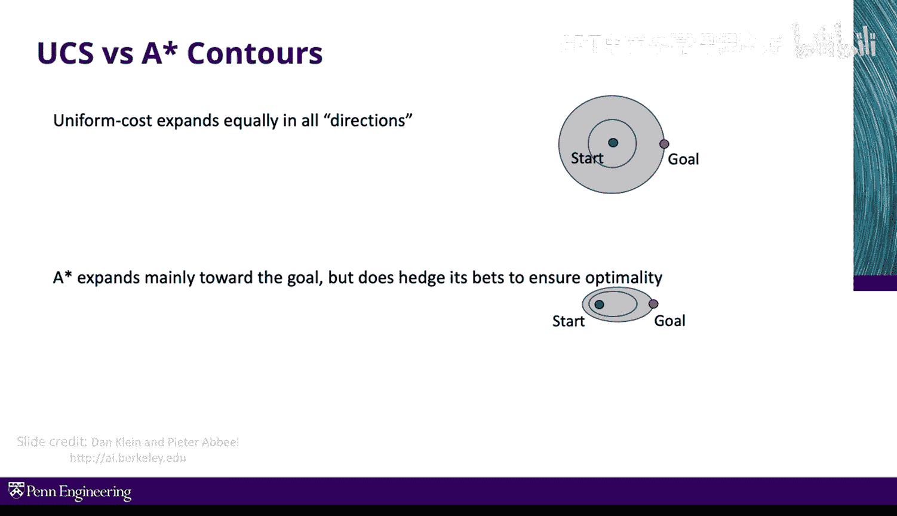

It's used in robot motion planning including navigation and even things like resource planning problems。

 making sure that your supply chain or your sequence of operations are scheduled in a good manner another cool application of astar searches in video games that leads me to recommending this resource there's a really nice tutorial about Astar search that I really like by Ammet Pattel who is a former Stanford PhD grad in algorithms and works in video games who's got a whole bunch of tutorials about algorithmic。

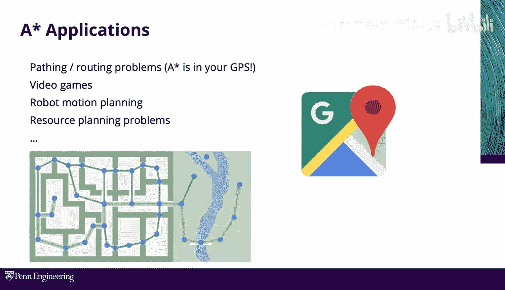

Things for video games and the A star is like a perfect match for this class and if you like video games like it's a great way to think about how you could use shortest path algorithms。

 video games。

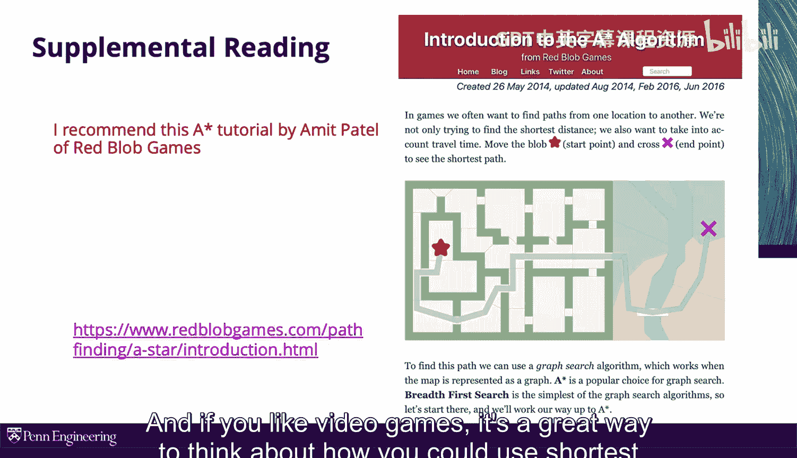

He talks about how you can or what's the relevance of pathfinding to video games。

 if you have a character including an AI controlled character that the player isn't playing and it's in a start position and you need it to get to some destination。

 then that's a root finding problem。And so he talks about how you can represent a video game map as a variety of different kinds of grids as a bunch of nodes and arcs where you have the nodes be particularly relevant locations in the grid and the arcs just be the paths between them that aren't blocked by obstacles like walls。

 another version of this is to have a grid worldlike thing where you have a different finer G resolution。

Or each of the rooms in your game with a bunch of waypoints in between。

And then he walks through how to implement Bfor search as an initial foray before he shows how he implement a star search。

 this is an example of where you just run Bfor search in the end without a particular goal state in mind。

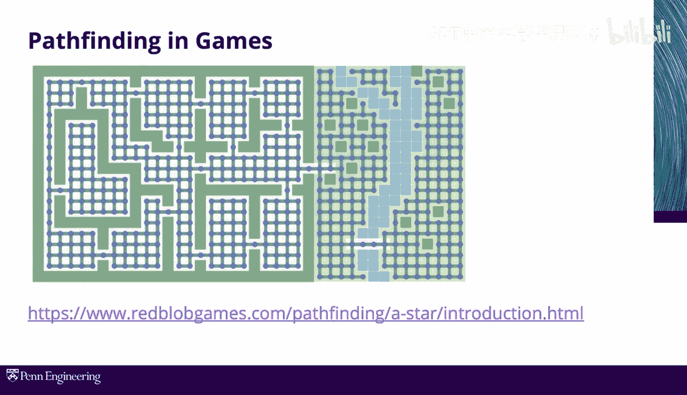

And as you now know it expands outwards， you can write breath firstt search in 10 lines of Python。

 here's the 10 lines of Python from the red Glob games， we create a frontier data structure。

 what is a frontier also Q in breathth first search。

 the type of queue that we're using is first in first out queue。

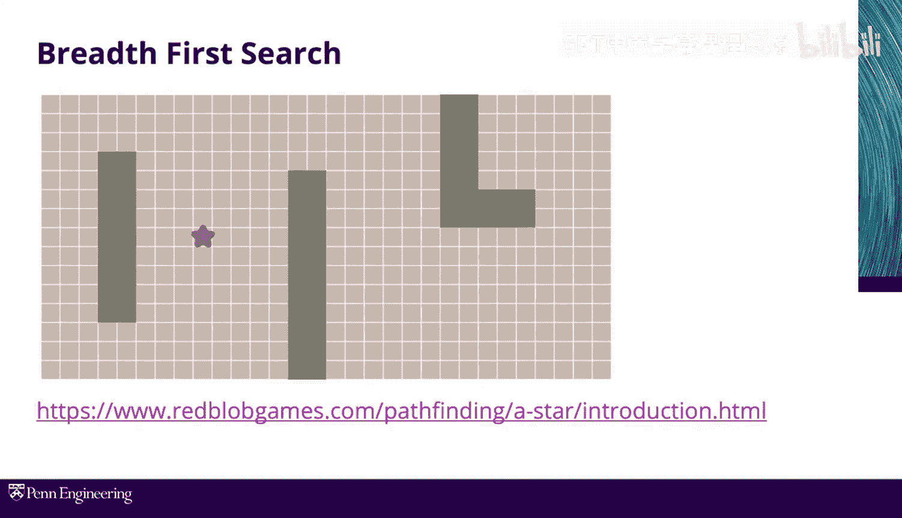

And so we're just going to add this Dar node to the queue and we're going to create another data structure that represents what nodes we've already visited and this is important to make sure that we don't repeatedly expand the same nodes because that'll lead to inefficient solutions and while the frontier is not empty you just get the first thing off of it and then you expand it what is expand mean that means you're getting the successors and this type of situation in a graph。

 the successors or just any nodes that are connected to that node that we've just popped off the frontier。

And then if you haven't already visited one of those successor nodes。

Then go ahead and put it on the frontier and record that you visited it。

 That's how you do breath first search。 Of course， that's not the only thing that we want from breath first search。

 What we want is also to record the path from the goal node。

Back to the original start state so that we can send that as the series of moves that our robot needs to take in order to get from one place to another or that our video game character can do in order to chase down the player。

In order to do that， we're going to also have to keep track of where we came from for each node that we're exploring in breathth for search and for this one we ran it to the ends。

 every place in our video game map is going to have been explored we just want to make sure we remember where we came from and that way when we get to a destination as deed by this purple X we can trace back。

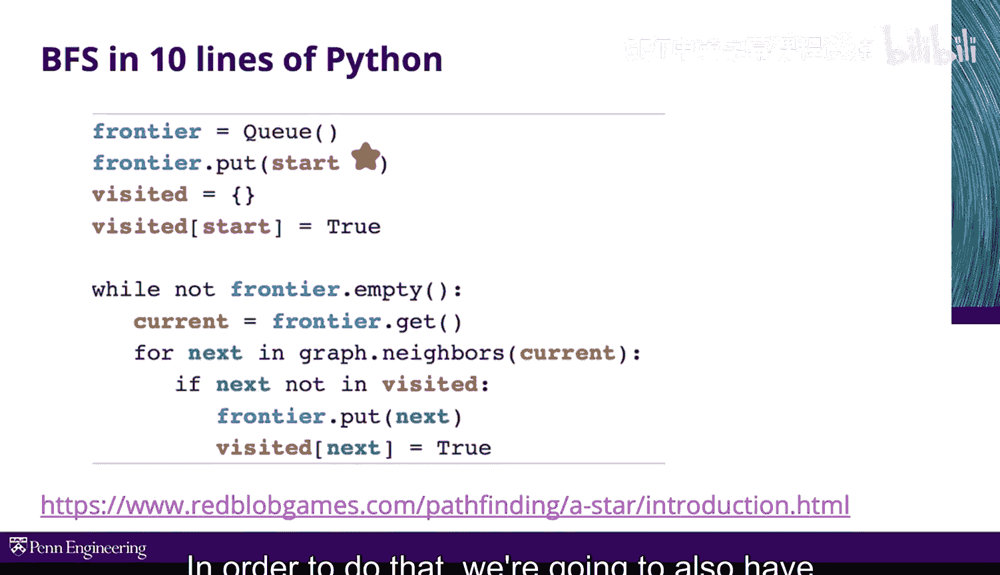

To where we came from in order to get back to。The initial state and that will be the shortest path according to breath first search。

There's several different ways to do that， the one suggested on this blog is to have another data structure that says came from and just records for each node where you came from。

 then you could record that when you're putting something onto this came from data structure。

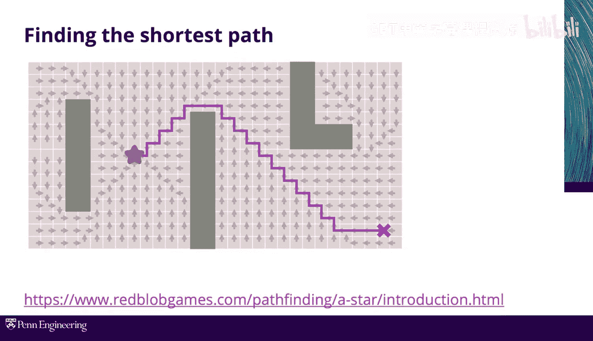

And so that also does a double duty and has the same property as the visited if it exists in this came from data structure。

 then we know that we visited it already so that's one way of doing that in order to trace back you can just construct the path by saying when we're at the goal node create an empty path and then add the current one to it and look up in our came from data structure what we came from until we get back to the start we're just going to keep app them and that's going to be。

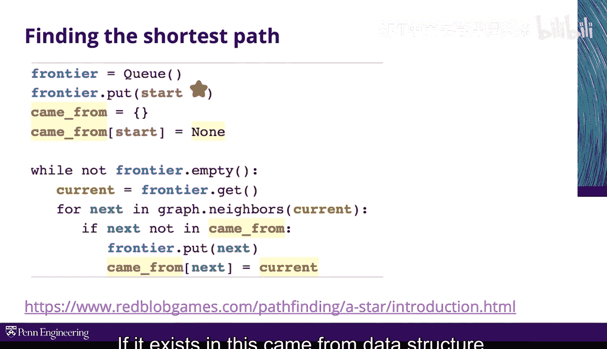

The path from the goal state back to the initial state， we just have to flip that order。

An alternative way of doing it is to keep track of the path so far explicitly。

 instead of just recording all these came from moves。

 you can just create a bunch of paths and one of the cool things about a queue in Python is that the things that you can put on it can be complex objects so you could basically keep a list that contains both the path so far and the node you want to expand。

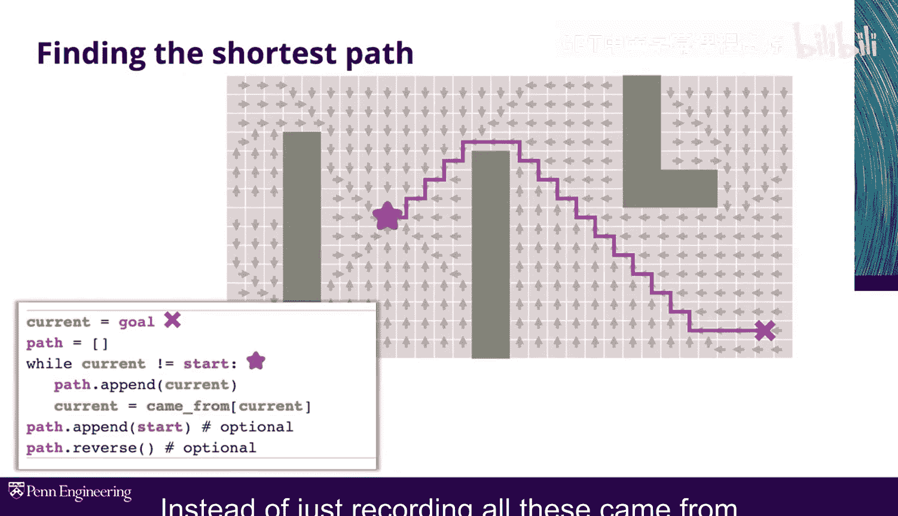

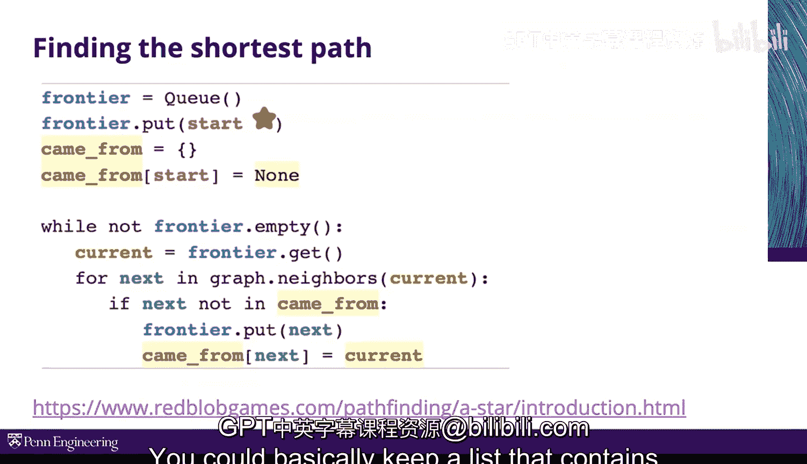