# 人工智能和机器学习基础：35：A*搜索的特性 🧭

在本节课中，我们将深入探讨A*搜索算法的特性、行为及其在实际中的应用。我们将了解它与其他搜索算法的区别，并通过一个视频游戏路径查找的实例，学习如何用简单的Python代码实现广度优先搜索，这是理解A*搜索的重要基础。

## A*搜索与均匀代价搜索的对比

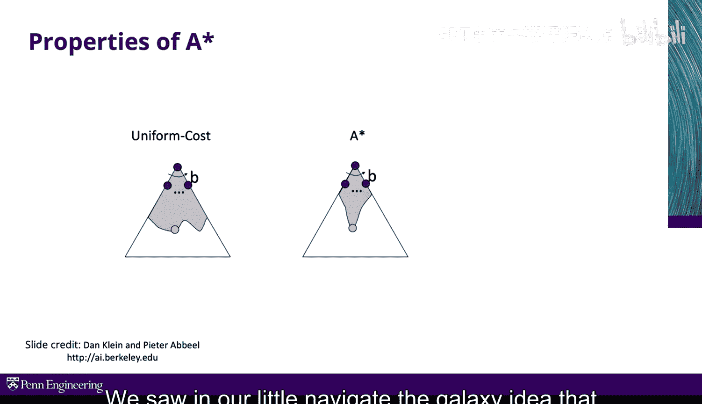

上一节我们介绍了A*搜索的基本概念，本节中我们来看看它与均匀代价搜索在节点扩展顺序上的不同。

*   均匀代价搜索可以被视为A*搜索的一个特例，其启发式函数 **`h(n)`** 始终等于 **`0`**。
*   均匀代价搜索只关注从起点到当前节点的实际路径成本 **`g(n)`**。
*   这有时会导致算法探索错误方向上的路径。在我们之前“星系导航”的例子中，目标是从Kesel前往Al Zand，但算法可能会先向相反方向（如Chiband）探索多个节点，之后才找到目标。

我们可以通过“等高线”来可视化节点的扩展过程。

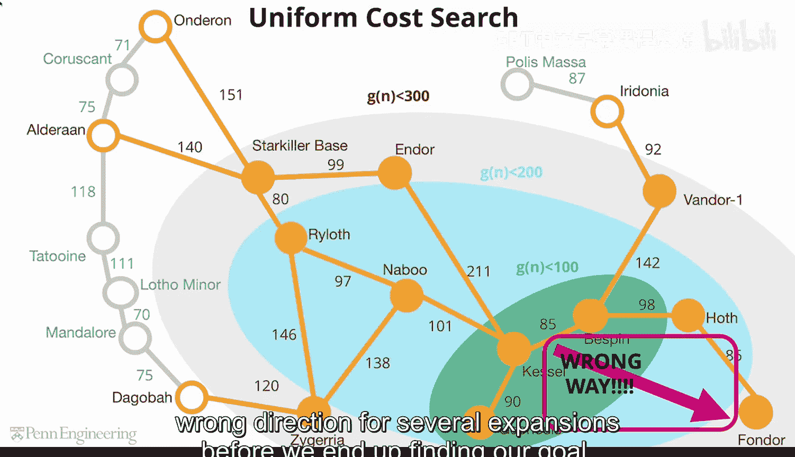

*   对于均匀代价搜索，等高线基于路径成本 **`g(n)`** 划分。例如，所有成本小于等于50的节点构成一个轮廓，小于等于100的构成下一个轮廓，以此类推。
*   等高线从起点开始均匀地向所有方向扩展。


## A*搜索的启发式引导

A*搜索在 **`g(n)`** 的基础上加入了启发式成本 **`h(n)`**，这改变了其扩展行为。

*   A*搜索的扩展方向会受到目标的“吸引”，其等高线会向目标方向拉伸。
*   但为了保证找到最优解，A*搜索不会盲目地直奔目标。它会“谨慎权衡” **`g(n)`**（已付出的成本）和 **`h(n)`**（预计剩余成本），因此仍会探索一些看似不必要的路径。

以下是两种极端情况的对比：

*   **均匀代价搜索**：评估函数为 **`f(n) = g(n)`**，仅按已发生的路径成本排序。
*   **贪婪最佳优先搜索**：评估函数为 **`f(n) = h(n)`**，完全忽略路径成本，只扩展看起来离目标最近的节点。
*   **A*搜索**：采取折中策略，评估函数为 **`f(n) = g(n) + h(n)`**，同时考虑过去和未来的成本，因此比贪婪搜索更保守和可靠。

## A*搜索的实际应用

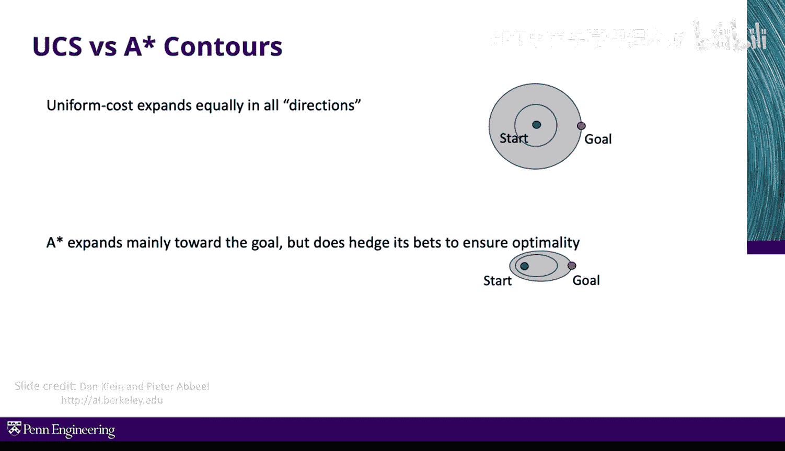

A*搜索因其高效和最优性，被广泛应用于各种需要路径查找的场景。

*   **地图与导航**：智能手机上的地图应用在为你规划行车路线时，底层很可能使用了A*搜索算法。
*   **机器人运动规划**：用于机器人的导航和避障。
*   **资源与工序规划**：可用于优化供应链或操作序列的调度问题。
*   **视频游戏**：这是A*搜索一个非常酷的应用领域，用于控制游戏角色（包括AI角色）寻找从起点到目的地的最佳路径。

## 实例：视频游戏中的路径查找

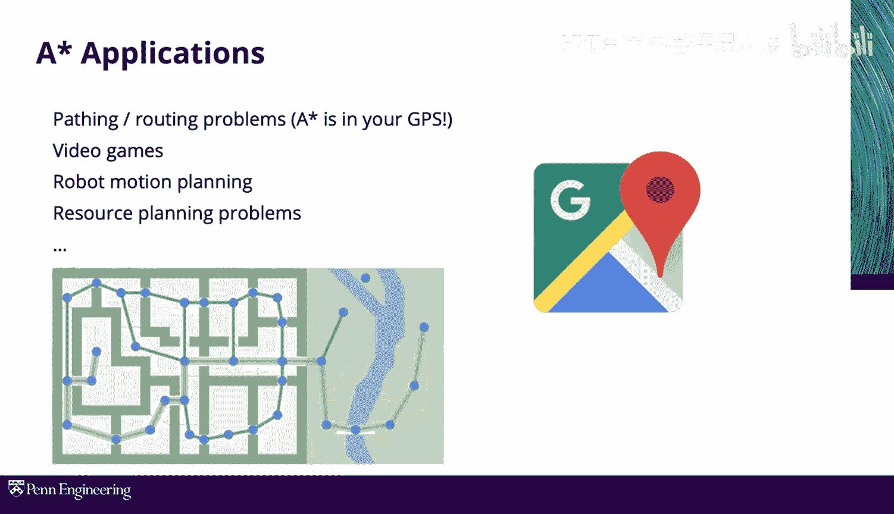

接下来，我们通过一个视频游戏路径查找的实例，来具体理解如何实现搜索算法。我们将首先实现广度优先搜索（BFS）。


在视频游戏中，可以将地图建模为图（Graph）。

*   **节点**：代表地图上的关键位置或路径点。
*   **边**：代表节点之间可通行的路径，被墙壁等障碍物阻挡的区域则没有边相连。
*   地图可以表示为精细的网格，也可以表示为房间与路径点组成的抽象网络。

以下是实现广度优先搜索（BFS）的核心步骤，该算法会均匀地向外探索所有方向。

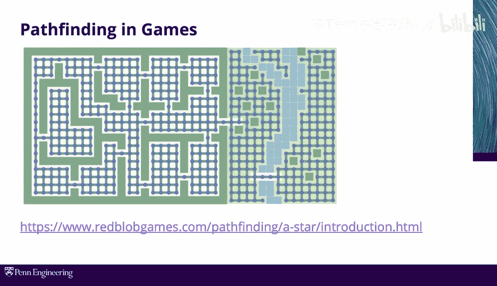

我们可以用大约10行Python代码实现基础的BFS。以下是来自Red Blob Games教程的示例代码框架：


```python
# 示例：广度优先搜索（BFS）框架
frontier = Queue()  # 创建一个先进先出（FIFO）队列作为边界
frontier.put(start_node)
visited = set()     # 记录已访问节点，防止重复探索
visited.add(start_node)

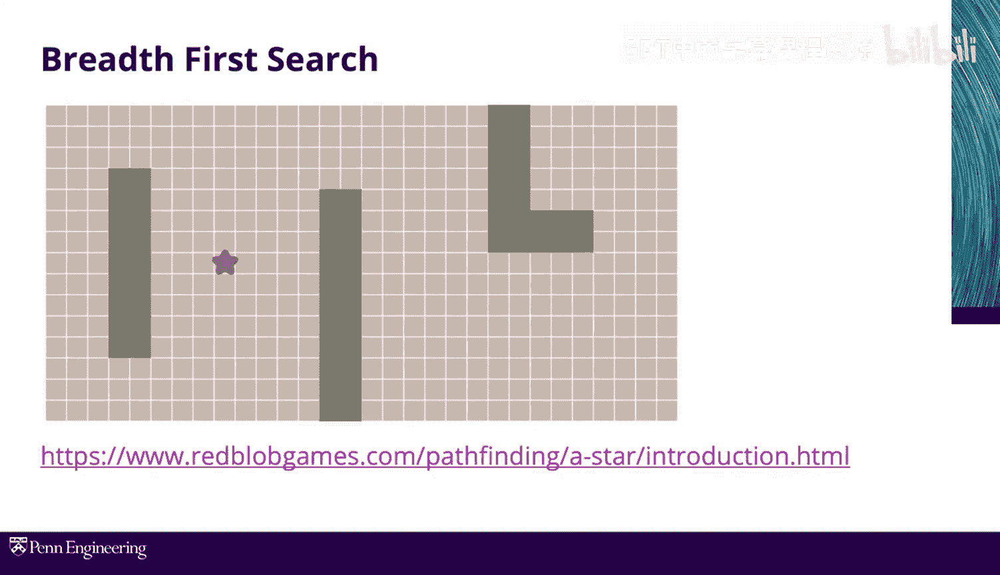

while not frontier.empty():
    current = frontier.get()
    for next_node in neighbors(current):  # 获取当前节点的所有后继节点
        if next_node not in visited:
            frontier.put(next_node)
            visited.add(next_node)
```

这段代码的核心逻辑是：

1.  创建一个先进先出队列 `frontier` 来存储待探索的边界节点。
2.  创建一个集合 `visited` 来记录所有已访问过的节点，这是保证效率、避免无限循环的关键。
3.  只要边界队列不为空，就取出第一个节点进行“扩展”。
4.  “扩展”意味着获取该节点的所有相邻节点（后继节点）。
5.  对于每个未访问过的后继节点，将其加入边界队列并标记为已访问。

然而，基础的BFS只完成了探索。为了找到一条具体的路径，我们还需要记录路径信息。

## 记录与重建路径

我们需要在搜索过程中记录每个节点的“父节点”（即从哪个节点来到当前节点），以便在找到目标后能回溯出完整路径。

以下是实现路径记录和回溯的一种方法：

*   创建一个 `came_from` 字典（或类似数据结构），在将新节点加入边界时，记录它是由哪个节点扩展而来的。
*   `came_from` 数据结构可以同时起到 `visited` 集合的作用——如果一个节点在 `came_from` 中已有记录，则说明它已被访问过。

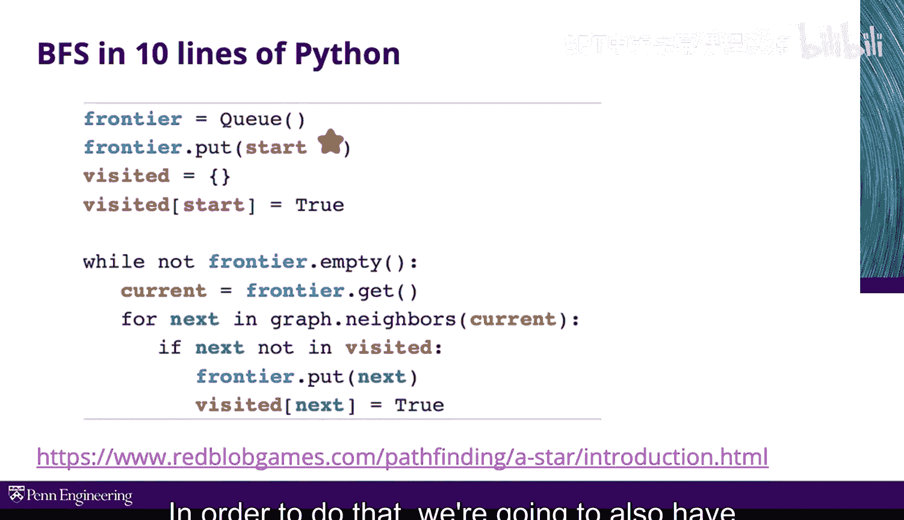

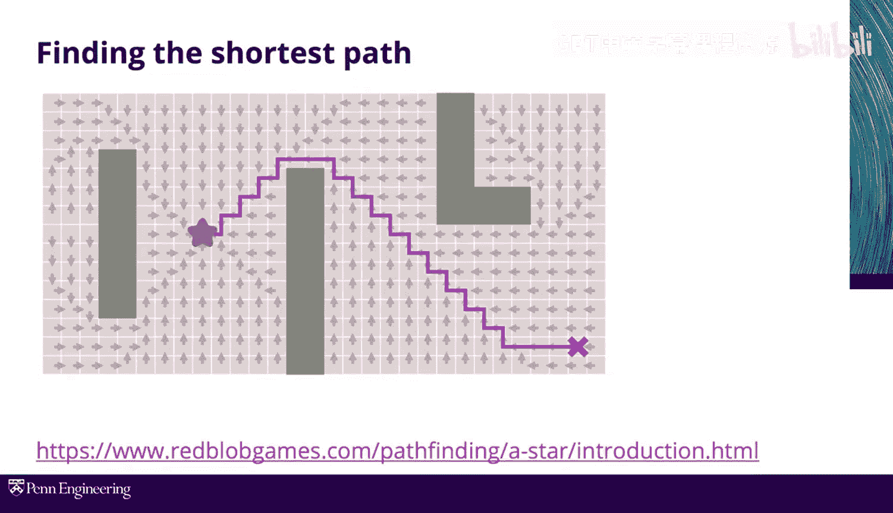

当到达目标节点（如图中的紫色X）时，通过 `came_from` 字典不断向前追溯，直到回到起点，就能得到一条从起点到目标的路径（注意顺序是反的，需要反转）。


```python
# 路径回溯示例
current = goal_node
path = []
while current != start_node:
    path.append(current)
    current = came_from[current]
path.append(start_node)
path.reverse()  # 反转列表，得到从起点到目标的路径
```

另一种实现方式是显式地在队列中存储“路径-节点”对。

*   利用Python队列可以存储任意对象的特性，将 `(当前路径列表, 当前节点)` 作为一个整体放入队列。
*   这样，当弹出队列项时，就直接获得了从起点到该节点的完整路径。

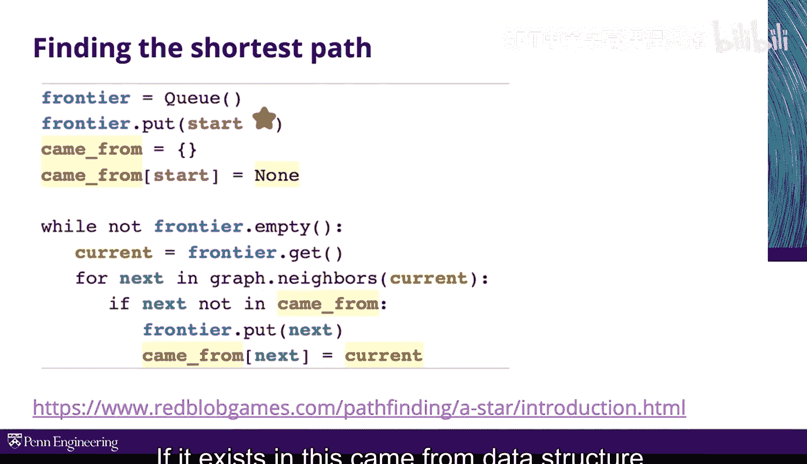

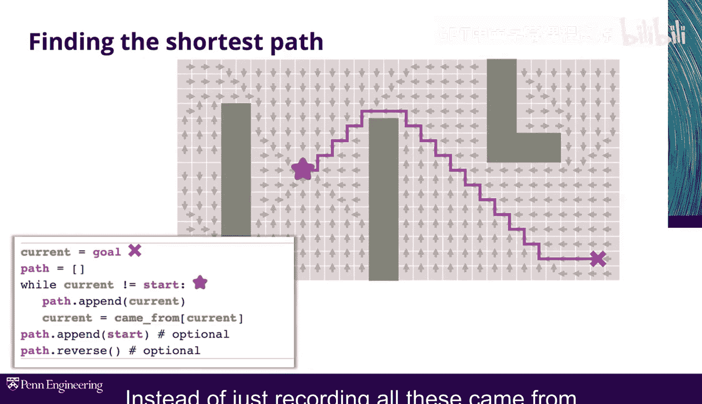
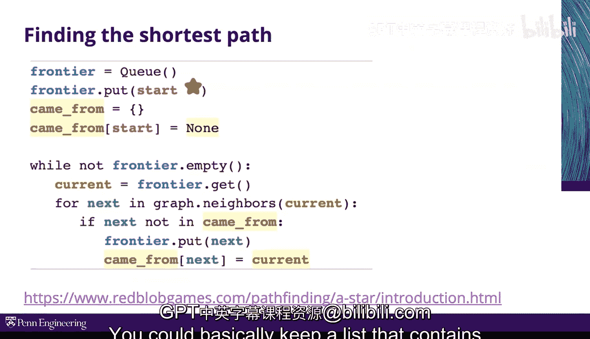

## 总结


本节课中我们一起学习了A*搜索算法的关键特性。我们了解到A*搜索通过结合实际成本 **`g(n)`** 和启发式估计 **`h(n)`**，在保证找到最优解的同时，能更有效地引导搜索方向。我们还将A*与均匀代价搜索、贪婪最佳优先搜索进行了对比。最后，通过视频游戏路径查找的实例，我们学习了广度优先搜索的实现原理，包括如何探索地图、记录访问状态以及重建最终路径，这些是理解更复杂搜索算法（如A*）的重要基础。