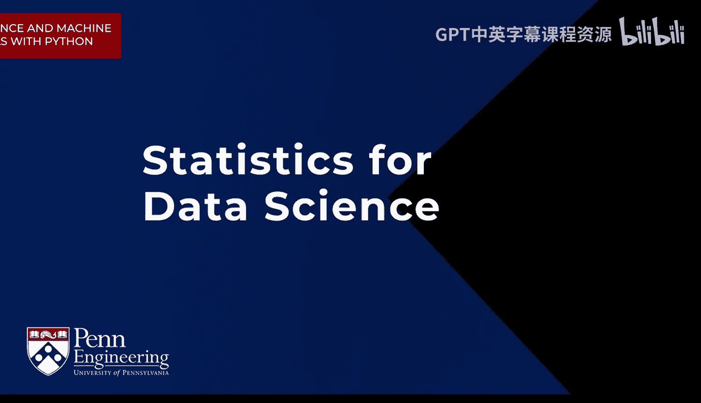

# 宾夕法尼亚大学《人工智能和机器学习基础（AI、数据科学、机器学习）AI and Machine Learning Essentials with Python》 p36 01_01_01_统计学在数据科学基础中的介绍.zh_en -BV16f421Q72q_p36-

I'm here with one of my outstanding colleagues from Penn's School of Engineering and Applied Science。

 Hamhmed Hassani。Hmed will teach you about the mathematical foundations of machine learning and artificial intelligence。

Amed， can you give us some examples of the types of topics that you're going to cover in your course for our specialization Sure thank you Chris。

 so the course in the current format will start by covering the main tools and concepts from probability that are required for machine learning and AI and then we'll cover another topic on estimation and hereby estimation we mean the task of estimating various quantities of data。

or the population or the society using a selection of data points or samples from that population。

 So let's think about a concrete example。 Imagine we wanted to build a machine learning system that can predict whether or not a patient has cancer Can you tell us how the mathematical or underpinnings of your course helps with that kind of machine learning task right So if an AI model is to predict cancer using the patient's information。

 for example， the FMRI scan of the patient the AI model has to estimate the likelihood or the probability of having cancer using that fMRI scan。

And once this estimation has been done and that's the main task that the AI model will do。

 Once the estimation has done， the prediction will just follow from that estimation of the probability。

 So there are two keywords here estimation and probability that we are going to cover in this specialization。

Most of the courses on our specialization focus on hands on assignments using Python。For this course。

 we're not going to use Python， Can you tell us what your assignments are like for your course。

 the assignments of this specialization have been designed in order to deepen the understanding of the learners about the main tools。

 algorithms and the concepts that are taught in their specialization。

Given that we're primarily targeting Python programming。

 why should programmers care about statistics？Right so statistics and probability are the main mathematical underpinnings of AI models and AI algorithms for that understanding having a good understanding of these foundational concepts will definitely help to understand what the algorithms are doing how are they designed and if you want to design new methods。

 new model and new algorithms， these kind of statistical concepts are definitely helpful That's wonderful that's great motivation for why you should take this class and we hope you enjoy learning from Hammed。

😊。