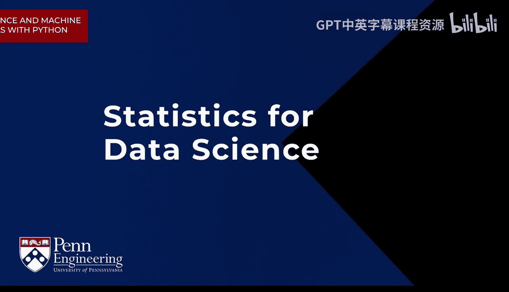

# 人工智能和机器学习基础：01：统计学在数据科学中的介绍

在本节课中，我们将要学习统计学和概率论在人工智能与机器学习中的核心作用。这些数学基础是理解AI模型如何工作、如何设计新算法的关键。

## 课程概述

我很荣幸地向大家介绍来自宾夕法尼亚大学工程与应用科学学院的杰出同事，Hamhmed Hassani。Hmed将为大家讲授机器学习和人工智能的数学基础。

## 课程内容概览

Hmed，能否请你为我们概述一下，在你的课程中将涵盖哪些主题？

当然，谢谢Chris。当前的课程将首先涵盖机器学习与人工智能所需的核心概率论工具和概念。随后，我们将学习另一个关于“估计”的主题。这里的“估计”指的是，利用从总体或社会中抽取的数据点或样本来估算各种数据量、总体或社会特征的任务。

## 核心概念的应用实例

让我们思考一个具体例子。假设我们想构建一个能够预测患者是否患有癌症的机器学习系统。你能告诉我们，你课程中的数学基础如何帮助完成这类机器学习任务吗？

好的。如果一个AI模型要利用患者的信息（例如患者的fMRI扫描）来预测癌症，那么该AI模型必须利用该fMRI扫描来估计患癌的可能性或**概率**。一旦完成了这个估计（这是AI模型的主要任务），预测就会基于这个概率估计得出。因此，这里有两个关键词：**估计**和**概率**，它们将是本专项课程中要涵盖的内容。

## 课程作业形式

我们专项课程中的大多数课程都侧重于使用Python进行实践作业。但在这门课程中，我们不会使用Python。你能介绍一下你课程的作业形式吗？

本专项课程的作业旨在加深学习者对课程中所教授的主要工具、算法和概念的理解。

## 为什么程序员需要关注统计学？

考虑到我们的课程主要面向Python编程，为什么程序员应该关心统计学呢？

统计学和概率论是AI模型和AI算法的主要数学基础。深刻理解这些基础概念，将极大地帮助你理解算法在做什么、它们是如何设计的。如果你想设计新的方法、新的模型和新的算法，这类统计概念无疑是至关重要的。

## 总结

本节课中，我们一起学习了统计学与概率论作为AI和机器学习基石的重要性。我们了解到，**估计**和**概率**是构建预测模型（如癌症诊断系统）的核心。尽管本课程不涉及Python编程，但其数学原理是理解所有AI算法运作机制的关键。希望这能激励你深入学习这门课程，并享受从Hammed教授那里学习的乐趣。