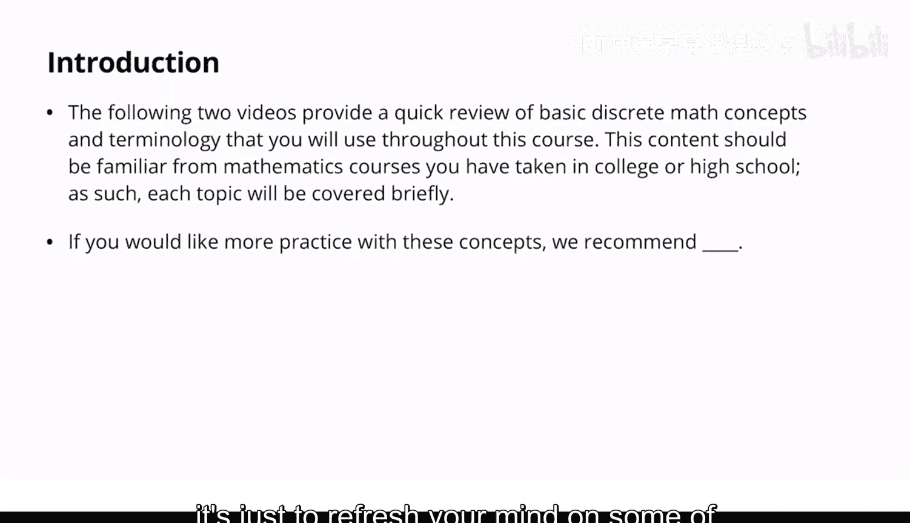
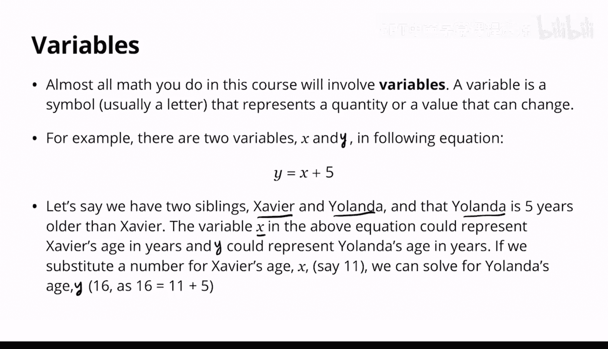
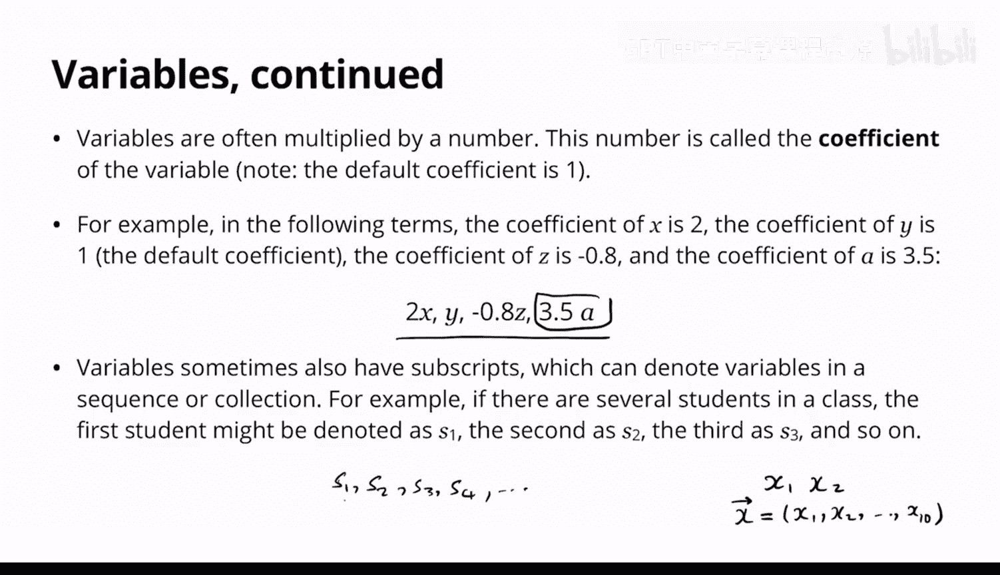
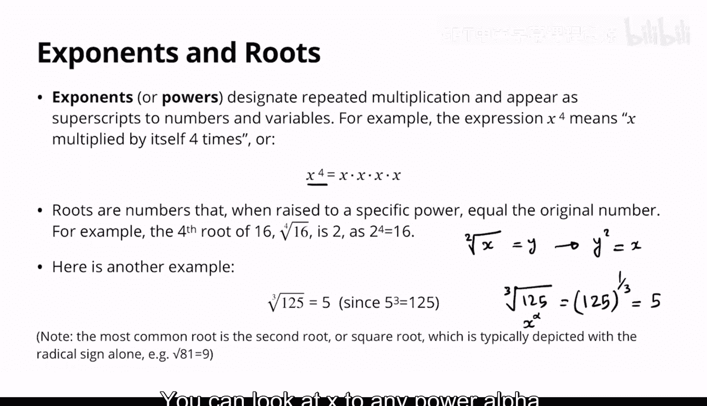
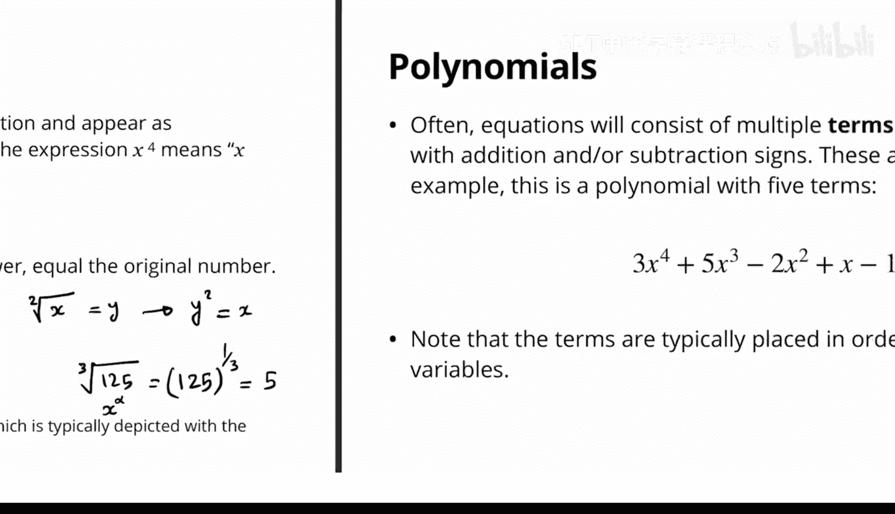
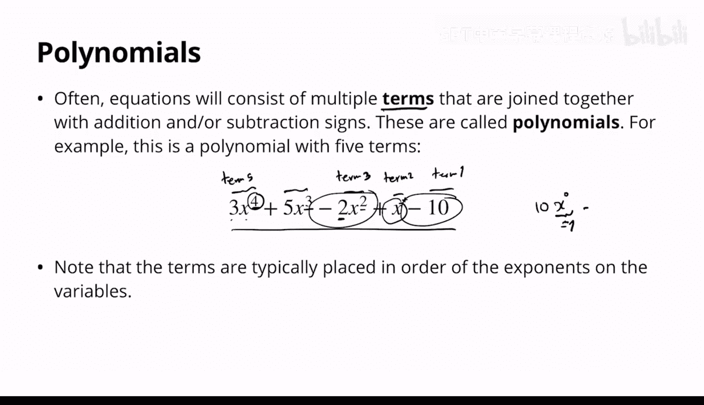
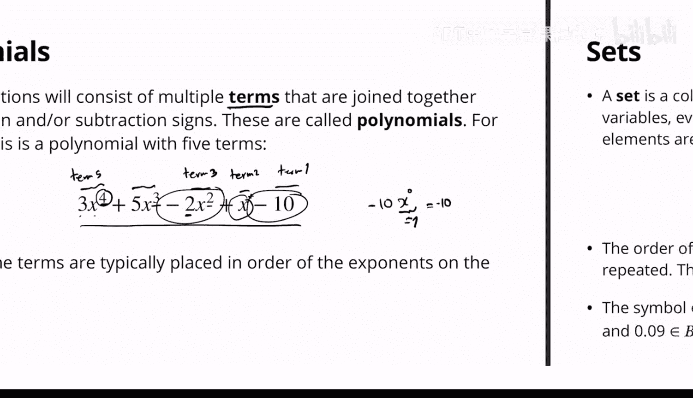
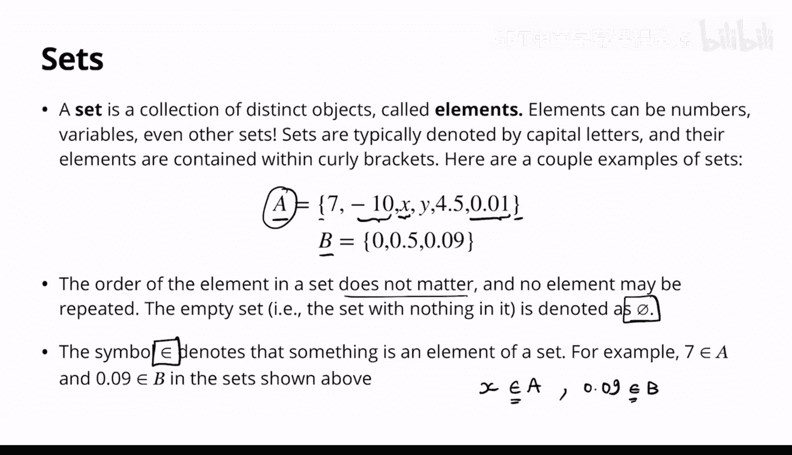
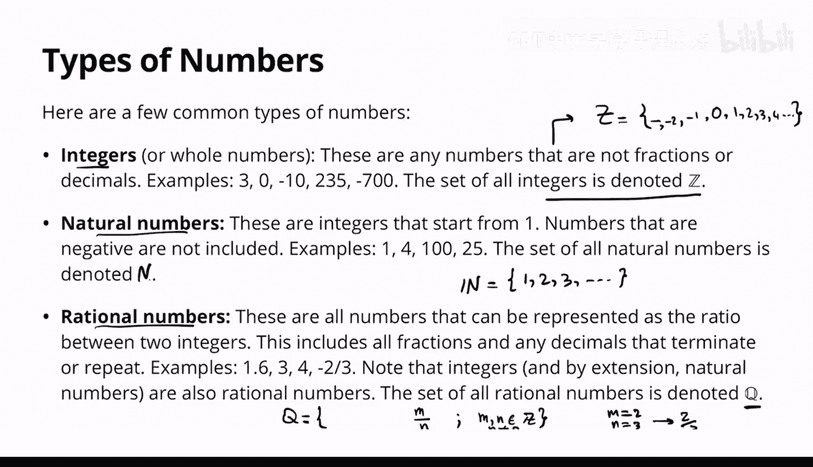
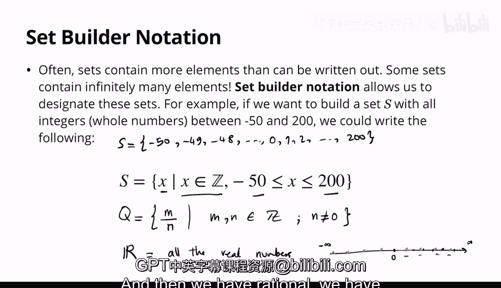

# 宾夕法尼亚大学《人工智能和机器学习基础（AI、数据科学、机器学习）AI and Machine Learning Essentials with Python》 p38 03_01_01_离散数学复习I-变量、多项式、集合.zh_en -BV16f421Q72q_p38-

Hi everyone， in this section we're going to review some very basic content from discrete mathematics。

 so I will have two subsections， discretere math review 1 and discretereet mathth review 2。

 and as you will see we're going to really touch on the basics here。All right。So the content。

 as I said， of these two subsections should be very familiar with you。

 you may have learned them from high school or from college。And because of that。

 we're going to just very quickly go through the content。

 I'm sure your family are with most of the contents just that it's just to refresh your mind on some of the things that you have seen before。

The very first item that we work with in mathematics is the notion of variables。

Again almost in all math and also in this course we are going to deal with all sorts and types of variables now as a formal definition a variable is a symbol that's usually represented by a letter that represents a quantity or a value that can change so every typically you are familiar with x y z that we use in our equations or alpha beta commma and so on these are the so-cal variables that we use and we are working typically with equations。

 sequences， unknowns and typically the building blocks of those equations or unknowns are variable。

So as a simple example here， were going to consider this equation y equals x and y x plus 5。

 x and y are the two variables that we work with and the value that y x would be the value of x plus the number 5。

😊，So again， as a simple example to represent this equation， so let's consider two siblings。

 Javier and Yolanda， and we know that Yolanda is five years。Older than javier， Okay。

 so in going back to the equation that we have the variable x would represent the age of jaer and y could represent the age of Yolandda。

 Now we know that。Uola is5 years older than half year， so this means that y is equal to x plus 5。

And if x， which is heavier as h is 11， then you go on as h is 11 plus 5， x plus 5。

 which is y equals 16。

So that was the notion of variables。😊，Now， typically we work with equations involving variables and these equations。

 variables would either appear with some coefficient behind them。

 and the coefficient would be a number multiplied to the variable a scalar number or the variable would be sent to a sum power for example。

 x would be sent to power 4 would be x to the 4 or x to the 5 and so on。

 So let's first introduce what we mean by a coefficient。 So typically again。

 as I said in our equations， variables are often multiplied by number a scalar value。

 and this number is called the coefficient behind the variable。

 Okay so default coefficient is one we don't represent one。 but it could be any other number 252。

5 minus-1 minus-2 anything that you can think about so these are for example。

 examples of variables multiplied by coefficients behind them。 So 3。5。

 So if you look at this one here。5 times a this means that the value of I of a would be multiplied by 3。

5。And so that was one thing coefficient。 Another thing that's also important is that we often use variables in a sequence。

 Okay， so we have a sequence of variables that are somehow of the same type。

 and we show these sequences of variables， elements inside the sequence。

 the variables inside the sequence using a subscript。 So， for example。

 we work with sequence of S1 S2。S3 S4 and that can continue。

 and so the subscript so each of these Ss would be a variable。

 but somehow these variables share something that we could be that we are putting them in a sequence Okay so that would be S I。

 the I， the underlying I would be the index of the variable inside the sequence。

Okay so that's one thing but again this just emphasizes that we are going to use subscripts or sometimes superscripts for our variables to show that variables are of the same time。

 but but because of this subscript or the superscript they may have differences。

 other differences so we could for example， sometimes we use x1 x2 for example or sometimes we use vector notions so a vector x which show by a vector notion would would correspond to a vector of numbers x1 x2 all the way to let's say x10。

 so that's a 10 dimensional vector。And the first coordinate of this vector would be x。

 The second coordinate would be x2， and the last coordinate1 coordinate would be x 10。 Okay。

 so we we used x everywhere for the vector and the coordinates because they share something some。

Some concept together， but x subscript I would represent the I coordinate of the vector x。

Okay。Now as I said， we are going to also use variables in equations in terms of powers of variables。

 so exponents or powers they repeated multiplication of the variable and appear as typically use we show power using a subscript to the number of the variable okay so for example x to the power4 as you see here would be x multiplied by its cells four times so destination of exponent or powers we will also sometimes use the roots of the variable so the square roots which we show by square root2 of x would be a number x should be positive here would be a number y such that y to the power2。

Is equal to x， or typically you have y or plus minus of y would would be the same would be an equation would give you。

X when they are sent to the power to。And we can think about roots of a number to other degrees to so for example。

 the third roots of 125。Would be。We it' sometimes represented by 1 over 25 to the power1 over 3。

 this would be 5。 okay in general， we can work with x to some power Al where Al is a real number。

 It could be 1 over 3。 It could be 1 over 2。 It could be 1 over 5。 It could be 0。2。

 It could be minus-0。3 and so on and so forth。 So this somehow shows that power is not just a limited to integers。

 You can look at x to any power Al provided that x come from the right comes from the right domain。

Alright so that was about exponents and roots now let's put these together and talk about polynomials so typically the equations that we work with involve several powers of variables together with coefficients behind them okay so each of these like a power times a coefficient would be called a term right so this and a collection of the terms that are added together would be called a polynomial okay so this is an example of a polynomial that you see here so each of these is called a term。

Okay， so term。Let me call it term 1， this is term 2， the second term of the polynomial。

 this is the third term。And this is the fifth term。Right？

And so the first the first term would be you can think about it as minus 10。

 so let me just put plus between everything so this is minus10， the first term is just a number。

 the second term is x， the third term would be minus2 times x squared。

 so the coefficient in this third term is2， the power so is x to the power2 and the fifth term or would be3 times x to the power 4。

Now， this polynomial is of degree 4， the largest power inside the polynomial is typically called the degree of the polynomial。

 so the degree of this polynomial is 4。Okay and typically we represent polynomials in the decreasing order of the terms so and by order I mean the exponent of the terms。

 so typically when we represent the polynomial the first term will have the largest power so in this case 4。

 the second term will have the second largest power in this case3 and then2 and then 1 and then 10。

 the number 10 which corresponds to 10 times x to the power 0 every number to the power 0 will be 1 so that this is equal to 1 so that would be 10 for example。

 let me put the minus source。

Right。

Alright， so another concept that we're going to work with is the concept of sets a set would be a collection of distinct objects that are called elements。

 So in this example that you see here the set a consist of six elements as you see and the elements could be of various types。

 So for example one。Element inside the set S is the number， the real number 0。01。

 Another element is the variable x。 Another element is the number-10。

 So here we are working with a very general notion of the set a set could be a collection of anything Okay。

 so a collection of any type of elements that you see here。

Now sets typically are represented by chapol letters and their elements are typically shown within inside or within a curly brackets as you see。

Right and this is another example of a set B， which is just a set of three real numbers okay so the numbers in this set B。

 so the objects in the set B have the same type as you see whereas the objects in the same A have different types。

 so one of them is x is available the other one is 4。5 for example。

So the order of the elements in a set does not really matter。

 what's important is that you have a collection， the collection itself is the important factor here。

And this a set does not contain repetitions of the element。

 so if an element is inside the set it's only in the set once， it's the object that's important。

 not the repetition of the object。And the empty set。

 the set that contains nothing is typically represented by this。Notation that you see here。

And so a few quick notations here， so this symbol that you see here that I have just highlighted here。

 this symbol represents inclusion， so we say that for example。

 the object X or element x belongs to the set a going to the example above。Or let's say，0。09。

This object belongs to the set so this notation here essentially represents inclusion。

All right。Again， as I said， we are quickly reviewing different concepts that are useful for the course and these a really basic concept that I'm sure all of you have seen before。

 just a quick review。Now types of numbers we are typically working with three types of numbers。

 integers， natural numbers and rational numbers， and then we have real numbers also which is kind of similar to rational numbers but but is more general than rational numbers the distinction doesn't really matter for thiscourse right now All right。

 so integers would be numbers that are。Integers， I set up integers that's denoted by z。

 the typical numbers without any decimal points or anything like 3，0， minus-10。

 235 and so on and so forth， all these all the discrete numbers。

 all they set up all the discrete numbers， both positive and negative。

Natural numbers would be integers that are strictly positive okay like1 so so z let me just write this so z the set of all the integers would be the set of all the discrete numbers。

01，2，34 and this excess to infinity from the right and minus1 minus-2 and this sets goes to infinity from left so from minus in 23 plus in all the integers and the set of natural numbers。

In。Would be the set of all the positive integers， so one，2， three， all the way to plus infinity。

 doesn't it excludes0， it doesn't include0， All。And the set of natural numbers is typically represented by。

um。N okay， so z for the integers and for natural。Rational numbers， which。

 which we typically represent them by Q is the set of all the numbers that can be represented as the ratio between two inte。

 Okay， so  Q。be there's no order。You cannot really represent the Q as as you see here。

 there is no like simple countable order on the elements of the Q。

 but it it's all the numbers of the form， let me write m over n。Where。M and N are inside。B okay。

 and n is non 0。Is Nazizi。Okay， any number of this form would be irratione。Okay。

 and this is denoted by Q。 like， so M could be 2。N could be 3， and that would give you two over3。

Which is a rational number is not an integer and that's inside Q。So rational numbers。

 so there is also another set called the real numbers， all the real numbers that you can imagine。

 rational number is a strict subset of real numbers。

 so there are numbers inside the real numbers that are not rational numbers but the distinction really doesn't matter for us for discourse。

Finally， one notation that will be useful for us throughout the course is the notation of setBuilder Se builder is a way of writing a set in a more compact kind of compact form。

So let me just give you an example to illustrate this notation。

 so let's assume that we want to write in a compact form the set of all the elements integer numbers that are between minus 50 and 200 okay so one way to do it would be to write S are set to be minus-50 minus-49 minus-48 continue at some point we should have 0 and then 1 and then2 all the way to 200 right that's one way to do it。

The more compact notion would be the following。 So the set S is all the x。

 the type of the x is integer and x is between minus 50 and 200。Okay。

 so that's another and more compact way of representing the set of in teachers。Another way。

 another example that I used in the last S slide was the set of rational numbers。

 So I would the set of rational numbers is the set of。All the numbers m over n， such that M。

And N are inside the set of integers。And n is not 0。Okay。😊，There are I mean。

 I'm sure you've seen examples of this before， but as the set of Nashton。

 Ra numbers represented in a very compact。And again。

 let me emphasize that we have the set of real numbers。Which is the set of all the real numbers。

 more all。The real。Numbers。Okay so if you look at the real line， all the numbers on the line。

 so from 0 to infinity and then here from minus infinity。

 any point on the line will represent a real number， some of these points will be integers。

 okay so they are equally distanceed and so on。So some of these are integers， some of these are。

Natural numbers， the positive ones are natural numbers， so these are the natural numbers。

Some of these are rational numbers， so rational numbers， there are many rational numbers on the line。

 they're really dense on the line。And then there are numbers that are not rational。

 but they are real numbers so the set of real numbers is really much is really de。😊。

All that you can imagine on the line， all the all the numbers。

 and then we have rational we have in teacher and we have rational national numbers。

