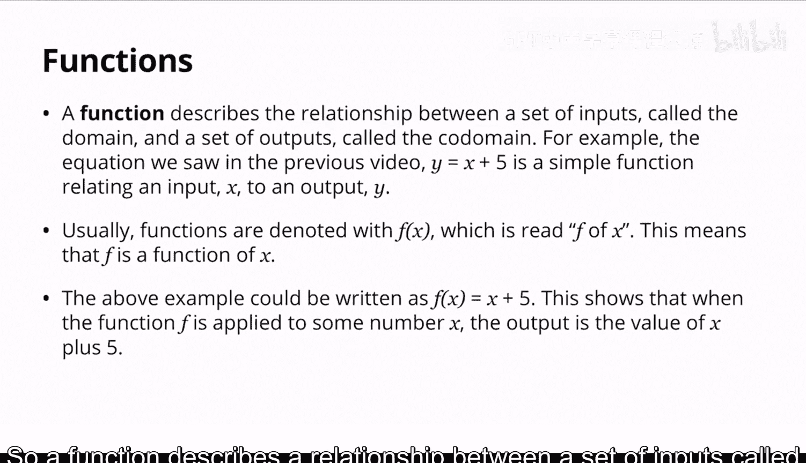
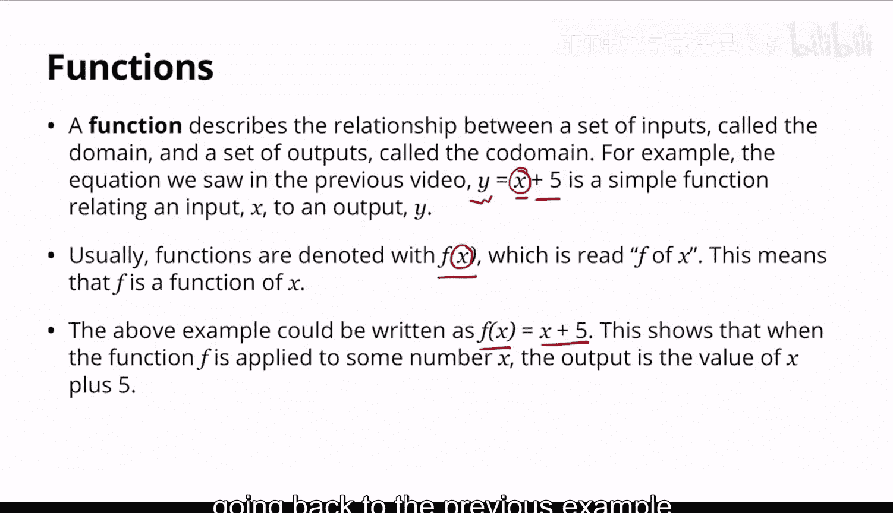
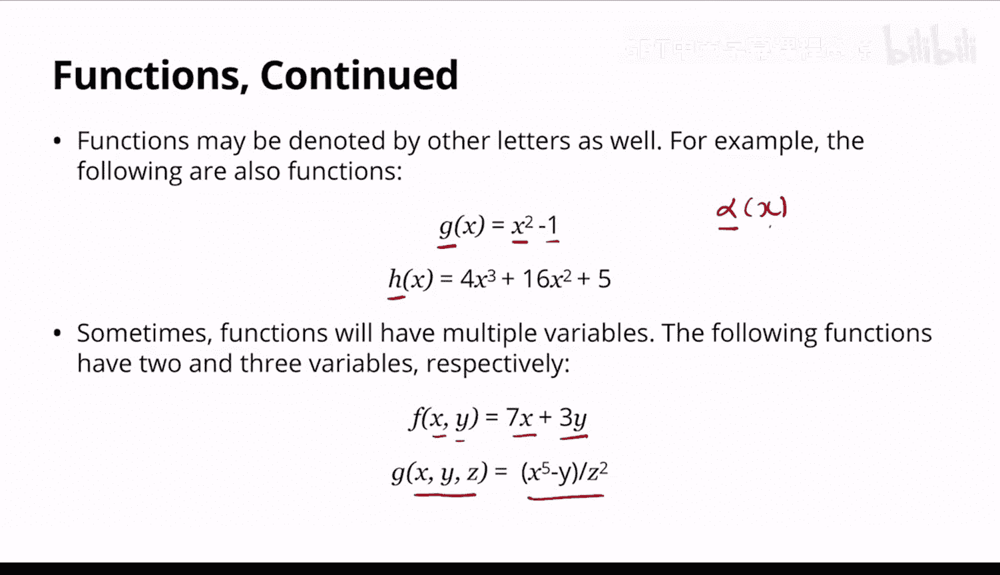
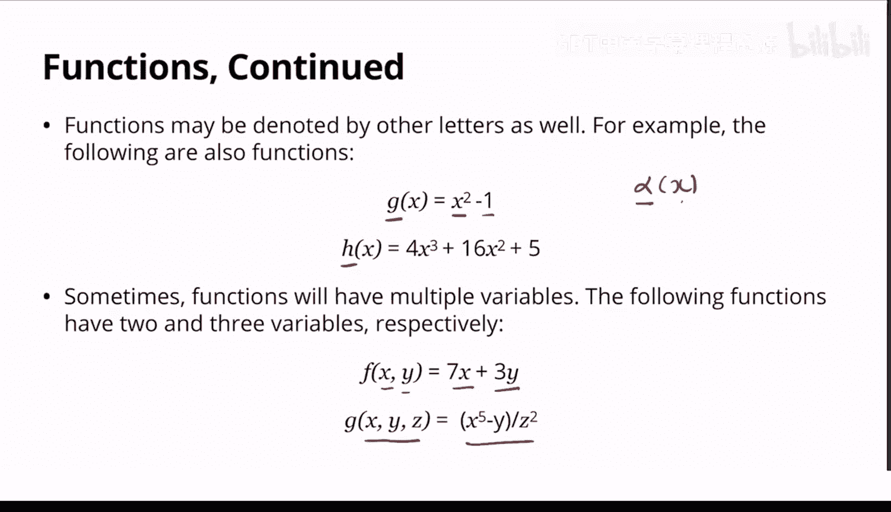
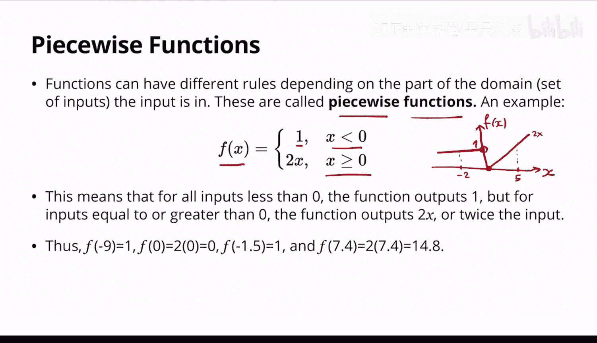
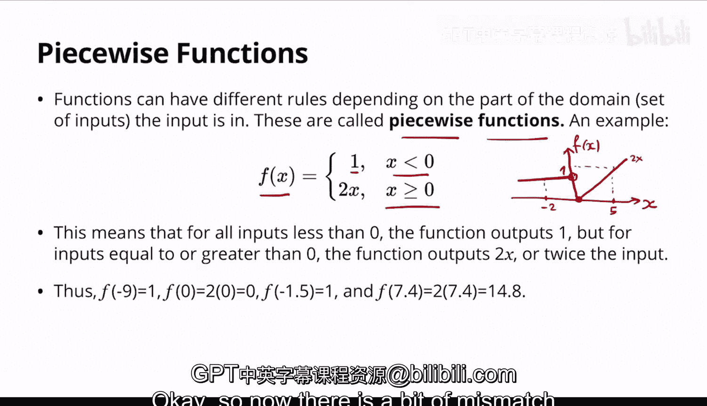

# 宾夕法尼亚大学《人工智能和机器学习基础（AI、数据科学、机器学习）AI and Machine Learning Essentials with Python》 p39 04_01_02_离散数学复习II-函数.zh_en -BV16f421Q72q_p39-

Alright， let's continue with our review of basic discrete math contents。

In the first section we talked about the notions of variable and sets。

We will talk about functions in this section。So a function describes a relationship between a set of inputs called the domain of the function and a set of outputs called decochodomy。

 for example。

U。A function could take an input X which comes from the real numbers and could add the number5 to this input and the whole function would be x plus 5。

 Okay so this is a simple function that applies to the input X and the output of the function would be the value y that you see which is equal to x plus5 so typically we represent functions by f of x and we read it as f of x f of x。

 So f would beat our function。 So the functionality is represented by f。

 which is applied to the input variable x that comes from some domain Okay so again going back to the previous example。

 f of x for us would be x plus 5。

Of course， there are other ways or other notions that we use for functions or other letters。

 typically g of x or h of x， but you can think about any function。

 so alpha of x would be a function represented by alpha denoted by alpha that applies to the input x so G of x in this example would be x2 minus-1 so the value of x would be sent to the power 2 and then the value 1 will be subtracted from it and that would be the output of the function。

Now， the functions could also depend on multiple variables。 For example。

 you can have f of x and y to be 7 times x plus3 times y。 Okay， so the variables are x and y， they。

 for example， come from the domain of real values and 7 x plus3 p would be the output。

 So here another example， G of x y and z is given in this complicated form x5 minus y divided by z squared。

 Okay so that's another way to define a relationship between all these three input。

Now， the functions need not have a explicit and short。A description of their inputs。

 the function could be P voice functions， for example。

 so a piece voice function has different functionalities depending on the value of the input。

 for example， f of x here would be1 exactly one as the output if x is negative。

And for x being non negative or positive， f of x will be equal to2 times x。

 So if I want to represent f as a function of x。As a plot， so this is the value of f of x， right？

So if x is negative， f will be the value of F will be flat1。 so this is the value1 here。

And if x is non negative， f of x will be 2 x， so that would be something like this。Okay。

 so this is here and then， you have an open box。Open circle。 That's how we represent the function。

Alright， so this means that for example， if if x is negative， for example， minus-2。

 f of -2 will be1 if x is and this is2 times x essentially， so the slope here is2。

 if x is let's say5， then2 times x will be 10 okay now there is a bit of mismatch here。

 so but this is the value 10 here。

