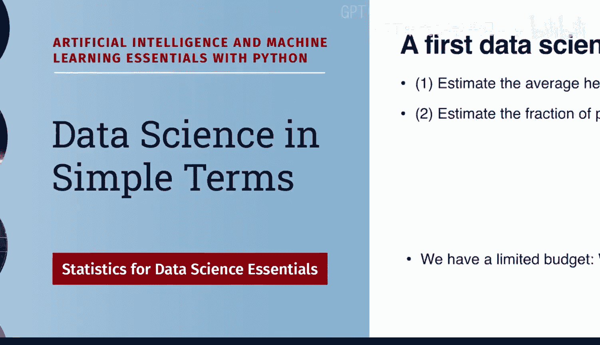
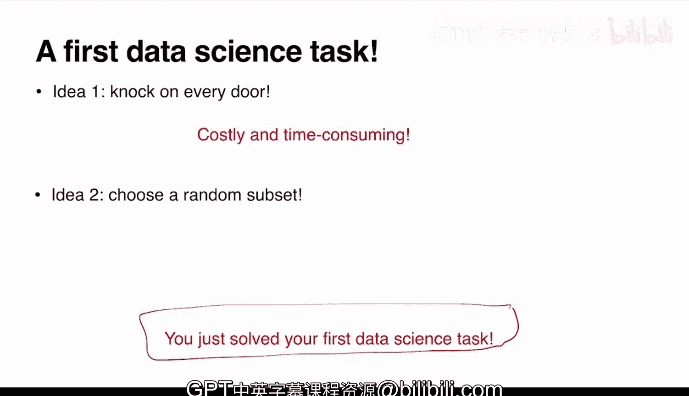

# 宾夕法尼亚大学《人工智能和机器学习基础（AI、数据科学、机器学习）AI and Machine Learning Essentials with Python》 p40 05_01_01_数据科学简明解读.zh_en -BV16f421Q72q_p40-

In this section， we're going to learn a very broad view and perspective of what data science is。

 In other words， we're going to try to define data science in simple words。

So before giving you a very broad definition of data science。

 let's try to come up with a very simple data science task。

 essentially it could be your first data science task to crack。

And it's a very simple task as you see， so we're going to essentially consider two tasks。

 but if you think about it these two tasks are essentially the same task in nature。

So the first task is estimating the average height of all the women in the city of Philadelphia so that's the city of Philadelphia。

 let's say。Okay。And essentially people are scattered throughout the map。Okay。

 so let's index people by numbers by integers，1，2，3 all the way to let's say capital n。

 which is the total number of people， women， let's say in the city of Philadelphia and what and each person has a height。

 Okay， so each person， let's say person number I。It's how her height is H。

 So what we want to understand and estimate or compute is the average height of women。

 So H1 through H N over。Okay。And what's important here is that well the city of Philadelphia has so its population is around several on million people。

 so this means that n is potentially a very large number， n is of the order of millions。Okay。And。

The second task that we're going to consider is this estimating the fraction of people who vote for a certain candidate again for example in the city of Philadelphia is again the same thing。

 so you have the city of Philadelphia so you have all the people in the city all the adults about let's say age of 18 and each person is assigned again a number let's call it again H but here H represents a different thing so it could be a binary value if it's zero this means that you vote for candidate a if it's one you vote for candidate B and again what you want to estimate or compute is the average of HIs which would be the percentage of people who would vote for candidate。

So this is the quantity that we're gonna essentially try to estimate okay and what's the challenge here is the challenge here is that in the number of people the number of potential points here is very large here is in the order of millions but typically in our data science applications the number of people in the population or the number of points in the population could be super super large。

 for example， hundreds of millions or billions， so this is the challenge here and given that n is large we should also note that we have a limited budget typically so in other words we want to obtain fast and accurate estimates without our limited budget。

 for example， in this specific example limited budget is that you want to estimate the average height or the percentage of people who would vote for a certain candidate in let's say a few days and you have a group of let's say10 people who could work for you and。

Your group you want to estimate this， this number。So let's try to think about ideas of how to estimate this average height。

 for example。Okay， so the first idea that comes to mind is to knock on every door。

 this means that let's say， go to every single address in the city of Philadelphia and knock on the door and ask for the height of the person so we gather all this data and then we compute the average in。

Okay，Now what's the problem with this very first idea？

The problem is that the city has millions of people。

 so this is very costly and time consuming right so if you want to knock on every door。

 if it takes whatever 10 minutes and then you have to essentially for every person invest 10 minutes that's a lot of time in total and you cannot essentially accomplish this task。

 let's say in a few days and it requires a lot of other kinds of resources to do so。

So essentially this is not a very practical idea。 Okay， this is not what we like as a data scientist。

 let's think about this another slightly smarter idea that we can come up for this data science task。

😊，What could be the second idea。 Remember， we want to just come up with a reasonable estimate。

 a good estimate of the average height。Okay。Now， the second idea that we can come up with would be essentially random sampling here。

 random sampling means that instead of going over all the people in the city of Philadelphia。

 we could just choose a small random subset。Among all the people。

and then compute the average over that small random subset this is a very intuitive idea。

 and I'm sure all of you have thought about this idea before I mentioned Okay it's very intuitive。

So again， if this is the city of Philadelphia and you have。

 let's say around in the order of millions of people。😊。

So instead of going over all of the people in this population。

 you would just randomly sample a small subset。So the total number of people。

 let's say n is let's say of the order of millions。But you choose a random subset。Okay。

 so let's call it。H。Wan。Okay， let me call it H。Prime 1。H prime 2。To edge prime。And。

Where the number of random people that you choose N。Is a small let's say， for example。

 of the order of thousands。Okay， so each H could be would be completely。

Randomly chosen person within the city。 Okay， so you just choose a random address and then ask for the height of the person in that address。

 and that would be one of your data points that you obtain。Okay， and your final estimate here。

 given this random sample would be just h prime 1 all the way to h prime n over n and if。

And the number of randomno samples， if this is a very small number。

 this is a very efficient way of estimating the original average rate。😊，Now， as we will see later on。

 this number here， the number obtained by random sample is in general a very good estimate of the original average of the height I mean this is intuitively most probably is intuitively clear for all of you but what we're going to do in the first module of the course is to understand the mathematics behind this estimation and we're going to understand and develop techniques from probability to understand how good is this estimate of the underlyinglined average。

Okay so congratulations， you essentially solved your first data science task and the basic technique that you learned which was very intuitive was random sampling。

