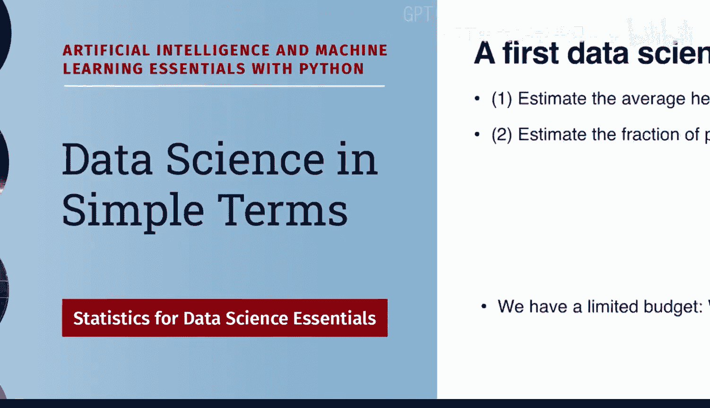
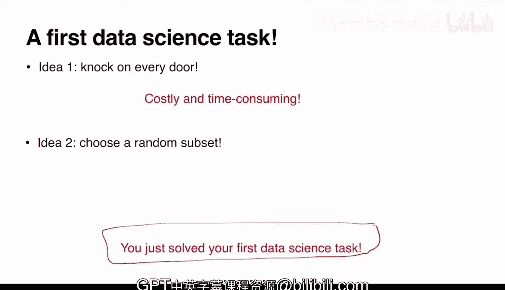

# 人工智能和机器学习基础：05_01_01：数据科学简明解读 📊

在本节中，我们将从一个非常广阔的视角来理解数据科学是什么。换句话说，我们将尝试用简单的语言来定义数据科学。

在给出数据科学的广义定义之前，让我们先尝试构思一个非常简单的数据科学任务。这本质上可能是你需要解决的第一个数据科学任务。

这个任务非常简单，我们将主要考虑两个任务。但如果你仔细思考，会发现这两个任务在本质上是相同的。

第一个任务是估算美国费城所有女性的平均身高。假设费城的人口分布在地图各处。我们用整数 1, 2, 3 ... 直到 N 来索引每个人，其中 N 是费城女性的总人数。每个人都有一个身高，例如第 i 个人的身高是 H_i。我们想要理解、估算或计算的是女性的平均身高，即 (H_1 + H_2 + ... + H_N) / N。这里重要的是，费城的人口大约有数百万，这意味着 N 可能是一个非常大的数字，数量级在百万级别。

我们要考虑的第二个任务是估算费城中投票给某位特定候选人的选民比例。这本质上是同一类问题。同样，费城所有成年人（例如 18 岁以上）每人被分配一个数字，我们再次称之为 H_i，但这里的 H_i 代表不同的含义：它是一个二进制值。如果为 0，表示投票给候选人 A；如果为 1，表示投票给候选人 B。我们想要估算或计算的同样是 H_i 的平均值，这代表了投票给该候选人的选民百分比。

我们试图估算的这个量，其挑战在于人口数量（或数据点数量）非常庞大，通常达到数百万级别。而在我们的数据科学应用中，总体中的个体数量或数据点数量可能极其庞大，例如数亿或数十亿。这就是挑战所在。同时，考虑到 N 很大，我们通常预算有限。换句话说，我们希望用有限的预算快速、准确地获得估算结果。例如，在这个具体例子中，有限的预算意味着你可能需要在几天内估算出平均身高或投票给某候选人的百分比，并且你只有一个小团队（比如 10 人）来为你工作。

现在，让我们思考一下如何估算这个平均身高。第一个想到的方法是挨家挨户敲门。这意味着前往费城的每一个地址，敲门询问每个人的身高，收集所有数据，然后计算平均值。

这个方法的问题在于，城市有数百万人口，因此成本极高且非常耗时。如果你敲每扇门需要 10 分钟，那么为每个人投入 10 分钟将累积成巨大的总时间，你无法在几天内完成这个任务，并且还需要大量其他资源。因此，这本质上不是一个非常实用的想法。作为数据科学家，我们不喜欢这种方法。

让我们思考另一个更聪明的想法。记住，我们只是想得到一个合理的、良好的平均身高估算值。我们可以想到的第二个方法是随机抽样。随机抽样意味着我们不去调查费城的所有人，而是只随机选择一小部分人，然后计算这个小随机子集的平均值。这是一个非常直观的想法。

同样，如果费城有大约数百万人口，我们不去调查总体中的所有个体，而是随机抽取一个小子集。总人数 N 的数量级是百万，但我们随机选择一个小样本，例如数量级为数千。每个被选中的 H'_i 都是城市中完全随机选择的人。你只需随机选择一个地址，询问该地址中人的身高，这就成为你获得的一个数据点。根据这个随机样本，你的最终估算值将是 (H'_1 + H'_2 + ... + H'_n) / n。如果随机样本的数量 n 相对较小，那么这就是估算原始平均值的一种非常高效的方法。

正如我们稍后将看到的，通过随机抽样得到的这个数字，通常是原始身高平均值的一个非常好的估计。这对你们大多数人来说可能凭直觉就很清楚。在本课程的第一个模块中，我们将学习支撑这种估算的数学原理，并利用概率论中的技术来理解这个估计值相对于真实总体平均值的好坏程度。

恭喜你，你本质上已经解决了你的第一个数据科学任务。你学到的基本技术——随机抽样——非常直观。

在本节课中，我们一起学习了数据科学的一个基本视角，并通过一个估算城市人口平均属性的具体例子，引入了**随机抽样**这一核心方法。我们了解到，面对海量数据（N 很大）和有限资源时，通过随机选取一个较小的子集（n 较小）进行计算，可以高效且相对准确地估算总体参数。这为后续深入学习数据科学的数学基础和技术应用打开了大门。