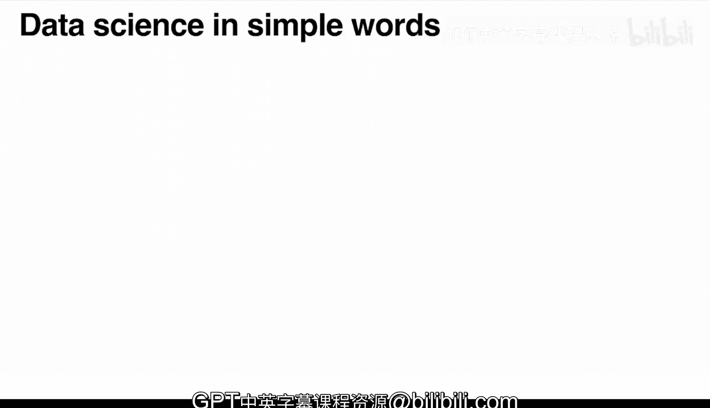
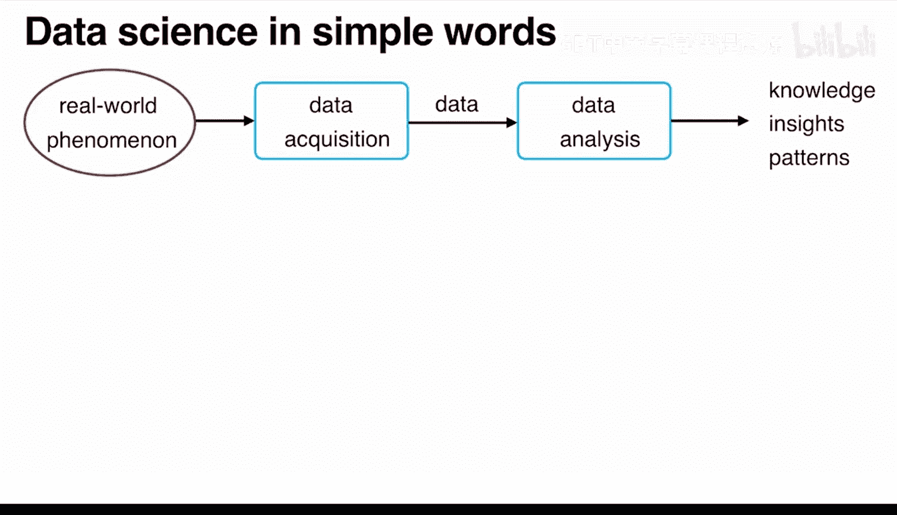
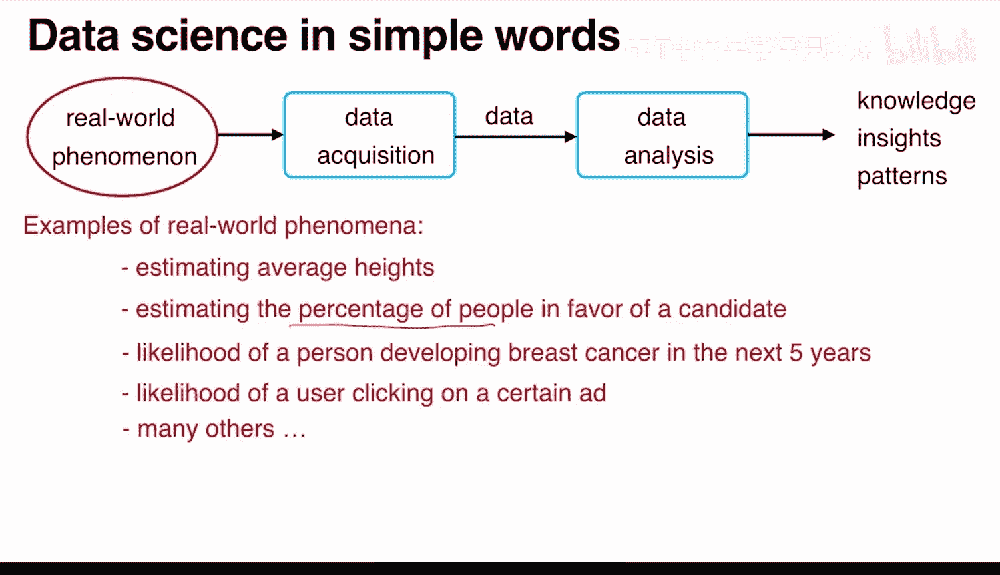
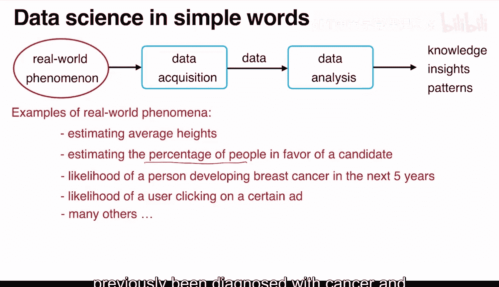
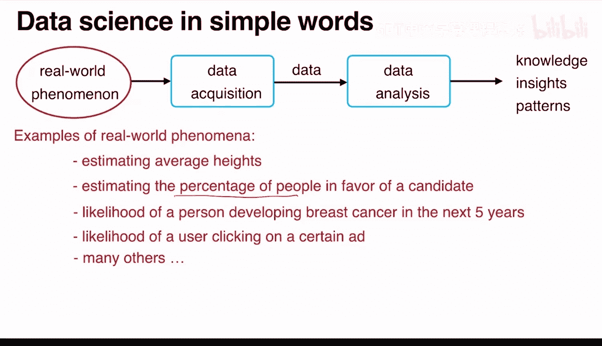
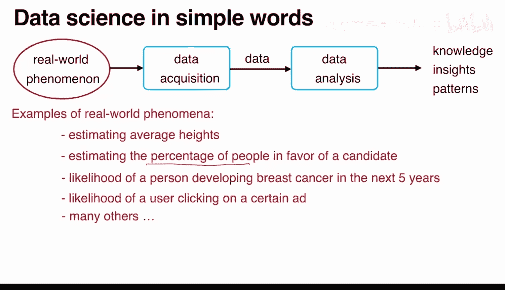
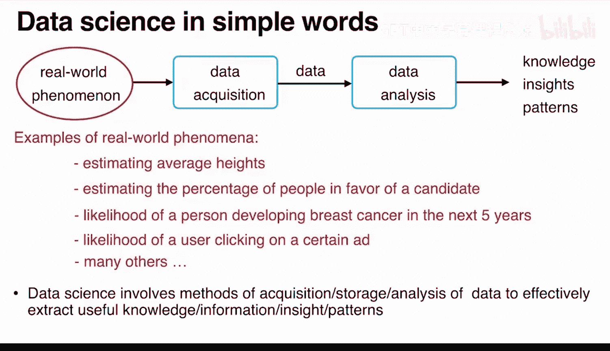
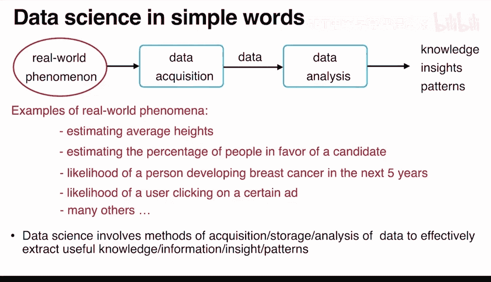
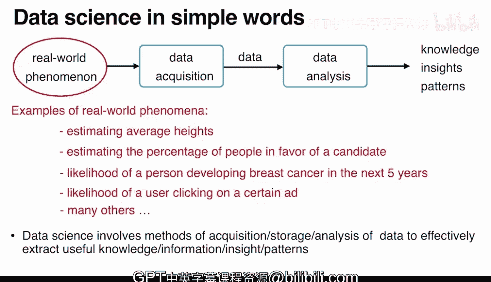

# 宾夕法尼亚大学《人工智能和机器学习基础（AI、数据科学、机器学习）AI and Machine Learning Essentials with Python》 p41 06_01_02_定义数据科学.zh_en -BV16f421Q72q_p41-

So now that we solved our first data size task。

We're going to try to essentially come up with a very simple and broad definition of data science。

Now typically in data science， what we intend to do。Is to study some real world phenomenon。

 some real world or some physical phenomenon that you want to study。Now。

 in order to study this phenomenon， the first step is to gather data from this phenomenon。

In our example， in the task of computing the average charge。

 which is a very simple and rudimentary task in data science。

 essentially gathering data would be just by randomly example like people。😊。

So once you gather data about this phenomenon， the next step would be to analyze the data right so you gather data and then you analyze it in order to understand something about your real world phenomenon In the case of computing the average height。

 the analysis part was very simple。 The analysis part was just to compute the average of the randomly sampled substrate。

So youll analyze the data。 and in the end， you obtain。

Some type of knowledge or insights or patterns about the underlying real world phenomenon that you wanted to assess Okay so that's essentially all the building blocks that you have that you could possibly think about in a general and broad way of thinking about data science。

Of course， so far we just talked about very， very， very simplistic data science tasks。

 There are much more interesting and serious kind of tasks that you could think about that can be solved using techniques from data science So I mean we started from simple ones estimating average heights or estimating percentage of people in favor of a candidate。

 So the second task is actually something that typically close to elections staians and companies try to do Okay estimating percentage of people or in favor of a certain candidate that's a real and important task that people do。

But there are many other tasks， for example， in the field of medical diagnosis。

 a very important problem is to， for example， estimate the likelihood of a person developing。

 for example， breast cancer in the next five years so this is estimating this likelihood or let's say probability is the parameter that you want to estimate and in order to do that you have to gather data so you gather data from people who have。

 for example， previously been diagnosed with cancer and people who have not been diagnosed with cancer so you gather the data and using their data you want to essentially understand patterns or come up with predictors to estimate their likelihood of cancer in the next five years but the same kind of problem exists for other kind of diseases for example you can think about Alzheimer's disease estimating the likelihood of Alzheimer's disease in the next 20 years that's a very important problem。

That data science has been trying to somehow help in solving。

And again， you can think about many， many other scenarios within medical diagnosis。

Da science could applies nowadays to essentially any field that you can think about one of the most important fields for data science is the field of online marketing for example。

 again estimating the likelihood of users clicking on certain ads。

 certain item Amazon has invested a lot on this for item recommendation and so on， or for example。

 if when you open your Facebook page for example on the righthand side you see the ads right so estimate so these ads are highly customized with respect to your profile underneath this。

 this kind of ads that you see there is a sophisticated algorithm that is run that takes as input your profile and tries to come up with the highly optimized feature ads that could be beneficial for you and。

Essentially， the probability of you clicking on those ads is maximized okay so there's a lot of interesting things happening here and again this is another instance of data science and there are many other kind of tasks that one can think about。

 So having said all these a very broad definition of data science here is the following data science involves methods of acquisition storage analysis of data to effectively extract useful knowledge。

 information insight and patterns。

