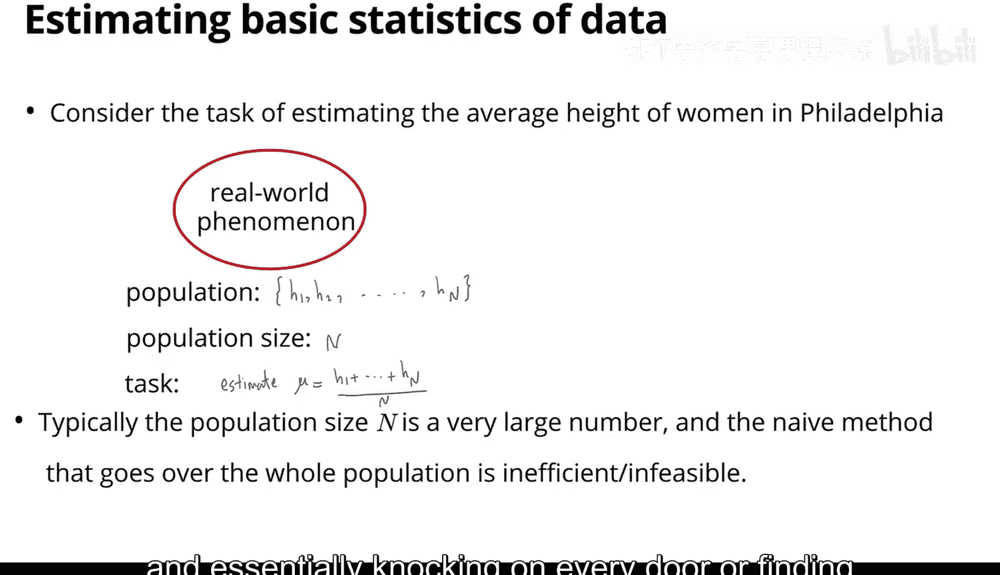
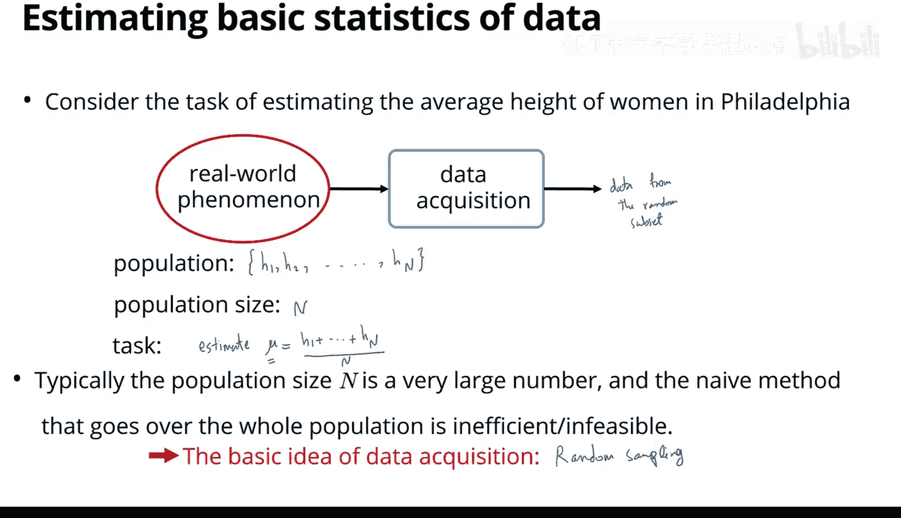
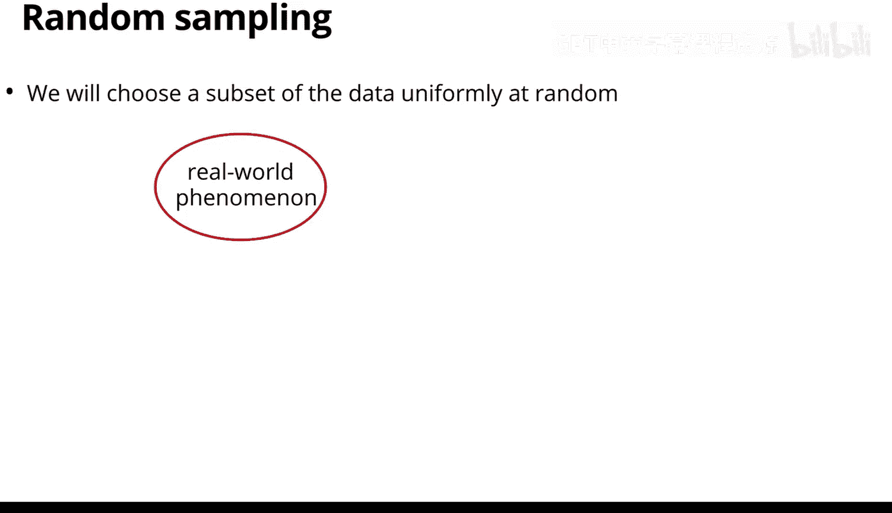
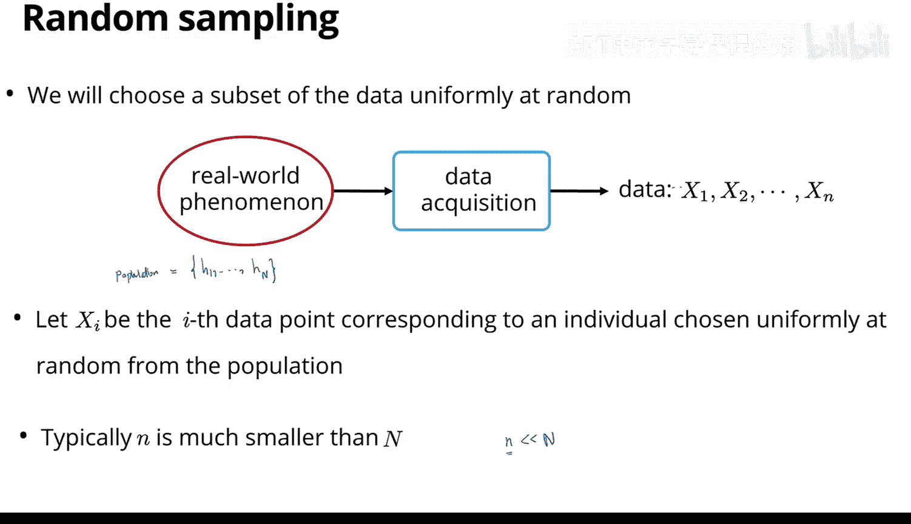

# 宾夕法尼亚大学《人工智能和机器学习基础（AI、数据科学、机器学习）AI and Machine Learning Essentials with Python》 p42 07_01_01_随机抽样I.zh_en -BV16f421Q72q_p42-

So in this section， we're going to try to understand in a more formal and mathematical way the solution that we gave to our simple data science task。

 which was to estimate average heights now the concepts that we will learn here are very general or run an example would be estimating average heights but as we will see these concepts apply to a much broader class of data science tasks。

Or estimation tasks。没没。All right， so what was our problem。

 we wanted to estimate the average height of women， adults women in the city of Philadelphia。

So that' what's our real world phenomenon here， so we have a very large population of people。

Heights H1， H2。All the way to H N。 Okay， so these are heights of all the people。

 So that's a very large set。 N would be the order of millions in other applications n is much larger billions or trillions sometimes So the population size for us would be denoted by n。

 and the task here in this case would be very simple。 So we wanted to estimate。The average height。

 so this parameter mu。嗯。Given as mule is the average of the high。一点嗯。O， over。Okay mu is unknown。

 I don't know it and I have to gather data from the population some a subset of people in this population in order to be able to estimate okay so that's our real world phenomenon and as I mentioned before typically the population size n is quite large and essentially knocking on every door or finding all the values within the population would be quite infeasible or quite expensive so the basic idea of data acquisition in this case would be to do random sampling okay so random sampling。

Is。When we essentially choose a subset of the population and try to estimate this parameter。

 this unknown parameter mu from that chosen sub， okay， random sampling。

 as I explained in the next slide is when we choose this subset random。Okay。

 now once we choose this subset。This is the data acquisition task we would then so let me just put here the random subset Okay let me just。

我哋 data。From the random。A lot subset。Once we collect this data in the next module。

 we will analyze this data and estimate。

Okay， so that's all essentially the so random sampling。

 what we will what we're going to do is to choose the ice data point。

From this set， H1 h n。Uniformly at random， okay， so that's the simplest way of random sampling that we've been talking about。

 Okay and that's just you choose a random address in the city of Philadelphia。

 you go and knock on the door。 We ask for the height Okay so X I。

 which is the ice take point to date the I random address that you will choose would be just a randomly chosen number from this population。

Sure。O。So we have data x1， x2 to xn。And here small n would be the number of data points that together okay。

 so for example， we choose 00 different people uniformly at random and that would be and ask for their heights and that would be these00 numbers that would be our data points X here and from now on would be the I data point and this would be for example。

 the information or the height from the I randomers。

And let me also emphasize on the fact that typically the number of data points is much。

 much smaller than the population size， capital n population size。

 the whole population is something that we cannot really control this is not up to us。

 we want to be efficient in being efficient， we typically choose our data points efficiently and intelligently and typically the number of data points that we pick I mean typically we have a lot of data points。

 but the number of data points that we pick is not really comparable with the actual population。Okay。

 so N。Typically is much， much smaller than capital Okay。

 and the good news is that with even a small number of data points it N data points。

 which is much smaller than the population。 you can provide very good estimates of the parameter of the average。

😊。

