# 宾夕法尼亚大学《人工智能和机器学习基础（AI、数据科学、机器学习）AI and Machine Learning Essentials with Python》 p43 08_01_02_随机抽样II.zh_en -BV16f421Q72q_p43-

Okay， so let's look at the probabilistic law of this X I。 Remember。

 X I was let me just write this year。

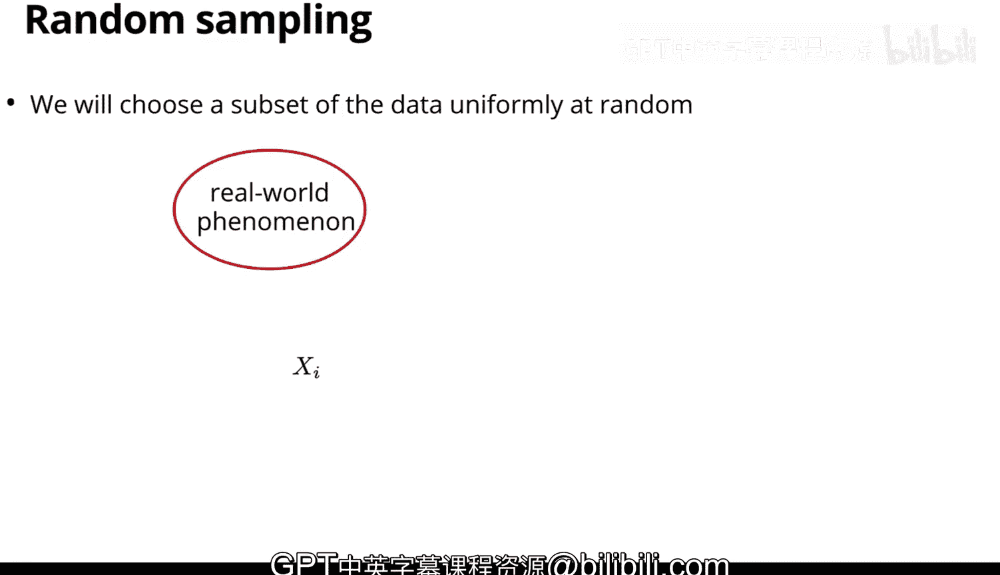

om。Pitch。Okay， from。Good。This set from the population， H1 through rich。So。Xi is a random variable。

 which takes the following values。So the probability that Xi is equal to the height of the first person h1。

Is one over n。 So X I would take value H1 with probability 1 over n because the I state， remember。

 the I data point was just a random choice， a random address from the city， right。

 So with probability one over n where n is the total number of people in the city you would assign or total number of women to be more precise would be。

X I would be equal to them。Be probably1 over and you would choose the first person and the height of the person would be the value of Xi。

H2。The information of the second person will be also chosen property 1 over n and essentially every since it's just uniformly at random。

 every person Hn will be chosen probability1 over n okay so that's the probabilistic law for this random variable X okay if you don't know about random variables or you don't remember I'm going to do a quick review of the essential probabilistic needs for the course in the next section。

So but for now， let me just explain what this random variable Xi is。

 and then we're going to review a bit of probability as we go on。😊，So that's the law of X， right？And。

You would choose n different data points， small and different data points according to this law。

 Okay So x1。X2 all the way to X N are chosen in this screen。 and remember。

 every data point X is is created。

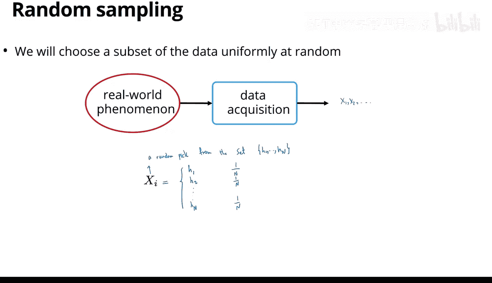

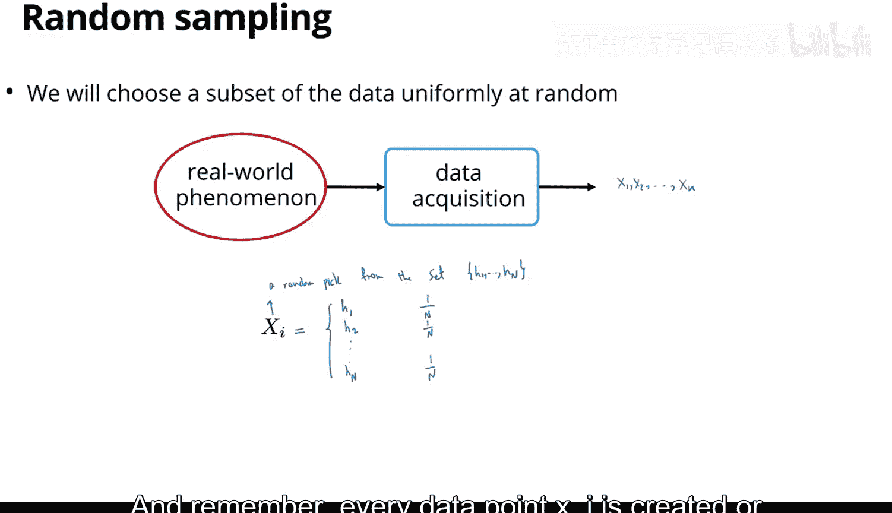

Or is chosen in this case， independently from the other data points。

 So I would also w to say that X is。Are independent。From。It other。Okay。

 that's another important point。

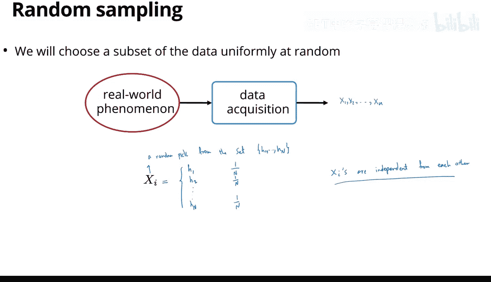

Okay， so that's my setting probabilistic set。Now that we have collected these n data points。

 x1 through Xn。Okay。The next question that we need to answer is。

 how do we process this data set X1 through x， and in order to。Learn something valuable。

 some new information about the underlying real world phenomena。 In this case。

 I want to estimate the average height， the original average height。

 which is the parameter mu Okay now as we explained before。

 the simplest answer to this question would be just to consider the mean of the data points。

 which is also called the sample mean and is typically denoted by x bar。

 So this mean the sample mean would essentially estimate。So let me just write this here。

 this would be an estimate。嗯嗯嗯。For the parameter meal， okay， the the total average height。

 the original average height。嗯。Of course what you should note here is that since Xs are themselves random objects。

 of course the average is also a random object or is also a random Bible。

 so x bar is not a fixed value， it takes different values。

 its different probabilities okay so if if I want to look at the distribution of x bar。

 distribution is something else， something like this， a distribution of x bar。Okay。

 let me just write this distribution。ね。A us， baseball。

And the next thing that I need to understand and analyze is essentially how， how。

 how good is this estimator that I have for me。 Okay， now， as I said， Xo is a random object。

 It takes different values with different probabilities。 So what I need to understand now is how to。

Characterize different properties， different statistical properties of X in order to figure out how good is X bar as an estimate formula you。

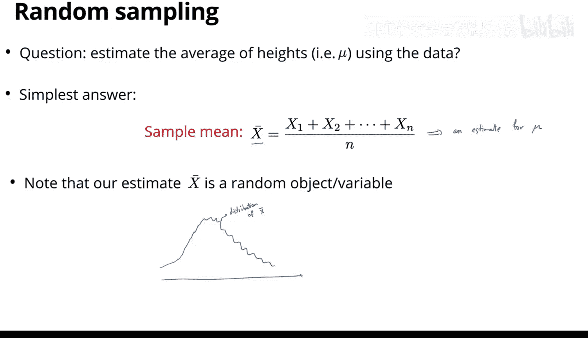

So the next two questions that I'm going to answer and essentially analyze is first。

Question number one。Whether or not x bar is a good estimate。

 but this is like a very general question in order to answer this question or in order to understand whether or not x bar is good。

 we need to analyze the statistical properties of x bar and in order to do so we need to define different metrics in order to quantify the performance or the error or the confidence balance for this estimator x bar so essentially remember x bar is。

啊。esttimating， Okay， let me just write it is an estimator。你能。For mu， right？

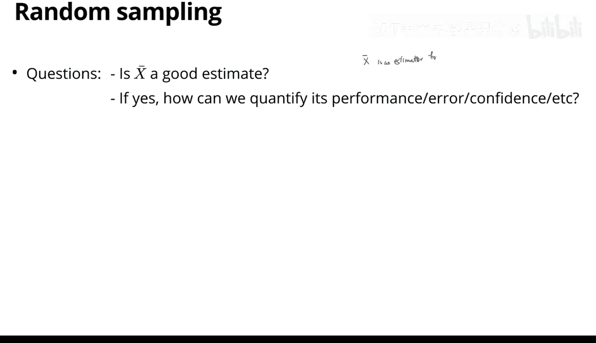

So what we want to see is how close our estimator is。

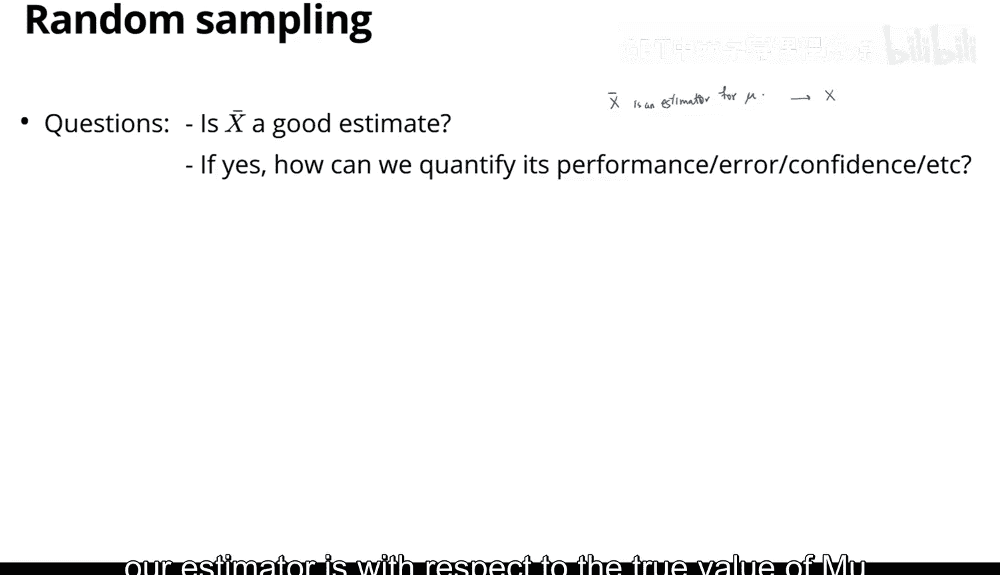

With respect to the true value mu， because in the end， I want to estimate mu right， the original。

 the， the average height of all the people in the society regime date。

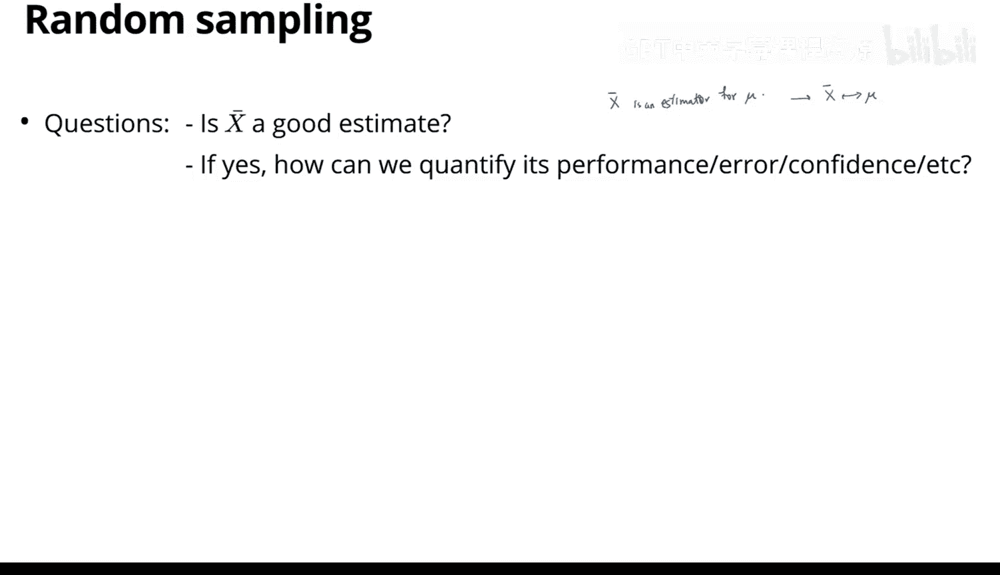

In the next section， we're going to start learning concepts from probability theory that are needed and helpful for us in order to compute the statistical characteristics of this random variable X bar and would help us to analyze this difference X bar minus mu。

 which is essentially the error in our estimate。

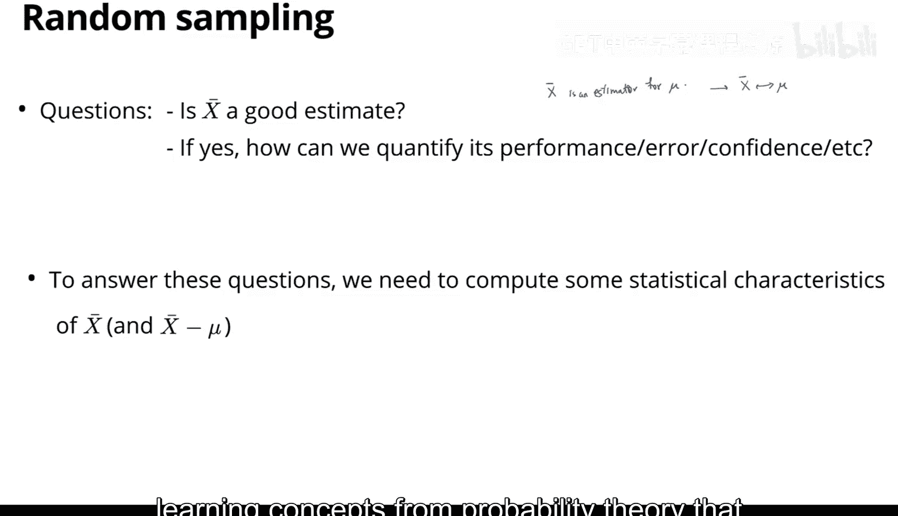

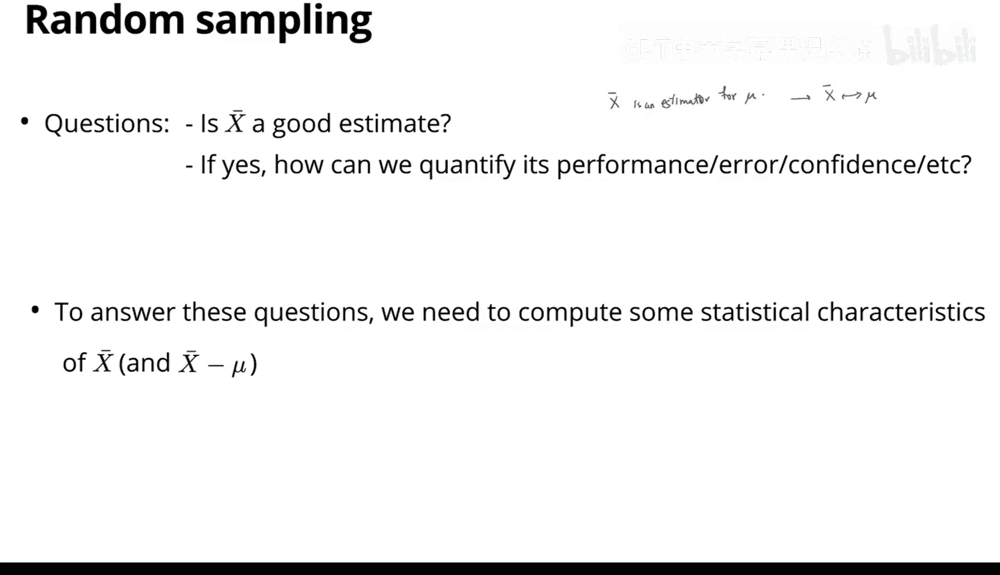

真对。

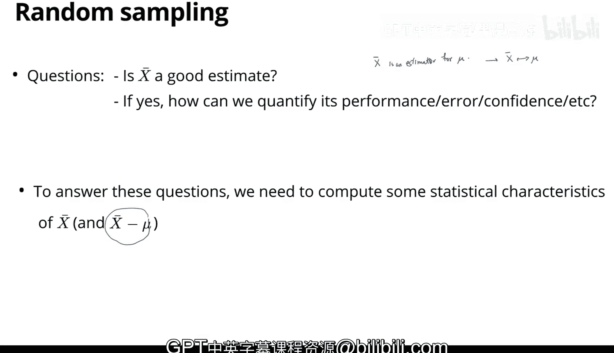