# 人工智能和机器学习基础：08_01_02：随机抽样II 📊

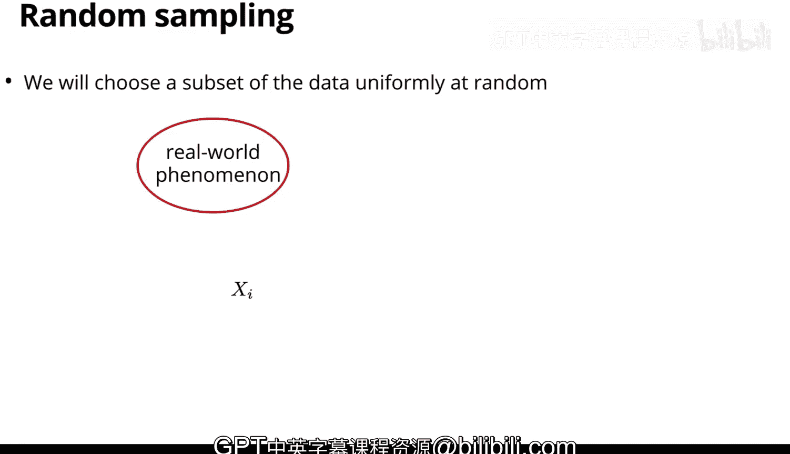

在本节课中，我们将要学习随机抽样中数据点的概率分布，并理解如何利用样本均值来估计总体参数。我们将分析样本均值的统计特性，并探讨如何评估其作为估计量的好坏。

---

上一节我们介绍了从总体中随机抽取数据点的概念。本节中我们来看看单个数据点 `Xi` 的概率分布规律。

`Xi` 是一个随机变量，它代表从总体中随机抽取的第 `i` 个人的身高。总体包含 `n` 个人，其身高分别为 `h1, h2, ..., hn`。

`Xi` 的概率分布如下：它取值为 `h1` 的概率是 `1/n`，取值为 `h2` 的概率也是 `1/n`，以此类推。因为抽样是均匀随机的，所以每个身高值被选中的概率都相等。

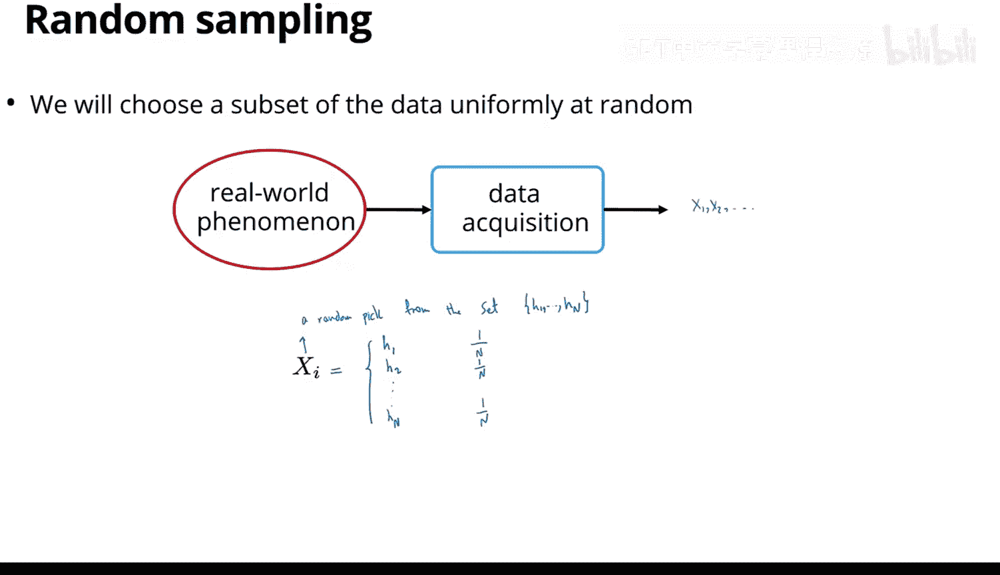

用公式可以表示为：
```
P(Xi = hk) = 1/n, 对于 k = 1, 2, ..., n
```

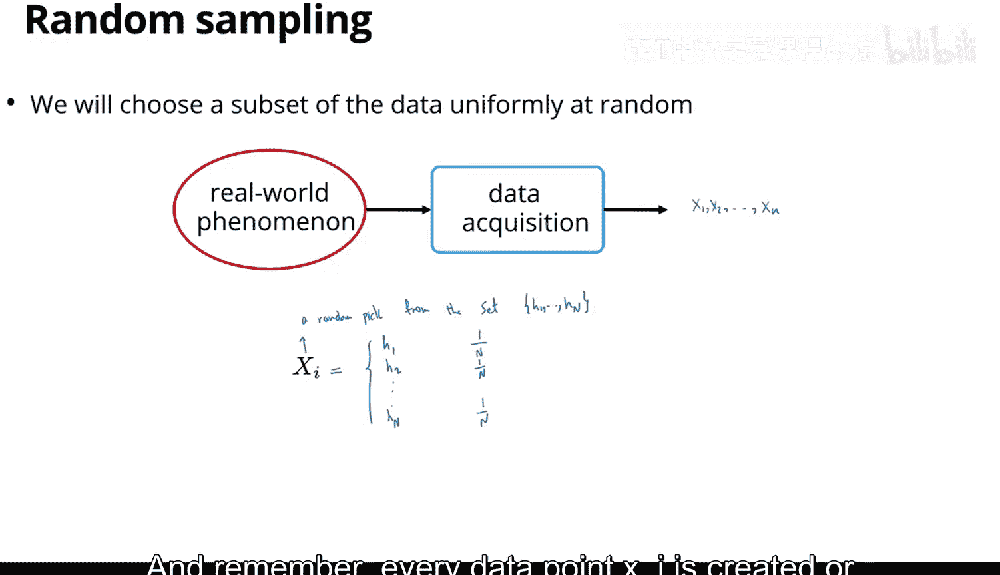

---

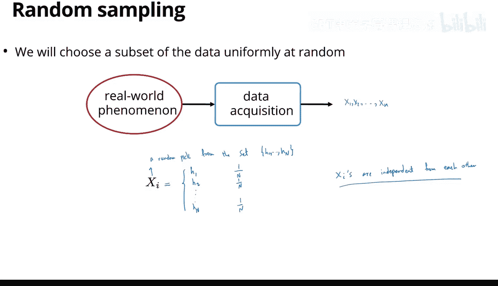

当我们进行抽样时，我们会收集 `n` 个这样的数据点：`X1, X2, ..., Xn`。一个重要的前提是，这些数据点是**相互独立**地从总体中抽取的。这意味着选择其中一个数据点不会影响选择另一个数据点的概率。

---

现在我们已经收集了数据集 `X1` 到 `Xn`。接下来的问题是，我们如何处理这个数据集，以获取关于真实世界现象（例如总体平均身高 `μ`）的有价值信息？

最简单的答案是计算数据点的平均值，即**样本均值**，通常记为 `x̄`。样本均值 `x̄` 被用作对总体参数 `μ` 的一个**估计**。

用公式表示为：
```
x̄ = (X1 + X2 + ... + Xn) / n
```

---

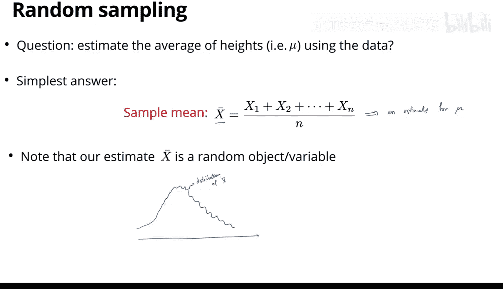

由于 `X1` 到 `Xn` 本身是随机变量，它们的平均值 `x̄` 也是一个随机变量。这意味着 `x̄` 不是一个固定值，它会根据不同的抽样结果以不同的概率取不同的值。因此，`x̄` 拥有自己的概率分布。

为了评估 `x̄` 作为 `μ` 的估计量是否“好”，我们需要分析 `x̄` 的统计特性。核心在于理解估计的误差，即 `x̄` 与真实值 `μ` 之间的差距 `x̄ - μ`。

我们需要定义不同的度量标准来量化这个估计量的性能、误差和置信度。

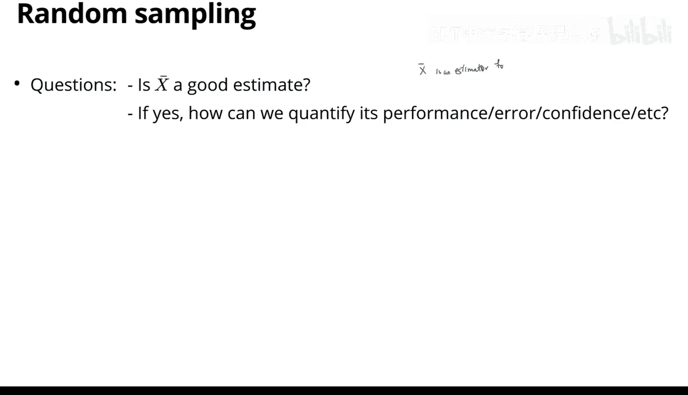

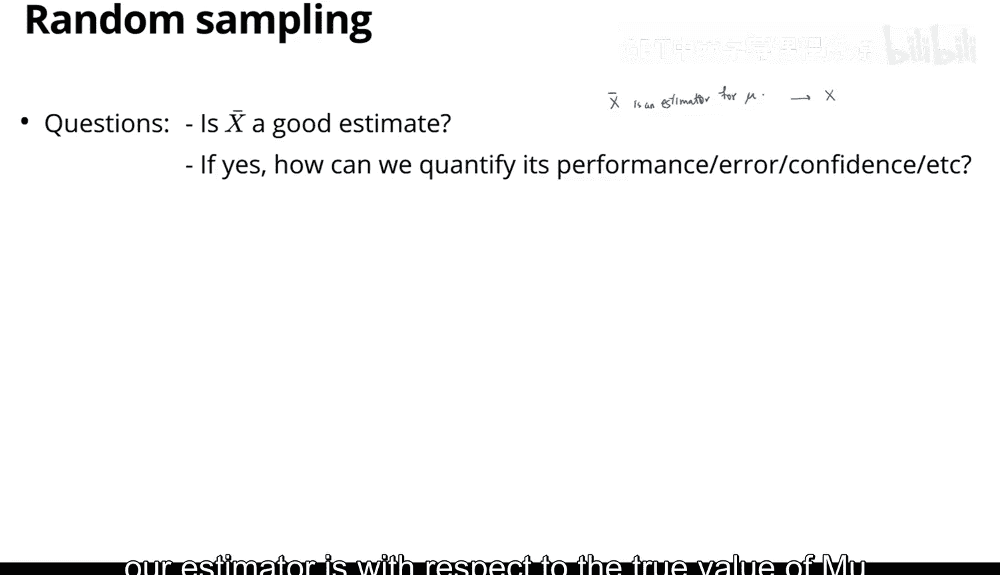

---

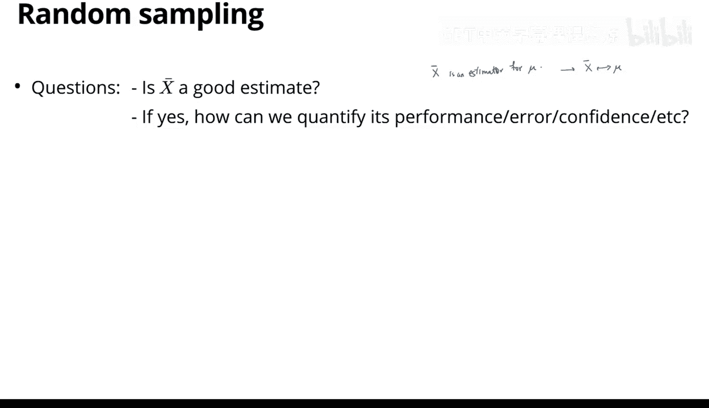

在下一节中，我们将开始学习概率论中的相关概念。这些知识将帮助我们计算随机变量 `x̄` 的统计特征，并分析估计误差 `x̄ - μ`，从而判断样本均值作为估计量的有效性。

---


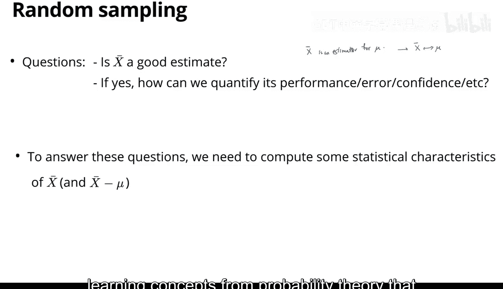

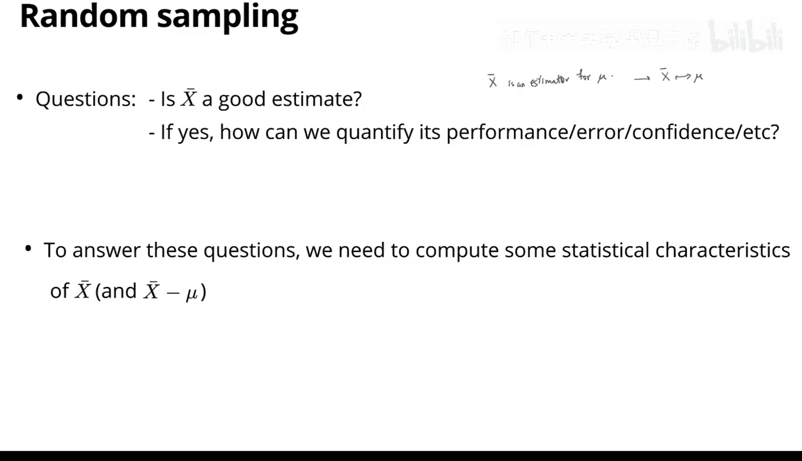

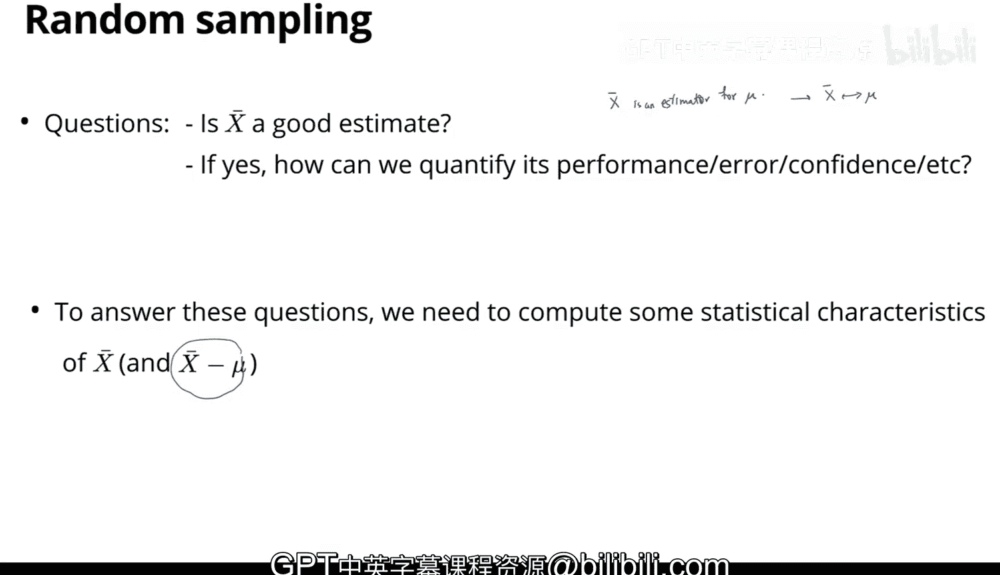

本节课中我们一起学习了：
1.  随机变量 `Xi` 的概率分布：它均匀地取总体中的每一个值。
2.  样本数据点 `X1, ..., Xn` 是独立抽取的。
3.  使用样本均值 `x̄` 来估计总体均值 `μ`。
4.  认识到 `x̄` 本身是一个随机变量，其统计特性决定了它作为估计量的好坏。
5.  提出了核心问题：如何分析和量化估计误差 `x̄ - μ`，这将是后续概率论学习的重点。