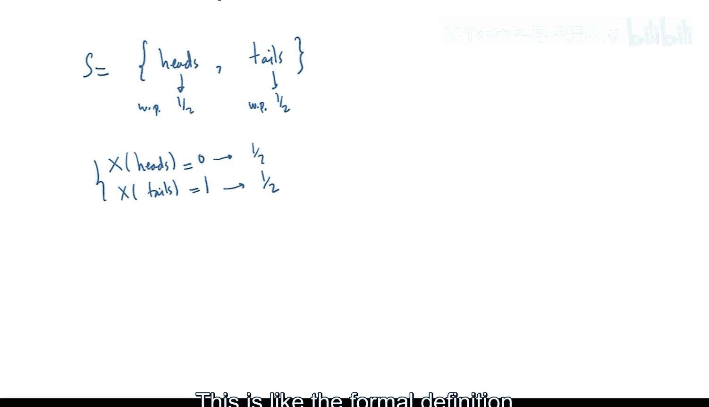
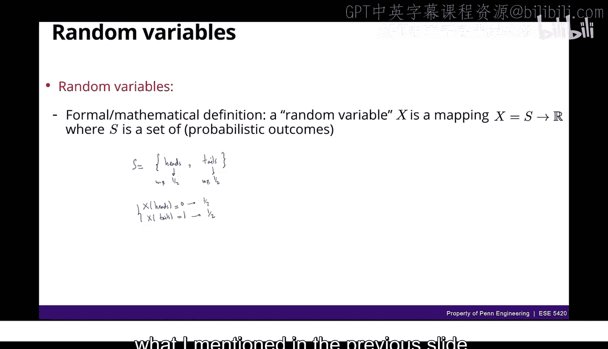
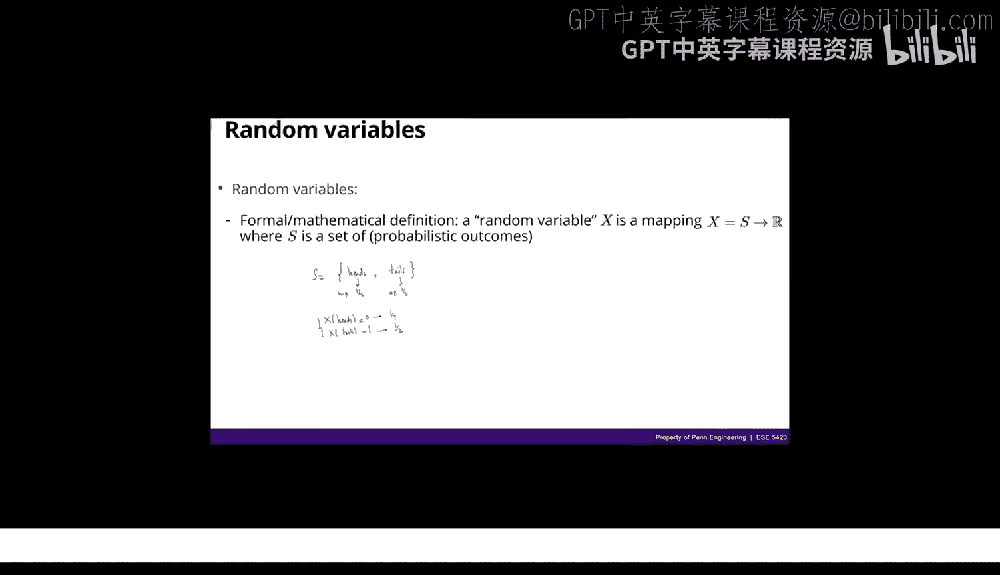
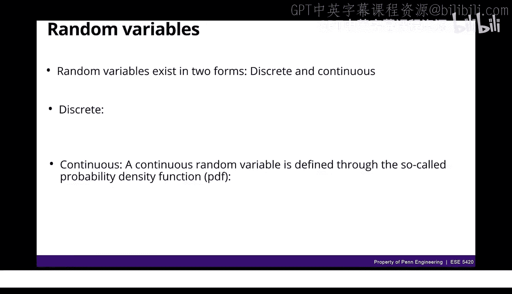
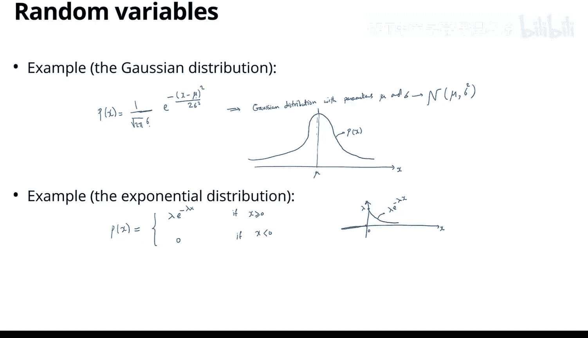

# 宾夕法尼亚大学《人工智能和机器学习基础（AI、数据科学、机器学习）AI and Machine Learning Essentials with Python》 p45 10_02_01_基础概率论I.zh_en -BV16f421Q72q_p45-

Okay， so in this section， I'm going to review some basic concepts from probability。

 some concepts that will be helpful for us throughout the course in order to analyze our estimators and also other kinds of concepts that we will see later。

So I'm going to start with the very， very basic concepts that we have already learned in probability。

I'm going to start with random variables。 So what's what's what's a random variable What's the definition of a random variable。

 I'm going to give you an informal definition， as you see here。

 And then later on I'm going to give you a more formal definition。

 So informally or intuitively a random variable would be a variable which takes multiple real values with different probabilities。

 Okay， and you have seen different types of random variables before。 I'm sure about that。 So x。

Take different values。 Let's call it x1。X2， these are different real values to x。Ki。And。

Each of the values is taken with some probability P1 X1 is taken with probability P1， x2 with P2。

 and x K with Pj。Okay， so so the Ps are probability values， so they are between 0 and 1。

And the sum of Ps。I from 1 to K pis is essentially1。Okay， let me give you a few simple examples。

 examples。Okay， the simplest example is typically when you flip a coin， so coin slip。😊，Okay。

 so you have heads。Ts。Okay， and for example， if it's a fair coin。

 that would be the probabilities are half and half。 So x for you， the random variable。 So let me。

 let me give heads the a number 0 and tells a number one。

 So x takes value 0 or heads with probabilitybil half。

 It takes value 1 or tails with probability number。 Okay， so that's like a discrete random variable。

 as you see。Another example is something that you have all I'm sure all of you have worked with and this is the example of throwing dies。

 so in the case of throwing the dies x takes six different values。

 one to all the way to6 and all of them happen with the same probability one we 6， one verse 6。

These are very simple examples of random variables， but intuitively again。

 a random variable is just is just a variable whose value is randomly chosen okay。

0 or1 before have or one to 6 with probability1 over 6 and so on and so forth。Okay。

 now a more formal definition of random variables would be as follows。

So a random variable x is a mapping from some set of outcomes S。

Set of probilities probabilistic outcomes S to the set of real values。 Okay。

 let me just again give you an example here。 So here， for example， S。

The set of outcomes would be heads。Or tails in the case of the fair coin。

And these are proistic outcomes。 This happens with poverty hal。 This happens with poverty hal。Okay。

 so big probability half with probability half。And x for you is this mapping。 So x of heads。Would be。

 for example，0。Exs soft tails。Would be one。 Okay， these are privacy outcomes。 This means that 0。

Probity that x equals 0 would be half the probability that x will take value1 would be half。

This is like the format definition， but I mean， the way you should think about a random variable is what I mentioned in the previous slide。

 This just takes random takes different values with probabilities， different approaches。

Now random variables exist in two forms discrete and continuous we've already talked about discrete random variables I mentioned a few examples。

 discrete is when the set of outcomes of the random variable is a discrete set is a finite set set of a few objects。

 so x1 x2 as we said before to xk with probabilities P1， P2 to p3。

Okay。Now continuous random variables are typically identified through something that we call the probability density function。

Okay， so essentially the probability density function。

Gives you the distribution of the points or the values that the probability that there are no variable x text。

 So there is， there is this function or this distribution， P D。P， D S， okay， P of P of x。Okay。And so。

 P of x。These are essentially probability probability values。

 so a p of x is between zero round 1 and the integral from minus infinity to infinity of p of x is1 so that's the Pdf or the probability density function for the random variable and from that we know that the probability that the value of x falls inside some interval A and B。

Would be just the integral from a to B， P of X Dx。Okay， so P of x。

 the Pf essentially gives you the probabilitybabilities that the value of x falls into different intelligence。

Now let let me give you examples of continuous random variables。

 The most well known continuous random variable is the Gaussian random variable。

 the Gaussian distribution where the Pf P of x is given in this spot one over2 pi。

Square root2 pi times。Prameter sigma times e to the power minus x minus mu to the power2 over to sigma squared。

 Okay， so mu for the Gaussian mu and sigma are two parameters of the Gaussian。 Okay， so we typically。

This is the notice by the Gausian。Distribution。Liz。😔，Parameters。Mux and sigma。Okay。

 and we typically denote it by n。Of mu and sigma， mu and sigma have typically put sigma squared here。

As we will see shortly， mu and s squared have their own meanings。

 muu is depict the a average of the distribution and sigma squared is the variance of the distribution。

 Here， we will see that。 But the Gaussian distribution is identified by two parameters。

 the parameter mu and the parameter s squared。 Now， the Pdf actually has a nice form。

So the P of this is X axis。 Then the Pdf has this very nice be shaped axis， which is symmetric。

Around meal。Okay， so that's the P Df that P of X。For the Gausian distribution。Okay。

For the exponential distribution， the next example， P of x has a different form。

So P of x has the following is。It's x。If is non negative。

 then P of x would be lambda times e to the power minus lambda x。And if x is negative。

 if negative P of x。 Okay， so the P DF。Looks like the following。Okay， so let me just hook you。

That's the X。That's the origin。She starts at value lambda。

And then it decreases exponentially fast to zero。 Okay， so this is lambda to the power minus up x。

 And when x is negative， it's0。Okay， so that's the P Df of the exponential distribution。

So these are two very famous examples of continuous distributions。

