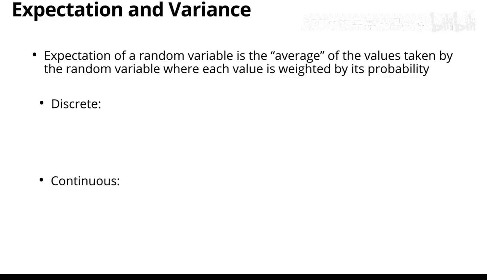
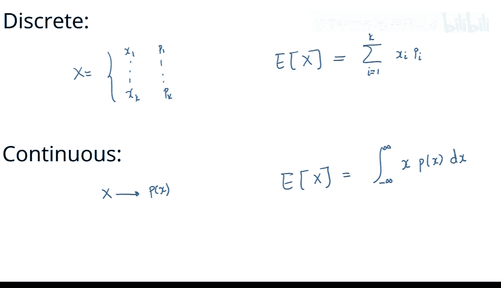
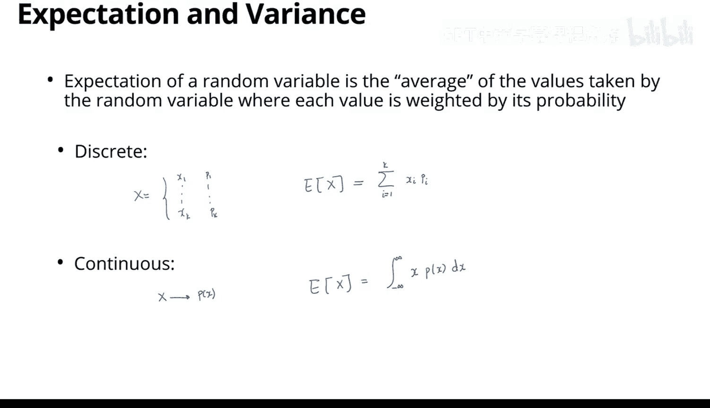
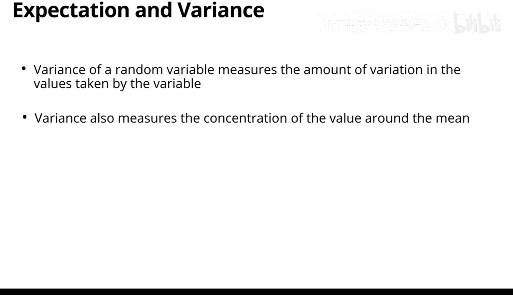
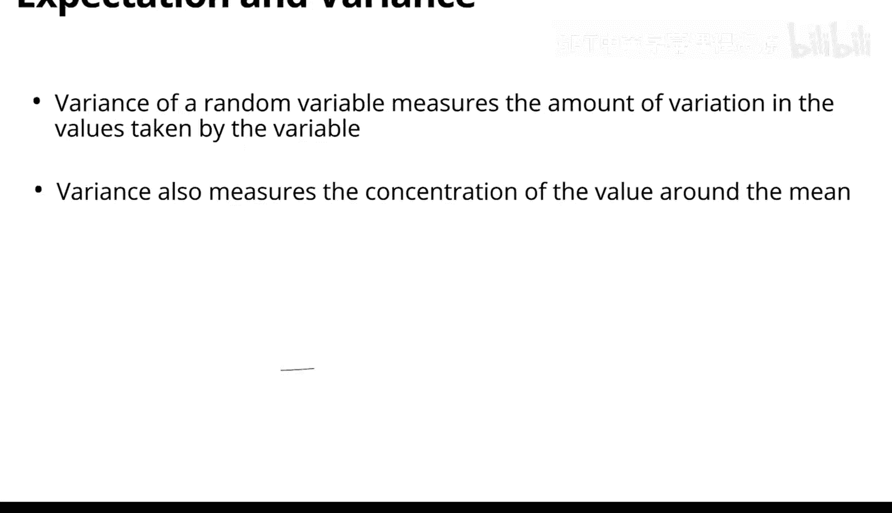
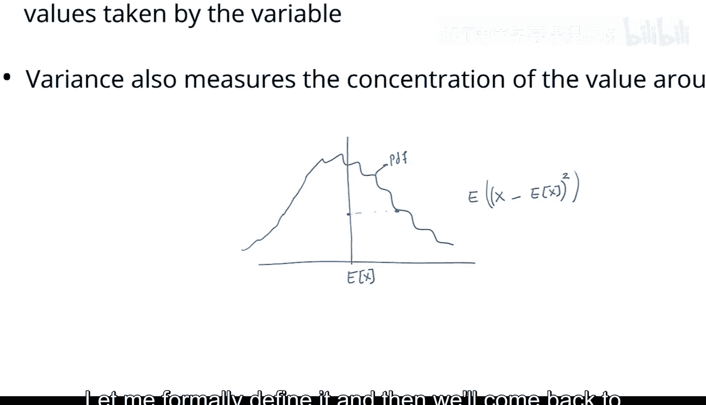
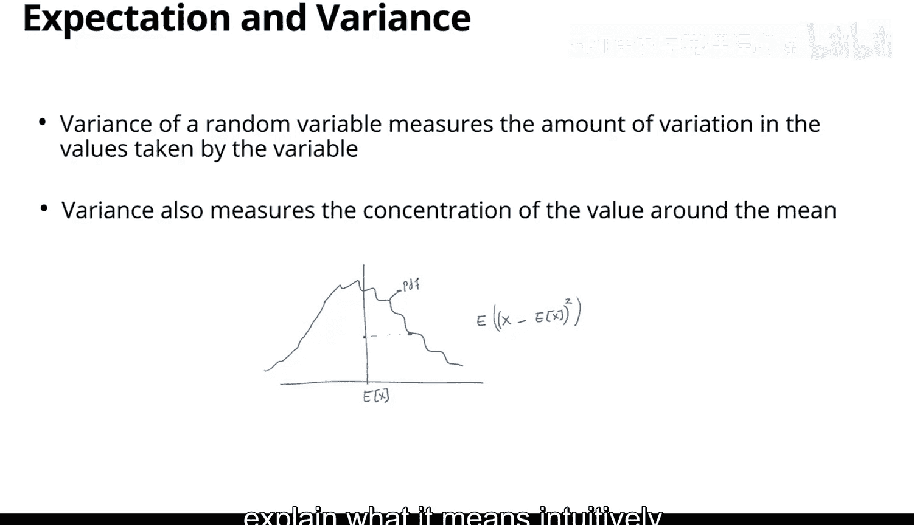
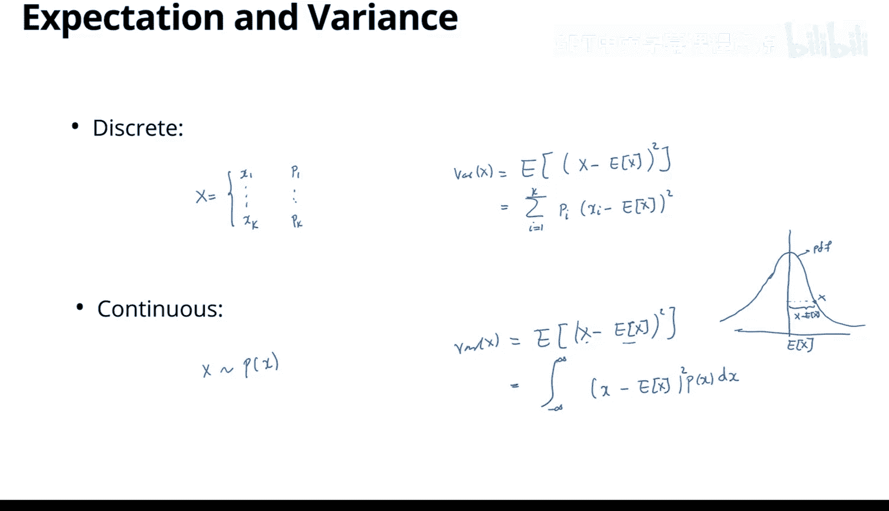

# 宾夕法尼亚大学《人工智能和机器学习基础（AI、数据科学、机器学习）AI and Machine Learning Essentials with Python》 p46 11_02_01_基础概率论II.zh_en -BV16f421Q72q_p46-

Okay， now that we have learned what the concept of random variable is。

 let me also talk about the concepts of expectation and variance for random variables。

 the expectation of a random variable as given by this definition here。

 the expectation is the average of the value is taken by a random variable when each value is weighted by its probability。

Okay， so for example， if， if you have a discrete random variable， remember if x is discrete。

 x takes a discrete set of values， x1 through x K with probability is P1 through P K。

The expectation of x， the average of x would be the sum。Over the values。X I。

 but then they are weighted by their probabilitybabil rate some X I P。 if you think about it。

 this is the weighted average of the values and the weights are just the probabilitybabilities。

If x is continuous， X would be identified by the P Df。P of x。

 and the average is defined as is just the extension of the definition in the discrete domain。

 So the average， I'm just replacing the sum here by an integral。 So integral from minus to infinity。

 the value x times its corresponding density x p of x。Okay。

 and that's the average for continuous random of variables。

Okay， so。

That's the definition of expectation。 Okay， let's now define what the variance of a random variable is。

 intuitivetuly， the variance of a random variable measures the amount of variation in the values taken by the variable。

 Okay， the variation with respect to the mean of the random variable or the average of the。

 So if if this is the distribution， the Pdf of a random variable， these are the values。

 the distribution of different values that the random variable take。 Okay， Pdf。

ve known we've already learned that the expectation or the mean of the random variable would be the average of the values taken by that random variable the weight average according to probabilities。

That the variance measures how much。Variation is in the values taken with respect to this mean okay。

 so if。We look at the difference of these values。And the mean and then we we weight these differences according to the probabilities of the batch okay。

So essentially， we are going to look at the values taken by the random variable minus the expectation of the random variable。

啊。And for the。Varariance， we look at this difference to the power to。 Okay。

 now we're gonna compute the expectation of this quantity， as you see here。

 And that's just the definition of the variance。 Okay， let me formally define it。

 And then we we will come back to the definition of the variance again and explain why what it means intuitively。

 Okay， so we're gonna define the variance for discrete and continuous random variable is actually the same definition。

 we just customize it to the nature of the random variable。 So for discrete random variable。

 Remember that a discrete random variable。 what's given as。

The value is x1 through Xk， with probability is P1 through Pk。And the variance。Of x。

Is defined as the expectation。Of this quantity here， x minus the average。Of x to the power to。 Okay。

 so the expected square of the difference of the value。And the mean of the random vibe。 Okay。

 so in this case， this would be just the sum。Over all the possible values。

So each value is weighted by its probability P。X I minus e by x。The out。

So for continuous random variables。You have the probability density function， Pf， and ver of x。

Which is given as the expectation of x minus e of x。The power 2。This given as the integral。

 I'm just replacing the sum by the integral And that's。How it's done for in the continuous setting。

 So it is the integral。Of P of x。 so that's the weighting the probability， the x and x minus E of x。

right too。Okay， that's the definition of the variance。 But again。

 if I want to intuitively explain this。😊，You will look at the all the values taken by the random variable。

 the Pf。So the average of the random variable。X is somewhere here。Essential。

 what you do is that you look at this difference x。 So this difference here， x minus the average。

And then you look at the square of this difference。

 and then you average it by a weighted average over all the possible values that the random variable takes。

 Okay， so if you think about it， the variance is a measure of how the values of the random variable taken by the random variable。

 how these values are different from the average。 What the。

Is the expectation of the gap between the value taken by the random variable and the expectation to the power2 Okay。

 so essentially it's a measure of how much variation is in the values taken by the random variable。

 and that's what is called the variance。

