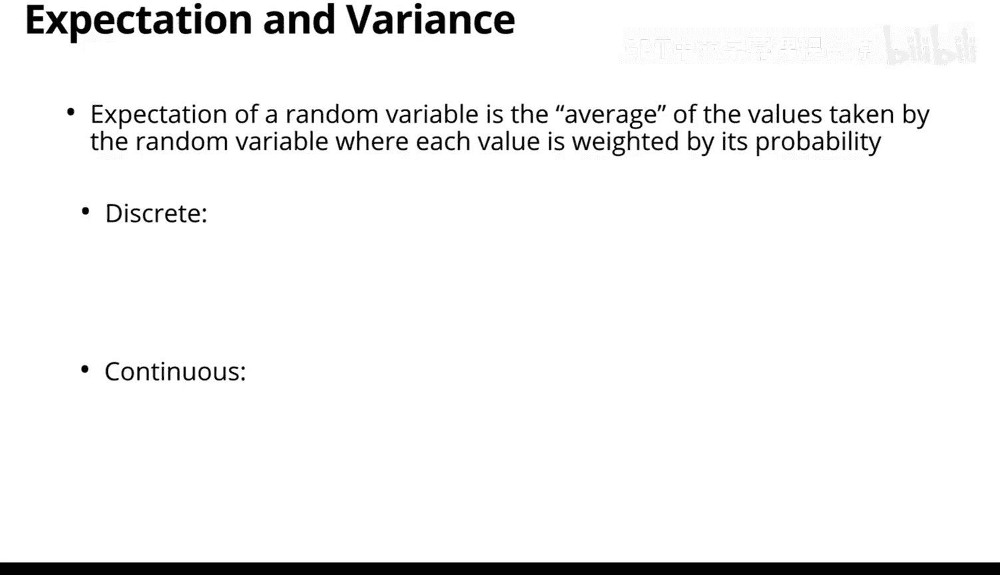
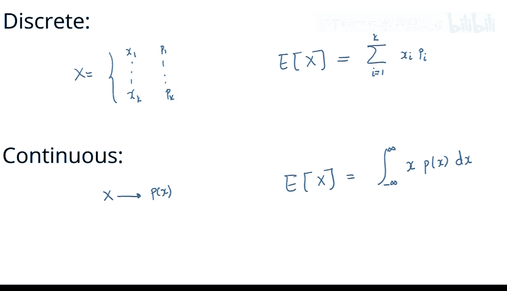
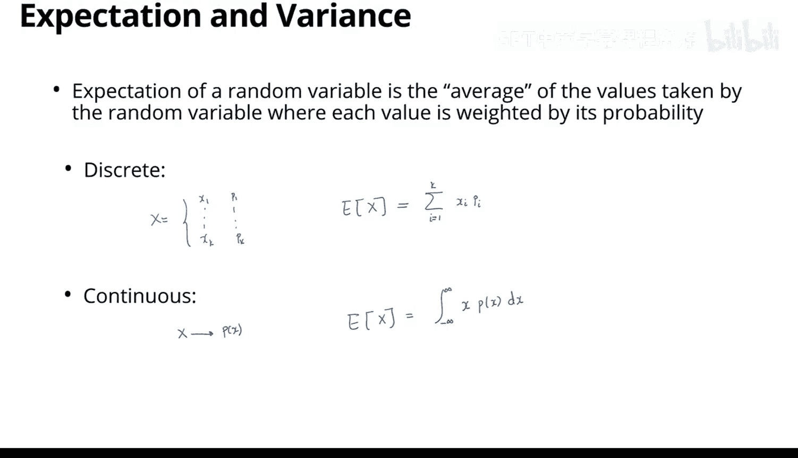
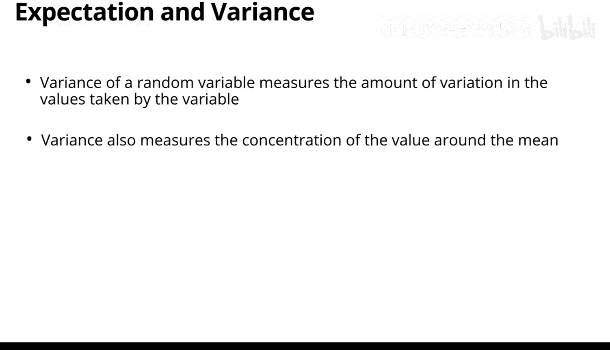
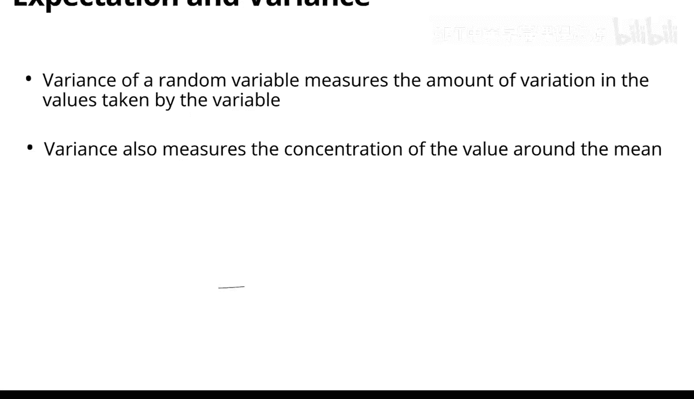
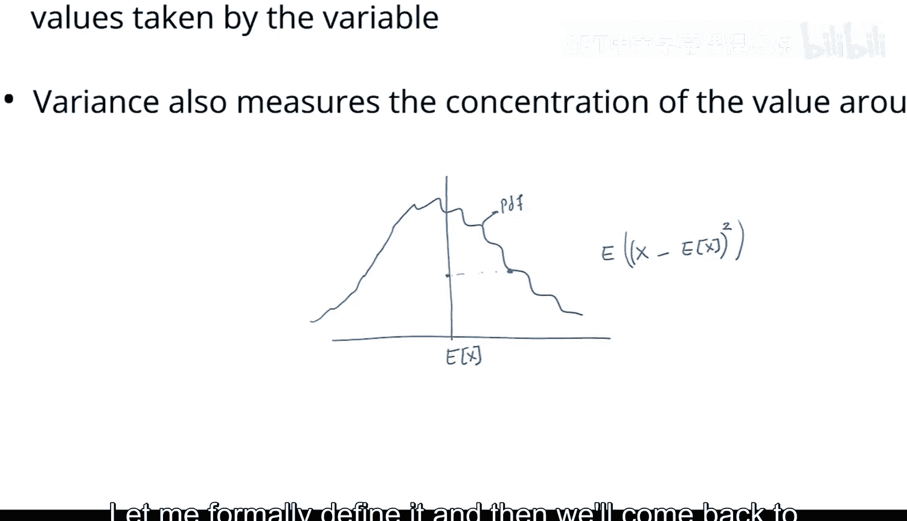
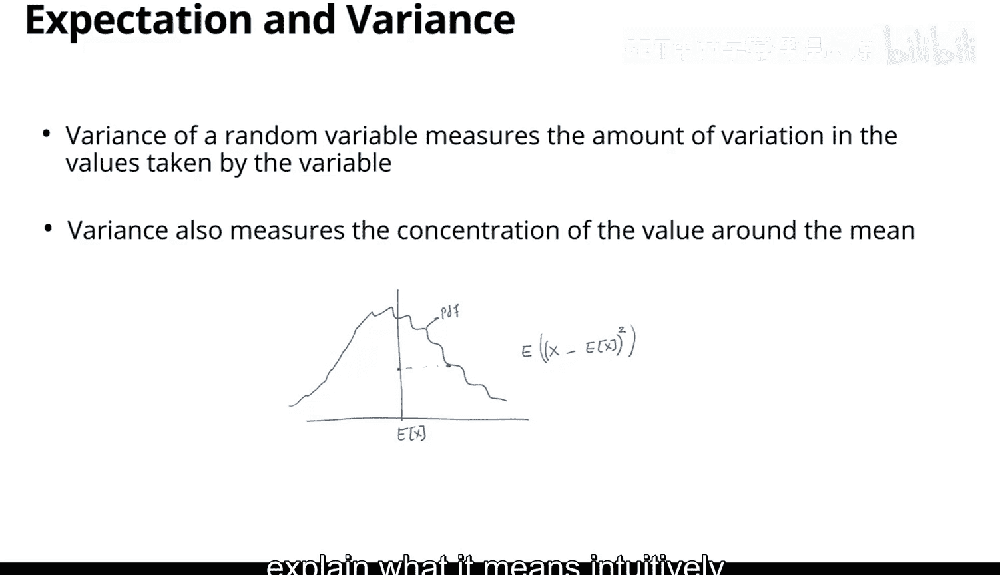
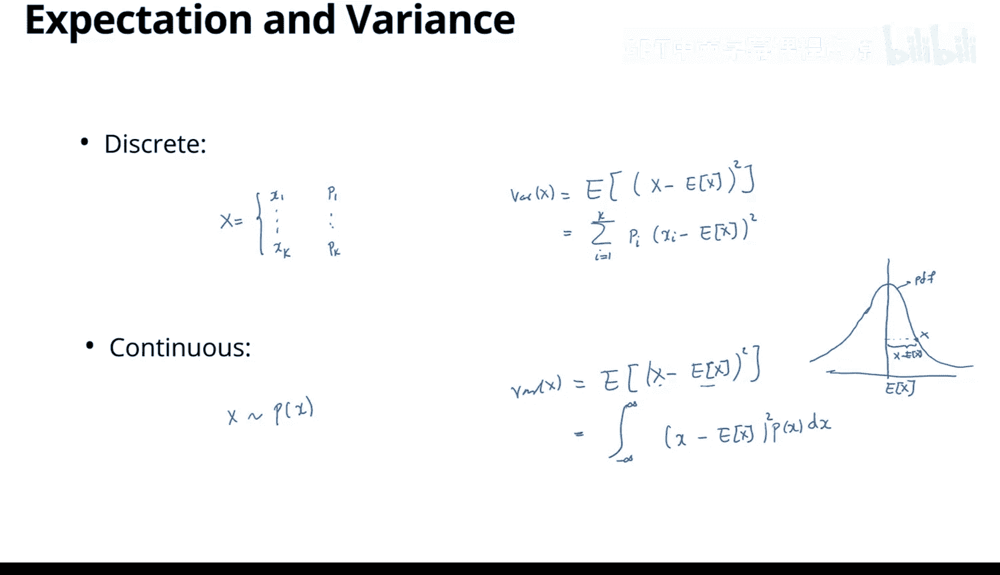

# 人工智能和机器学习基础：11_02_01：基础概率论II 📊

在本节课中，我们将要学习随机变量的两个核心概念：**期望**和**方差**。上一节我们介绍了随机变量的基本概念，本节中我们来看看如何量化随机变量的“中心位置”和“离散程度”。

## 期望（Expectation）

期望，或称均值，是随机变量所有可能取值的加权平均。权重就是每个值对应的概率。

对于**离散型随机变量**，其定义如下：
设随机变量X可以取值 `x1, x2, ..., xk`，对应的概率为 `P1, P2, ..., Pk`。则X的期望 `E[X]` 为：
`E[X] = Σ (xi * Pi)`，其中求和 `i` 从1到 `k`。

对于**连续型随机变量**，其定义是离散定义的扩展。设其概率密度函数为 `p(x)`，则期望 `E[X]` 为：
`E[X] = ∫ x * p(x) dx`，积分区间为整个定义域（通常为负无穷到正无穷）。

简而言之，期望代表了随机变量在大量重复试验中的平均结果。

## 方差（Variance）

方差衡量的是随机变量的取值相对于其期望（均值）的离散程度或波动大小。

直观上，我们观察随机变量所有可能的取值（由其概率密度函数描述）。其期望 `E[X]` 是这些取值的中心点。方差则计算每个取值 `x` 与中心点 `E[X]` 的差距（即 `x - E[X]`），将这个差距平方以消除正负号的影响，最后对所有可能的 `x` 求这个平方差的加权平均。

以下是方差的正式定义。

对于**离散型随机变量**，方差 `Var(X)` 定义为：
`Var(X) = E[(X - E[X])^2] = Σ Pi * (xi - E[X])^2`。

对于**连续型随机变量**，方差 `Var(X)` 定义为：
`Var(X) = E[(X - E[X])^2] = ∫ p(x) * (x - E[X])^2 dx`。

因此，方差是随机变量取值与其均值之间“平均平方距离”的度量。方差越大，说明数据的波动越大；方差越小，说明数据越集中在均值附近。

---

本节课中我们一起学习了随机变量的期望与方差。期望描述了随机变量的平均或中心趋势，而方差则描述了其取值的离散或波动程度。理解这两个概念是后续学习概率分布、统计推断及机器学习中许多算法（如评估模型误差）的基础。