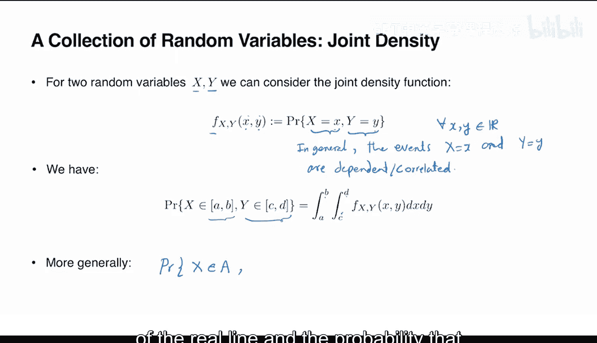
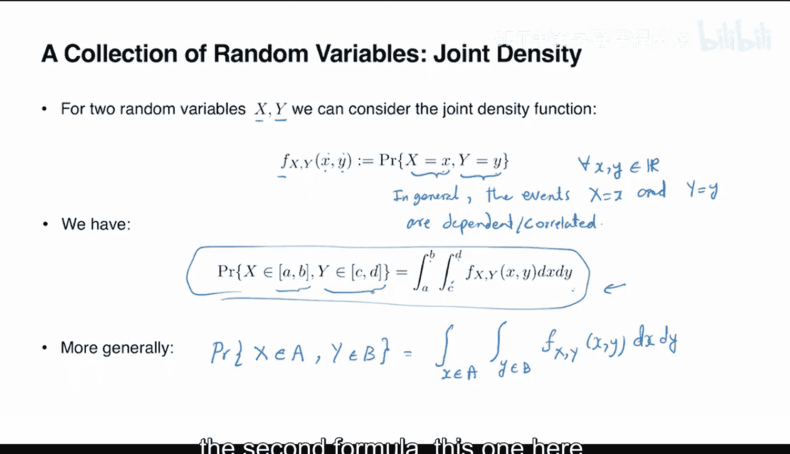
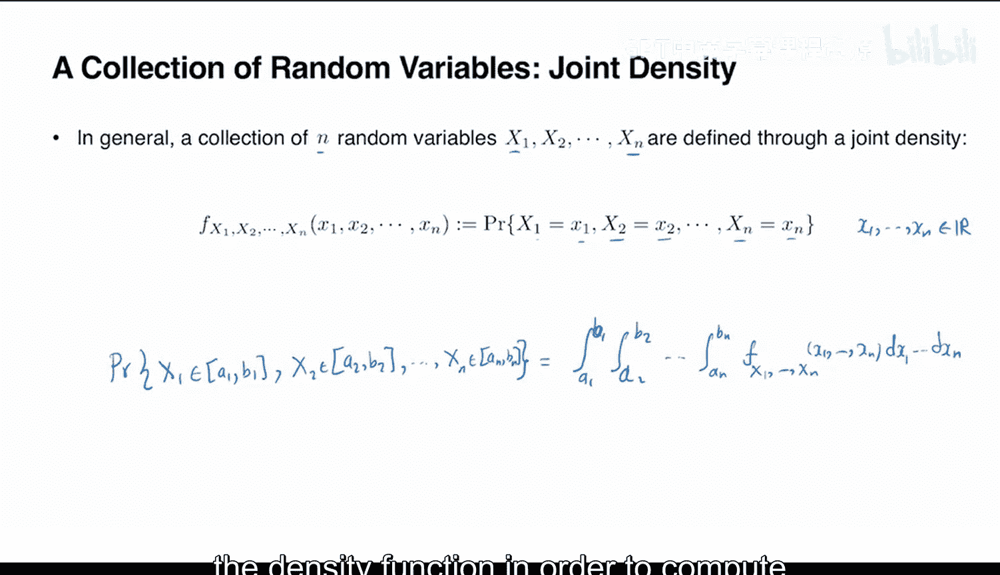
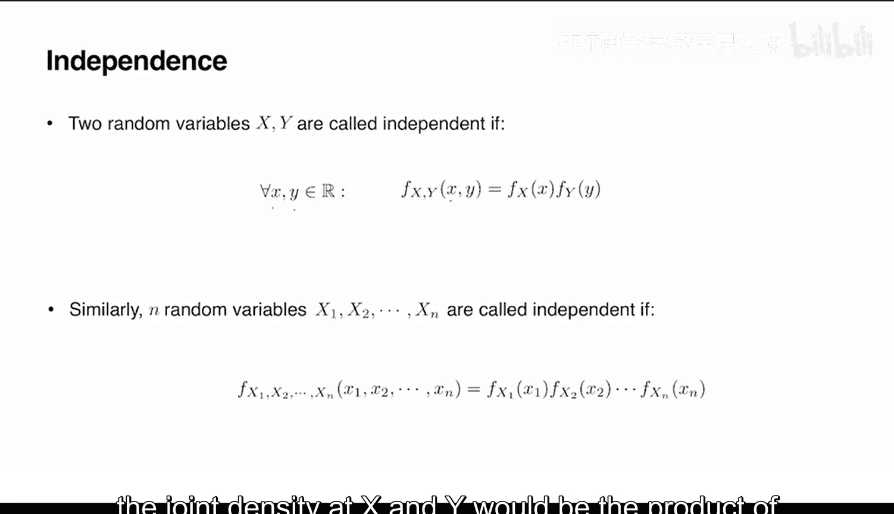
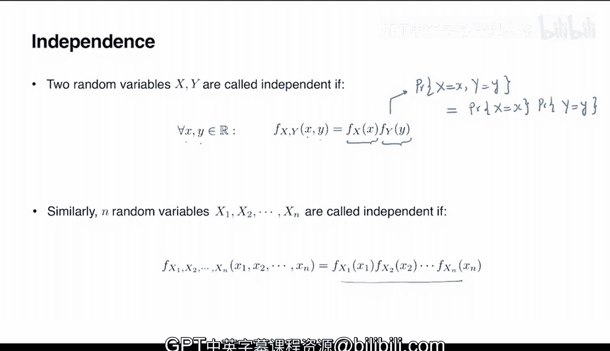

# 宾夕法尼亚大学《人工智能和机器学习基础（AI、数据科学、机器学习）AI and Machine Learning Essentials with Python》 p48 13_02_01_进阶概率论I.zh_en -BV16f421Q72q_p48-

And in this section we're going to talk about a collection of random variables and their joint density function。

 how their values， the probability that they take values would be connected to each other and that will be quantified through the joint density function and then we're going to talk about the concept of independence and see what are the implications of independence in computing let's say variants of some random variables and so on and so。

And indeed let start with two random variables， so given two random variables x and y。

 each of x and y could take values， for example， x could take a specific value x y could take a specific value of y。

 the joint density function of x and y would essentially give you the density or more intuitively the probability that x takes value x and at the same time the random variable y takes value y okay so that's the joint probability that these two events x equals x and y equals y happen。

And this is defined for every choice of x and every choice of y on the real life。

Remember that in general， the events x equals x and y equals y are dependent。

dependpenent or correlated right and the joint density this function here。

 which is a function of x and y essentially would quantify or characterize that correlation between and given the joint density function which we typically deote by f of x and y and a specific value x and y so is's a function of x and y where x is in R and y is in R So given this density function。

 you can essentially compute probabilities of different events for x and y So for example。

 the probability that the value of x falls into some interval A and B and at the same time the value of y falls into another interval。

 let's say C and D would be the integral over x going from A to B and over y going from C to D and you integrate the density function。

 the joint density function F of x and y over the choice of x going from A to B and y going from C。

Okay， so that that's flow through that integral that you see here and in general。

 the probability that x falls into some a， so a could be an interval could be a unit of the interval could be like a complex subset of the real line。

And the probability that y falls into another set B could be computed using the joint density function through the following integral。

 So this is the integral over x taking values in the set A。

Integgrral over y taking values over the set B。F of x and Y。The X you Y， Okay。

 so that's the general formula that you have。 Okay。

 what you really need to do to know is essentially this formula。 the second formula for this course。

 And this is just a more advanced kind of relationship between general sets and the the function。

 if you， if you， if you do not know this formula cannot at the moment。

 understand this formula is completely fine。 What we want't really。

 what we really work with later on throughout the course is the second formula this one here。 Okay。

 now that we define the joint density function for two random variables。

 you can easily generalize this concept for a collection of。

N random variables， n being 2 or larger than 2。 So given n random variables。

 x1 through x N their joint density。Would be defined as follows。

 Is the density or intuitively the probability that x1 takes some value x1。

The random y but x 2 takes some value x2 all the way to X N， taking some value X N， Okay， and x 1。

Through Xn could be just sum。Could be any real values。 Okay。

 so for any specific values electron through X N this joint density function would give you this probability that you see here。

 Okay， and again， similar to before。For example， you can compute these events。

 the probability that exp。Fs into some interval。 Let's call it a1。Bwen。

And x2 at the same time falls into another interval， A2， B2。

All the way to X N falling in the interval A and B N。

Could be computed from the joint density function through this integral。 So a one integral over。

X going from a 1 to B1。X2 going from a 2 to B2， all the way to X N， going from A N to B， N。

 the joint density function， X bound through X N。S。And you integrate over the choice of x1。

 So that's how you use the density function in order to compute the probabilities of different events for these random variables。

Okay now that we talked about the joint density function。

 we are ready to define the concept of independence of random variables through the notion of the joint density。

 Okay， now two random variables x and y are called independent if their joint density function decomps into the product of the individual densities。

 Okay， so in formulas for any choice of x and y in real values。

The joint density at x and y would be the product of the individual or the marginal density of x over x times the marginal or the individual density of y over y Okay。

 so essentially I'm sure all of you are familiar with the intuitive notion of independence and probabilities。

 So essentially this would intuitively this would essentially tell us the following。

 So the probability that x takes value x and y takes value y。

woul be equal to the product of the probability of x taking value x and the probability individual probability that y x value y and that's just the good old notion of independence that we are all familiar are with。

 the probability of the two events， the intersection of the two events would be the product of the probability。

And that is defined here in terms of the joint density function of the two random variables。

 And again， you can easily generalize these two n random variables。

And independence for n random variables would be defined through their joint density functions as follows。

 So the joint density function。 So x1 through x n or independent if and only if the joint density function f of x1 through x n decomposes into the product。

Of this individual density function。 So F of x1 times f of x2 all the way to f of x。

