# 宾夕法尼亚大学《人工智能和机器学习基础（AI、数据科学、机器学习）AI and Machine Learning Essentials with Python》 p49 14_02_02_进阶概率论II.zh_en -BV16f421Q72q_p49-

Now that we have independence， we have talked about independence and joint density functions。😊。

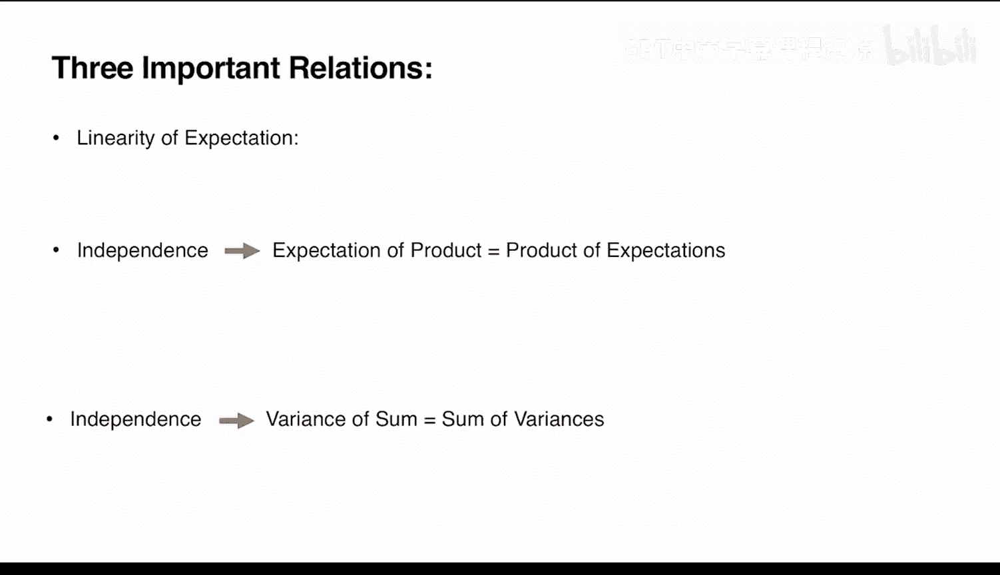

I'm going to talk about three important relations between that we can derive for the expectation and and the variance of a collection of random variables。

 which will be very handy for us as we go as we go on through the course。

 Okay so I'm going to explain these three very simple， but very important relations。

 and I'm going to give them names， for example， linearity of expectation and so on and so forth。

 and we're going to use these laws or relations later on in the course。 Okay。

 linearity of expectation is simple。 So for let me do it for two random variables and it's very easy to general to end random variables。

 So for any two random variables。

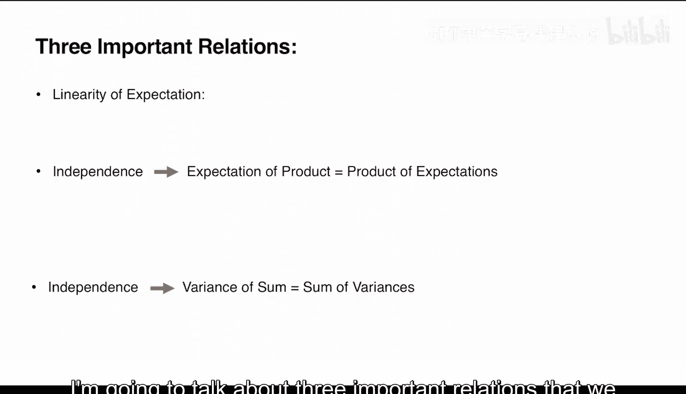

We don't care about the relation that holds no matter how the random variables are。

Correrelatedated with each other， no matter if they are independent or dependent。 Okay。

 so expectation of any two random variables X， the sum of any two random variables x plus y。

Would be equal。To the expectation of x plus expectation of y。

 that holds no matter what for any two randomvirus。

 no matter how they are correlated with each other。So that's called the linearity of expectation。

 And then you can do it for end random by expectation of。

X1 plus x 2 all the way to X N is equal to the sum of expectation。

 So expectation of x1 plus expectation of， let's say， X2 all the way to expectation of X 。 Okay。

 that's just linear of expectation。 You can easily prove this if you want by writing the expression for expectation。

 And， and just as an integral。 And then just you see that。

You have linearity of integral right from x one to X n。

 and that easily basically gives you the result。So that linearity of expectation。

 The second relation， which is very interesting and useful for us。

 is a direct consequence of independence。 So if two random variables， okay x and Y。

If x and y are independent， then for any two functions， these are arbitrary functions， F and G。

 we have。Expectation of F of x。Times G or y。Is equal to the expectation of f of x。

Times expectation of G of y F and G are generative function。 there could be any function。

 For example， if F and G are identity functions， this would be expectation of x times y is equal to expectation of x times expectation of y。

 So expectation of the product will become the product of expectations as you see。

 So this is the law that we are talking about。And you can do this easily for n random variables。

 expectations of functions of n random variables will become of the product of functions will become the product of the expectations of those functions and the final relation that will be very useful for us is the following relation on the variance of a sum of independent random variables so if let me just write it in the following way if you have n random variables X1 through Xn。

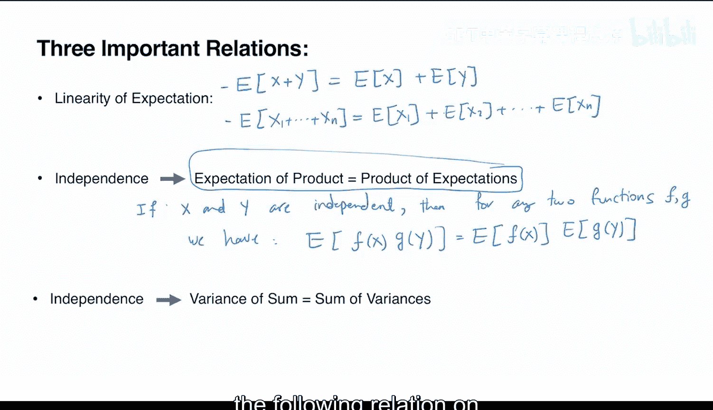

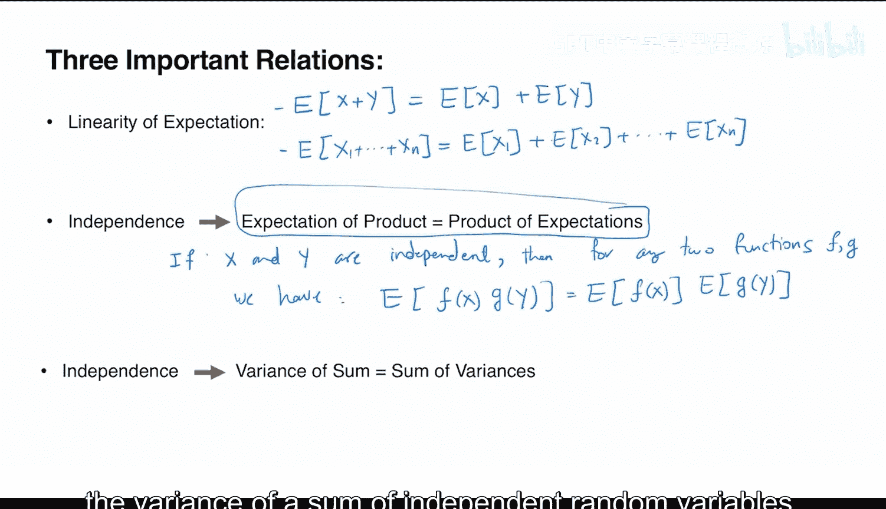

Are independent。

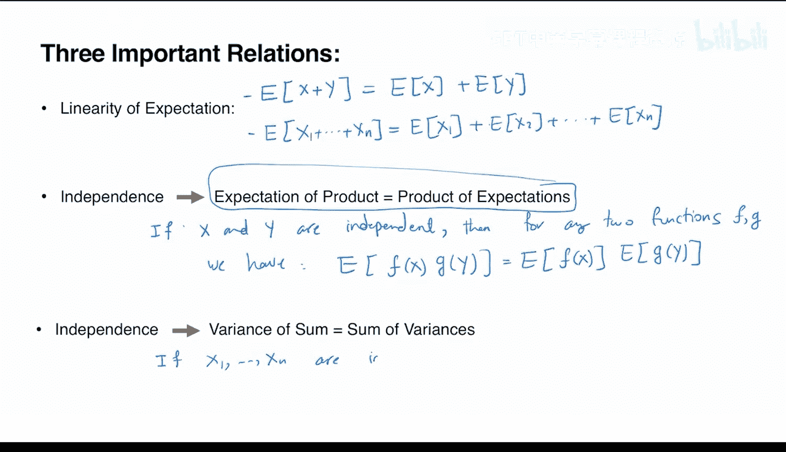

Random variables。Then I'm going to write this here。 So the variance。Of the sum。

Of the random variables。 So x1 plus。

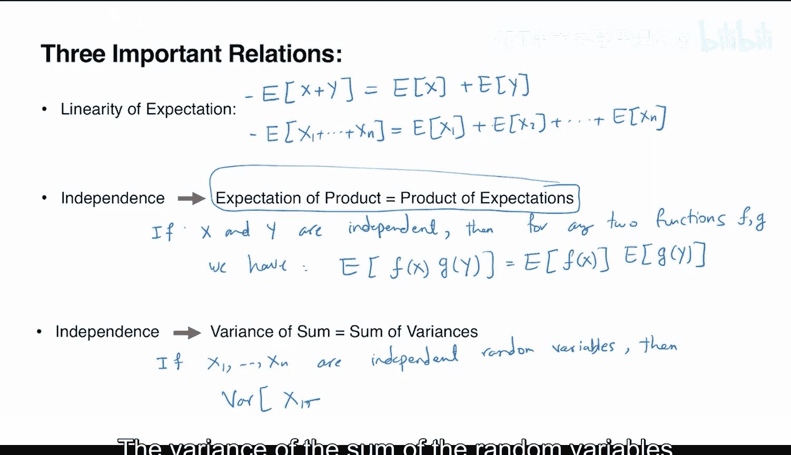

X 2 plus x 3 all the way to Xn is equal to the sum of the variances。 So variance of x1。

Vy on self x 1。Plus， variance of。X2。All the way to the variance of X。Okay。

 and independence is necessary here。 So you need independence here and independence also for the product rule。

 However， for the linearity of expectation， you don't need expert。

 You don't need any independence here。 Okay， so I'm gonna。Prove for you the third relation。

 the relation about the variance。 The first two relations are really a direct consequence of the definitions。

 For example， we talked about the first one for the second one。 If you just write the integral。

Of the integral expression for the expectation of f of g times F G or Y。

 since the two random fibers are independent， their density also decomposes。

 so it it's very easy to see that the integral can be written as a product of two integrals。

 which give you to individual expectations that you see here。

So I'm going to show you the proof for the last。

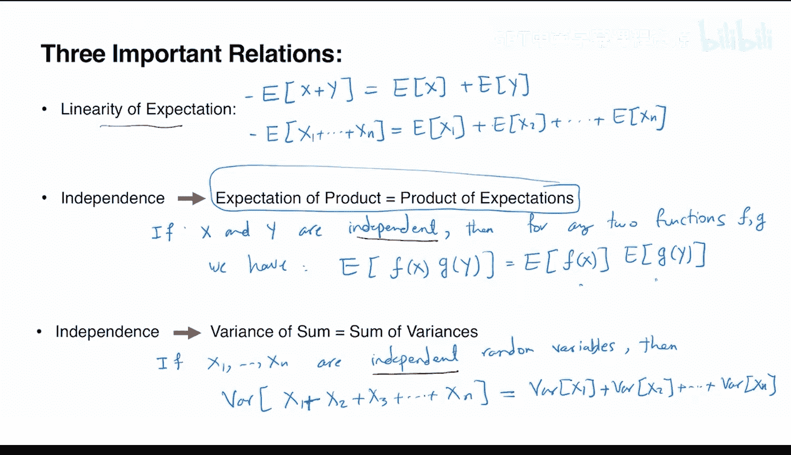

Relation here。Okay。The setting is as follows x1。

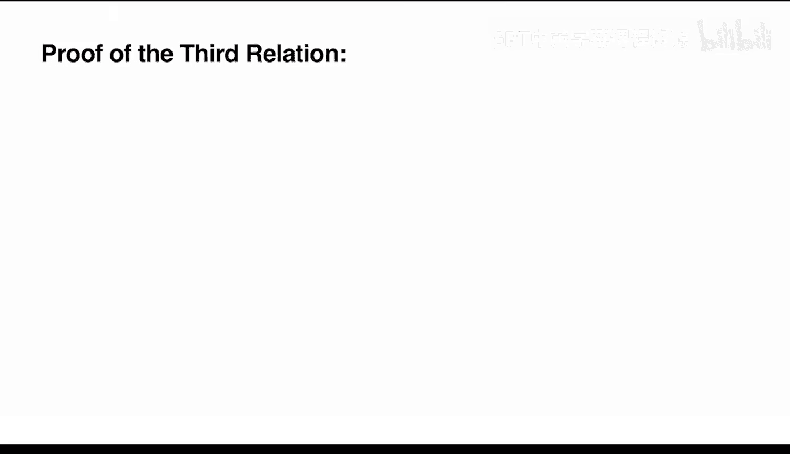

To Xn are independent。 And what we want to show is that the variance of x1 to Xn equals the sum of the variances。

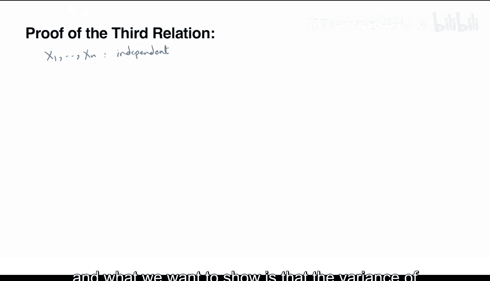

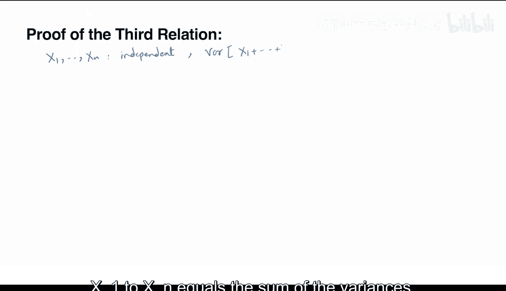

Now， in order to so I mean the proof is quite simple， we just write the definition of the variance。

 we expand it， and then we show that essentially this relation holds。

In order to write the definition of variance， we first need to compute the expectation of the sum of these random variables。

 Okay， and let me just add a a simple piece of notation。 So I'm gonna。Dote。By Mioai。

When you use me I too essentially denotes。The expectation of the。I random variable。 Okay。

 that's just a piece of notation that I'm adding。 Now， using this relation。

 this additional notation expectation。Of x 1。All the way to Xn。

Would be equal to So expectation of the sum。 So I'm going to use the first law。

 which was linearity of expectation。 Let me just write this here。 So linearity。

Of expectation to show that expectation of the sum will be the sum of the expectations。

 which in our new notation would be mu 1， the sum of mu I， right， mu1 to mu I。 Okay。

 so that's the expectation。 So let me just rewrite the formula of the variance here。 So variance。

Of x1。

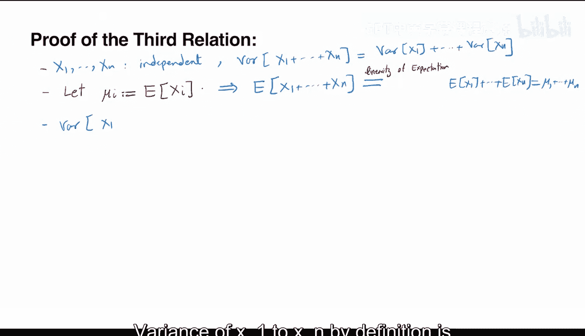

To X n。By definition， is the expectation。

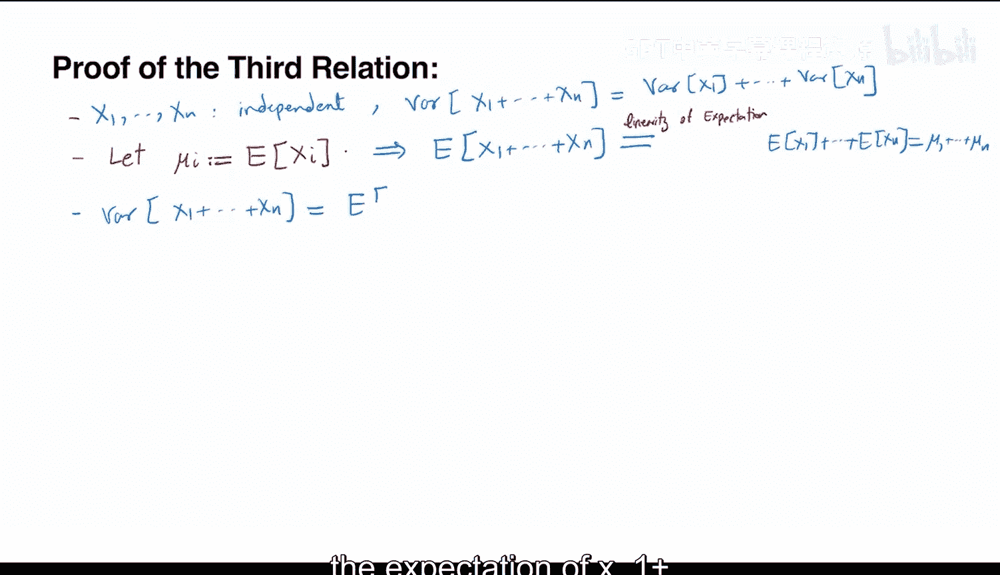

Of x1 plus。X N minus。The expectation of xon through xn。

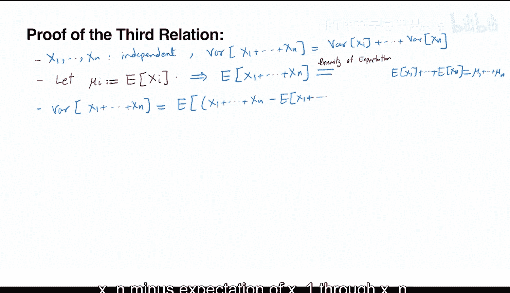

So this difference to the power2， that that's just the formula of the variance。

Which is equal to the expectation I mean expectation of the sum。Is the sum of the expectations。

 so that would be minus。Mu1。To me N。Right to the power2。And I can write this as the sum。

Of let me write it in， let me write it in the following way。 So x1 minus muu 1。Plus x2 minus mu 2。

All the way to x and minus mu n。So the whole thing to the power2， Okay， let me， so this is。

 this is a quadratic term。 Let me just expand it。 So this would be。

 let me write it in the in a more compact form。 So this would be some。Over all the random variables。

 And then I have an expectation here of X I minus mu I。

The power 2 plus  two times sum I and J from 1 to n。I is not equal to J X I minus mu I。Xj minus muj。

 I just expanded the quadratic term above and this， again。

 we are going to use the linearity of expectation here。So linearity of expectation。

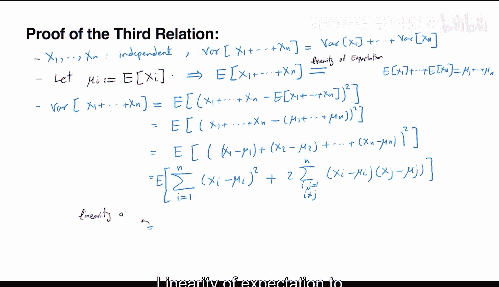

To derive that this is equal to the sum of E of X I minus mu I。

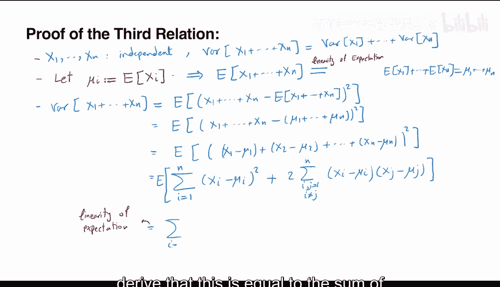

To the power 2。Plus， two times the sum I and J from1 to n。 I is not equal to J。E of X， I minus mu I。

X J minus energy。This term here， expectation of X I minus mui to the power 2。 This is exactly。

The variance of X。This is just a definition。Now， here， this term here。

 X minus mui times Xj minus muj， where I and J are different can be simplified。A。Okay。So。

 by independence。Since X I and Xj are different random variables， I J are different。

 then X and Xj are independent random variables， the second relation was the expectation of product is equal to the product of expectation。

 so I can just write this as expectation of X minus mu I。

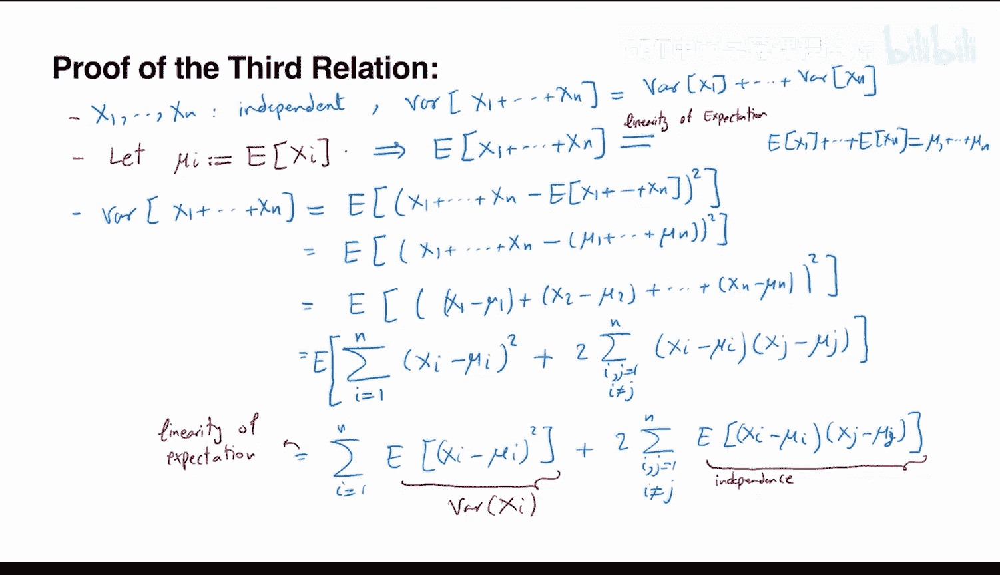

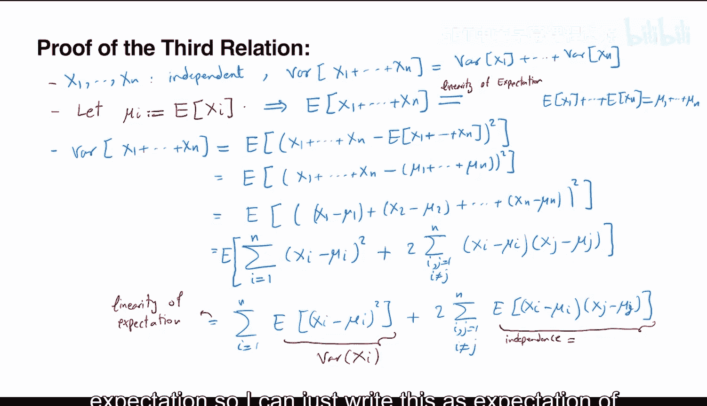

Times expectation of X J minus mu J。 That's the second relation that we talked about before。

 expectation of the product。 So that you can think of it as some function of X I。

 And this is some other function of X J。 Okay， so and then。

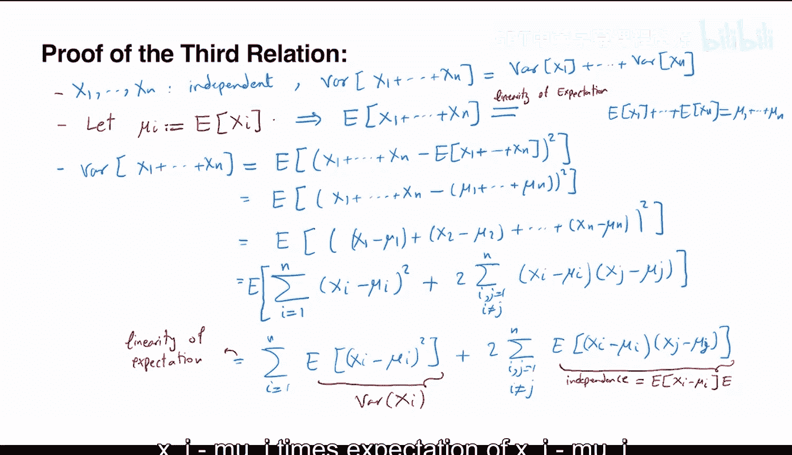

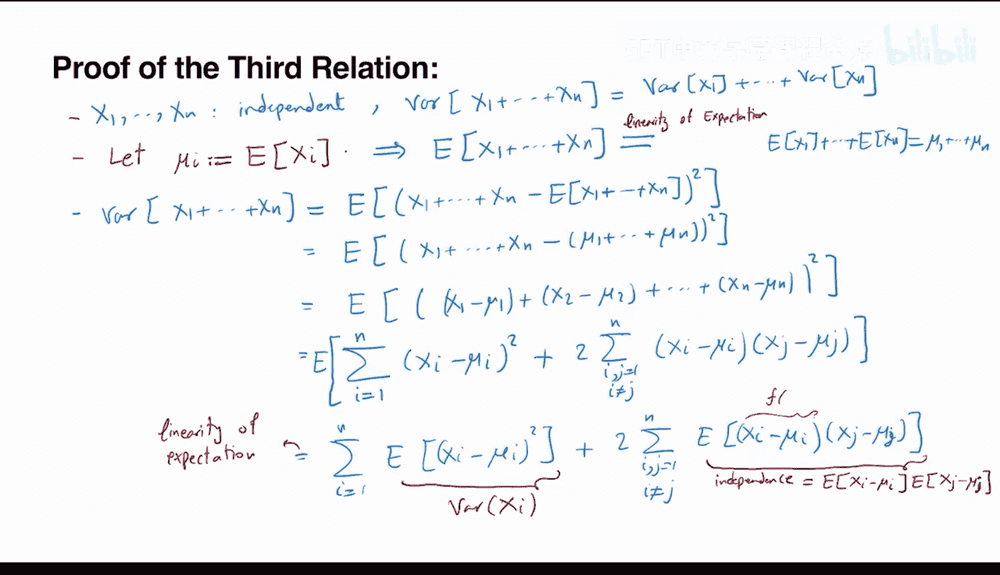

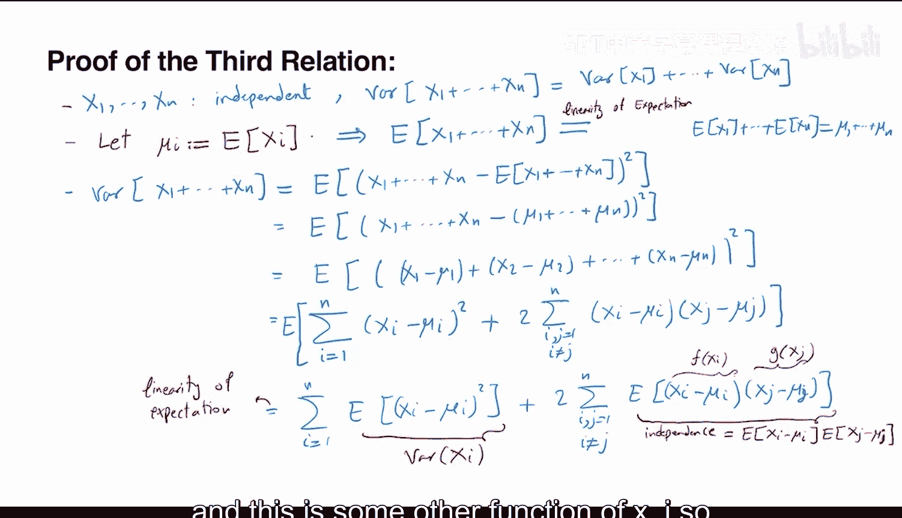

So expectation of the product of these two would be equal to the product of the expectations。

 And if you look at each of these individual terms。 let me just look at one of them。

 this is by the linearity of expectation。 This is just E of X minus mu I。

 But E of X I by the definition is actually mu I right So this is actually0。

 So all these individual terms in the second sum， All of them are0。

 So you're just left with the first sum， which is the sum of the variances of X。

 and that just proves our formula because we are started with being equal to the sum of the variance of Xs。

 which is exactly this formula that you see here。

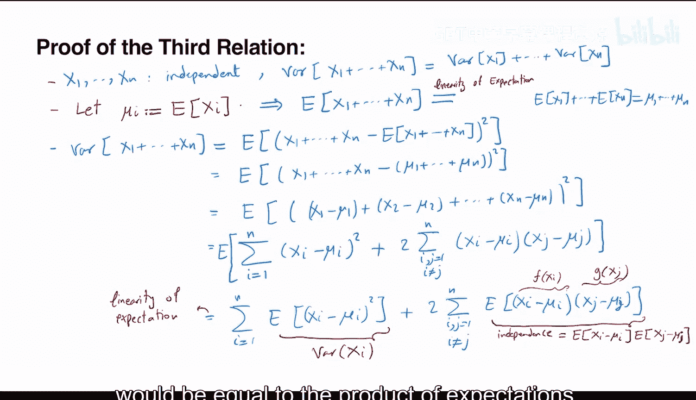

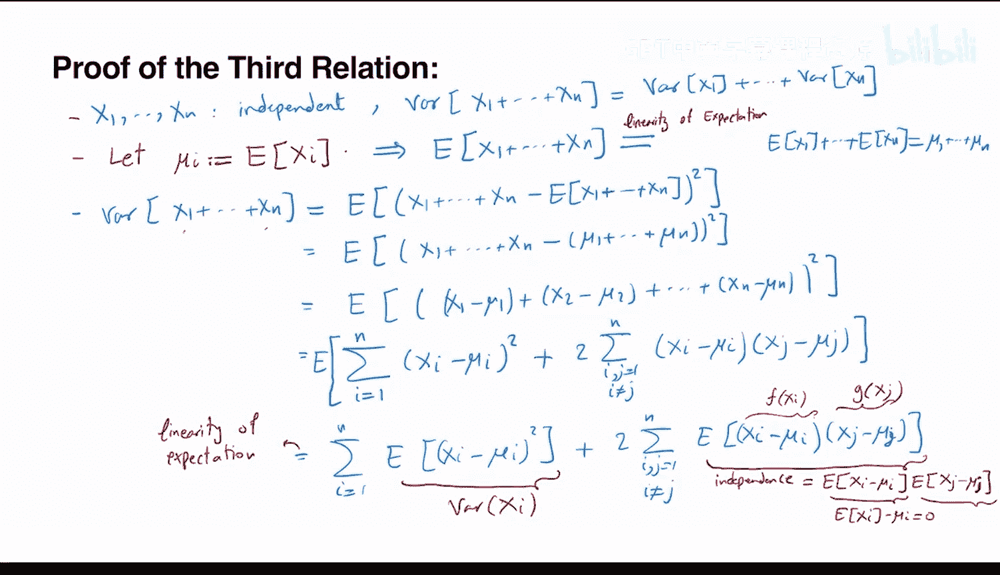

So that's the end of this section。

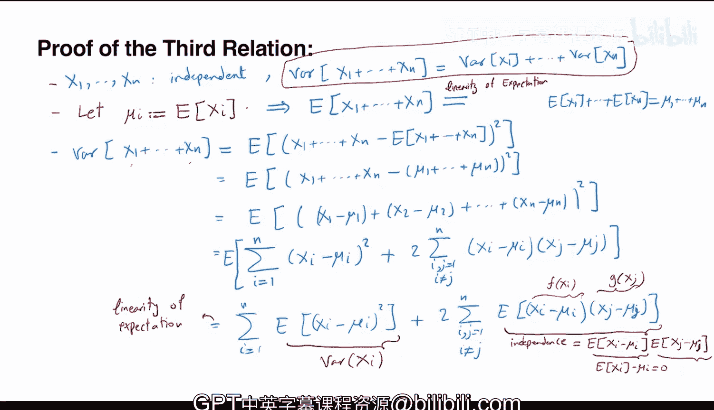