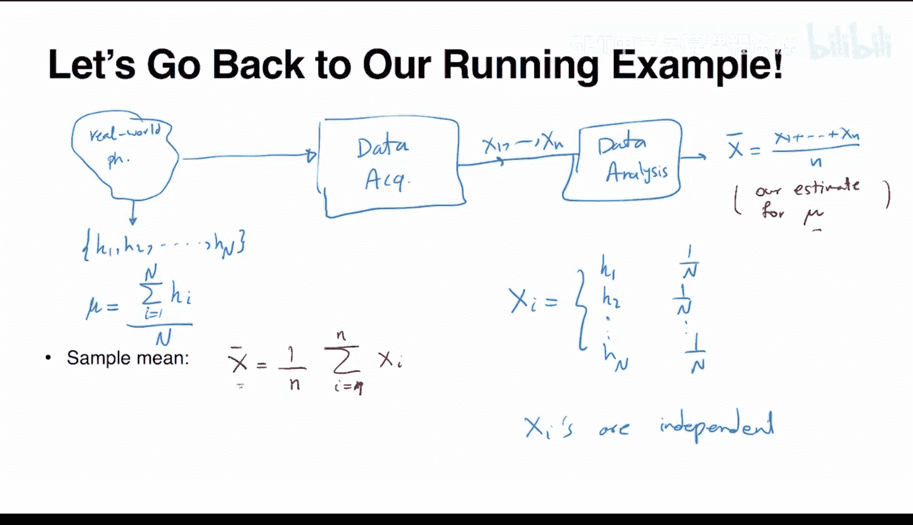
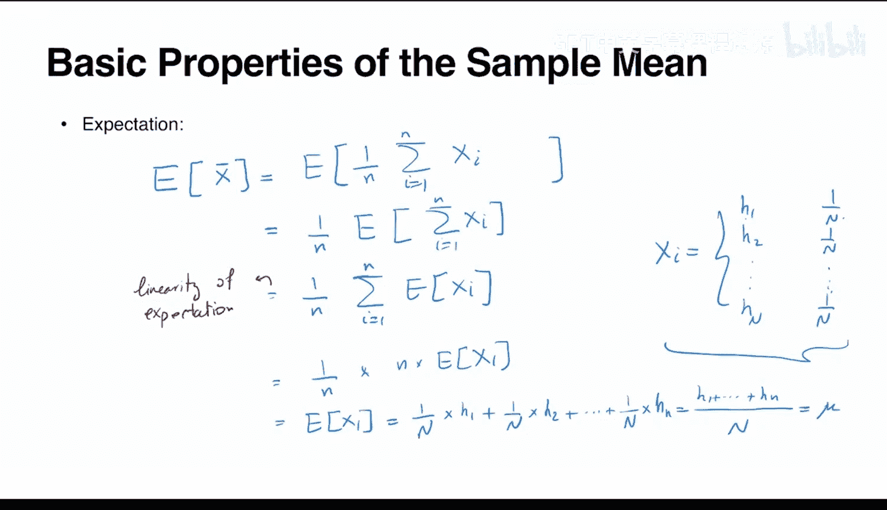
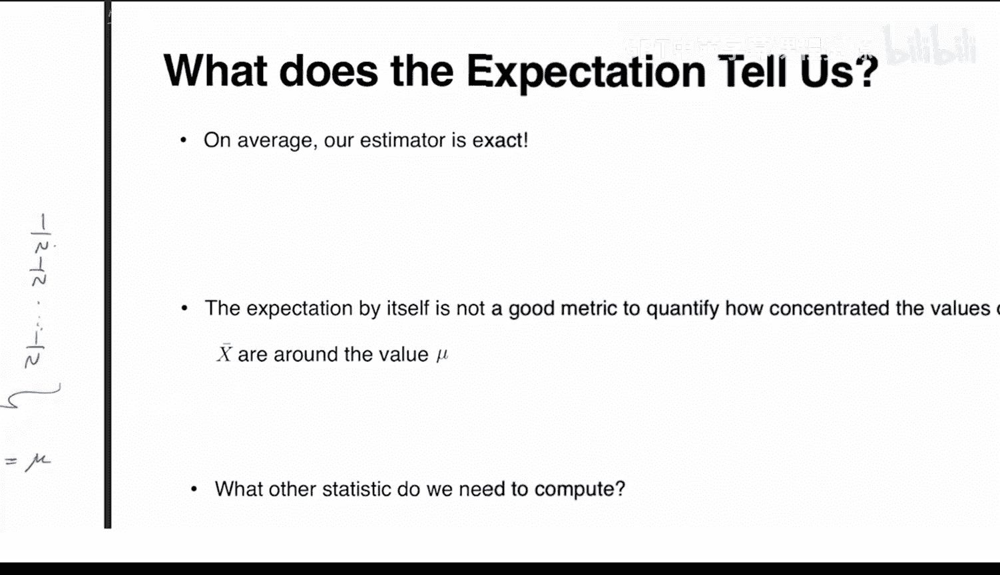
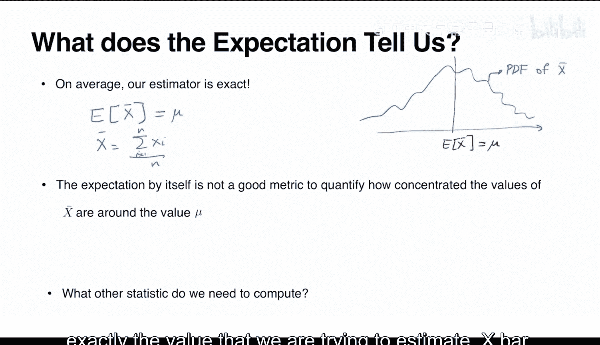
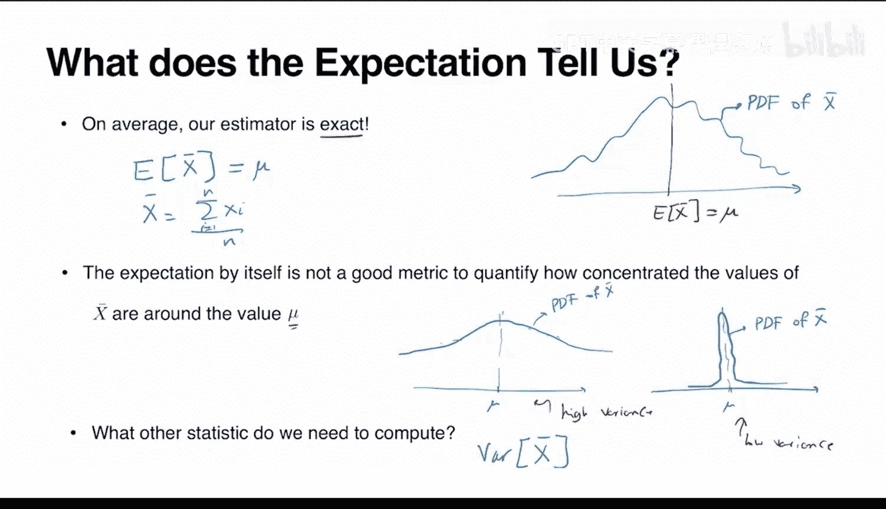

# 宾夕法尼亚大学《人工智能和机器学习基础（AI、数据科学、机器学习）AI and Machine Learning Essentials with Python》 p51 16_03_01_样本均值分析-期望.zh_en -BV16f421Q72q_p51-

Okay， so lets now that we have understood and learned the concepts of independence and joined density of two random variables and we talked about these three important rules for variance and expectation。

Let let us go back to our running example， which was the example of estimating the average heights of let's say women across the United States and then on that example we're going to talk about specific properties of the estimators that we design。

Now that we are equipped with the tools that we learned from the review of probability。

 we can essentially try to estimate these kind of properties that we will see。😊。

So there was some real world phenomena。Which in our case was a very simple task to do。

You have a population of heights， right， So height of the first person。

 H2 height of the second person to H n。And remember。

 N capital N was which was the size of our population could be very large， for example。

 the total number of women。Adult women in the United space that could be in the order of hundreds of millions。

And our task was to estimate the average height。 Okay， so this quantity here。

 some of the heights from one to capital n divided by n。 So that was our task。

 We want to solve this task， estimate this average height。 using data obtained from this population。

 So we have the data acquisition block， and that gives us data x through xn。

 and then we want to analyze the data that we collected through this n random variables。

 remember smaller n is much smaller than capital n using the sample mean。Which is respond plus。

X and over。Okay， so X bar。And that's our estimate。That's our estimate。

And we also talked about wanting the distribution of X's， remember X take the following distribution。

 so X is the height of the first person in the society with poverty 1 over n because we were choosing people uniformly at random。

 second person with poverty 1 over n all the way to the1 person with poverty 1 over n。

And what's also important is that X Is。Are independent because every time that we choose a new person it's completely random and independently of the previous people that we have chosen okay。

So Xs are independent and also what's important is that X all have the same kind of probabilistic law right。

 they are just X each X is the height of a completely random person chosen in that in the society and the sample mean which was ourestator let me just rewrite again is one over one over the number of data points that I collect。

The sum over all the data points， X I。Okay， what I'm going to do is to try to estimate basic properties of x for example。

 its mean and its variance and from these basic properties we will see how good this estimator x is with respect to the true value。

Okay， so let's start with the。Expectation of the sample Okay， so what we're going to compute。

Is the expectation。Of export。Which is equal to the expectation。 So by definition x bar。

Is just1 over n。S I from one to n of X Is。Which is equal well1 over n goes out of the expectation。

Of some of the Xs I from 1 to an X。Now we have the first law or first relation that we talked about in the previous。

Section， linearity of expectation， let me just write this here。Theniity of expectation。

Which essentially tells you that this is。The sum over expectation of the sum is the sum of the expectations。

Open X I。Now， remember， each all the Xs had exactly the same distribution or the same law， right。

 So X I was the height of a。Randomly chosen person， right？

All of them have exactly the same probability distribution。So in other words。

 the expectation of X size is exactly equal to each other right so that's just equal to expectation of one of the X's。

1 over n times。So you have n of these， so n times expectation of。One of the excs。

 let's call it exp because all of the excs have the same law and that would be just。E of Exp， okay？

So we need to just compute E of x1， but E of x1 is easy to compute right so given this probabilistic law that you see。

 we just compute E of x1 according to the formula So x1 would be equal to h1 with probability 1 over n right so the probability with probability 1 over n x1 is h1 with probability1 over n。

X1 is equal to H2。And then all the way to the last height， so 1 over n x1 is page pin。Right。

And this would be。H san。To H n over n， which is exactly the average height。So what did we learn here？

What we learned here is that。

On average， our estimator is exact。 so expectation。Of export。Is exactly me in general， Exp。

Which was the sample mean。It's a random variable right it has a PDF that has a probability density function。

Which。Which could be a complicated density function， right？For different values。

 So that's the Pdf of X bar。 you're just plotting it generic Pdf of X bar。

 So X bar is a random variable Pf is something generic。 But what's important here is that on average。

In expectation or the expected value of Exp。Is exactly。The value that we are。

We are trying to estimate export。 So on average or estimate or export， the sample means exact。

 It gives you exactly new on average。 So that's very good， right， because at least on average is not。

 it doesn't have a bias。 It is not。

It's exactly new。But what we should also note is that the expectation by itself is not a good metric to quantify how good our estimator is。

With respect to estimating the true value mu， right in other words。

I can give you here two examples of random variables which have the same average mu， so x bar。

Let me just give you two examples here， export could be， so this is middle here。

I I'm going to plot two different examples of the Pdf of X bar。

 So X bar could be something like this Okay something very mildly vary， right。

And this is me also in expectation。😊，So that's one version。

 the expectation of Pf will be equal to mu， but the values could be the values that it takes could be quite far from mu。

 right？In another example， the Pf of mu could be some Pdf of export could be something like this。

 okay， something very concentrated around mu。So it is very concentrated on on mu and expectation is again equal to mu。

 however， this one， the PDF on the right。😊，Is very concentrated I't mean。

 So in most probably the values that you get as outcomes of export are very close to meal compared to the。

PDf on the left， whose values are quite static are quite far from U In expectation。

 both of them are exact。 Give the value mu， but the one on the right。

The estimator on the right with the PDF on the right is much more concentrated around mu。

And in other words， the values that it has are much less varied compared to the mean mu。

 Okay so that essentially hints us towards another property of the  estimate or x that we need to compute in order to quantify the error of x。

 or in order to quantify how good our est or x is in the end。

 Exp is designed to estimate the value of mu so。An estimator X is good if its Pdf is quite concentrated around you。

 And in order to measure concentration around the value of the mean。

 what we need to compute is the variance of our。Estimate or export Okay， so here。

If we want to go back to these two examples， this one has a low variance。

And this one has a high variance。But computing the value of x bar， the variance of x bar。

 we will essentially understand in which case are we in。Okay， and that's our next goal。

