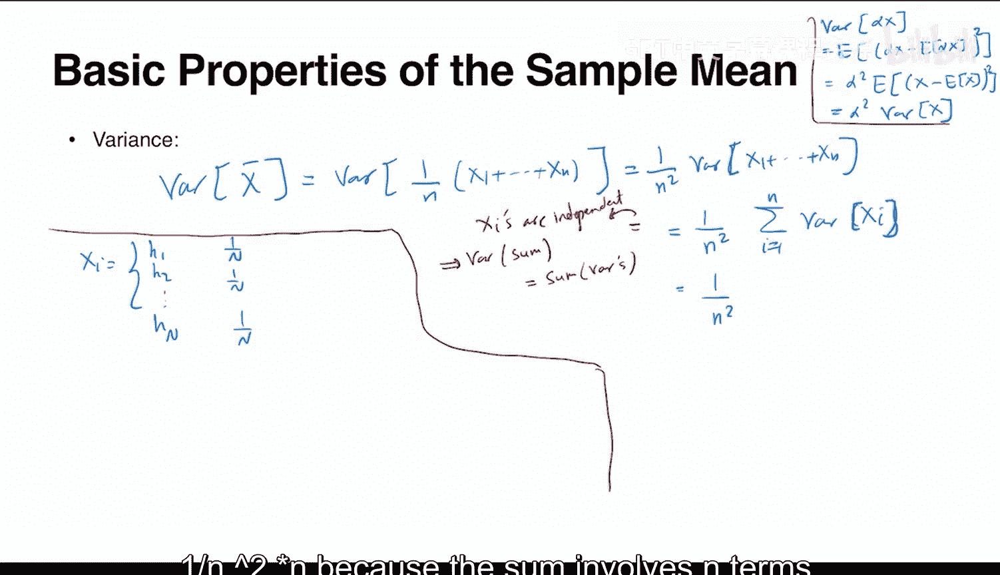
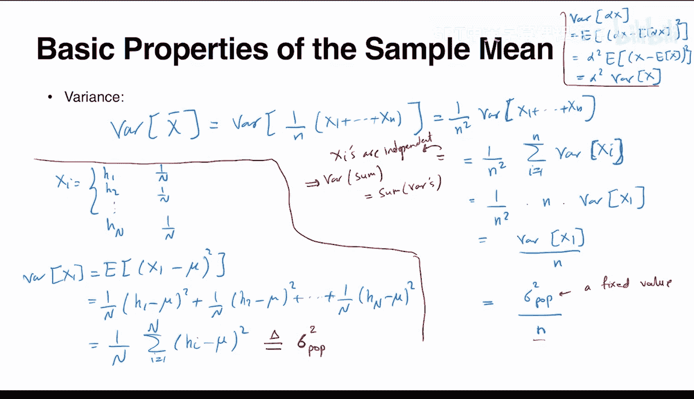
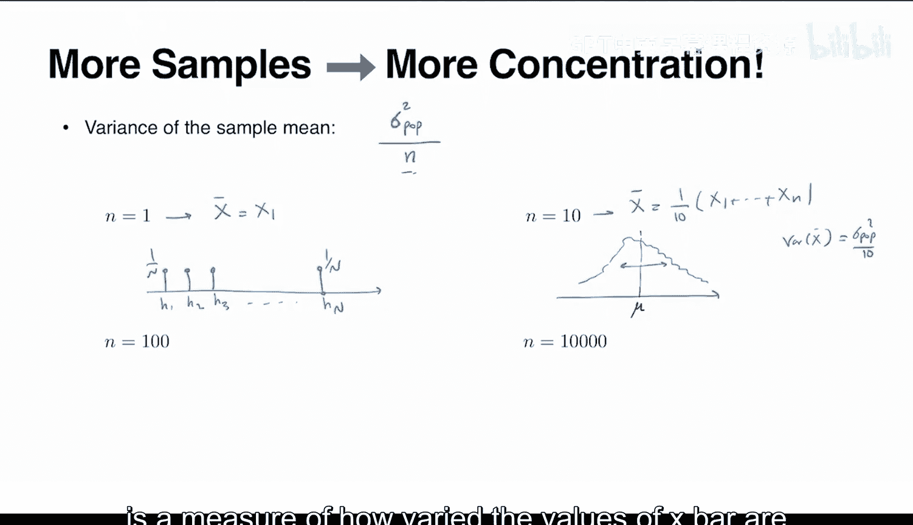
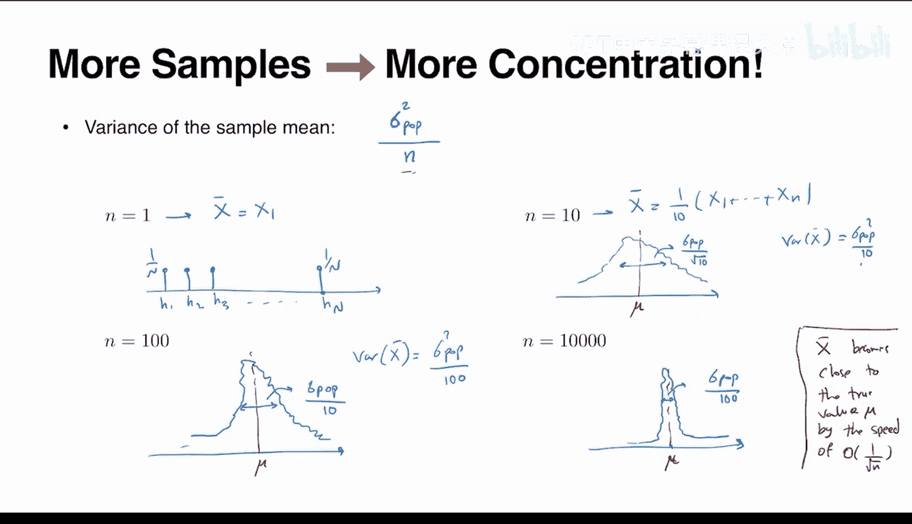

# 宾夕法尼亚大学《人工智能和机器学习基础（AI、数据科学、机器学习）AI and Machine Learning Essentials with Python》 p52 17_03_02_样本均值分析-方差.zh_en -BV16f421Q72q_p52-

Let's now compute the variance of the sample。Okay， so by definition， the sample mean。Is given as。

The sum of Xs， the data points。Over n， right？X1 plus。Excellent。

And I'm just taking the constant out one over and out。 So that would give me one over and a squared。

The variance of the sun。The fact that I get1 over n squared is because I have a quadratic so the variance is given through a quadratic term。

 so let me just open a quick parentheesis here。So the variance of， let's say， alpha for x。

Where alpha are constant。An x is a random variable would be equal to in by definition to the expectation of all for x minus E of。

Alpha x to the power 2， because of this quadratic term。

 Al goes out to be alpha squared times the expectation of x minus E of x。To the power2， right。

Which is all for squared times the variance of x， right。

So that's why when1 over n goes out of the variance， it would be 1 over n squared。Now。

 the other important fact here is that I'm。I'm computing the variance of the sum of Xs and Xs are independent。

 right， So by the third relation that we talked about in two sections back。

We know that the variance of the sum is the sum of the variance， so Xs。Or independent。

This means that the variance。Of the sum。Is equal to the sum of the variances。

That's the third law or the third relation that we talked about。

 so that would be just equal to one over n a squared。The sum of the varianceance。Of X is。Okay。

 and what was。The law of exise。Let me just open the parentheses here。

 So Xs were given as the following。 So X was the first。

 the height of the first person in the population with probability1 over n height of the second person probability 1 over n all the way to height of the n person with probability1 over n。

 So Xs all have exactly the same probabilistic law。

 So their variance are exact variances are exactly the same。

 So that would be 1 over n squared times n， because the sum involves n terms sum the variance are one of them。

 for example， x1 which will be the variance of let's say x1 over n。

Okay， let me compute the variance of xon in terms of the specific properties of the population。

So here so variance of x1。By definition is the expectation of x1 minus E of x1。

 which we have computed before， and it was exactly mu the average height。

 the true average height to the power 2。Let me just write this out。 So Im。

 I'm going to compute the expectation of this quantity。 X1 is with probability 1 over n equal to H1。

 So it's H1 minus mu to the power 2。With 41 over n， x1 is equal to h2。

 so that's h2 minus mu to the power 2 all the way to the last value that x1 can take so 1 over n。H。

 N minus mu to the power 2。 Okay， so that would give me as1 over n sum I from 1 to capital N H I minus mu to the power 2。

 Okay， and mu， remember， is the average of H's。 Okay， over the whole population。 Okay。

 let me give this a name。 This is something completely。Defined in terms of the population values。

 right， in terms of Hs， completely computable in terms of H。

 let me give it a name right And this is just a variance of all the heights in the population。

 So let me just give it a name denoted by sigma squared of the population。

 So pop here refers to population。 That's a constant right that depends only on the on the heights in our population。

So， here。We also computed the variance of the population。 So that's sigma to pop。

 the population variance over。What's and remember， this is just a fixed value。

 It doesn't depend on the number of data points。 Okay。

 it's a fixed value computed from the population， but then it's divided the variance of x is divided by n。

 the number of samples So if if you want to think about this in a more sample complexity way。

 the variance of X is some fixed number which can be computed from population divided by the number of samples。

 In other words， as the number of samples grow as this n here will become larger and larger。

 the variance of X will become smaller and smaller。

Let's see what are the implications。So the variance of the sample mean we just computed it。

 it was sigma squared of pop population divided by n and sigma squared of the population is just a fixed number that that's a property of the population。

I'm going to try to plot the PDF of the population now that we have this information here in terms of different values of n and by PDF I mean a generate PDF just how the PDF should look like based on the information that we have so when n equals1。

 this means that we have just one sample the Pf of x1 just one sample。It's just something like this。

 right？So everything is just one over n。 So you have H， whatever， the H values， H2。 I mean。

 they may not be ordered， but just so， So P iss just n values。

 and each of them takes place with property1 over n。Now， when n is 10， so that's so x bar is here。

 X bound n is 10， X bar is essentially1 over 10。So is the average of 10 random variables drawn independently from the same distribution。

 Okay， each X I has these random values。 Okay， so the P Df， according to this。To this law here。

 we know that PDF has some shape， okay。I mean I don't know the exact shape， but it's some shape。

 right？ We know that the average is exactly equal to mu and the variance is the variance is sigma squared variance of x is sigma pop squared over 10 right？

 So this， the width of this Pdf okay， which is a measure of how varied the values of x all around the value of mu。

 the true value， is somehow of this order is sigma pop， the square root of this value。

 sigma pop over squared 10。

Let's increase n a bit， right， So n from 10， let's increase it to 100。

 So the Pf will become something like this again。I mean， I don't know the specific values。

 but the variance goes down， right？ So the variance。Of x bar will be sigma 2 pop。

 which is a fixed number divided by 100。 So Pdf still the mean， which we compute is exactly mu。

But the width here。Is something around sigma 2 pop。

 Sigma pop is the square root of the variance over square root of the00， which is 10。 Okay。

 so the width。 So comparing n equals 10 and n equals 00。

 the width essentially goes down by a factor or one over square root 10。 Okay。

 so it becomes more and more concentrated。 And if I want to do it for one， for 10000。

The Pdf is become very concentrated around the value mu， right。

 So that's mu here and the Pf should be something like this。Okay， so the width here。

 which is somehow proportional to the square root of the variance。Will be。Sigma pop over 100。

 And what's important here， as you see as N the number of samples。

 the number of data points that we collect becomes larger and larger。 The variance goes down。

Inversely proportional to n。 So it's inversely proportion。

 It's essentially proportional to one over n， right。

 So the width of the P Df will be inversely proportional to a square root1 over square root n， right。

And by increasing n。The random variable X， the sample mean becomes more and more more concentrated around the value of mu and the speed of this concentration。

 the speed of getting close to the actual value mu is something of order1 over square root n。

That's the important message from this variance computation。 Okay， let me actually write this here。

So X， essentially X。Becomes。Close to the true value。Mu。By the speed， by speed， I mean。

 we are increasing the number of data points， and we are essentially measuring how X。

 how close X is to mu by speed of essentially something of order there1 over square root n， right。

 something that's that goes down by like one over squared N。 Okay， that's the main message here。

