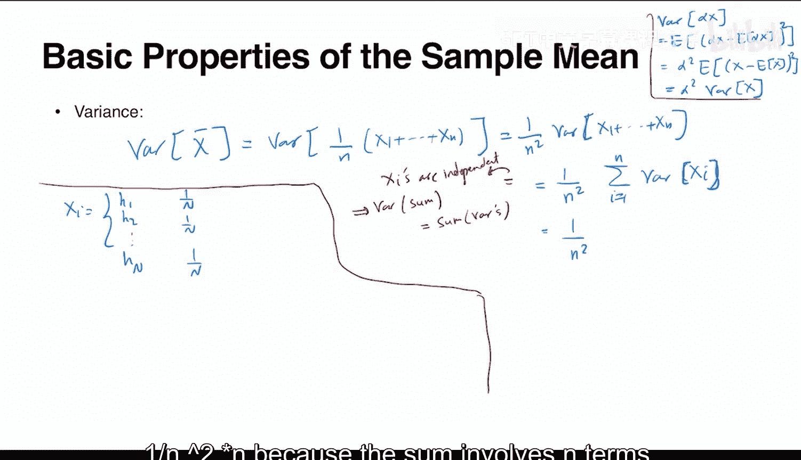
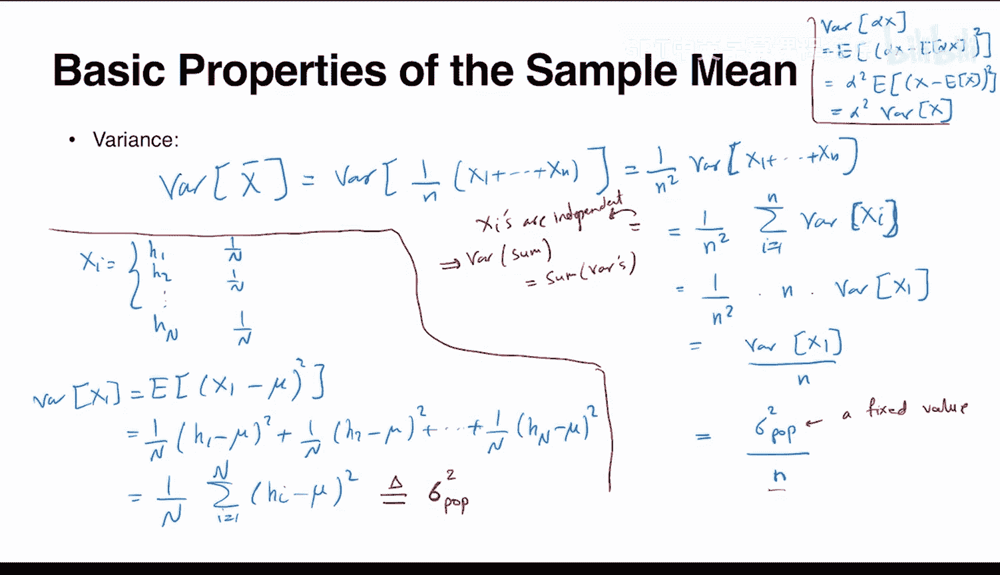
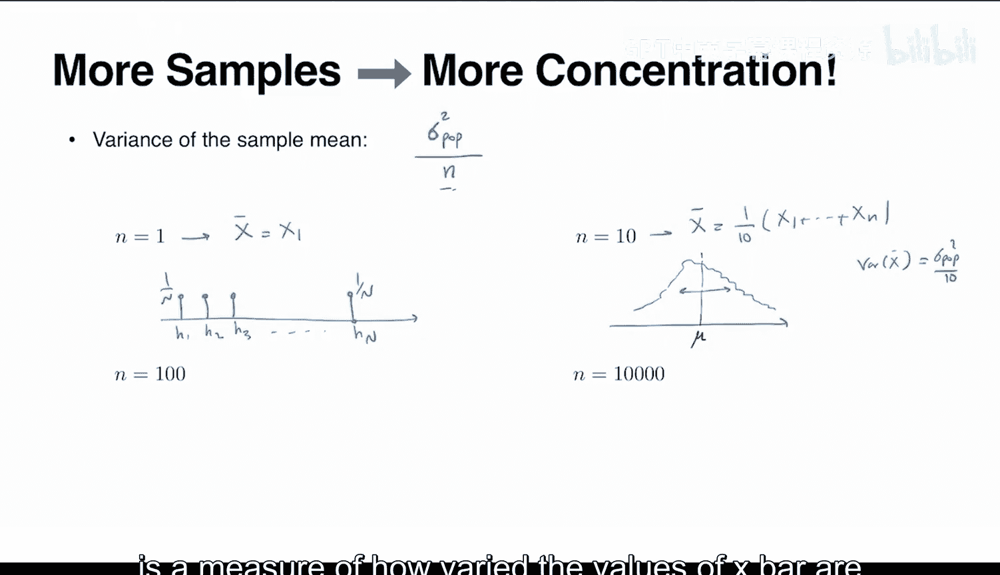
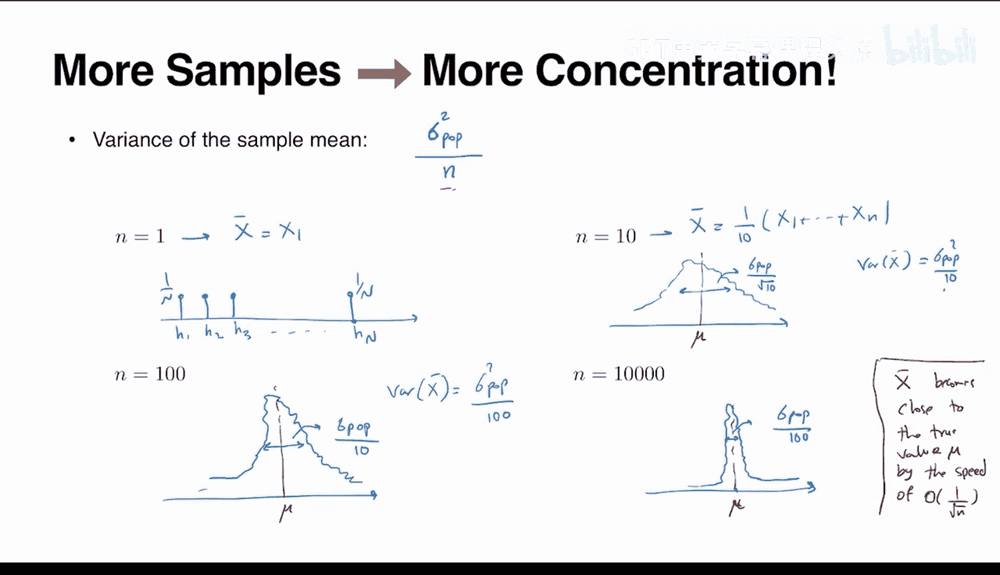

# 人工智能和机器学习基础：17_03_02：样本均值分析-方差 📊

在本节课中，我们将要学习如何计算样本均值的方差。我们将从方差的定义出发，逐步推导出样本均值方差的公式，并探讨其重要含义，特别是样本数量如何影响估计的精确度。

上一节我们介绍了样本均值的概念，本节中我们来看看样本均值的方差。

## 计算样本均值的方差

根据定义，样本均值 `X̄` 的计算公式为：

`X̄ = (X₁ + X₂ + ... + Xₙ) / n`

其中，`X₁` 到 `Xₙ` 是独立同分布的随机变量，`n` 是样本数量。

现在，我们来计算 `X̄` 的方差。方差衡量的是随机变量与其期望值之间的离散程度。

根据方差的性质，对于一个常数 `α` 和一个随机变量 `X`，有：

`Var(αX) = α² * Var(X)`

同时，对于一组独立的随机变量，它们之和的方差等于各自方差之和：

`Var(X₁ + X₂ + ... + Xₙ) = Var(X₁) + Var(X₂) + ... + Var(Xₙ)`

以下是计算样本均值方差 `Var(X̄)` 的步骤：

1.  将常数因子 `1/n` 提取出来。
2.  应用方差的性质 `Var(αX) = α² * Var(X)`。
3.  由于 `Xᵢ` 是独立的，应用方差的可加性。
4.  由于 `Xᵢ` 同分布，它们的方差都等于总体方差 `σ_pop²`。

具体推导如下：

`Var(X̄) = Var( (X₁ + X₂ + ... + Xₙ) / n )`

`= (1/n)² * Var(X₁ + X₂ + ... + Xₙ)`

`= (1/n²) * [Var(X₁) + Var(X₂) + ... + Var(Xₙ)]`

`= (1/n²) * (n * σ_pop²)`

`= σ_pop² / n`

因此，我们得到了核心结论：**样本均值的方差等于总体方差除以样本数量 `n`**。

## 总体方差 `σ_pop²` 的定义

总体方差 `σ_pop²` 是一个描述整个总体离散度的固定值。假设总体有 `N` 个个体，其取值（例如身高）为 `H₁, H₂, ..., H_N`，总体均值为 `μ`，则总体方差定义为：

`σ_pop² = (1/N) * Σ_{i=1}^{N} (Hᵢ - μ)²`

这个值完全由总体本身决定，不依赖于我们抽取的样本。

## 方差含义与样本数量的影响

样本均值方差 `σ_pop² / n` 的公式揭示了统计学中一个极其重要的规律。

`Var(X̄) = σ_pop² / n`

从这个公式可以看出，样本均值 `X̄` 的方差与样本数量 `n` 成反比。`σ_pop²` 是一个固定值，因此随着样本数量 `n` 的增加，`X̄` 的方差会越来越小。

方差越小，意味着样本均值 `X̄` 的分布越集中在其期望值 `μ`（即真实的总体均值）周围。我们可以通过概率密度函数（PDF）的形状变化来直观理解这一点。

以下是不同样本数量 `n` 下，样本均值 `X̄` 的概率密度函数（PDF）示意图：

*   **当 `n = 1` 时**：`X̄` 就是单个样本 `X₁` 的分布。其 PDF 形状与总体分布相同，较为分散。
*   **当 `n = 10` 时**：`X̄` 是10个独立样本的平均值。其 PDF 的均值仍为 `μ`，但宽度（离散程度）已经收窄，大约为 `σ_pop / √10`。
*   **当 `n = 100` 时**：PDF 进一步收窄，宽度约为 `σ_pop / √100 = σ_pop / 10`。与 `n=10` 相比，宽度缩小了约 `1/√10` 倍。
*   **当 `n = 10000` 时**：PDF 变得非常尖锐，高度集中在 `μ` 附近，宽度约为 `σ_pop / 100`。

核心结论是：**随着样本数量 `n` 的增大，样本均值 `X̄` 以 `1/√n` 的速度越来越集中地围绕在真实总体均值 `μ` 周围**。

这意味着，我们收集的数据越多，用样本均值来估计总体均值就越精确。这种收敛速度（`1/√n`）是许多统计推断和机器学习算法的理论基础。

本节课中我们一起学习了样本均值方差的计算与含义。我们推导出关键公式 `Var(X̄) = σ_pop² / n`，并认识到样本数量 `n` 的增加会显著降低估计的方差，使样本均值更可靠地逼近总体真实均值，其收敛速度与 `1/√n` 成正比。这是理解统计估计精度和设计实验样本量的基础。