# 宾夕法尼亚大学《人工智能和机器学习基础（AI、数据科学、机器学习）AI and Machine Learning Essentials with Python》 p53 18_03_03_另一个例子-哪位候选人将获胜.zh_en -BV16f421Q72q_p53-

In this section， we're going to talk about another example。

 another task which could be solved or estimated using the ideas that we have developed so far。

So the task that we're going to solve or estimate will be the following。

 So let's consider a presidential election that's。Coming up soon。

And let's call this one of the candidates。😊，Wwhichch wants to estimate the percentage of people in a certain state that would vote for that candidate okay so a state of Pennsylvania。

 the candidate would want to know how what fraction of people in the state of Pennsylvania are in favor of that candidate。

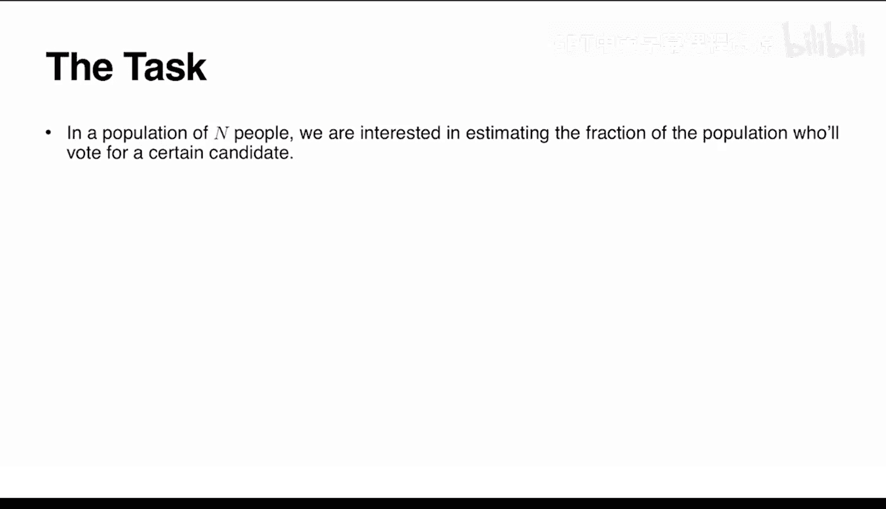

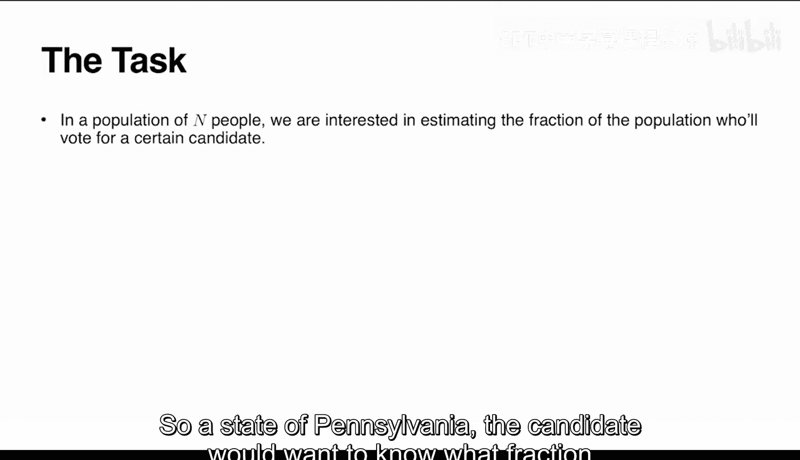

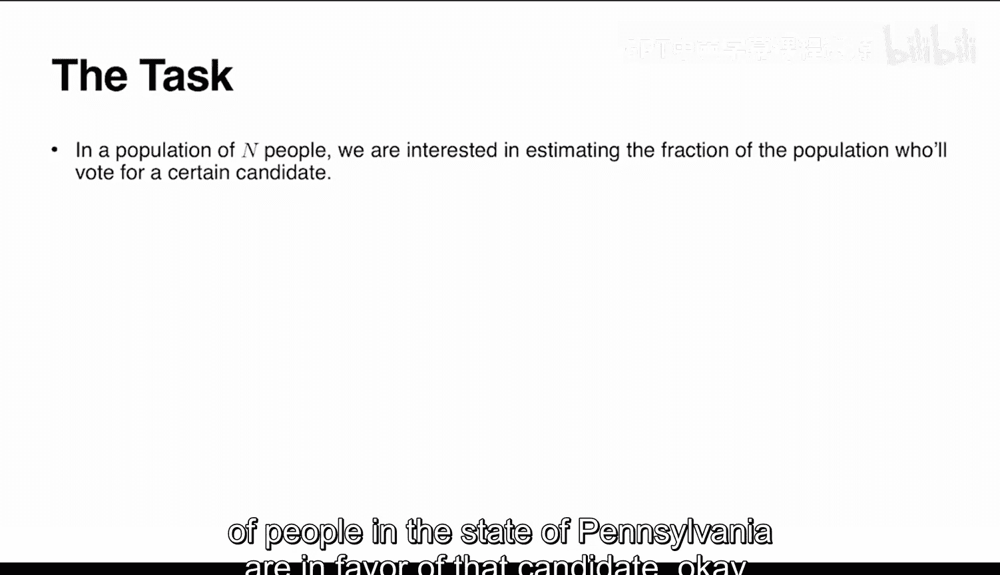

Okay， who will vote for that candidate？As the data scientist advisor to the president。

 you would say that， okay， so what I'm going to do and we want fast results here because the election is coming up soon。

 So as the advisor， you would say the following， I'm going to choose 1000。

People chosen uniformly at random from the state of Pennsylvania。

I'm going to ask each of them to which president tall candidate they would vote for。

 and I'm going to essentially by taking the average or the sample mean I would be able to estimate provide a good estimate for the percentage of people who are in the favor in favor of the or or candidates right。

 so that's essentially the goal here Okay， so let me put everything in the。

In the picture that we have been talking about。 So there is this real。World phenomenon。Okay。

 so here the real world phenomenon is this。😊，I have a population of N people and individuals。

Each individual。Has a number in mind， okay？Here for individual number I。The I individual。

 the number Y I is 1。If。应地逼。i。Person。Person I。뭐。我操。4。😔，Our candidates。Okay。

 and it's zero otherwise if it， if the individual would vote for the other candidate， Okay。

 and it's clear now， so the fraction。

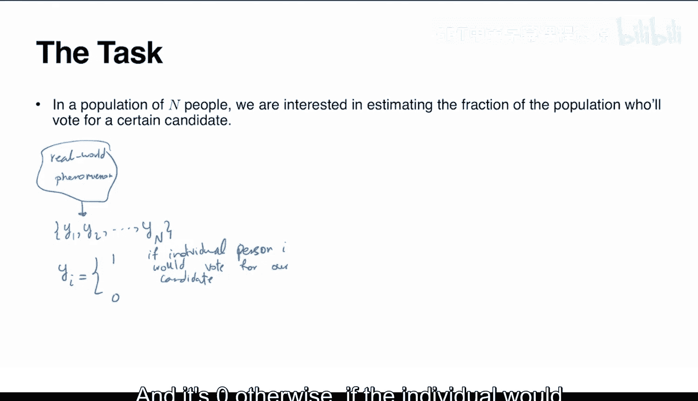

Of people across the state of Pennsylvania who would vote for our candidate would be just the average of boy eyes。

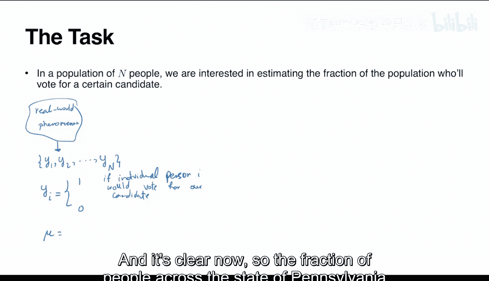

So y1， y2。All the way to white， similar to before n is a very large number。

 I cannot just go and knock on every door and ask for the vote。 I'm going to choose a smaller sample。

 so I'm going to connect data from this。Population。So again， the data acquisition module。

And I'm going to collect data x1 to x n。 So here small n is much smaller than capital n is in the order of thousands where capital n could be in the order of millions。

And then I'm going to analyze this data。😊，OkayIn this case， the data analysis module is very simple。

 I'm going to just consider the sample me。

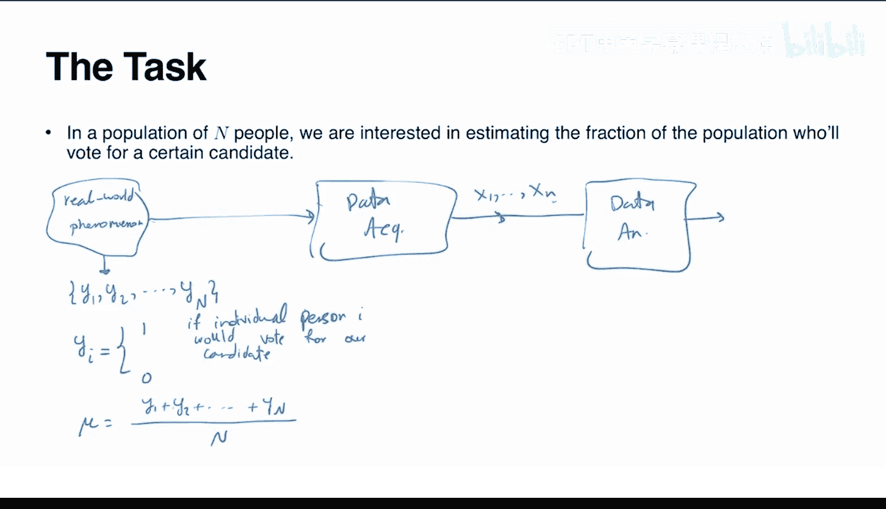

And the hope is that the sample Min bar could be a good estimate for this value meal here。

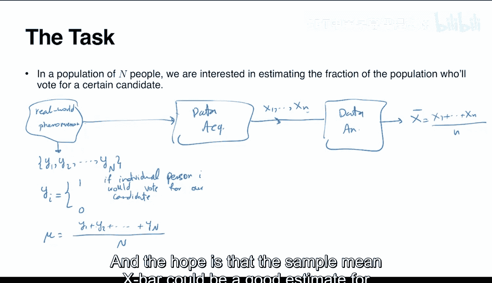

That's exactly the same setting as before， but here YIs are just simple binary values in the previous setting that we had but YIs were real values here。

 there were heights here they are just 01 values indicating whether or not we are voting for a setting gap。

Now， how does X become？😡，So， X I。Which is the。The I data point。

For a person that's chosen completely a random from the population。It's a probabilistic number。

 so it's a。It's a random variable， the outcome， the value the random variable Xi right because I'm just choosing a person from the population uniform at random and I'm essentially asking that person whether or not its value is 0 or1 so Xi is also a01 value。

So it its value is either0 or1， okay now。We're gonna to compute these probabilities， right。

 We're gonna essentially see how these probabilities are。 Now， the probability that X is 1。Is。

The probability of the following event， the event that we that we choose one person from our population uniformly at random among these N people。

 capital N people。 And that person turns out to。Give us value 1。

Meaning that that person is in favor of our candidates。Now。

 the probability that Xi turns out to be one is the probability that we choose among these capital Ns。

😡，One of the Ys that has that that's one right， so this probability would be exactly equal。

Would be exactly equal to mu because the fraction of people。Who who are in favor of our candidates。

 which is the fraction of ones among this set of YI's is exactly mu？And of course， with poverty。

1 minus muu。The outcome of my I data point will be zero。Okay。

And what's also important to note is that Xs are。Because Im choosing every person completely at random。

 right independently from each other person that I have already chosen。

And X is essentially have the same probabilistic law。

 right so they are the value of X is either one with poverty mu if I'm choosing a person in our favor。

 the favor of our candidate， and it's0， if otherwise。So， that's our setting。

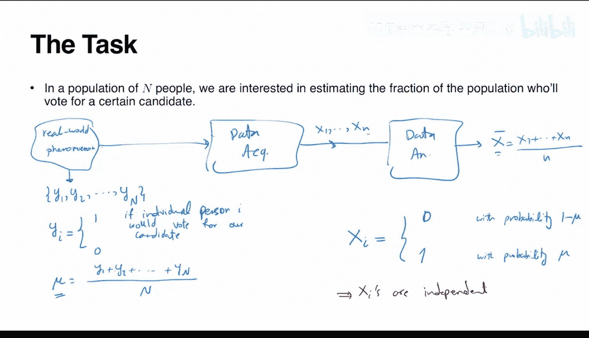

The estimator that we have based on this kind of random sampling was Xpar。

 which was the sum of X's i from 1 to n。Over n。 And remember。And is much smaller than capital。Okay。

 now in the next step， in order to analyze X bar， we need to compute its mean and its variance。

 but this we have already done is exactly similar to the previous task。

 So I'm going to just compute the expectation and variance of X here。

 So expectation of X exactly similar to the previous computation for the previous task is just expectation。

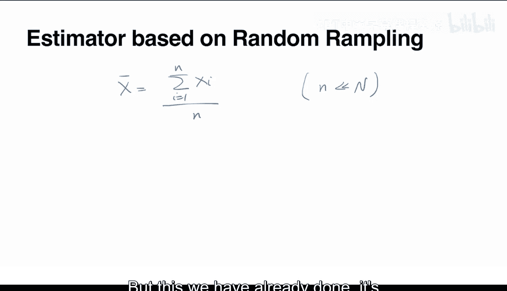

Of x1。Okay， which is exactly mu because x1。 Okay， let me just write this here， X I's。

Had this benoli law， so it's either 0 or 1 is one with probability mu。Is0 with poverty。Or minus mu。

 So this is also called。A。Okay， so this random variable here。But this law is called the。本努里。

Random variable with。Parameter。没有。Okay， it's the binary binary the random Bible。

So an e of x1 is just what is0 times 1 minus mu。Plus one times mu， which is equal to mu。 Okay， again。

 in expectation or estimator x is giving us the the value that we are hoping to find mu。

 right So in expectation is the exact the variance we have also computed again。

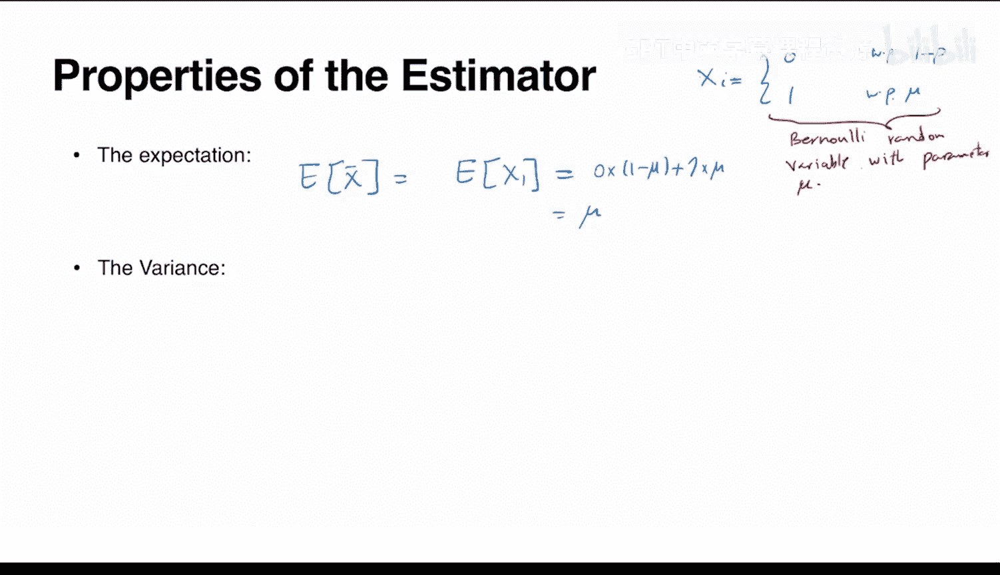

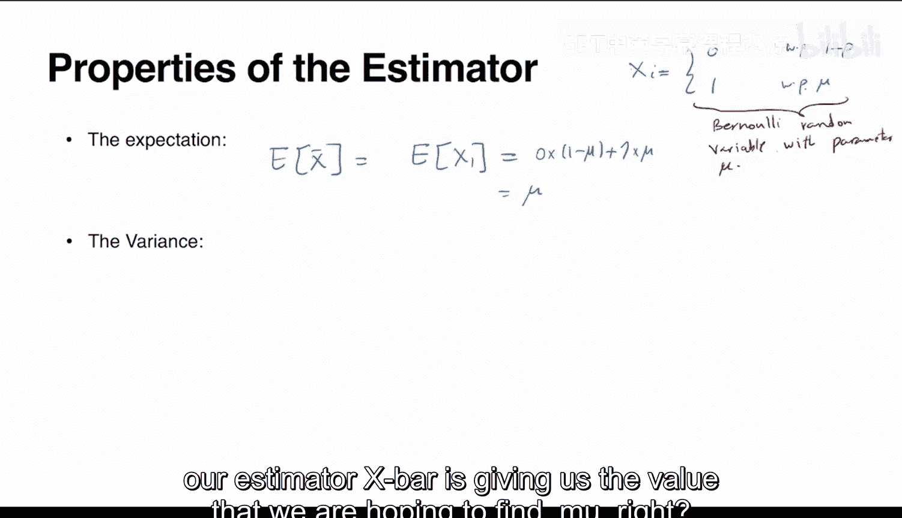

Similar to before， so variance of x4， again， exactly similar calculation as before would essentially give us the variance of x4 to be equal to the variance of x1 over n。

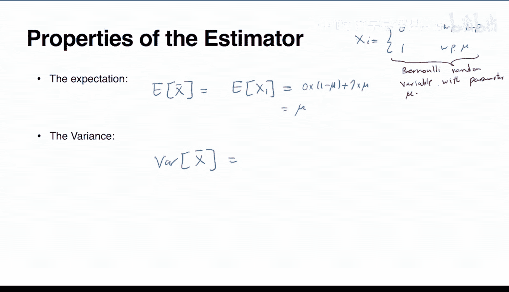

And variance X1 can be computed easily。 Let me just do it directly here。 So is the expectation。

Of x1 minus its average， which is new to the power 2。This is the law of X on the top of the page。

 So this is。With 41 minus mule。The value of x1 is 0， so that's 0 minus mu to power 2。

 and with mu the value is 1。We power 2 over n。And that will be equal to。Mu squared times0 is mu。

Plus mu times1 minus in squared。Over n， which is by just a simple factorization。

 we see that this is just mu times 1 minus mu。So that's what we get again。

 some fixed value mutized1 minus mu， some value that depends only on the population is a fixed constant divided by n。

 the number of samples。 So again， as you see as the number of samples grow。

 the variance becomes smaller and smaller and is inversely proportional to n。

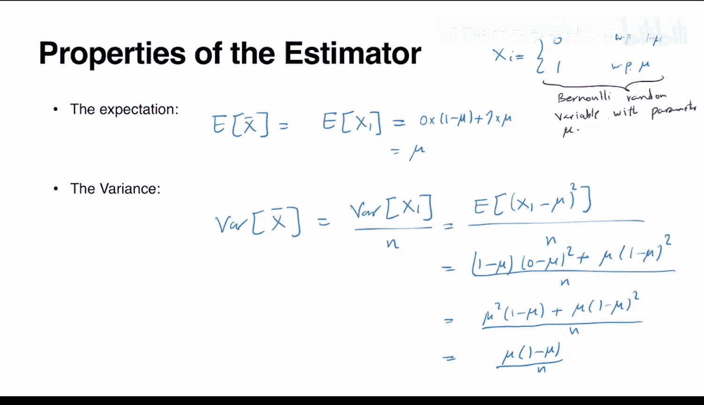

So the same type of consequences that we had about our previous task about the average of highs hold exactly in this case as well。

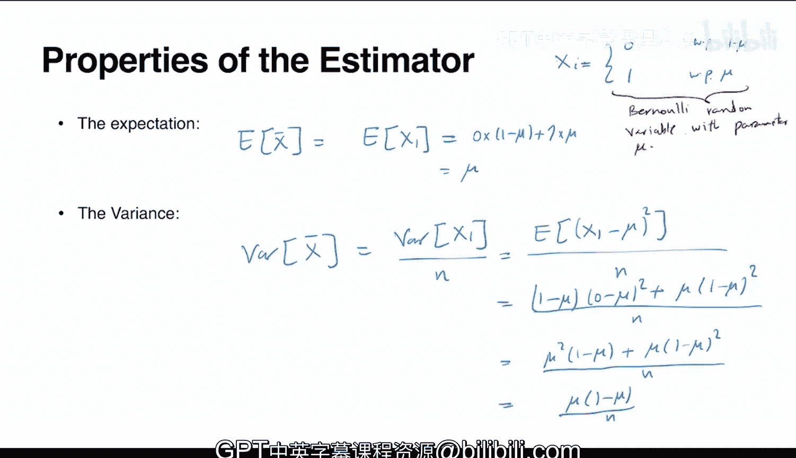