# 人工智能和机器学习基础：18：另一个例子 - 哪位候选人将获胜 🗳️

在本节中，我们将讨论另一个例子。我们将探讨一个可以使用我们目前所学的思想来解决或估计的任务。

## 概述

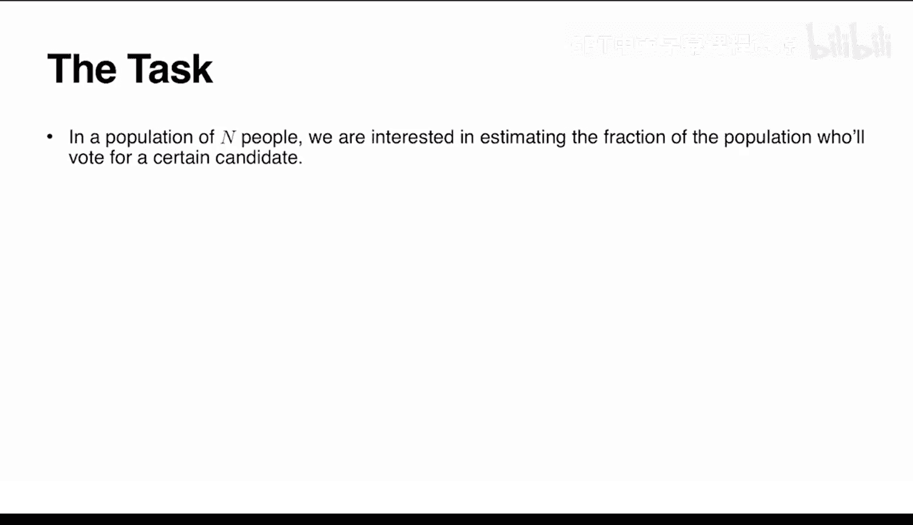

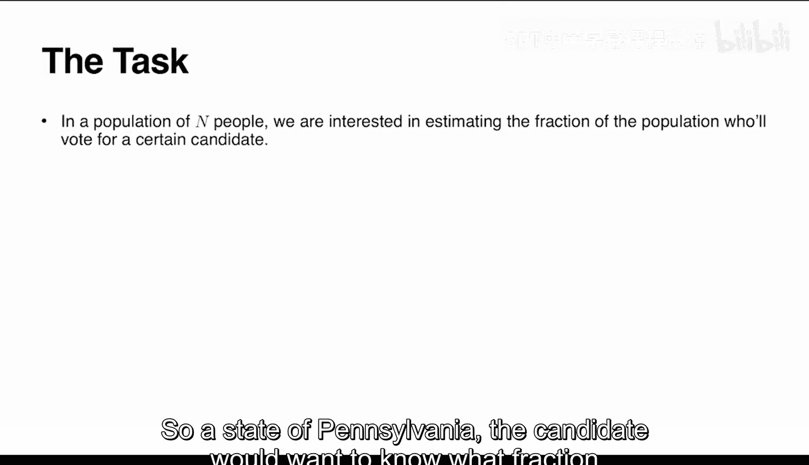

我们将要解决或估计的任务如下：考虑一场即将到来的总统选举。其中一位候选人希望估计某个州（例如宾夕法尼亚州）中会投票支持他/她的选民比例。作为总统的数据科学顾问，我们需要快速提供结果。我们将从宾夕法尼亚州中均匀随机地选择1000人，询问他们打算投票给哪位候选人，并通过计算样本均值来估计支持我们候选人的选民比例。

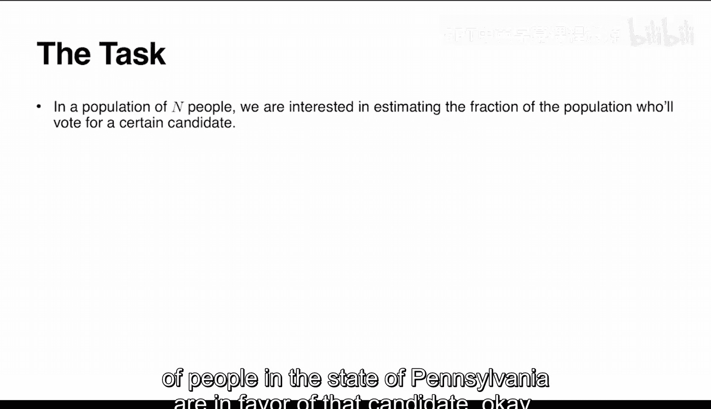

## 问题建模

现在，让我们将一切放入我们一直在讨论的框架中。这里存在一个真实世界的现象。

*   我们有一个包含 **N** 个人的总体。
*   每个个体心中都有一个数字。对于第 **i** 个个体，数字 **Y_i** 是 **1**（如果该人投票给我们的候选人），否则是 **0**（如果投票给另一位候选人）。

因此，整个宾夕法尼亚州支持我们候选人的选民比例 **μ** 就是所有 **Y_i** 的平均值：

**公式：μ = (Y₁ + Y₂ + ... + Y_N) / N**

这里的 **N** 非常大（例如数百万），我们无法挨家挨户询问。因此，我们需要从总体中抽取一个更小的样本。

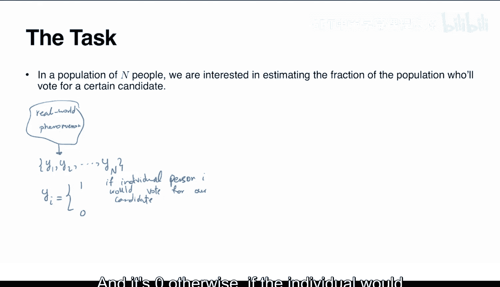

## 数据采集与分析

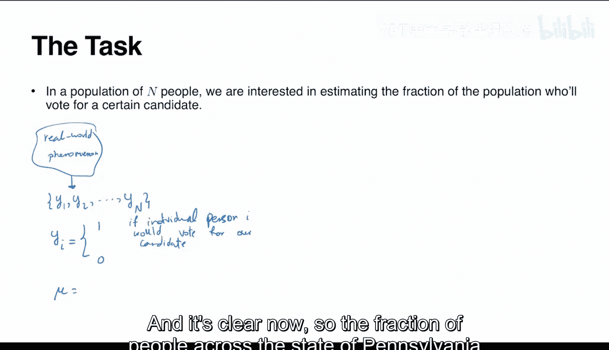

我们将通过数据采集模块收集数据 **X₁** 到 **X_n**。这里的小写 **n**（例如1000）远小于大写 **N**。

*   每个数据点 **X_i** 是一个随机变量，因为我们是从总体中完全随机地选择一个人。
*   我们询问这个人，其值 **X_i** 是 **0** 还是 **1**。

然后，我们将分析这些数据。在这种情况下，数据分析模块非常简单：我们将计算样本均值 **X̄**。

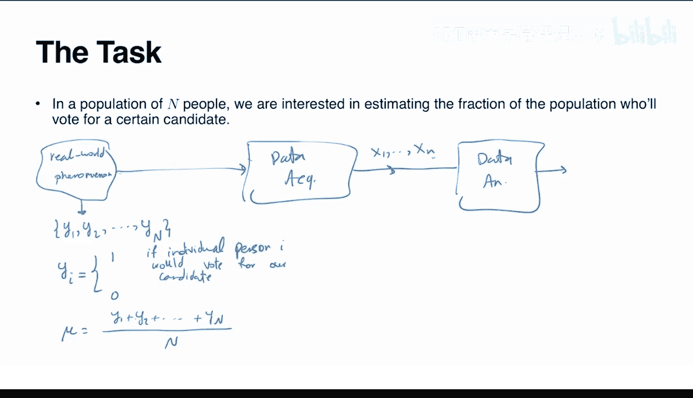

**公式：X̄ = (X₁ + X₂ + ... + X_n) / n**

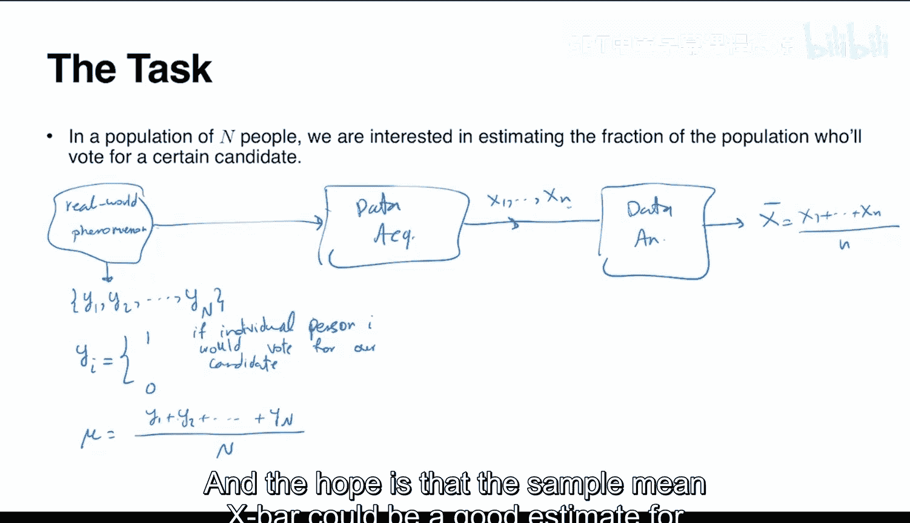

我们希望样本均值 **X̄** 能成为总体比例 **μ** 的一个良好估计。这与之前的例子（估计平均身高）设置完全相同，只是这里的 **Y_i** 是简单的二元值（0或1），而不是实数值。

## 随机变量的概率分布

现在，我们来计算 **X_i** 的概率。由于我们是从总体中均匀随机地选择一个人：

*   **X_i = 1** 的概率等于我们选到一个支持我们候选人的个体的概率。这个概率恰好等于总体中支持者的比例 **μ**。
*   **X_i = 0** 的概率则是 **1 - μ**。

此外，因为每次选择都是完全随机的，并且独立于之前的选择，所以 **X_i** 具有相同的概率分布。这种分布被称为**伯努利分布**，其参数为 **μ**。

**代码/公式描述：X_i ~ Bernoulli(μ)**

这意味着 **X_i** 以概率 **μ** 取值为1，以概率 **1-μ** 取值为0。

## 估计量的期望与方差

我们基于这种随机抽样的估计量是 **X̄**。为了分析 **X̄**，我们需要计算它的期望和方差。这与之前的计算完全类似。

首先，计算 **X_i** 的期望值 **E[X_i]**：

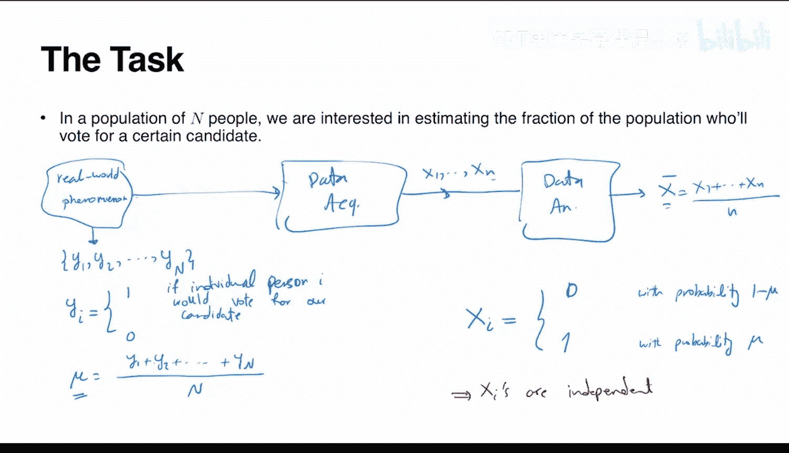

**公式：E[X_i] = 0 * (1 - μ) + 1 * μ = μ**

因此，我们的估计量 **X̄** 的期望值也是 **μ**。这意味着，平均而言，我们的估计量给出的正是我们希望找到的真实值 **μ**。

接下来，计算 **X̄** 的方差 **Var(X̄)**。与之前类似，**X̄** 的方差等于 **X_i** 的方差除以样本量 **n**：

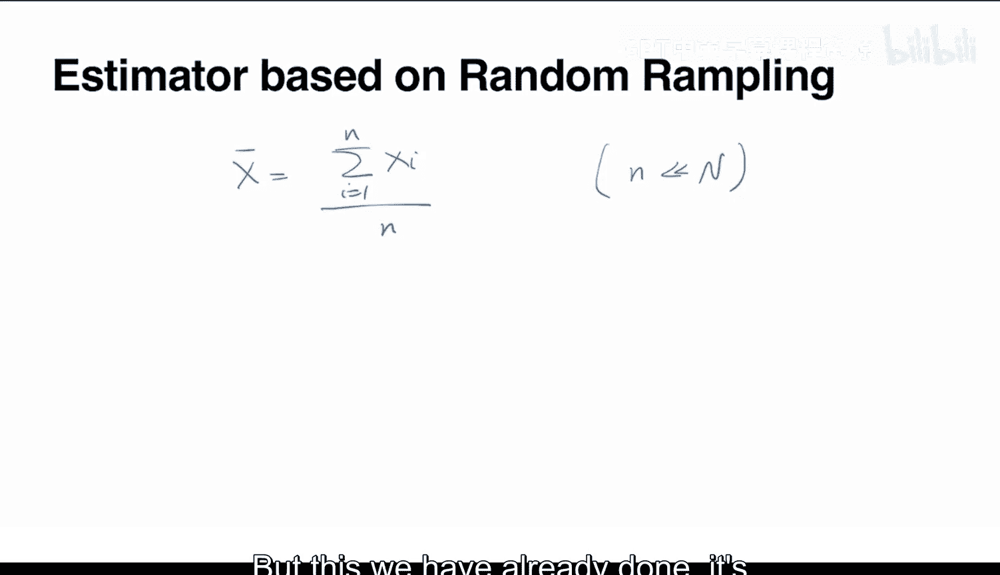

**公式：Var(X̄) = Var(X_i) / n**

现在计算 **Var(X_i)**：

**公式：Var(X_i) = E[(X_i - μ)²] = (0 - μ)² * (1 - μ) + (1 - μ)² * μ = μ(1 - μ)**

将结果代入，得到：

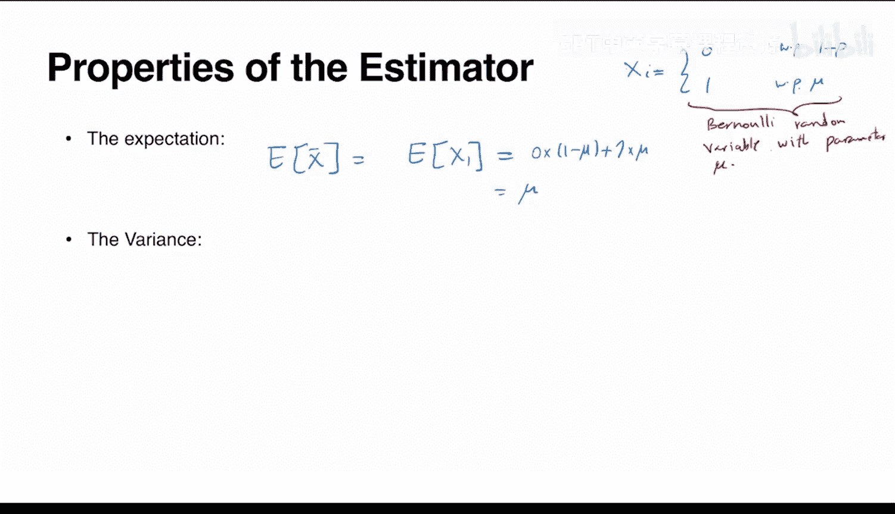

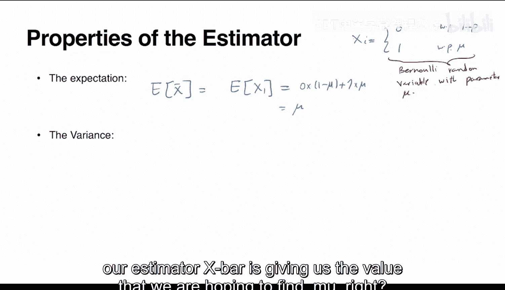

**公式：Var(X̄) = μ(1 - μ) / n**

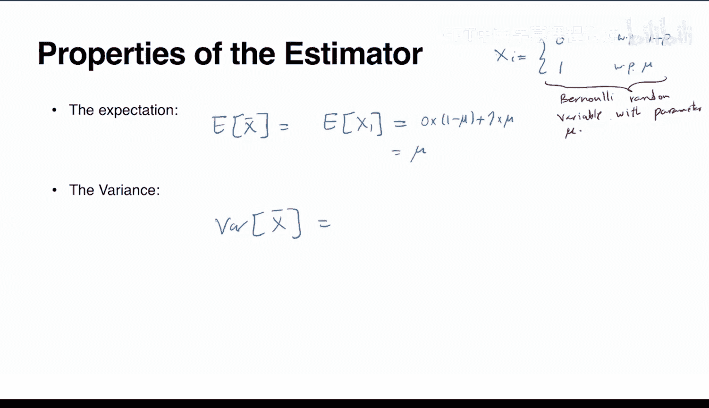

## 结论与意义

我们得到了与之前任务完全相同的结论：

1.  **无偏性**：估计量 **X̄** 的期望值等于真实参数 **μ**，说明这是一个无偏估计。
2.  **方差递减**：估计量 **X̄** 的方差为 **μ(1-μ)/n**。这是一个仅取决于总体（固定常数）的数值除以样本量 **n**。
3.  **样本量的影响**：随着样本量 **n** 的增加，方差变得越来越小，并且与 **n** 成反比。这意味着收集更多数据可以使我们的估计更加精确和可靠。

因此，关于之前平均身高任务的所有推论和结论，在这个选举预测的例子中同样完全适用。通过随机抽样和计算样本均值，我们可以有效地估计总体中的比例，并且其准确性随着样本量的增加而提高。

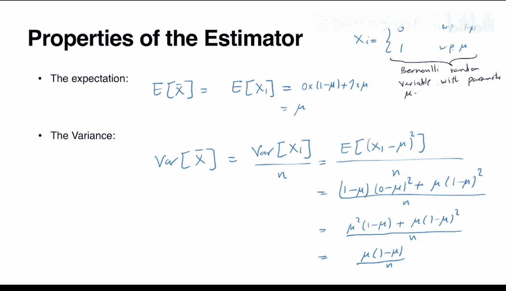

---

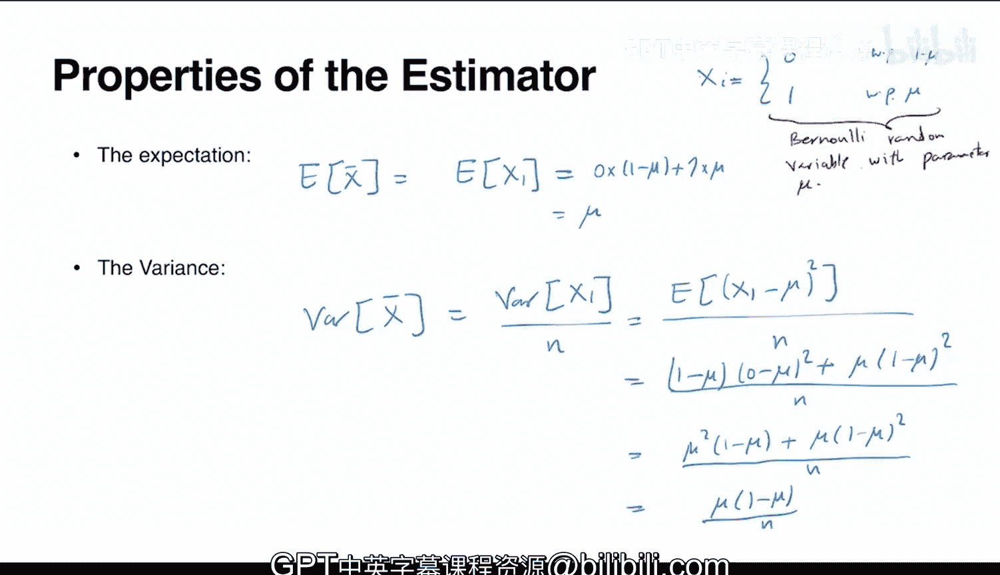

**本节课总结**：在本节课中，我们一起学习了如何将数据科学框架应用于一个实际问题——预测选举中候选人的支持率。我们建立了总体模型，定义了二元随机变量，说明了如何通过随机抽样收集数据，并计算了样本均值估计量的期望和方差。我们得出结论，样本均值是总体比例的无偏估计，并且其精度随样本量增加而提高。这再次验证了统计推断中核心概念的有效性。