# 宾夕法尼亚大学《人工智能和机器学习基础（AI、数据科学、机器学习）AI and Machine Learning Essentials with Python》 p55 20_03_02_进阶概率论III.zh_en -BV16f421Q72q_p55-

The Gausian distribution and some of its properties and the notations associated with these distributions。

 and we're going to use these kind of notations later on in the central limit theorem and in the confidence interval calculations。

Let me also mention that these the concepts that we're going to define in this section will be used again and again throughout the course。

Okay， so let's recall what was the Gaussian distribution so it was defined through the following PDF this PDF here and it is also customary to show the Gaussian distribution using this notation here so n standing for the normal variable of mu and sigma squared so mu and sigma squares are the two parameters of the Gaussian distribution and we know by now that the expectation。

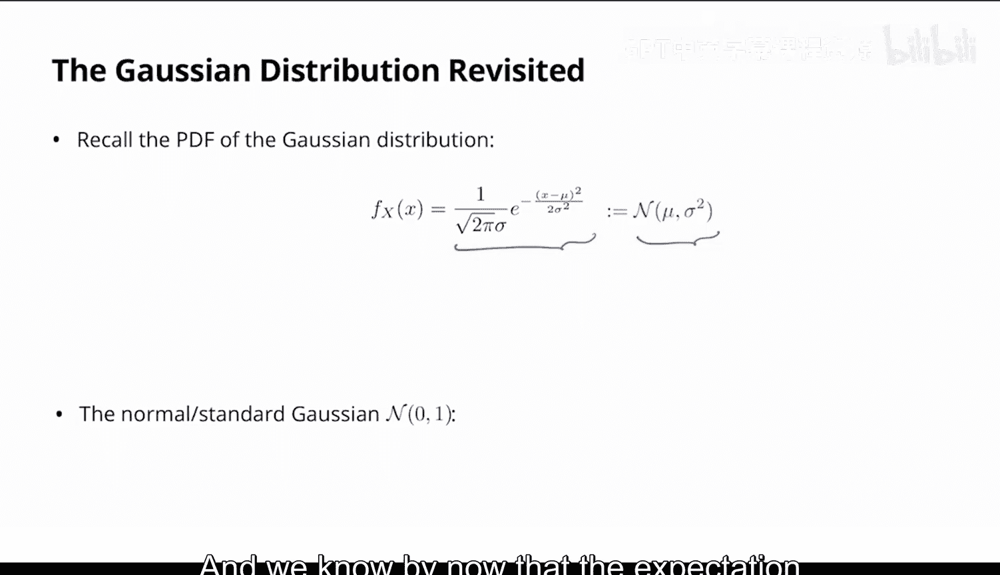

Of the Gaussian distribution， if x comes， according to this Pdf that you see here。

 the expectation is exactly new and the variance。

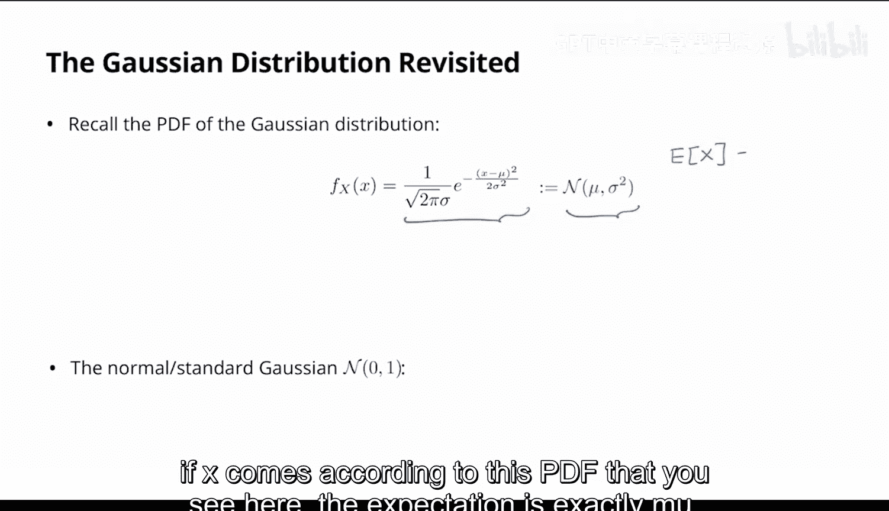

Of x would be exactly sigma squared。 Okay， so the Pdf of the Gaussian distribution。

 if I w to draw it here would be this very nice bell shaped equations。

 It's symmetric around the value mu and the variance is sigma squared。

 This means that roughly speaking， the width。Of this spell shaped the equation essentially varies with sigma is Turkey proportional to the value of sigma so this is the Gaussian distribution and it's also customary to consider the Gaussian distribution that has mean0 and variance1 typically we call this the standard Gaussian or sometimes the normal Gaussian distribution So here mu essentially 0 the mean 0 and the variance is1。

 So the pdf would look something like this。 so this is 0。

 this is like a rough picture so the variance， the width here is more or less1 so when I say the width is more or less 1 this means that essentially I'm looking at the scaling of the width in terms of the parameter sigma So here the variance is 1。

 so this is like something of order  one and the Pdf of the normal distribution is1 over square root2 pi So this is this function here e to the power minus let me use z here。

Minus c squared。Overto， okay， so that's essentially S of the。And here and throughout the course。

 we will use Z to denote the random variable。That's。

Distributed according to the standard Gauss and since it's z the values that it takes the specific realizations are denoted by R。

Thecase C。 So this the realization of this random variable or the not。

 And that's why I defined it this in with respect to the variable Z as you see。 Okay。

 so we talked about the Gaussian distribution and the standard Gausian。

 Now it turns out that every Gaussian could be written as a shifted and rescaled version of the normal random variable。

 the normal or the standard Gaussian。 So so this is the formula Okay so this means that if you have a general Gaussian distribution with mean mu and standard variation or sigma or variable sigma squared you can write this as mu。

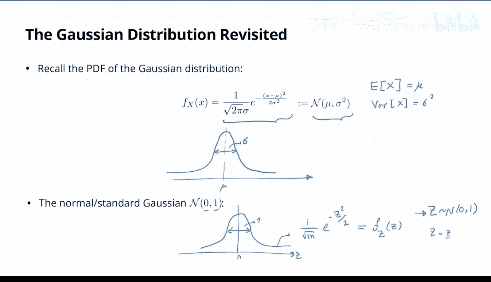

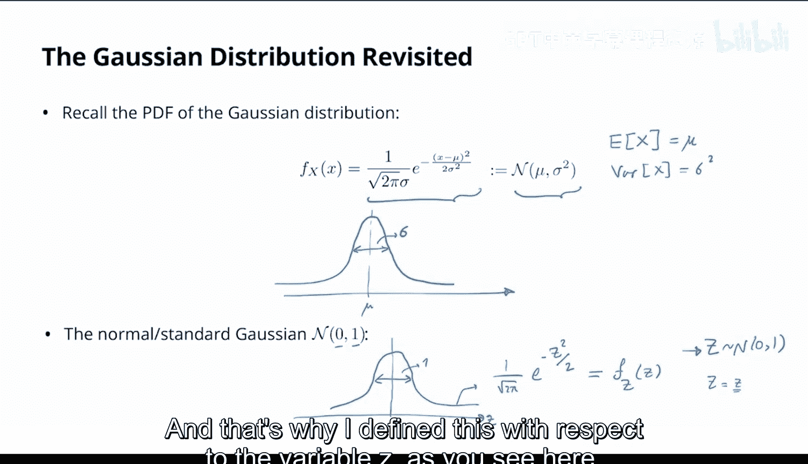

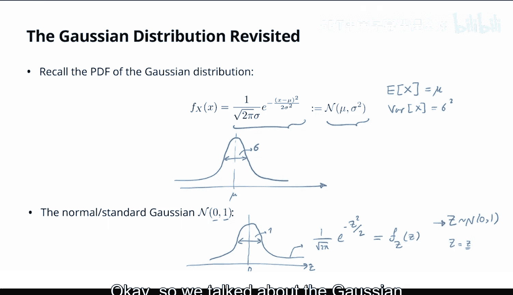

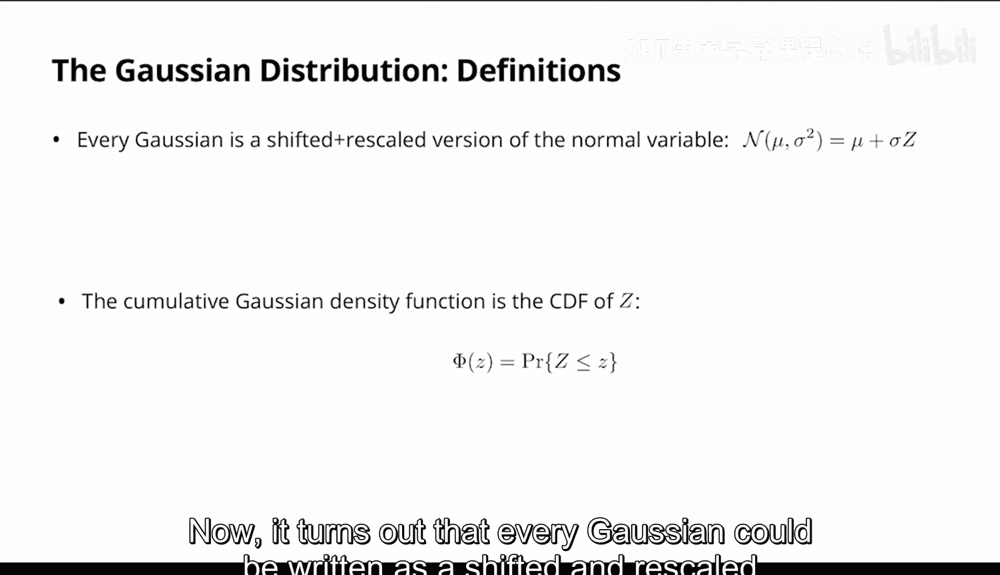

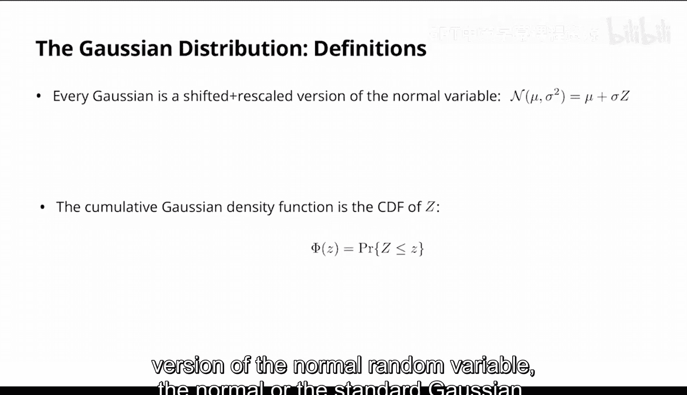

Plus， sigma times the standard Gaussian。 So this means that up to a shift by mu and the rear scaling。

By the value of sigma， you would essentially reach well to the normal random bar。Here is0。

 and this is just normal randomfi。Okay， so remember this relation here because we're going to use this later on in this section and in the next section and we talk about the center limit here。

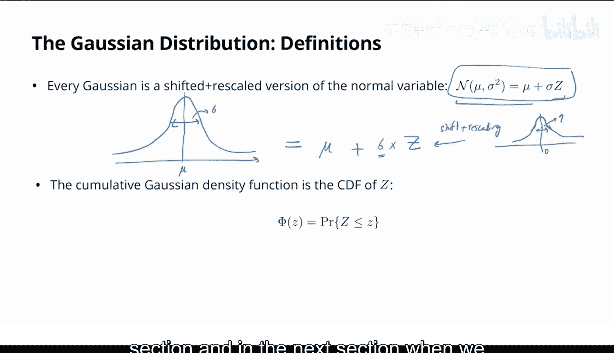

Another notion for the Gaussian random variable that we should keep in mind is the cf of the standard Gaussian。

 remember z here and throughout the course would denote the standard Gaussian random variable n of0 and 1 and phi of z will always denote the cf of this random variable okay so it's essentially equal。

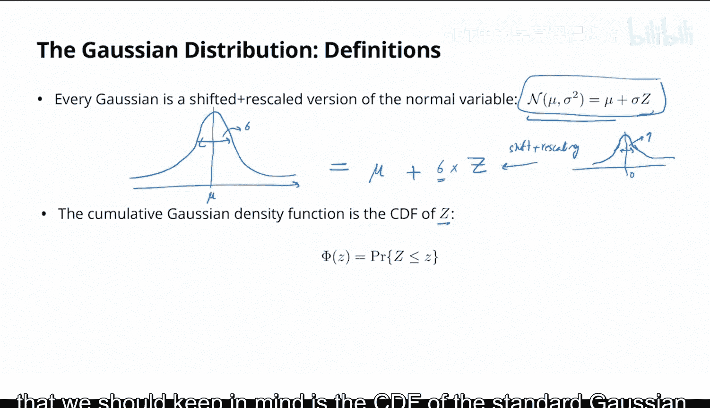

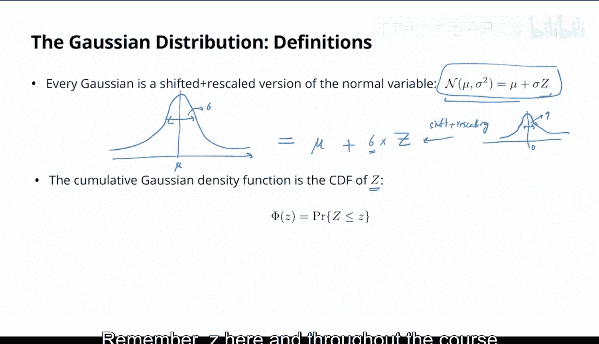

To the integral from minus infinity to z1 over square root2 pi e to the power minus z squared over 2。

 Thats the CDf of the Gaussian random bar。Okay so if I want to also show this by the area under the PDFf。

 you would get to something like this。This is the。PDf of the standard Gaussian random variable。

 So this is0， this is。1 over square root2 pi。E to the power minus c squared over 2。Then the value of。

Phi at a point， let's call it Z would be this area here。 Is this area here。Would be try a big。Okay。

So so far so good， that's how the CDF or of the normal distribution or the Gaussian density function is defined。

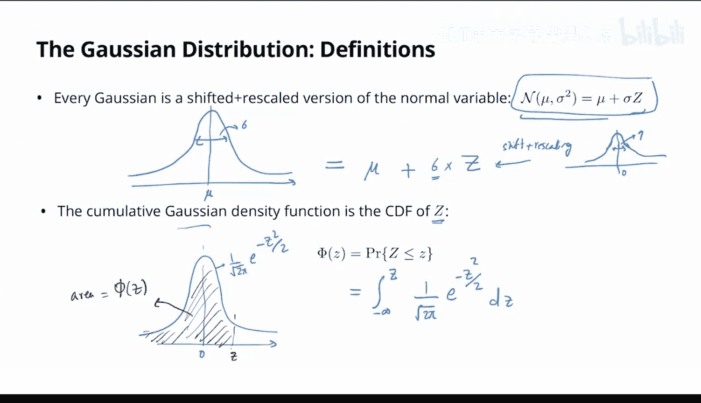

Another very important notion that we should define is the so-called z alpha value or the z values corresponding to the normal random variable。

 So by definition which is given here， z value denotes the point under the line such that the area under the Pdf of the normal random variable after this point is exactly alpha。

 Okay， so what it means is the following。 So we look at the Pdf of the standard Gaussian or the normal random variable。

 So this is one over squared root2 pi e to the power minus0 squared over2。

 So that's the function here with to z。

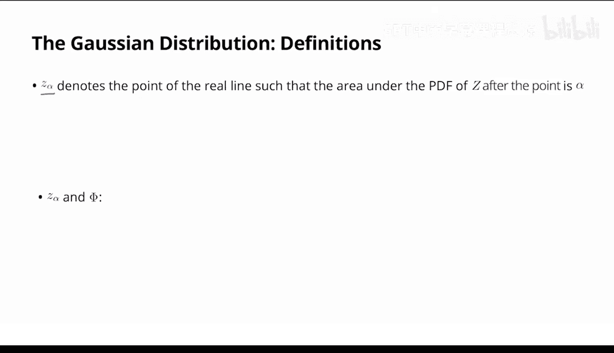

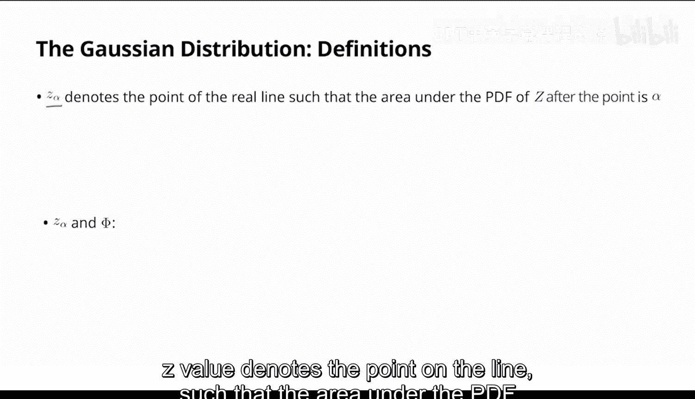

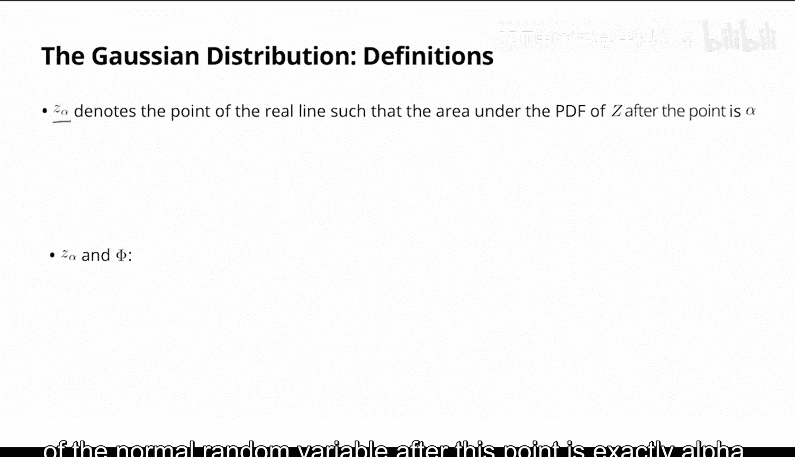

We look at the first point from the right such that this area here is exactly alpha。

So this point here would be the alpha。 Okay， so Z alpha is the point on the real axis such that the area to the right of it under the Pdf of these standard culture nanobi is exactly。

 Now， if you want to connect the alpha。

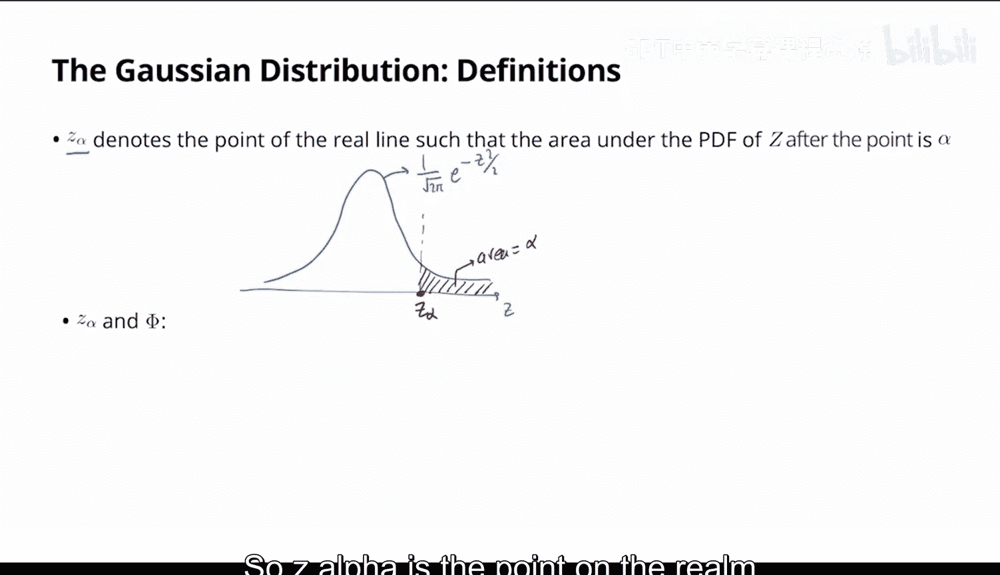

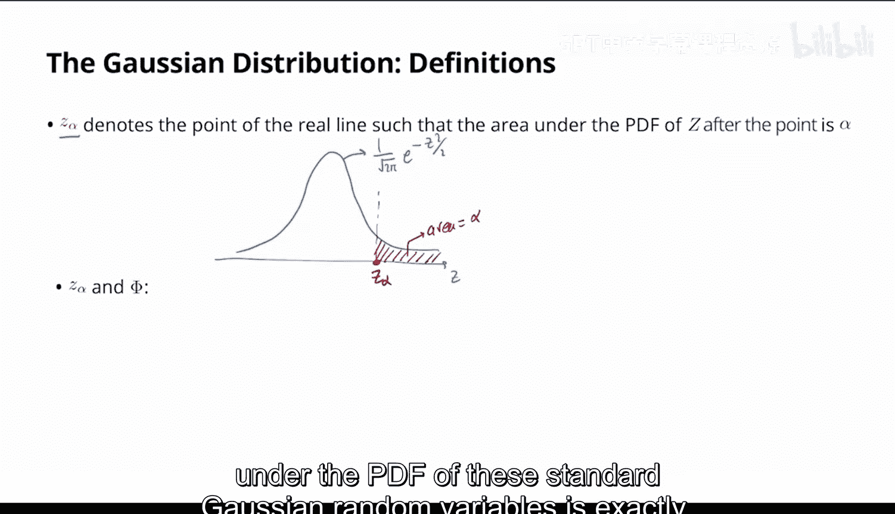

To Al。Using the function Z， there is a very simple connection。

 so if this let me just write this here， so if this area to the right is exactly alpha。

 the area to the left since the area under the PDFf is exactly one the area to the left would be。

One minus， right？So this means that phi。Of the alpha。

Remember5 was the area to the left is exactly 1 or， so the alpha is equal to 5hi minus1。

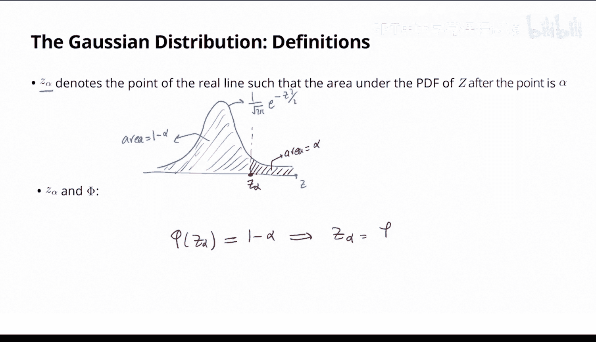

so this is another relation that connects the alpha to alpha using the function file。

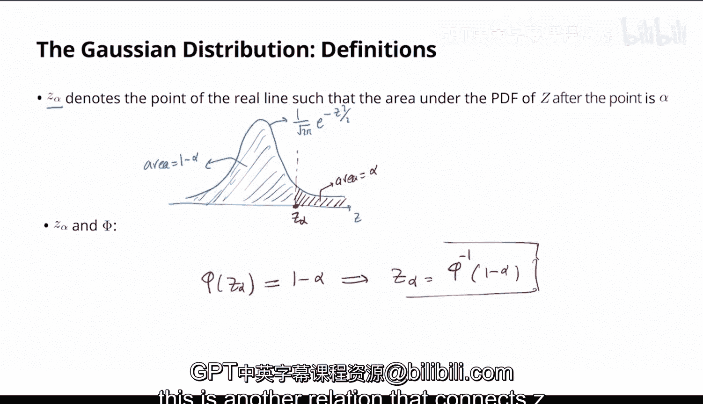

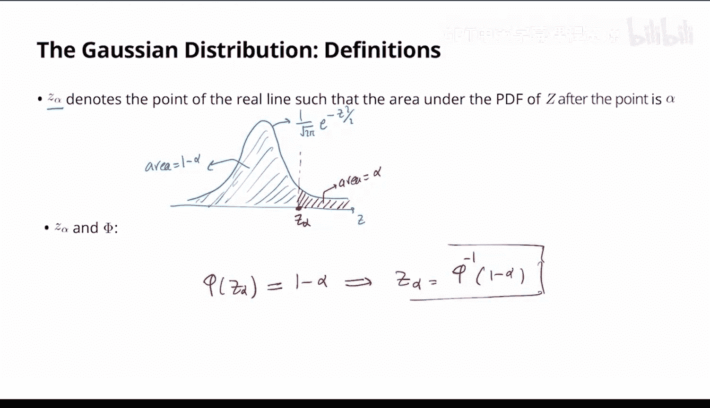