# 宾夕法尼亚大学《人工智能和机器学习基础（AI、数据科学、机器学习）AI and Machine Learning Essentials with Python》 p56 21_03_01_中心极限定理I.zh_en -BV16f421Q72q_p56-

So in this section we're going to talk about the central limit theorem。

 which we will show typically by CLT and let me first say that we're going to use this central limit theorem frequently。

It's a very important theorem in general in all areas and branches of science， including statistics。

 physics， mathematics and so on and so forth and engineering。

 So what we're going to do in this section is to first give you an intuitive or informal picture of the central limit theorem and then we're going to explain the exact statement of the central limit theorem what's important for you to understand is this informal picture。

 the formal statement is also important but we're not going to use it directly throughout this course we're going to mostly use this informal picture and the approximation that central limit theorem will give us to use in our settings later on So what central limit theorem So we're start with the informal picture so we're going to essentially consider Iid or nonvariables x1 x2 to xN So IID means that the distributions are exactly equal to each other and they are independent and central limit theorem in a nutshell says that if you look at the average。

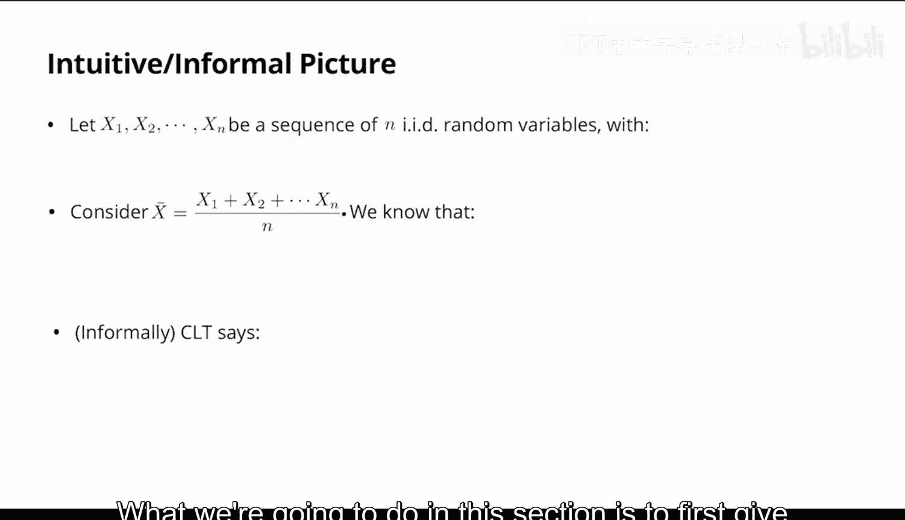

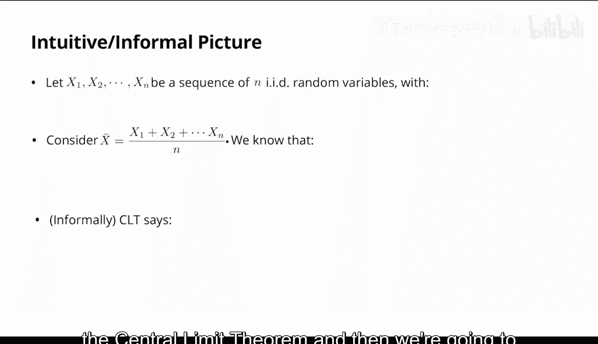

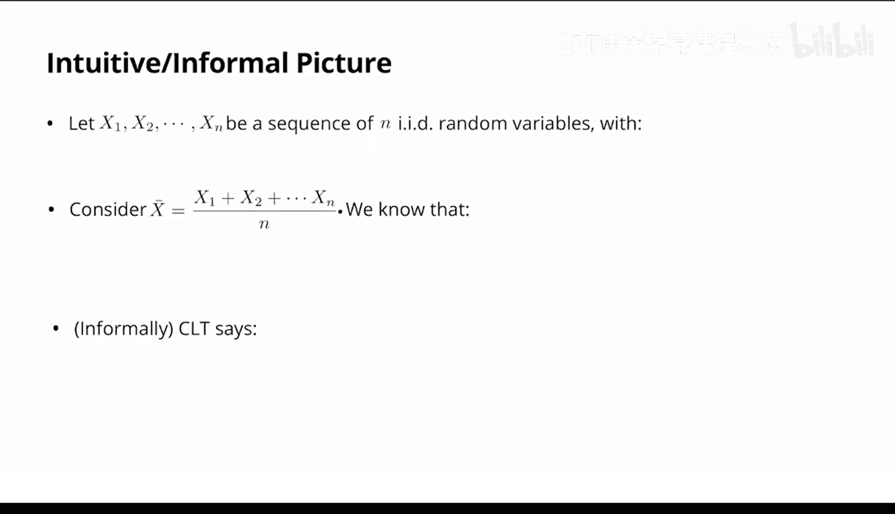

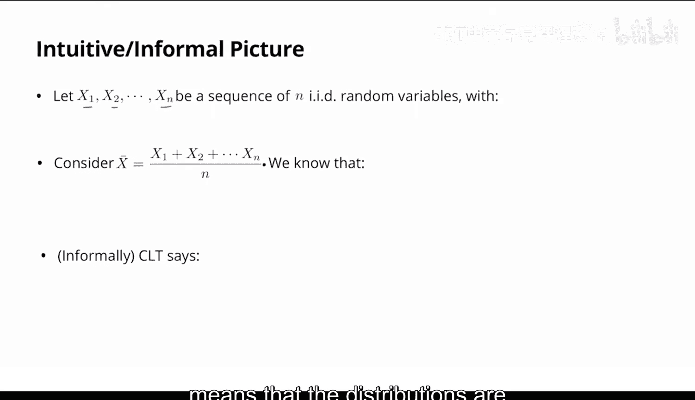

These random variables， this average has more or less a Gaussian behavior okay so let's maybe dig into the details and see what it means so we we have ND random variables the only thing that matters for us in order to explain the central limitorem is the mean of these random variables remember they are identical to each other so the mean of all of them is exactly mu and the variance of all of them。

😊，We use， use sigma squared to denote their variance。 Okay。

 I don't care about the distributions of this random variables。

 The only thing that I'm assuming and denoting here is the mean by mu and the variance by sigma squared。

 Now， let's consider the average of this random variables。 The sum of X divided by n。

 We have already already computed the mean and the variance of X， which is the average。

 So if you remember expectation of x because of the linearity of expectation is exactly equal to the expectation of the individual random variables and the variance of X。

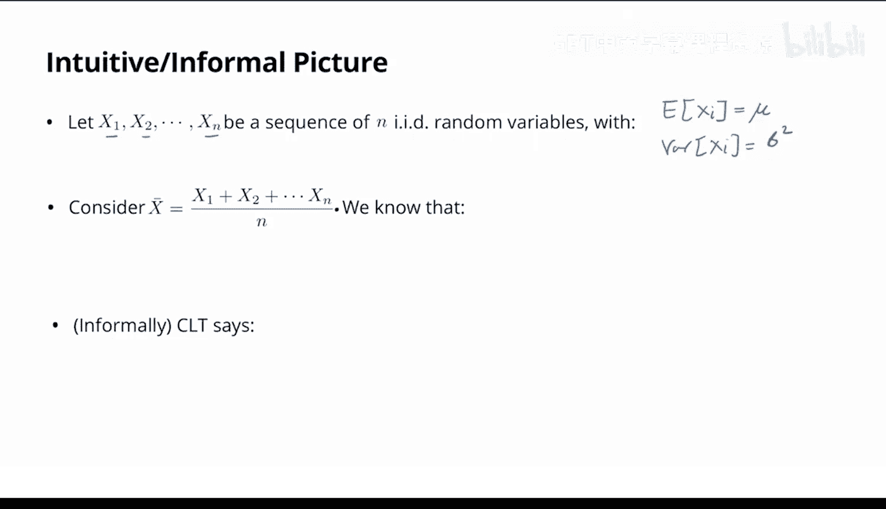

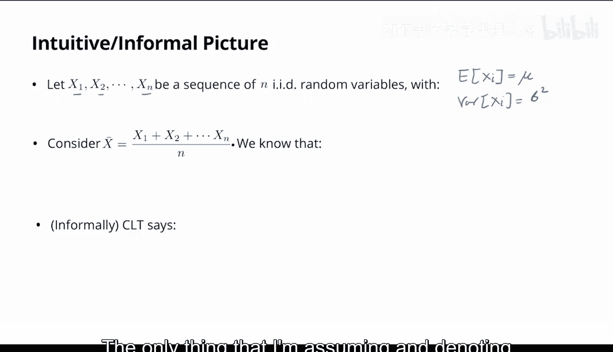

Would be reduced considerably compared to the individual variance。 So this， if you remember。

 this is sigma squared over n。 Okay， so there is this factor n reduction in the variance。 Okay。

 so central limit theorem informally would tell us the following。 So if you look at export。

 you can write export as a Gaussian。Plus， some small or lets call it negligible。

Typically in our applications and later on in the course， when we use the central limit theorem。

 we would essentially neglect the second part， the error part， because typically in our applications。

 n is large and when n is large， this error is very， very as small and actually asymptically。

 the error goes to0 as n grows large。 Okay， so we typically。

Remove the error part from our calculations and work with the Gaussian。

Let me also drive now what that Gaussian is that should be easy to drive given what we have learned so far Okay。

 so what we are saying is that exploits the Gaussian plus some error。

Let's for now assume that this error didn't even exist， okay， so X， let's assume was a Gausian。

What would be the mean the variance of those Gausian， Of course。

 the mean the variance of the Gaussian would be equal to the mean variance of x。

 right if the error you can think about it in this way， if the error is very， very， very small。

 which doesn't have any effect in the mean variance。

 the mean variance should be more or less similar to the mean variance of x right so and also remember that a Gaussian distribution is identified by its mean variance。

 So once I tell you the mean variance of the Gaussian distribution。

 you know exactly what that distribution is So it's a Gaussian。

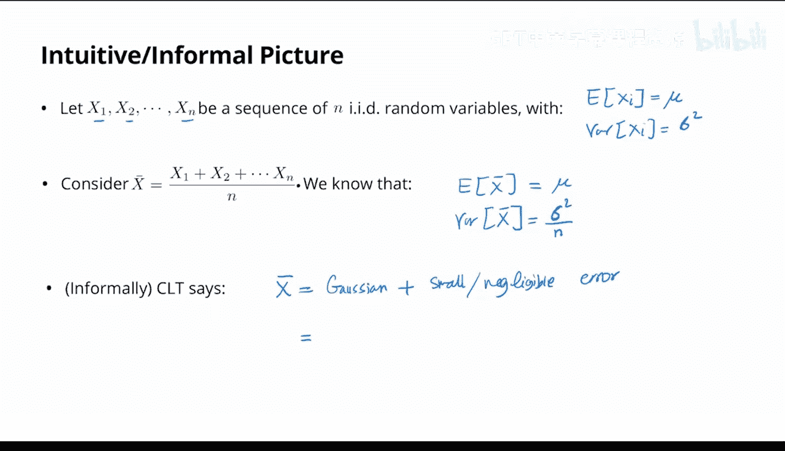

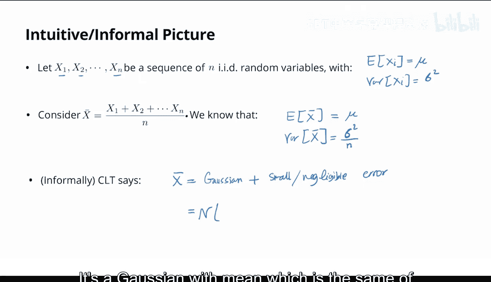

With mean， which is the same of X bar。And various， which is sig squared over。

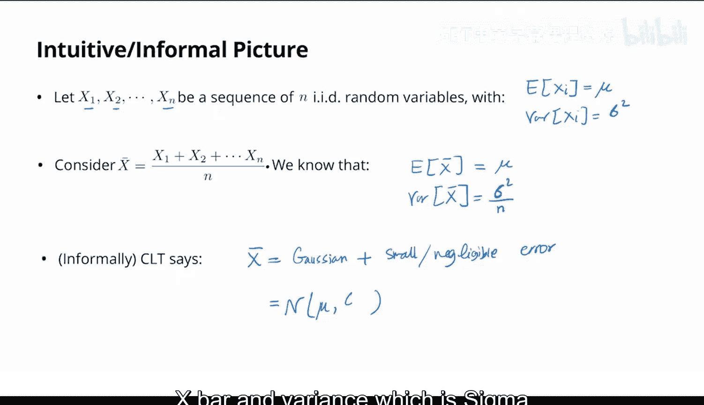

So that's essentially central limit theorem and again， let me emphasize that this error。😊。

As n the number of samples grows large， this error will be negligible with respect to the first person in our computations。

 essentially we get rid of this error。And we only work with the Gaussian part。 Okay now in terms of。

The Pdf again， this is let me let me again emphasize that this is an intuitive picture。

 This may not be exactly true in general， but this is like an intuitive picture for you to help you to think about what the Gaussian what the central limit your is。

 So essentially it tells you the following。 So if you look at the Pdf of X bar and the Pf of X has some。

Some form。Okay， something like this。Okay， when n grows large， when n becomes larger and larger。

 the Pdf of x bar looks more， more and more closer closely to the Gausian distribution。 Okay。

 what is the mean of the Gausian distribution， the mean is exactly the mean of x power， which is mu。

 What is the variance of the Gausian distribution is exactly the variance of x right so the width of this bell shape Pdf of the Gausian would be sigma where squared at。

Okay， so its is close。 the P Df of X and the Pdf of the Gaussian or close。 And again， remember。

 this is an intuitive picture is not entirely exact。 For example。

 when your random variables X are discrete random variables。

 this picture about the Pdfs is not really exact。 we'll talk about the formula statement in a。

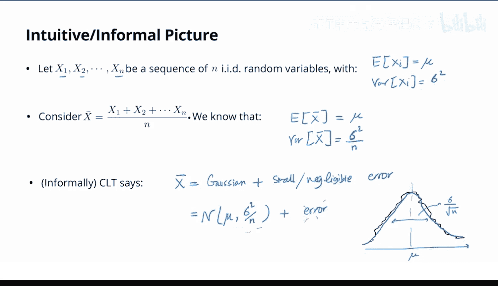

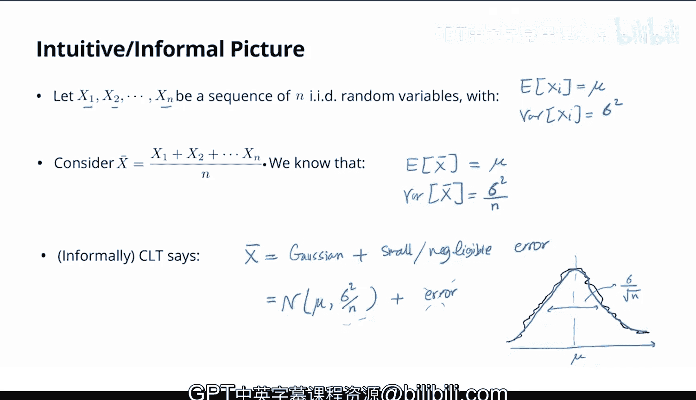