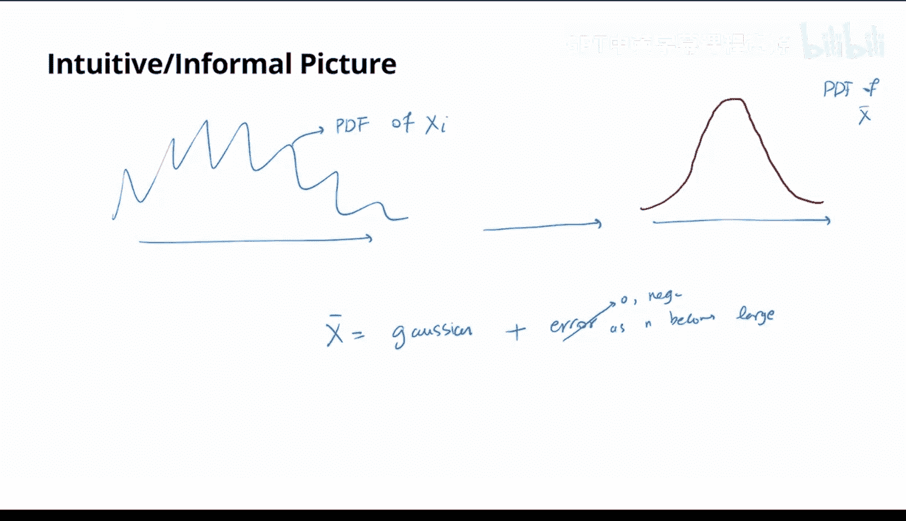
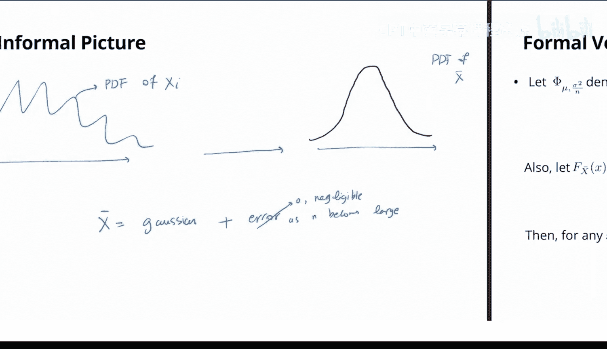
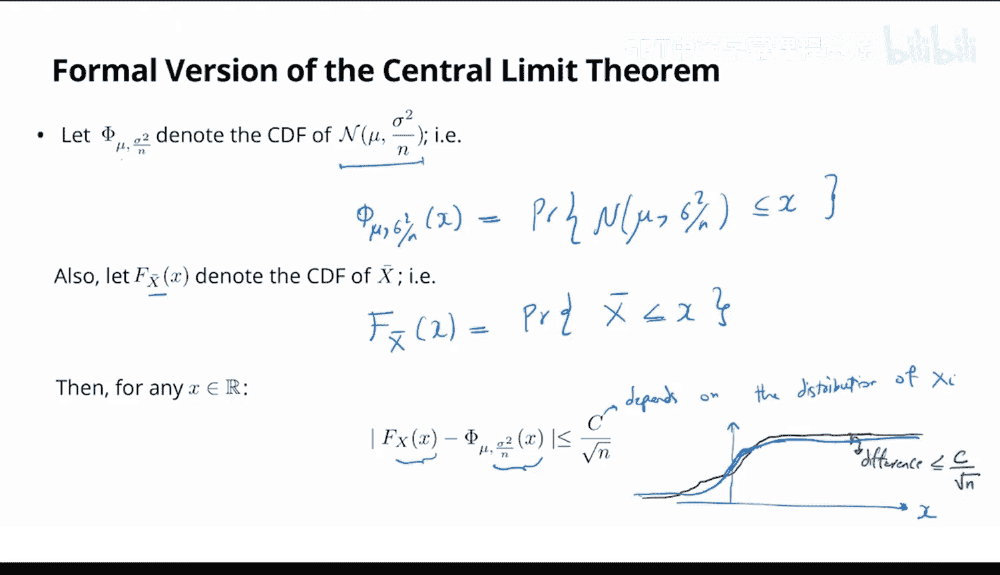
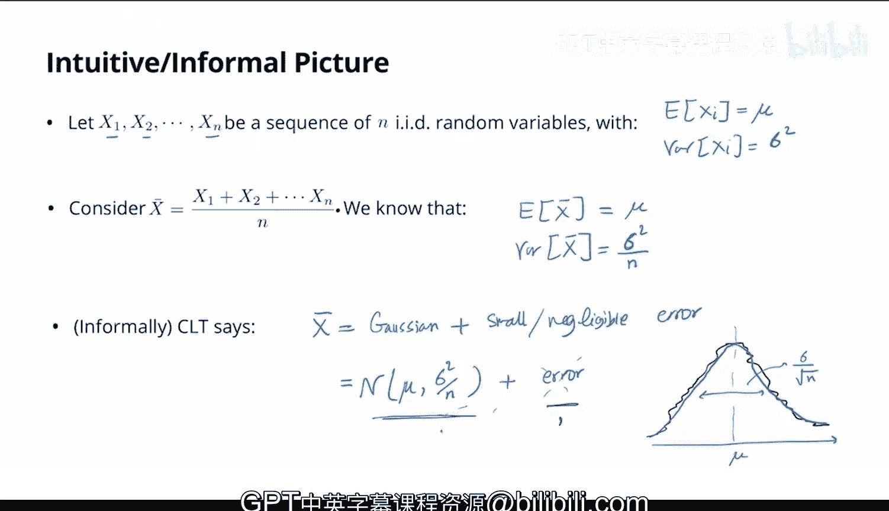

# 宾夕法尼亚大学《人工智能和机器学习基础（AI、数据科学、机器学习）AI and Machine Learning Essentials with Python》 p57 22_03_02_中心极限定理II.zh_en -BV16f421Q72q_p57-

Okay。Okay， let me also emphasize that the central limit theorem does not really care about the initial distribution。

 the original distribution of Xs， Okay， so it could be that if we look at Xs。嗯。

The PDFf could be something very general。 Okay， so this could be， for example。For example。

 I'm just giving an example。 This could be the Pf。Of Xs okay？But。

What the central limit them says is that if you look at the PDF。Of。Explore。The PDFs。

As en grows large， will more and more。Look like this very simple and nice be shaped equation。

 So something like。So that's the center unlimitedtic so as long as Xs are IID。

 the original distribution of Xs do not matter， could be any distribution。

What matters in the end is that if you look at export， the export becomes a Gaussian。

Whose mean and variance are。Determined by the mean variance of Xs plus some negligible errors which goes to0 as n。

这。So that goes to0 as n becomes large。Okay， and furthermore， it's negligible， zero negligible。

So that's the intuitive picture behind the seton theorem。😊。

Alright， so let's now explain a formal version。Of the center limit theor remember that x bar asyically as n becomes large becomes very。

 very close to the Gaussian and no variable。 And this was the Gaussian that we were talking about。

 Okay， so let's look at the cdf of this Gaussian， which is defined as so we show the cdf by phi So phi of mu。

5hi up mu1 sigma squared n。At a point， x would be the probability。That the Gaussian。

 it mean muu and variance s squared over n is less than x， right So that's the definition of the Cdf。

And let's also look at the Cf of the。X the random variable x bar。

 which is the mean of the the random variable。 So f of x bar of x is the probability that x bar is less than x。

 Now， the formal statement of CLt says that for any x on the real line。

If you look at the difference between the CDf of X bar and the CDf of the Gaussian。

 this difference is very small and specifically is some constant。

 some fixed constant divided by a square root n and remember n was the number of samples。

 the number of random fiber or the number of data points in our settings and this C is a constant which depends。

On the distribution of Xs， but it's a constant， It's like 5，10， whatever is's a fixed constant。

 which is independent on of n。 Okay， so there there is no n and it is just a fixed constant that is determined by the distribution of X。

 We can just treat it as just some fixed number。But what's important is that this error。

 the difference between the two cfs is very， very， very small。

 and it also vanishes as the number of data points n across。 Okay， so in pictorially。😊。

If and that's a that's a theorum。 that's the central limit theorem。

 That's a formal statement of the central limit theorem is's called the Bar S N version of the central limit theorem。

 So formally， if you look at the Cf of Expo， let me just draw it here。 So it's。It's an increasing。

Function。And this CDf will be very close to the CDf。Of the Gaussian random variable。

 which is a very small。Function。Okay， and the difference。

 so this is the and they both essentially conversege to one。As m goes tofin as x goes to infinity。

 so this is x here。This is a Y axis。So this means that the difference between the two cs。

 for example。The error， the difference， if you look at this error here is always less than some some known constant divided by a square root。

And as you increase the number of samples as n becomes larger and larger。

 this difference between the two2 cds at any point x。😊。

becomes smaller and smaller okay so that's the central limit here。

 So that's the formal version which is important， but what I really want from you to remember and really grasp is this picture here where X bar behaves like a Gaussian plus some error。

 but when all the applications that we use throughout this course typically we assume that the number of data points n is large enough such that this error here would be neglected compared to the Gaussian random by。

Okay， so we typically neglect this error and we only work with the Gaussian part that we see。

