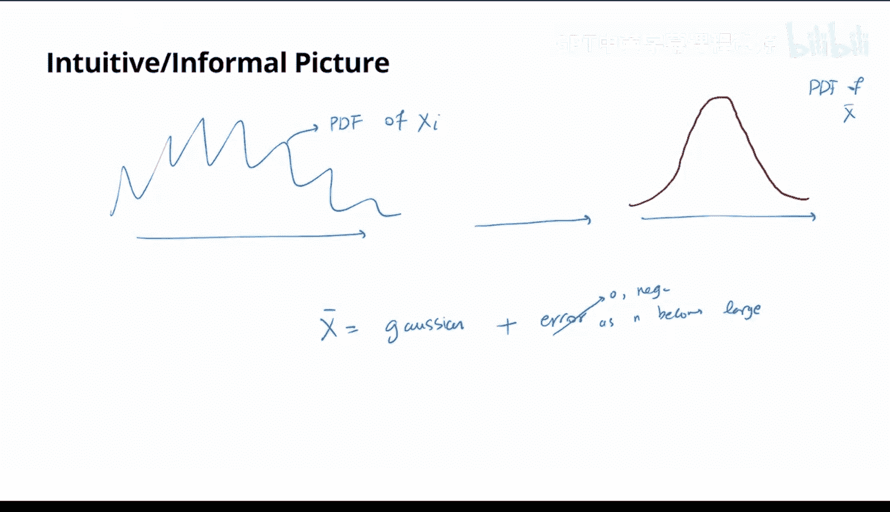
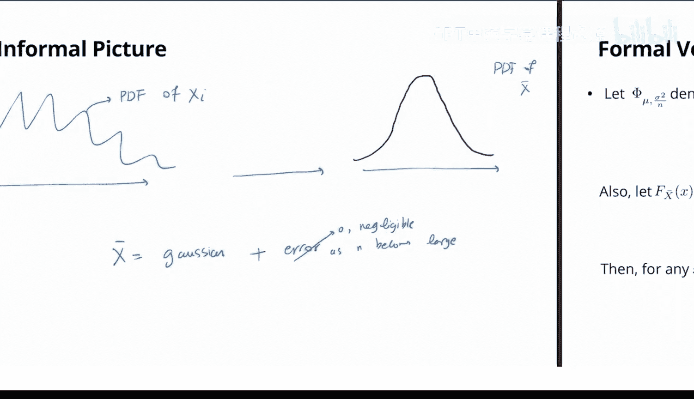
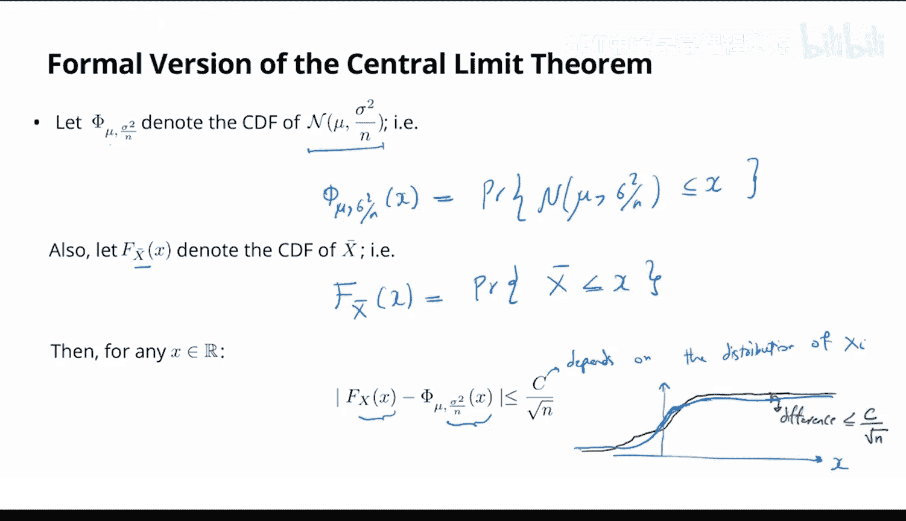
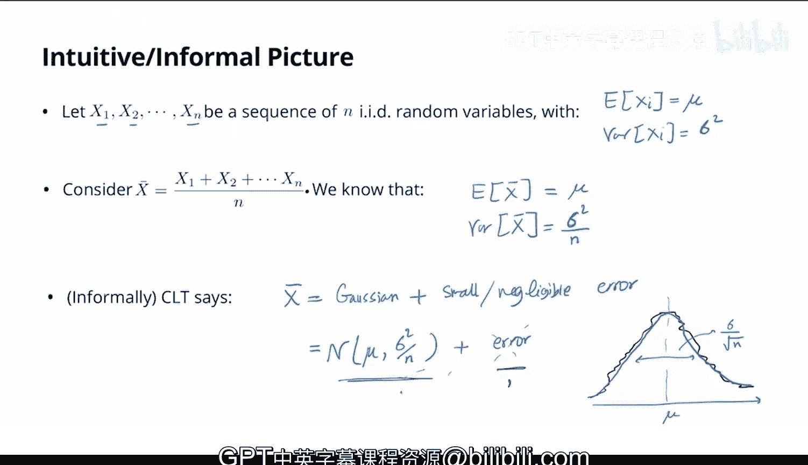

# 人工智能和机器学习基础：57：中心极限定理II

在本节课中，我们将深入学习中心极限定理的核心思想、正式表述及其直观意义。我们将理解为何样本均值的分布会趋近于正态分布，以及这一性质在数据科学中的重要性。

## 中心极限定理的核心思想

上一节我们介绍了中心极限定理的基本概念。本节中，我们来看看该定理的一个关键特性：**它不关心原始数据的分布形态**。

中心极限定理并不关心随机变量 \( X \) 的初始分布。原始变量 \( X \) 的概率密度函数 \( f_X(x) \) 可以是任何非常一般的分布。例如，它可以是任意形状的分布。

中心极限定理指出，只要随机变量 \( X_i \) 是独立同分布的，那么当你观察样本均值 \( \bar{X} \) 的概率密度函数时，随着样本数量 \( n \) 增大，这个分布会越来越像一个简单、漂亮的钟形曲线方程所描述的形态。

因此，只要 \( X_i \) 是独立同分布的，\( X \) 的原始分布具体是什么并不重要，它可以是任何分布。最终重要的是，样本均值 \( \bar{X} \) 会变成一个高斯（正态）分布，其均值和方差由 \( X \) 的均值和方差决定，外加一些随着 \( n \) 增大而趋于 0 的可忽略误差。

用公式表示，样本均值 \( \bar{X} \) 近似服从以下正态分布：
\[
\bar{X} \sim \mathcal{N}(\mu, \frac{\sigma^2}{n})
\]
其中 \( \mu \) 是 \( X \) 的总体均值，\( \sigma^2 \) 是 \( X \) 的总体方差，\( n \) 是样本数量。当 \( n \) 很大时，近似误差可以忽略。

这就是中心极限定理背后的直观图像。

## 中心极限定理的正式表述

理解了直观思想后，我们现在来解释中心极限定理的正式版本。

回忆一下，当 \( n \) 变得很大时，样本均值 \( \bar{X} \) 在渐近意义上会非常接近一个高斯随机变量。我们所说的正是这个高斯分布。

让我们先看看这个高斯分布的累积分布函数，我们用 \( \Phi \) 表示。对于均值为 \( \mu \)、方差为 \( \sigma^2/n \) 的正态分布，其在点 \( x \) 的 CDF 定义为：
\[
\Phi_{\mu, \sigma^2/n}(x) = P(\text{Gaussian} \leq x)
\]
同时，我们看看随机变量 \( \bar{X} \)（样本均值）的 CDF。记作 \( F_{\bar{X}}(x) \)，它表示 \( \bar{X} \) 小于 \( x \) 的概率。

中心极限定理的正式表述如下：对于实数轴上的任意一点 \( x \)，样本均值 \( \bar{X} \) 的 CDF 与对应高斯分布的 CDF 之间的差异非常小。具体来说，这个差异的上界是某个常数 \( C \) 除以 \( \sqrt{n} \)：
\[
| F_{\bar{X}}(x) - \Phi_{\mu, \sigma^2/n}(x) | \leq \frac{C}{\sqrt{n}}
\]
这里，\( n \) 是样本数量（或数据点数量），而 \( C \) 是一个常数。这个常数 \( C \) 依赖于原始随机变量 \( X \) 的分布，但它是一个固定值（例如 5、10 等），与 \( n \) 无关。重要的是，这个误差（两个 CDF 之间的差异）非常非常小，并且随着数据点数量 \( n \) 的增加而消失。

以下是该定理的直观图示：

*   \( F_{\bar{X}}(x) \) 和 \( \Phi_{\mu, \sigma^2/n}(x) \) 都是递增函数。
*   随着 \( n \) 增大，\( F_{\bar{X}}(x) \) 的曲线会越来越接近 \( \Phi_{\mu, \sigma^2/n}(x) \) 的曲线。
*   在任意点 \( x \) 处，两条曲线之间的垂直距离（即误差）始终小于 \( C / \sqrt{n} \)。
*   随着样本数量 \( n \) 变得越来越大，任意点 \( x \) 处两个 CDF 之间的差异会变得越来越小。

这就是中心极限定理的正式版本（Berry-Esseen 版本），它很重要。然而，在本课程中，我希望大家真正记住并掌握的是下面这个图像：\( \bar{X} \) 的行为就像一个高斯随机变量加上一些误差，但在本课程涉及的所有应用中，我们通常假设数据点数量 \( n \) 足够大，以至于这个误差与高斯随机变量部分相比可以忽略不计。

因此，我们通常忽略这个误差，只处理我们看到的高斯部分。这使得基于正态分布的统计推断（如置信区间、假设检验）在实际应用中成为可能和有效的工具。

## 总结

本节课中我们一起学习了中心极限定理的深入内容。我们明确了该定理的核心在于**样本均值的分布形态与原始分布无关**，最终都会趋近于正态分布。我们学习了该定理的正式数学表述，即样本均值累积分布函数与理论正态分布累积分布函数之间的误差，其上界以 \( C / \sqrt{n} \) 的形式收敛。最重要的是，我们理解了在实际应用中，当样本量足够大时，我们可以安全地忽略这个误差，直接将样本均值视为服从正态分布，从而为后续的统计分析和机器学习方法奠定了坚实的理论基础。