# 宾夕法尼亚大学《人工智能和机器学习基础（AI、数据科学、机器学习）AI and Machine Learning Essentials with Python》 p59 24_04_01_置信区间I.zh_en -BV16f421Q72q_p59-

So we're now going to use the knowledge and the concepts that we learned from the central limit orM section to compute confidence intervals。

 but before that in the first part of confidence intervals。

 I'm going to explain and develop what we mean by this G terms confidence intervals。

 what does confidence interval mean and how do we even think about confidence interval and formally and mathematically quantify。

Okay， so let me first do a quick recall on what our setting was。

 Remember our setting so far was to estimate the mean of a given population， right。

 so in terms of the block diagram that we had on data science， remember。

 so there was some real world。Phenomemenon。statisticalatically。

 we thought about this as some population with let's call the mean or denote the mean by mu right the the value of mu was unknown。

And what we could do was to gather data from this physical phenomenon。

 so we had the data acquisition module。Which would give us data x1 through xn。And statistically。

 we thought of these data points x1 through x Xn to be II。

But we also notice that or assume that the expectation of X size。

 the mean of X size since they come from the same population would be exactly mu。And。Remember。

 the task was to estimate the unknown value of mu， so we had the data analysis module。

 which designed a point estimator for this mu and our estimator was x， right so the sample mean。

 which was the average of X size。And this was an estimate。f。M， okay。

 now what we're going to talk about in this section is how close Exp is to mu。

 We have already computed the mean of X， which was exactly new and the variance of。

Xpo which was sigma squared over n where sigma was the population variance。

 Now we're going to give more accurate or precise error bounds on how close is X bar。

With respect to the value that is trying to approximate or estimate the value。

 the true value mu In reality， the only thing that we have access to this data is x1 through X N。

 That's the only thing that we have， right， We're going to use this data in order to figure out how close is our estimated value X。

Is to the true value mu。 Okay， so this is the only thing that we can compute。

 The value of mu we do not know。 We have no idea about what mu is。

 The only thing that we know about mu is through data， for example， X。

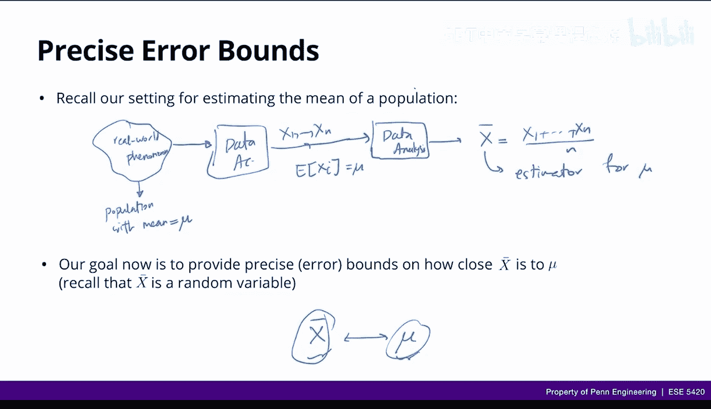

Okay， so that's our goal here。 The first question that we need to think about is you want to quantify the error。

Of X bar in approximating the value of mu， How do you even quantify this error。

 What the right mathematical notion， Think about this， The first idea that comes to mind。

 the simplest idea would be the following。 So X bar。Is intended。To estimate new， right？

 So why not just thinking about。The event that expires exactly so let's look at the probability。

That exporto is exactly me。After all， if exporto is approximating mu。

 the hope is that Exp gives you the exact value of mu most of the times， this is a reasonable idea。

 but there is actually a problem with this， right The problem is that oftentimes， for example。

 if the distribution of exercise is a continuous distribution oftentimes this value is exactly zero。

Why， because。If you look at the PDF of Exp， the PDF if for example。

 excise are continuous random variables， the PDF of Exp is like a continuous function is a continuous PDF。

Even though the mean of xo is exactly mu， the probability that x is exactly equal to mu is obviously0 right。

 I mean if xo if Xs are let's say exponential random variables or Gaussian random variables。

 the probability that they become exactly their average becomes exactly equal to mu is 0 right。😊。

So this is really not the right notion to quantify the error。

Or how to quantify how close export is to mu。But somehow this can be extended to the right notion right so we are。

We actually want to see in what portion of times export。Close to me， I mean， not exactly equal。

 but close， right， So why not just。Draw on a small interval。A small interval around the value of mu。

 Okay， so this is this is the Pdf of X。Draw a small interval around the value of mu let's call this mu plus beta and mu minus beta。

Okay so these are these two points。And look at the probability that。Essentially。

 the value of X falls in this interval and think of beta to be a small number， right？

So point so let me go back again。 So idea1 was just point by probabilities。

 what point by pro are most likely0 right So this idea doesn't work。

 but if instead of point voice we look at intervals around the correct value of mu so like mu plus be mu minus beta then the following concept would make sense right so the probability。

That the value of mu essentially falls。Into x bar minus beta。An ex bar。To。

This quantity here makes a lot of sense， right， It's it's not the point wise value。 Okay。

 because the pointwise value is 0。 But if you think about better to be a small number。

 let me give you examples if， for example， if。Beta is 0。01。A very small number。

 Then what we are asking is what what we are asking is the probability。

That mu is also is x bar minus-0。01。

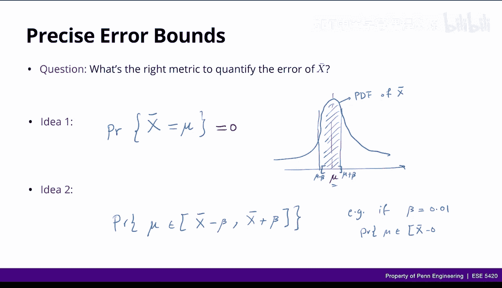

An X bar plus 0。0， right， So what we are asking here is what's the probability。

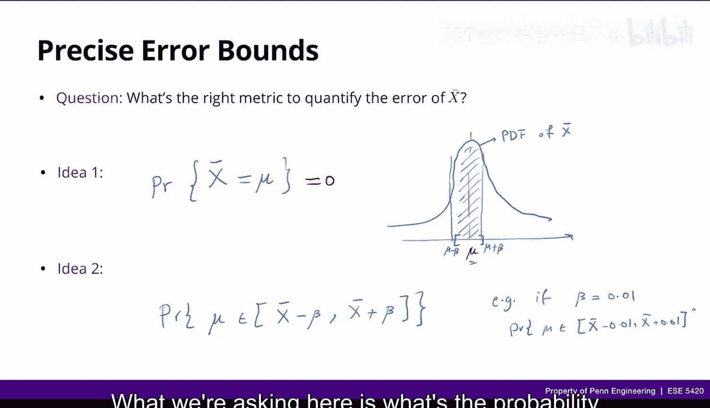

That the the correct value mu falls into this very， very small interval around the value of X。

 And remember， X is something you compute from data。Okay。

 so export you computed from data and then you just asking， for example， export is 5。

 You're just asking what's the probability。 Okay， let me just also add this。

 Let's assume that export you compute from data and iss 5 essentially。

 you're asking what's the probability that mu folds into this interval。 So 4。99 and 5。0 right？

 So essentially， we're gonna。We're going to compute this likely likelihood this probability。 Okay。

 so not exactly 5， but just the small interval around it。 Okay。

 that now suddenly makes sense because its not， is not exactly a point。 It's a small interval。

Right so were going to so essentially the second idea which is to compute this probability actually makes sense because we are now working with intervals and intervals do not have zero probability。

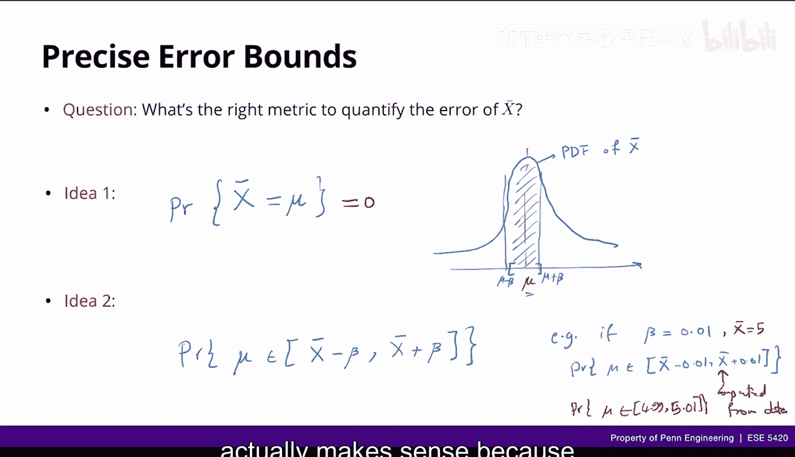

So generalizing this to the actual concept of confidence intervals。

 the main question regarding confidence intervals that we are going to ask is the following。

 So we are given a sample data x1 through x n， we can think of it as sequence of ID random variables。

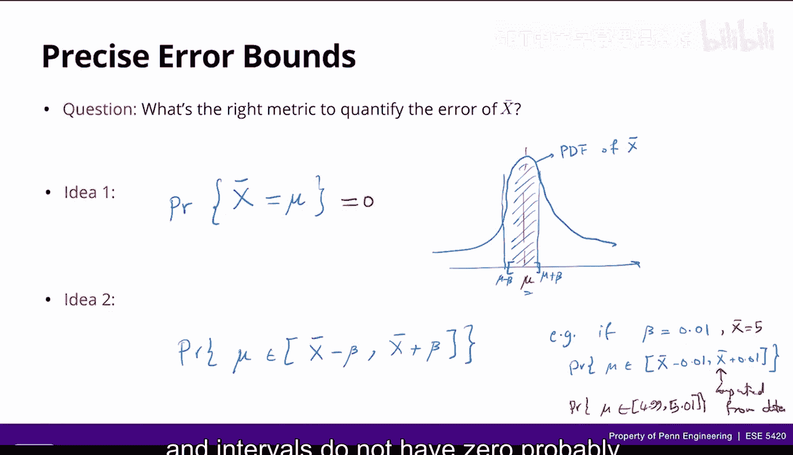

And we are also given a co value1 minus alpha， okay， think of alpha to be a small also。Think of。

All far to be small。Okay， typically all four in practice， you can。Take alpha to be 0。05，0。02。

 and so on。Okay。So we are looking for a value beta such that the probability。😮。

That the true value mu， remember， mu was unknown。😮。

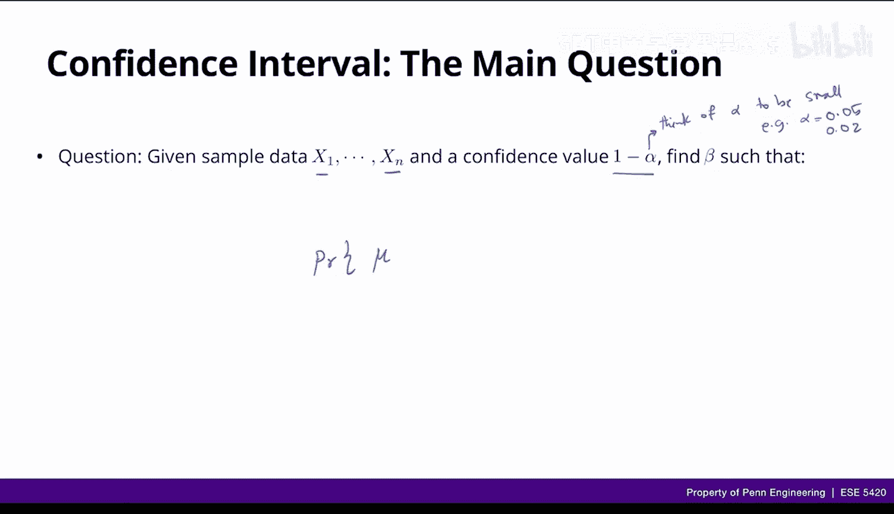

True value mu falls inside。

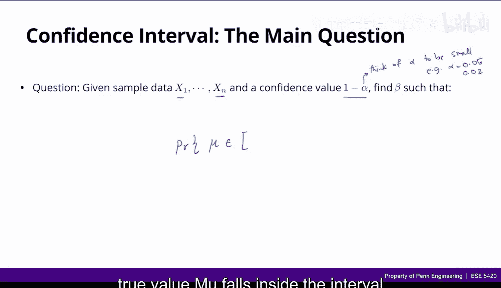

The interval explore minus beta。An export。Plus， betterta is。1 minus okay。

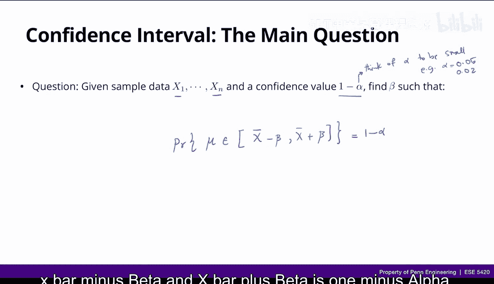

So essentially what we' are going to do is to find this interval here right find the interval such that the probability that mu is in that interval is 1 minus alpha okay so remember Al is a small number。

 for example。😊。

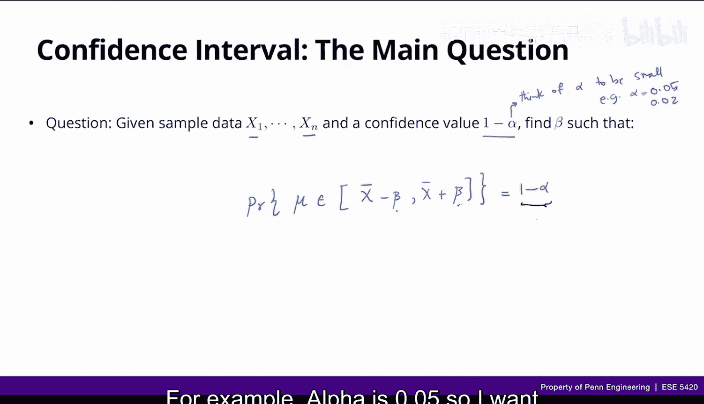

Alpha is 0。05， so I want this provided to be 0。95。

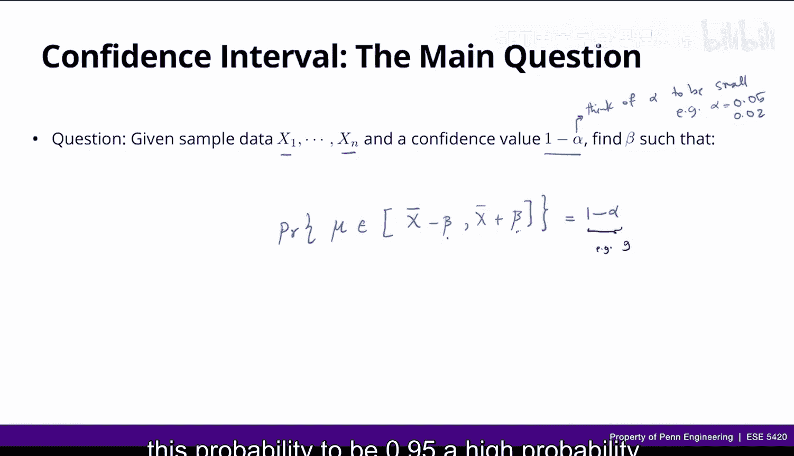

So a hypervoltic。 And this is asking， what's the interval such that 95% of the times the value export that from the value export that I compute。

 I can have this interval Exp minus beta and export plus beta such that the value mu falls into the interval。

 right， we're going to find the value of beta。We're going to find better。

In terms of all and N and and properties of the distribution。Of X， right？Okay。

 some very simple properties like the variance of exercise， okay？

And that's the concept of confidence intervals。Right so our job now is to find beta with to the other variables once we find beta that would give us an interval right so was the interval such that for example。

 95% of the times the true value of mu falls into that interval and that interval is computed from x bar which is computed from the typess。

So we're going to do that， but before that let me just explain that this probability here can be written in a slightly different way。

 which will help us to compute this probability precisely。

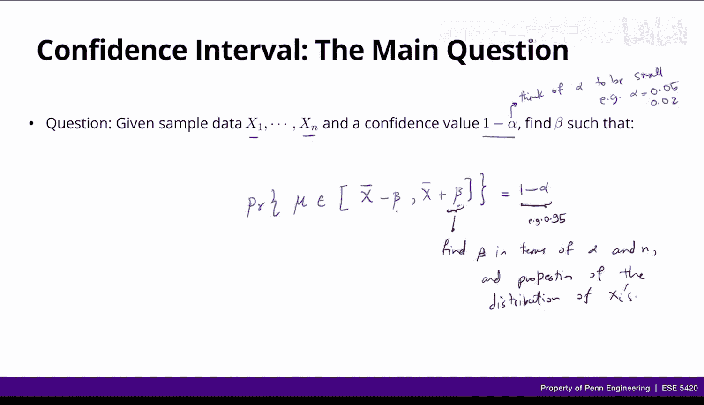

The probability that x mu falls in the interval x bar minus beta and x bar plus beta is exactly equal to the probability that X bar falls。

In the interval new minus Spec time nu prospect。 Okay， some of you may may essentially thought about。

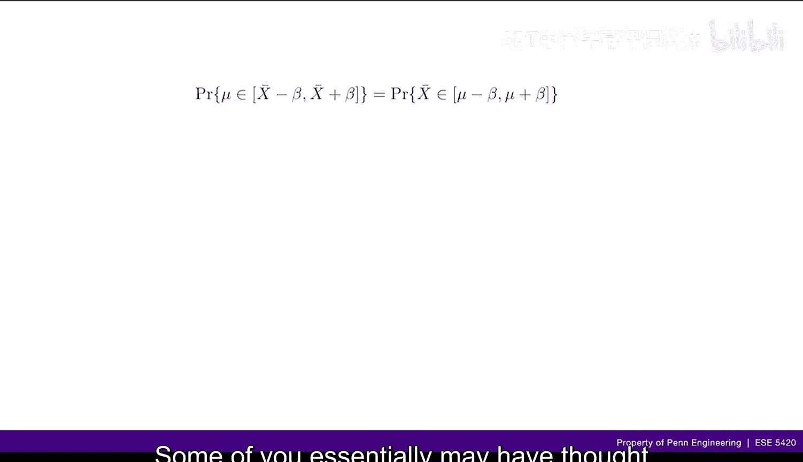

May have thought about this when I talked about this intervalt here。

 So it was mu minus betterta mu plus betterta。 And suddenly I wrote mu between X bar minus beta and X bar plus betterta。

 But these are the same things。

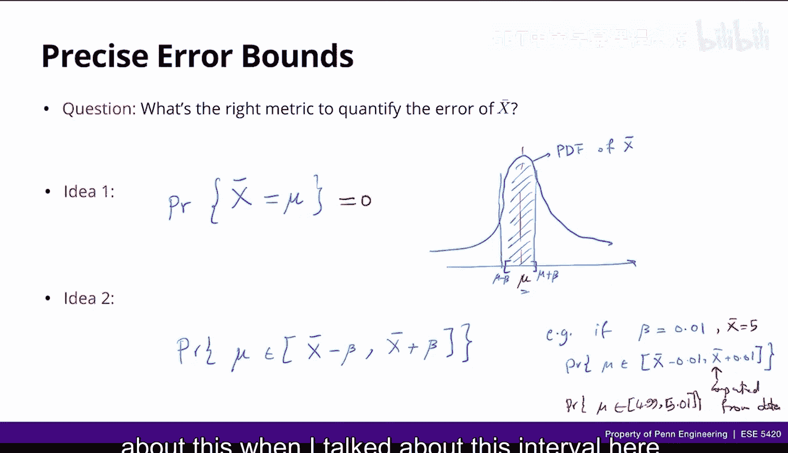

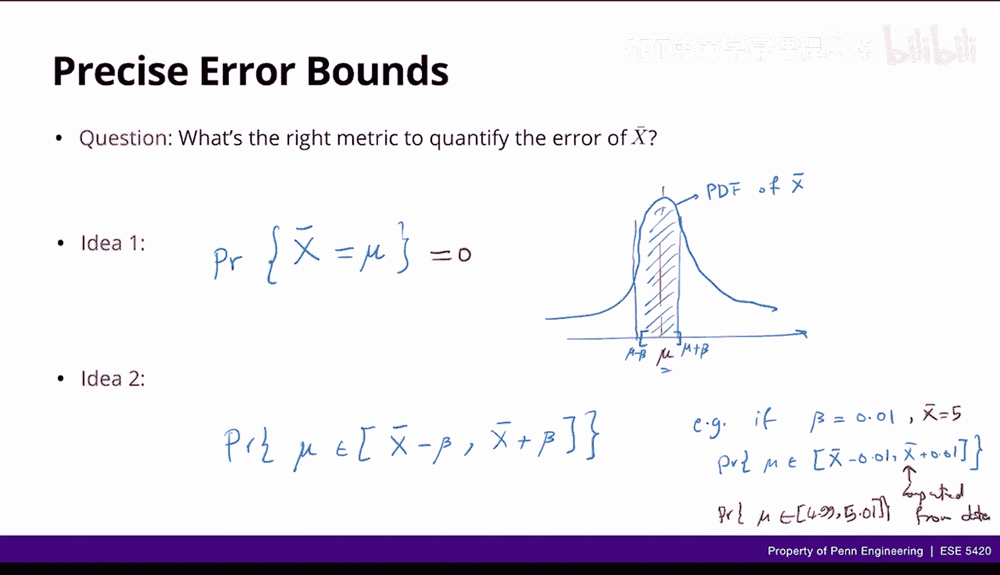

Okay， so if we look here。I'm essentially claiming that these two probabilities are exactly actually。

These two are。These two conditions or events are exactly equal。 Okay， so this。

 this event that mu falls here and this event that Exp falls into this interval。

Will you minus us better time you class better。These two events are exactly the same。 Why， I mean。

 the reason is very simple， let me just do the quick algebra for you just to。😊。

Just to show you that these are the same。 So let me start with here with the left hand side。 So this。

 this is telling you that mu。

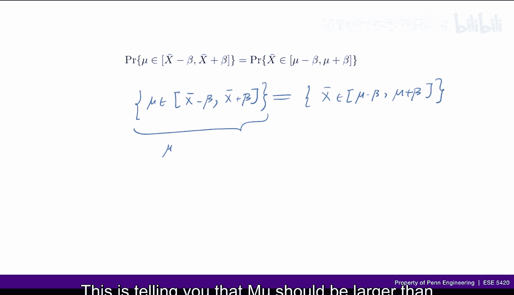

Should be larger than explore minus beta。And you should be smaller than explore clipman， right？

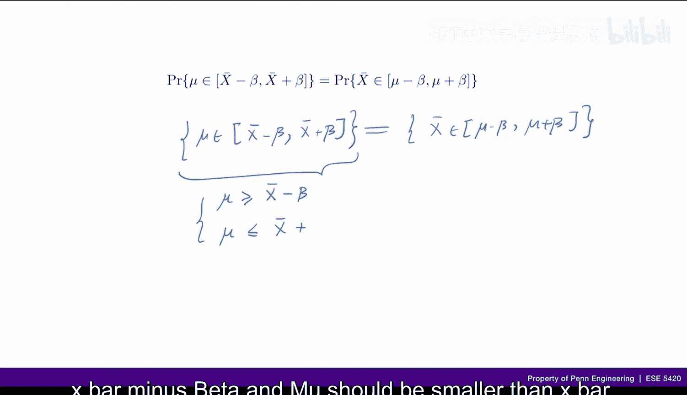

Now， from the first inequality， essentially， let me just move better to the other side。

 this would tell me that x bar should be smaller than mu plus beta。

The second inequality would be telling me that x should be larger。

By just moving better to the other side than new mind spend。 Okay， and this is exactly。

This event so x bar is between me minus better。A you class better。

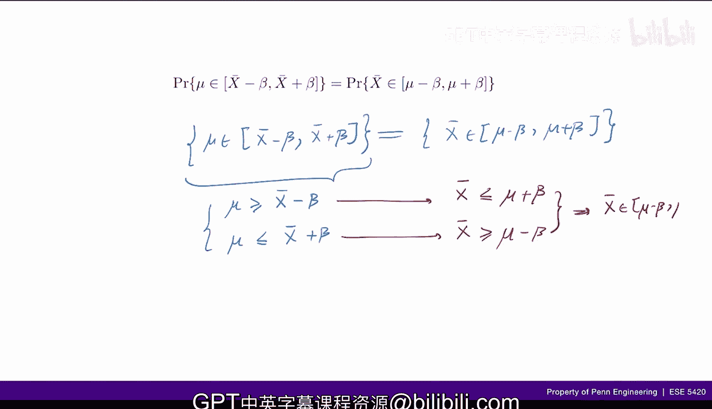