# 人工智能和机器学习基础：24_04_01：置信区间 I 📊

在本节课中，我们将要学习置信区间的基本概念。我们将利用中心极限定理部分学到的知识和概念来计算置信区间。首先，我们会解释并阐述“置信区间”这一术语的含义，探讨如何从概念和数学上理解并量化它。

## 背景回顾与目标设定

上一节我们介绍了中心极限定理，本节中我们来看看如何应用它。首先，快速回顾一下我们目前的研究背景。

到目前为止，我们的设定是估计给定总体的均值。从数据科学的角度来看，存在一个真实世界的现象。在统计学上，我们将其视为一个总体，其均值用 **μ** 表示，而 **μ** 的值是未知的。

我们能做的是从这一物理现象中收集数据。数据采集模块会给我们数据 **x₁, x₂, ..., xₙ**。在统计学上，我们认为这些数据点 **xᵢ** 是独立同分布的。我们还注意到或假设，由于它们来自同一个总体，**xᵢ** 的期望值（均值）恰好是 **μ**。

我们的任务就是估计未知的 **μ** 值。数据分析模块为此设计了一个点估计量，我们的估计量是样本均值 **X̄**，即 **xᵢ** 的平均值。这是一个对 **μ** 的估计。

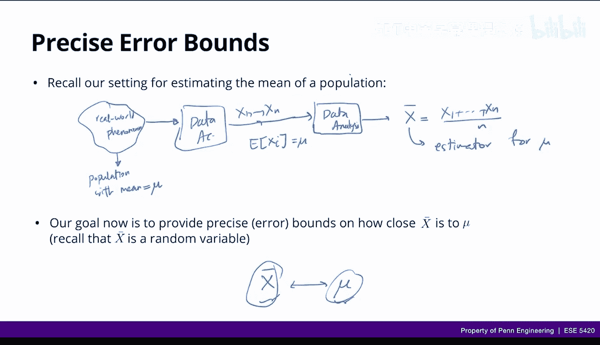

在本节中，我们将讨论 **X̄** 与 **μ** 有多接近。我们已经计算了 **X̄** 的均值（恰好是 **μ**）和方差（是 **σ²/n**，其中 **σ** 是总体方差）。现在，我们将给出关于 **X̄** 与其试图近似或估计的真实值 **μ** 之间接近程度的更精确误差界限。

实际上，我们唯一能接触到的就是数据 **x₁, x₂, ..., xₙ**。我们将使用这些数据来弄清楚我们的估计值 **X̄** 与真实值 **μ** 有多接近。这是我们唯一能计算的东西。我们不知道 **μ** 的值，对 **μ** 的唯一了解都来自数据，例如 **X̄**。

## 误差的量化思路

我们的目标在此。第一个需要思考的问题是：如何量化 **X̄** 在近似 **μ** 时的误差？正确的数学概念是什么？

思考这个问题，首先想到的最简单的想法如下：**X̄** 旨在估计 **μ**。那么为什么不直接考虑 **X̄** 恰好等于 **μ** 的事件呢？让我们看看概率 **P(X̄ = μ)**。毕竟，如果 **X̄** 在近似 **μ**，我们希望 **X̄** 在大多数时候能给出 **μ** 的精确值。这是一个合理的想法，但实际上存在一个问题。

问题是，通常情况下，例如当 **xᵢ** 的分布是连续分布时，这个概率值恰好是零。为什么？因为如果你看 **X̄** 的概率密度函数，如果 **xᵢ** 是连续随机变量，**X̄** 的 PDF 是一个连续函数，是一个连续的 PDF。即使 **X̄** 的均值恰好是 **μ**，**X̄** 恰好等于 **μ** 的概率显然是零。例如，如果 **xᵢ** 是指数随机变量或高斯随机变量，它们的平均值恰好等于 **μ** 的概率是零。

因此，这确实不是量化误差或量化 **X̄** 与 **μ** 接近程度的正确概念。但我们可以将其扩展到正确的概念。我们实际上想看在多大比例的情况下 **X̄** 接近 **μ**，不是恰好等于，而是接近。那么，为什么不围绕 **μ** 值画一个小区间呢？

## 引入区间概念

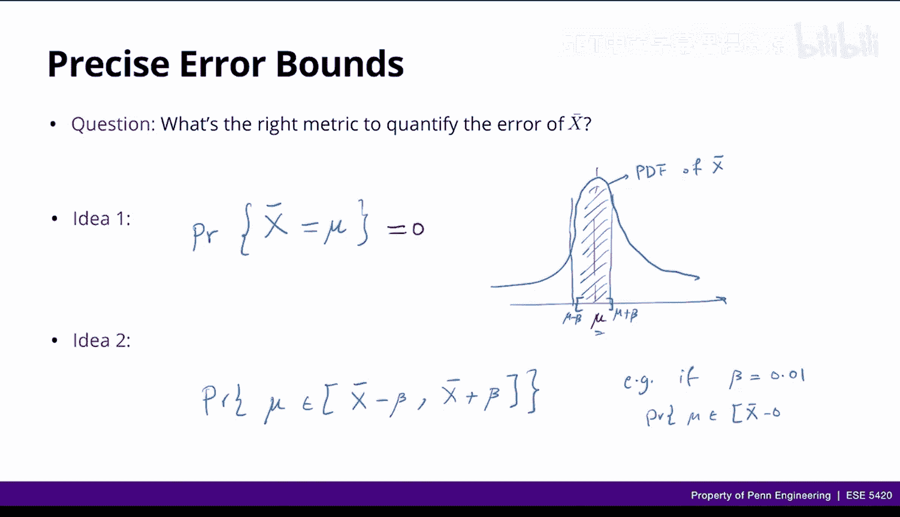

这是一个围绕 **μ** 值的小区间，称之为 **μ + β** 和 **μ - β**。然后看看 **X̄** 的值落在这个区间内的概率，并认为 **β** 是一个很小的数。

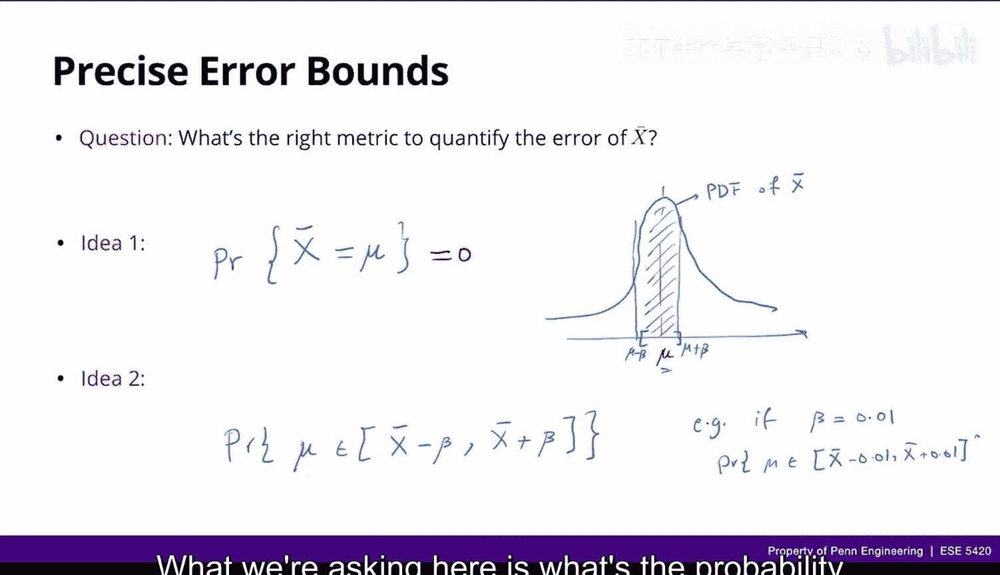

所以，回到思路。思路一是点概率，点概率很可能为零，所以这个思路行不通。但是，如果我们不看点，而是看围绕正确值 **μ** 的区间，比如 **μ ± β**，那么下面的概念就很有意义了：概率 **P(μ ∈ [X̄ - β, X̄ + β])**。这个量很有意义，因为它不是点值。点值是零。但如果你认为 **β** 是一个很小的数，让我给你举个例子。

例如，如果 **β = 0.01**，一个非常小的数。那么我们问的是：概率 **P(μ ∈ [X̄ - 0.01, X̄ + 0.01])** 是多少？我们在这里问的是，正确值 **μ** 落入围绕 **X̄** 值的这个非常小的区间的概率是多少？记住，**X̄** 是你从数据中计算出来的东西。例如，假设你从数据中计算出 **X̄ = 5**。你问的是：概率 **P(μ ∈ [4.99, 5.01])** 是多少？本质上，我们要计算这个可能性，这个概率。现在这突然变得有意义了，因为它不是一个精确的点，而是一个小区间，区间没有零概率。

## 置信区间的正式定义

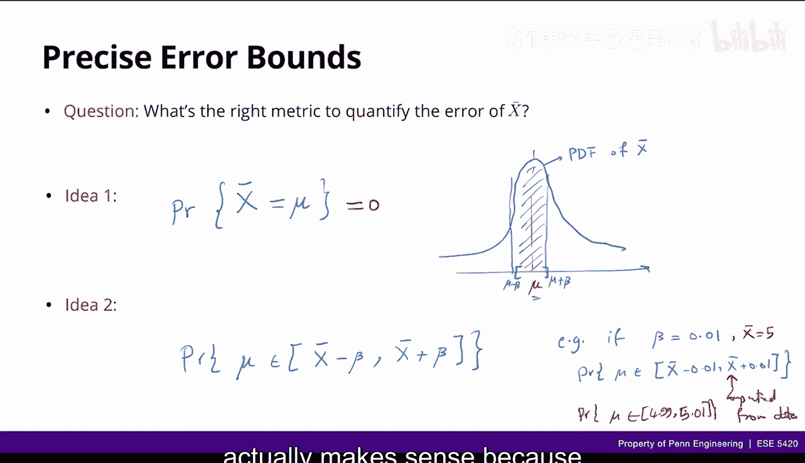

将这个概念推广到置信区间的实际概念，关于置信区间我们要问的主要问题如下：

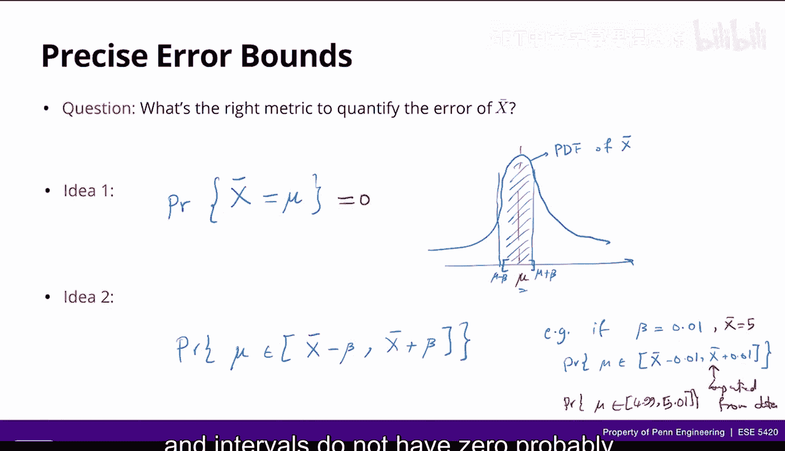

我们给定样本数据 **x₁, x₂, ..., xₙ**，可以将其视为独立同分布随机变量序列。我们还给定一个置信水平 **1 - α**，将 **α** 视为一个很小的数。通常在实践中，**α** 可以取 **0.05**、**0.02** 等。

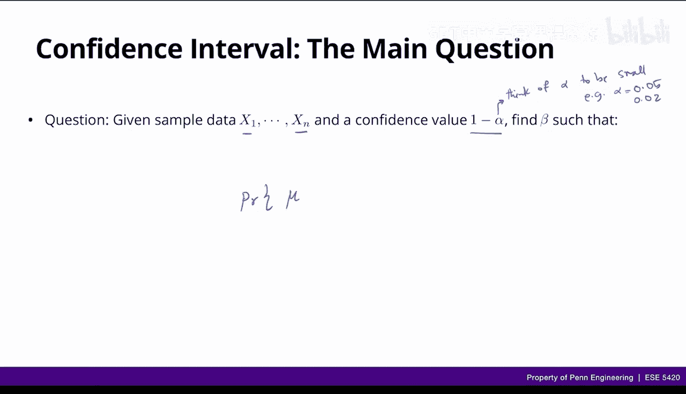

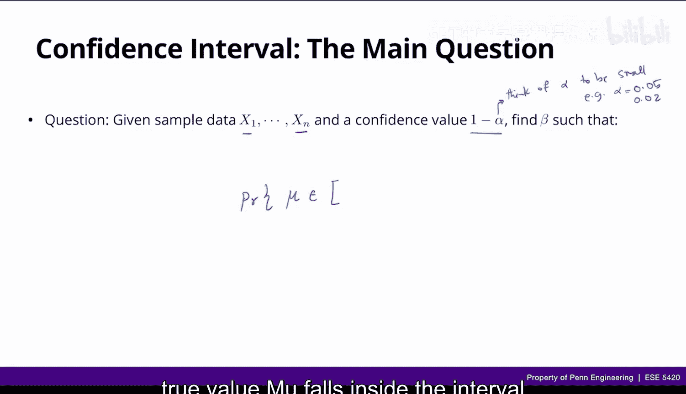

我们要寻找一个值 **β**，使得真实值 **μ**（记住，**μ** 是未知的）落入区间 **[X̄ - β, X̄ + β]** 的概率是 **1 - α**。

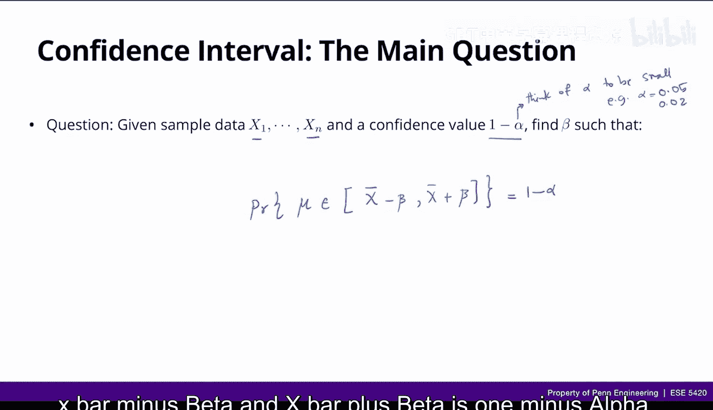

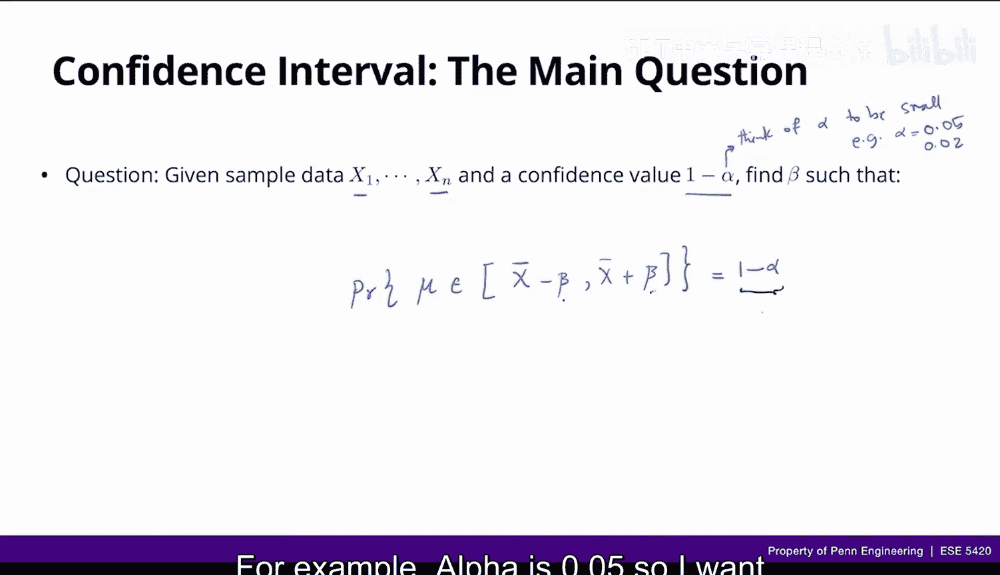

本质上，我们要做的是找到这个区间，使得 **μ** 在该区间内的概率是 **1 - α**。记住 **α** 是一个小数。例如，**α = 0.05**，那么我希望这个概率是 **0.95**。这是一个假设。问题是：什么样的区间使得在 95% 的情况下，从我计算的 **X̄** 值出发，我可以有这个区间 **[X̄ - β, X̄ + β]**，使得 **μ** 值落入该区间？我们要找到 **β** 的值。

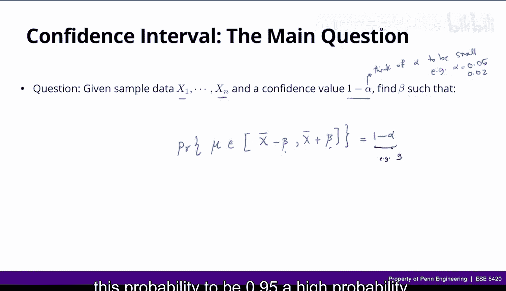

我们将根据 **α**、**n** 以及 **X** 分布的性质（例如 **xᵢ** 的方差）来找到 **β**。这就是置信区间的概念。所以，我们现在的任务是找到 **β**。一旦我们找到 **β**，它就会给我们一个区间。例如，这个区间使得在 95% 的情况下，**μ** 的真实值落入该区间，并且该区间是从 **X̄** 计算出来的，而 **X̄** 是从数据点计算出来的。

## 概率的等价转换

我们将这样做，但在此之前，让我解释一下，这里的概率可以用一种稍微不同的方式书写，这将帮助我们精确计算这个概率。

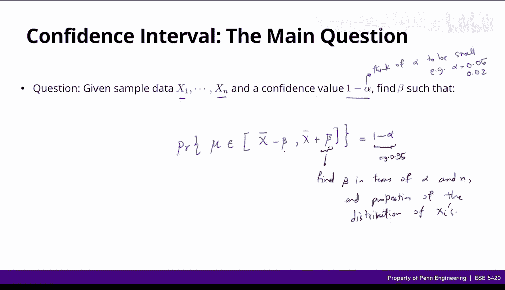

概率 **P(μ ∈ [X̄ - β, X̄ + β])** 恰好等于概率 **P(X̄ ∈ [μ - β, μ + β])**。当我谈到这个区间时，你们中的一些人可能已经想到了这一点。所以，之前是 **μ ± β** 的区间，然后我突然写了 **μ** 在 **[X̄ - β, X̄ + β]** 之间。但这两者是同一件事。

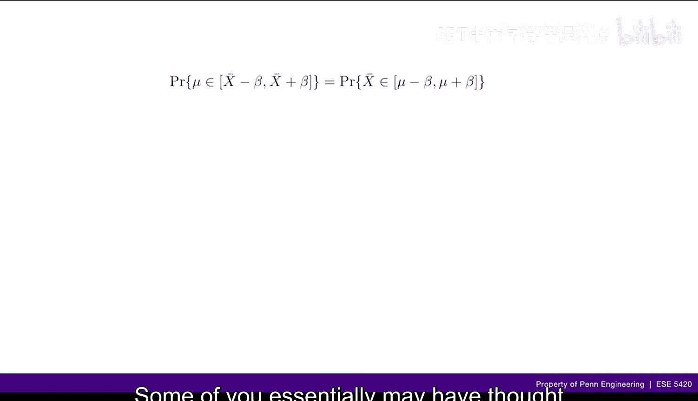

我在这里声称这两个概率实际上是相等的。这两个事件是完全相同的。为什么？原因很简单，让我为你快速做一下代数运算，只是为了向你展示它们是相同的。

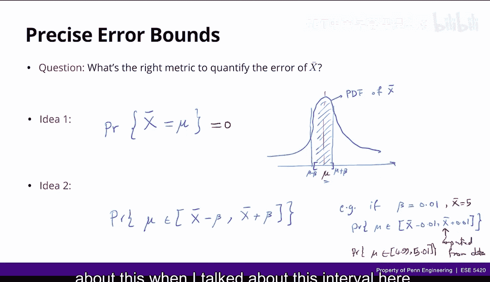

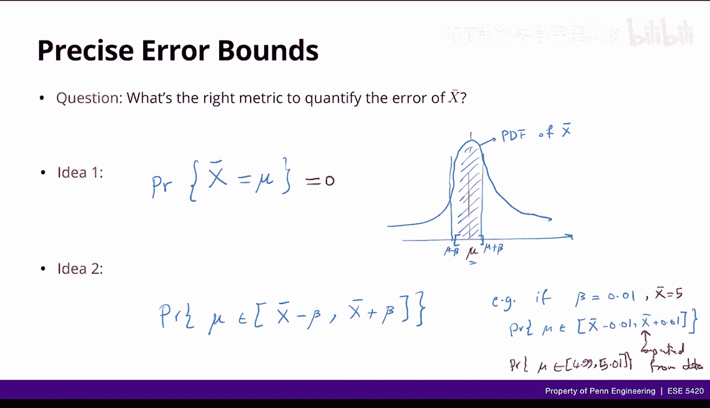

让我从左手边开始。这个条件告诉我们：**μ ≥ X̄ - β** 且 **μ ≤ X̄ + β**。

现在，从第一个不等式，本质上，让我把 **β** 移到另一边，这会告诉我 **X̄ ≤ μ + β**。第二个不等式会告诉我，通过把 **β** 移到另一边，**X̄ ≥ μ - β**。这正好就是事件 **X̄ ∈ [μ - β, μ + β]**。

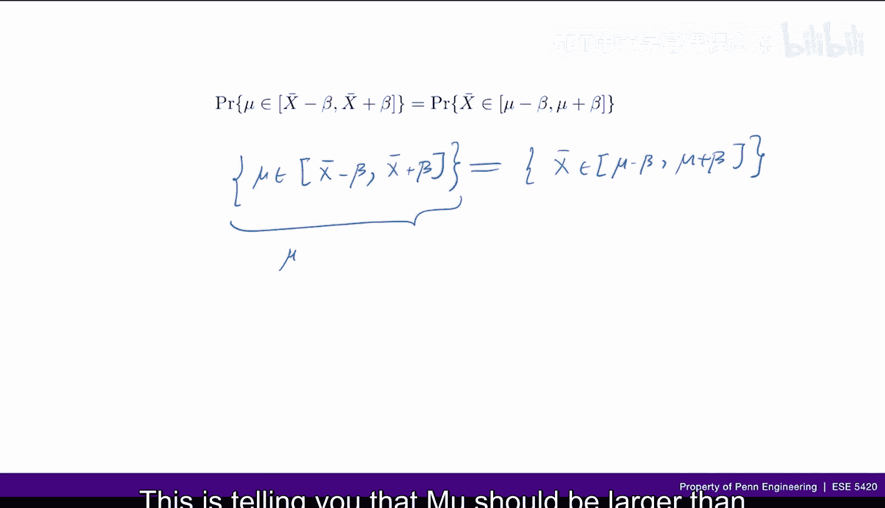

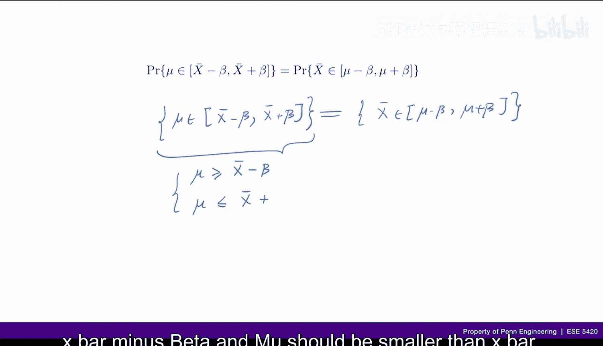

---

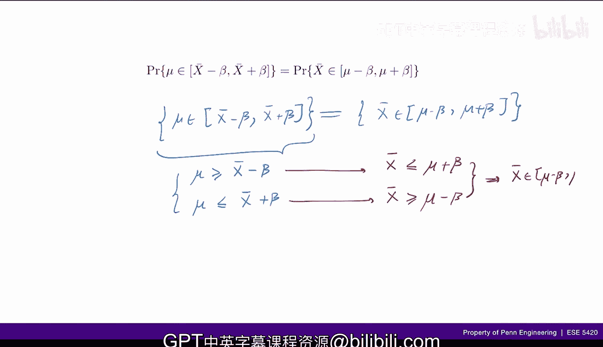

本节课中我们一起学习了置信区间的基本概念。我们从回顾估计总体均值的背景出发，探讨了为何不能直接用点概率来量化估计误差，从而引入了围绕真实值的小区间思想。我们正式定义了置信区间：在给定置信水平 **1 - α** 下，寻找一个区间 **[X̄ - β, X̄ + β]**，使得未知总体均值 **μ** 落在此区间内的概率为 **1 - α**。最后，我们通过代数转换，证明了寻找该区间等价于考虑样本均值 **X̄** 落在区间 **[μ - β, μ + β]** 内的概率。这为我们下一节具体计算置信区间奠定了理论基础。