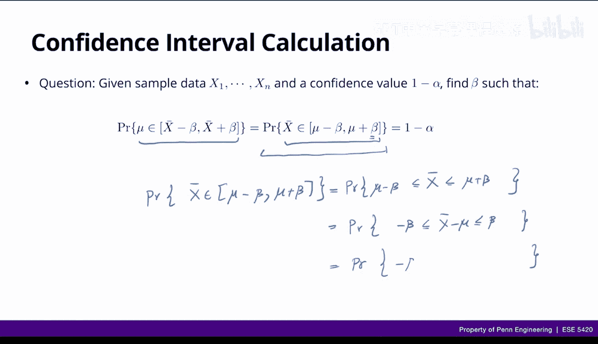
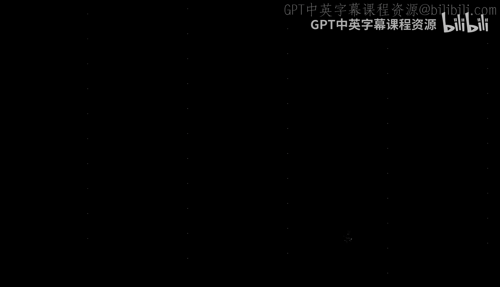
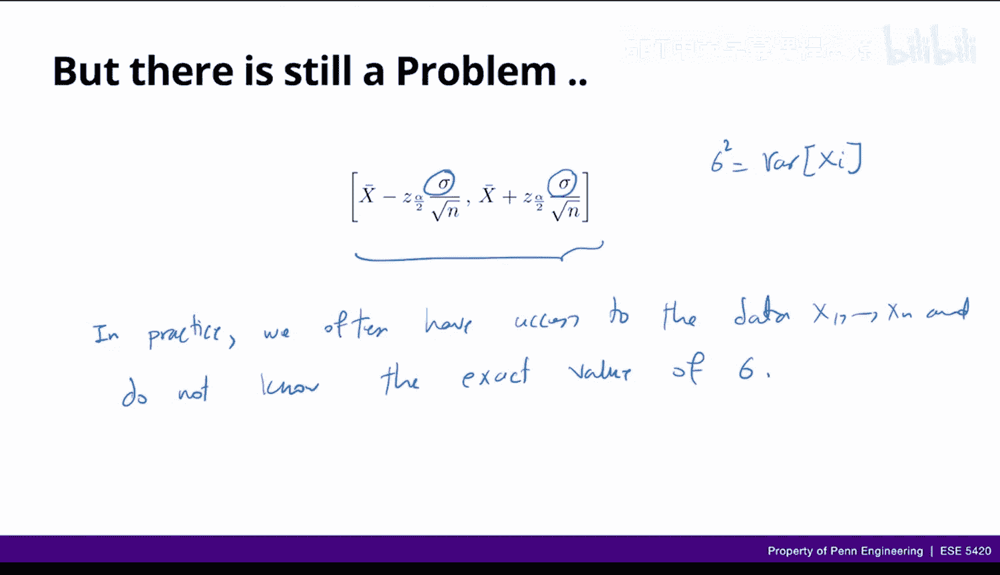

# 宾夕法尼亚大学《人工智能和机器学习基础（AI、数据科学、机器学习）AI and Machine Learning Essentials with Python》 p60 25_04_02_置信区间II.zh_en -BV16f421Q72q_p60-

Remember from last section that were looking for a value beta。

Such that the probability that the true value mu falls in this interval X bar minus beta and X bar plus beta is exactly1 minus alpha okay and as we explained last time in the last section。

 these two probabilities， these two intervals or events are exactly the same。

 So we're going to start with the interval or the probability on the right hand side because it's much more convenient to work with but this is just the same thing as the left the probability in the left hand side。

Let me just rewrite this。 I'm looking for， I'm trying to compute the probability that x bar falls into this interval world mu minus beta。

 a mu plus beta， and I want to find beta such that this probability is 1 minus alpha。

 Let me just rewrite this in a slightly more convenient way。

 So this is the probability that x bar is between mu minus beta。And mu plus better。 And then we just。

Right this take mu to the middle。 so that would be the probability that X minus mu Exp minus mu is between beta。

And minus specta， let me divide all the sides by a fixed constant， which is sigm over square root n。

So。

Let me just divide everything。And。And sigma， remember， sigma squared was the。

Varance of X。Okay。So this is x bar minus mu。Over a signal over a squirred hen， and then be。😔。

Over6 over squared。So this is just the same probability。

 What we will see now is that this random vibe but here has a very nice distribution。 Okay。

 and we're going to use central limit 3 or M to drive the random wire。

 the distribution of this random vi。Okay， so let's use CLT， so what was CLT？😊，X1 through xn。

 which are Iid， according to some distribution， I don't care what that distribution is。

The only thing that I want to know and I want to have is that the expectation of the Xs is mu and the variance of Xs is denoted by sigma squared So C。

 L T。Would tell me that X bar is essentially the Gaussian？It mean mu and variance s squared over n。

Plus， some error where when n is large， this error is essentially negligible。 right。

 So as as I said here and throughout the course， we are assuming that our n。

 the number of samples is sufficiently large， such that we can essentially neglect this error in our computations。

Okay， so that's how export is distributed。According to the Gaussian。Now。

 also remember that the Gaussians so end of remember every Gaussian。

Could be written as a shifted and rescaled version of the normal or standard Ga。

 so n of mu and sigma squared over n。Could be written as mu That's the shift and square root of the variance。

 which is sigmma over square root n。Times the standard random vibe， right， So Z。

 which is essentially。This sees n of0。So this means that if we look at Exp。

If you subtract mu from X bar and if you divide this by sigma over a square root n。

 then it becomes distributed。According to the standard normal random variablebe， right。

 which is remembered was given as n of 0。 Okay， so the distribution of x bar minus mu over s over squared n。

Has a very simple4。 It's just there。Standard random vibe， standard ca。 Okay， so let's use this。

So we so far， the probability that mu falls into this interval x minus beta x plus beta was equal。

To the probability， that has to explore minus。Mu。Over sigma over squared n less than minus beta over sigma over squared n and plus beta over sigma over squared n。

 Now， using C L T， I know that this is。This is distributed。

 has the same distribution as this is the approximation from CLT as the standard random variable。

 so this is just equal to the probability。That z is between beta over sigma over squared n。

inus beta over sigma over squared。 right， Now， remember， I wanted this。

 I wanted to find beta such that this probability was 1 minus of。

So I'm looking for the value of beta such that this probability is 1 minus。

 so the probability z fall between these two limits is exactly 1 minus of okay。

And I have to solve better in this equation in terms of let's say。

 alpha and sigma over square root n。 and I know that these the standard cache。

So since this is the standard Gaussian， let's see where we are okay in terms of this picture here。

 so this is the standard Gaussian， so its PDFf is this noise be shaped equation。

So1 over a squared root with 2 pi e to the power minus d squared over 2。And essentially， I wanna。

 I wanna find the value。 So the the mean。Of this distribution is 0。 I want to find a value better。

 such that。The probability that these between these two limits。

 So beta over sigma over squared n and minus beta over sigma over squared n。 So this area here。

 Im want to find better such that this area here。Is exactly 1 minus off， right？I want to find it。

 okay， but。If this area is 1 minus alpha and remember the the Gaussian curve。

 the Pdf is very symmetric around the value of 0。 So if this area in the middle is 1 minus alpha and this interval symmetric is beus plus be over sigma squared n and the other part is minus be over sigma square squared right So this means that the green area is alpha。

So this means that the area on the right is half times alpha right so this is this area。

Would be all over2 in this area here。Would be all forward to because of symmetry， right。

 so this area that you see on the right hand side。Is all over to any other area I suppose。Now。

 if this area is off over2， what do you think this point here should be， remember we defined。

In the section where we talked about the Gaussian random variable。

 we define Z alpha as the point for which the area on its right under the Gaussian Pdf under the normal Pdf is exactly alpha。

 So this means that this point here is the area on its right is exactly alpha over2 this point should be z alpha over2 right So from these calculations you would see essentially that z alpha over 2 should be exactly equal to beta over sigma over squared。

 So this means that the beta that we were looking for is z alpha over2 times sigma over squared。

 So we found our value beta such that the probability that。Mu falls into this interval x bar minus。

 So this was the beta that we were looking for。 So x bar minus the alpha over 2 sigma over squared n and x bar plus the alpha over 2 times sigma over squared to n is y minus。

Why did I put approximately equal and not exactly equal， Because this formula holds。Okay。

 so that you neglect the error of the central limitmethorum。

 as I said in this course and it's typically a assumed to be large and neglect that error Okay so the final message here is that is the following。

 so a 100 times 1 minus all5% confidence interval。Okay， so this one。

In estimating the mean of a population with variance sigma squared。 So right now。

 we are assuming that the variance is known is exactly this interval that you see here。

 And now we know that the probability that the true value mu falls in this interval。Is。1 minus Alta。

 Okay， very close to1 minus Al。 So this is all good。

 And that's the final formula for confidence intervals。 But there is still a problem。

And the problem is that when computing the confidence interval that you see here。

 the confidence interval relies on knowing the value of sigma。

And the value sigma is a property of our population population of the variance or remember sigma squared is the variance of our random variables X。

 and in practice in reality， we may not have this variance。

 the only thing that we have access to in reality is data in practice we often have access to the data。

 which is just x through Xn and hence we do not know the exact value of sigma right so。

That's the problem。 This confidence bound depends on the value sigma。

 which is the variance of the population。 and we don't have it。 So question is， what can we do here。

 Still， this confidence bound is not really exact because we don't know what sigma is Well。

 as data scientists， what do you think we should do data scientists use data to estimate things。

 So what the next thing that we should do in order to have a completely computable confidence bound is to estimate the value of sigma from data。

 That's what we will do in the next sections。 E sigma from data。 And as you will see。

 this will also reveal us a few interesting concepts and new concepts about estimation。

