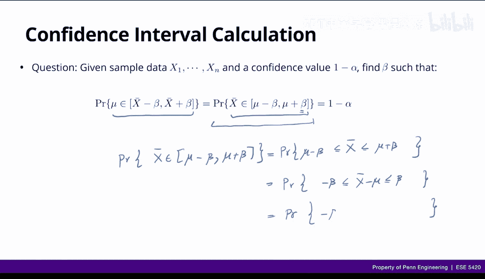
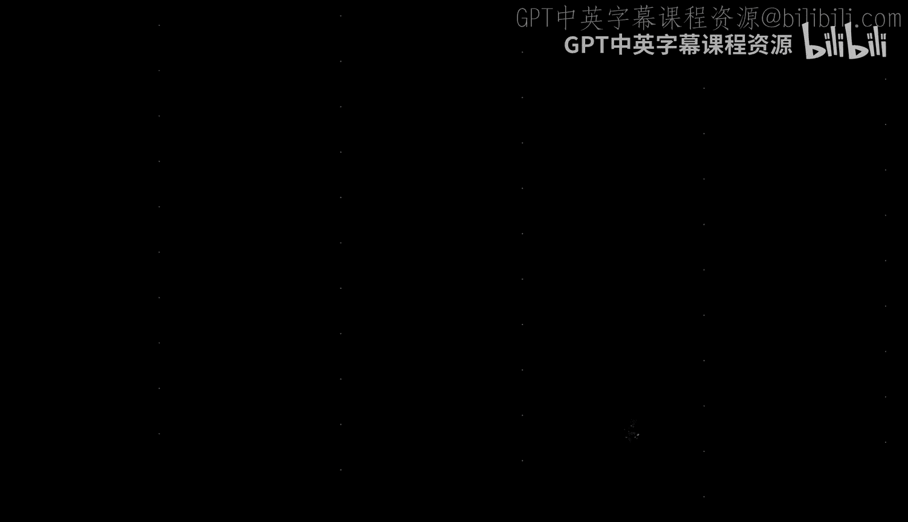
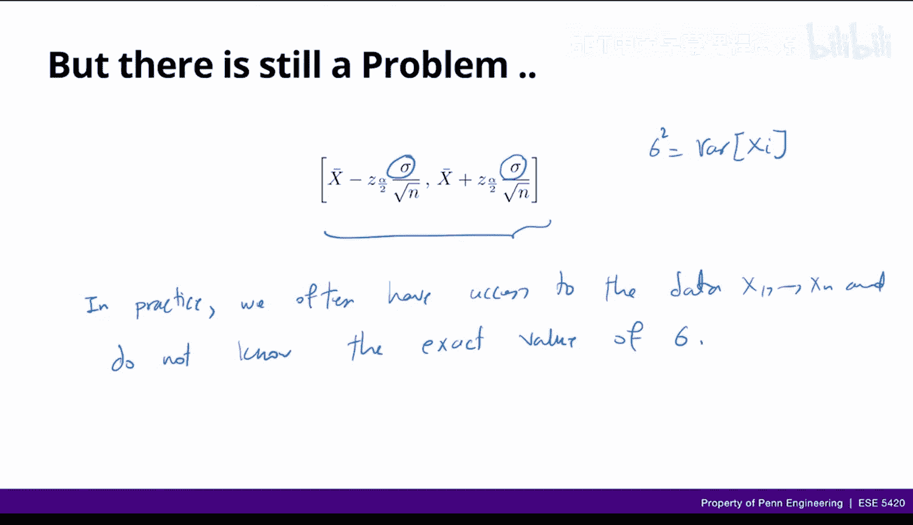

# 人工智能和机器学习基础：25：置信区间II 🎯

在本节课中，我们将继续学习置信区间的构建。上一节我们介绍了置信区间的基本概念，本节中我们将推导出置信区间的具体数学公式，并讨论其在实践中面临的一个关键问题。

## 概述

我们的目标是找到一个值 **β**，使得真实均值 **μ** 落在区间 **[X̄ - β, X̄ + β]** 内的概率恰好为 **1 - α**。正如上一节所解释的，这个概率等价于样本均值 **X̄** 落在区间 **[μ - β, μ + β]** 内的概率。

## 推导置信区间公式

以下是推导置信区间公式的关键步骤。

### 步骤一：概率等价转换

我们首先处理更便于计算的概率形式：
`P( μ ∈ [X̄ - β, X̄ + β] ) = P( X̄ ∈ [μ - β, μ + β] )`

### 步骤二：标准化处理

将区间条件进行重写和标准化：
`P( μ - β ≤ X̄ ≤ μ + β )`
这等价于：
`P( -β ≤ X̄ - μ ≤ β )`
为了应用中心极限定理，我们对不等式两边同时除以 `σ / √n`：
`P( -β/(σ/√n) ≤ (X̄ - μ)/(σ/√n) ≤ β/(σ/√n) )`

### 步骤三：应用中心极限定理

根据中心极限定理，当样本量 **n** 足够大时，标准化后的统计量 `(X̄ - μ)/(σ/√n)` 近似服从标准正态分布 **Z ~ N(0, 1)**。因此，上述概率可以近似为：
`P( -β/(σ/√n) ≤ Z ≤ β/(σ/√n) ) ≈ 1 - α`

### 步骤四：利用正态分布的对称性

标准正态分布的概率密度函数关于 **0** 对称。我们希望中间区域的面积为 **1 - α**，那么两侧尾部的总面积就是 **α**。由于对称性，每个尾部的面积就是 **α/2**。

在标准正态分布中，我们定义 **z_{α/2}** 为这样一个点：其右侧曲线下的面积恰好为 **α/2**。根据对称性，左侧对应点为 **-z_{α/2}**。

因此，区间的上限必须满足：
`β/(σ/√n) = z_{α/2}`

### 步骤五：求解 β

由此，我们可以解出 **β**：
`β = z_{α/2} * (σ / √n)`

## 最终公式与解释

将 **β** 代回最初的区间，我们得到了总体均值 **μ** 的 **100(1-α)%** 置信区间公式：
`CI = [ X̄ - z_{α/2} * (σ/√n), X̄ + z_{α/2} * (σ/√n) ]`

**核心公式**：
`CI = X̄ ± z_{α/2} * (σ / √n)`

这个公式的意义是：我们有大约 **100(1-α)%** 的置信度认为，真实总体均值 **μ** 落在这个计算出的区间内。这里的“大约”是因为我们使用了中心极限定理的近似，当样本量 **n** 足够大时，这个近似是合理的。

## 实践中面临的问题

虽然我们推导出了漂亮的公式，但在实际应用时立刻会遇到一个障碍：**公式依赖于总体标准差 σ，而这个值通常是未知的**。

在现实的数据科学工作中，我们通常只能接触到样本数据 **X₁, X₂, ..., Xₙ**，而无法直接知道总体的真实方差 **σ²**。

## 解决方案与后续方向

作为数据科学家，我们自然的思路是：**用数据来估计未知参数**。因此，要获得一个完全可计算的置信区间，下一步就是利用我们手头的样本数据来估计 **σ** 的值。

在接下来的章节中，我们将学习如何从数据中估计 **σ**。这个过程不仅会解决当前的问题，还将向我们揭示估计理论中一些有趣的新概念。

## 总结

本节课中我们一起学习了：
1.  从概率等价出发，通过标准化处理推导置信区间。
2.  应用中心极限定理，将问题转化为标准正态分布下的概率计算。
3.  利用正态分布的对称性，通过分位数 **z_{α/2}** 确定了区间半径 **β**。
4.  得到了总体均值置信区间的核心公式：`X̄ ± z_{α/2} * (σ/√n)`。
5.  指出了该公式在实际应用中的主要限制：需要已知总体标准差 **σ**，并提出了用样本数据估计 **σ** 的解决方向。