# 宾夕法尼亚大学《人工智能和机器学习基础（AI、数据科学、机器学习）AI and Machine Learning Essentials with Python》 p61 26_04_01_点估计.zh_en -BV16f421Q72q_p61-

As we saw in order to compute confidence bounds， we need to be able to estimate the variance of the underlying population from data so in this section we're going to put this in a slightly more general perspective and talk about point estimation let me go back to the diagram that we have always been talking about so we have some real world phenomenon。

I'm not trying to talk more general here， so there are some parameters associated with this real world phenomenon。

 let's call this parameter one of these parameters Theta and essentially our task would be to estimate this parameter theta so so far we've been talking about the mean of the population as a choice for this parameter theta So if that example was theta being the mean of the population but theta could be for example the variance of the population or any other parameter regarding the underlying real world phenomenon I'm just trying to put this in a more general perspective So in order to estimate theta all we have access to is data from this real world phenomenon so there was the data acquisition module which gave us x1 through XN IID samples data samples and then this would be fed into the data analysis module where the goal of the data analysis module is to essentially。

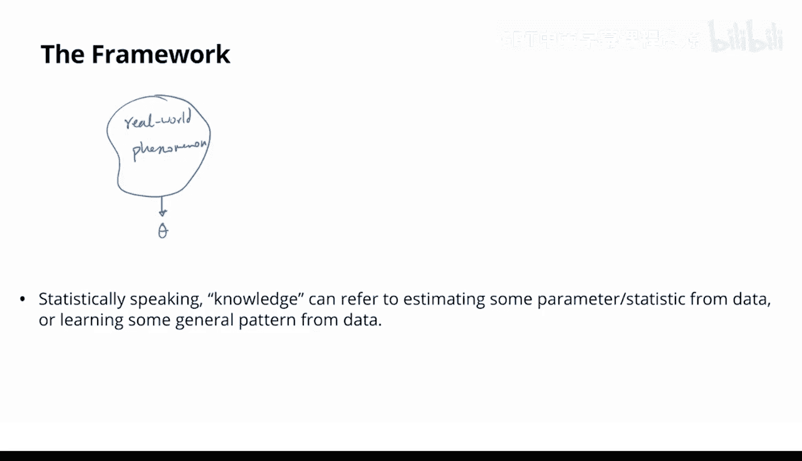

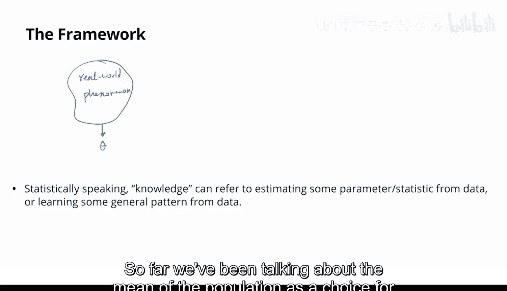

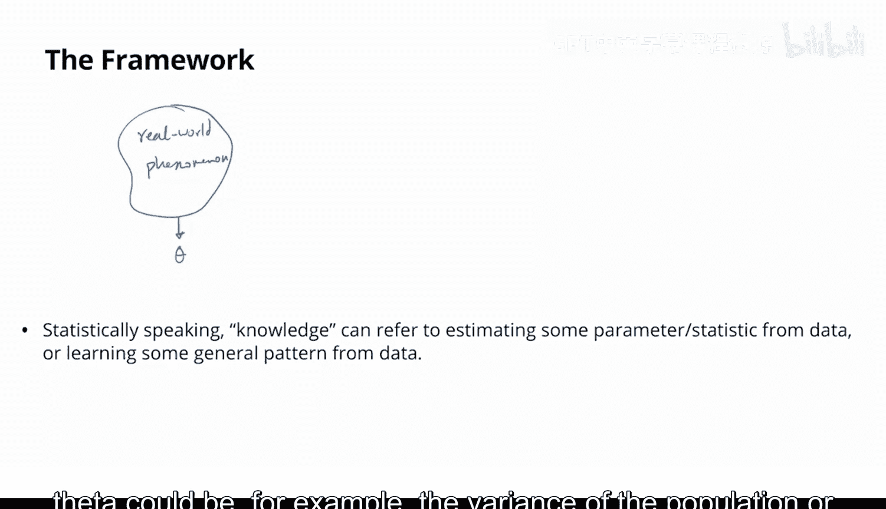

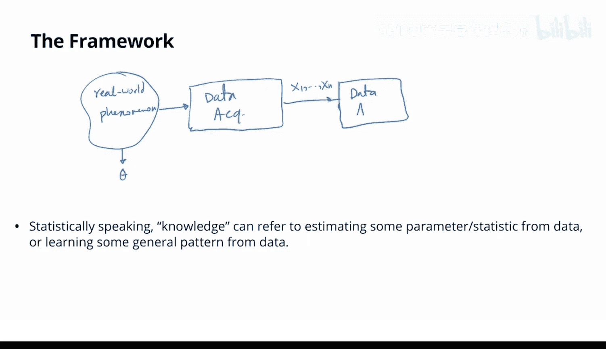

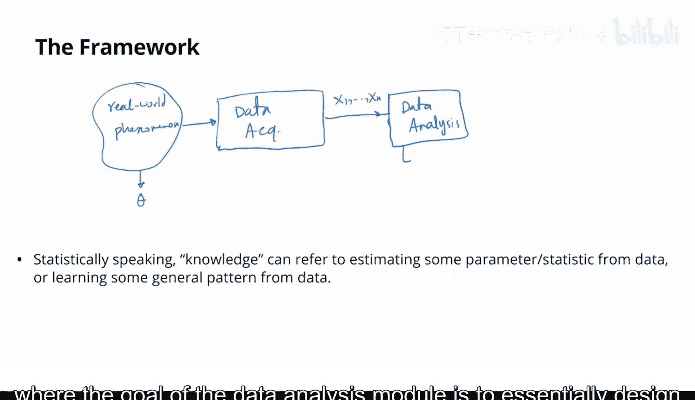

Estimate， design an estimator。To estimate this underlying parametert。 Okay， so design。

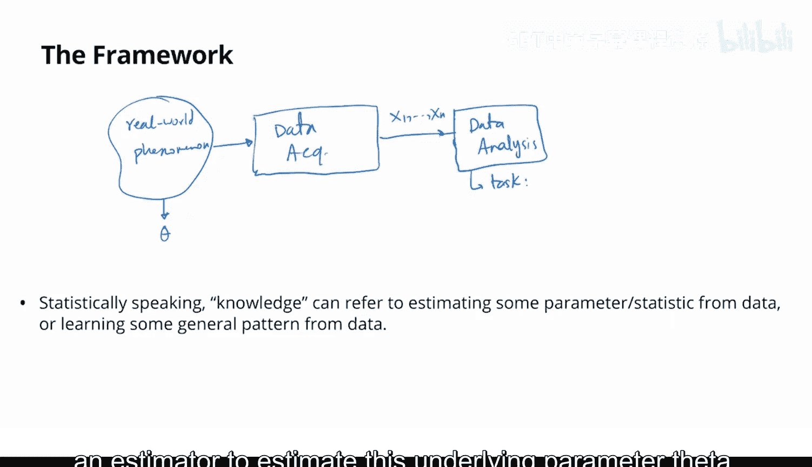

A statistic Theta had。Which takes us input the sample data and gives us an output an estimate for T。

 right？And essentially that in general would be our complete diagrams of knowledge right Well here。

 statistically speaking by knowledge， we essentially mean estimating some parameter or statistic from the underlying data or more generally learning some general pattern from the data。

 but that's the diagram that we are talking so again， in a more general perspective。

 now we have a general parameter of theta， not just the mean of the distribution。

 theta could be the variance could be any other parameter related to the underlying real world phenomenon and what as data scientist what our task is is to design a statistic theta hat here that est the value of theta and such an estimator such such statistic that you see here at that hat is called a point estimator for the parameter t so that's essentially what we mean by point estimation。

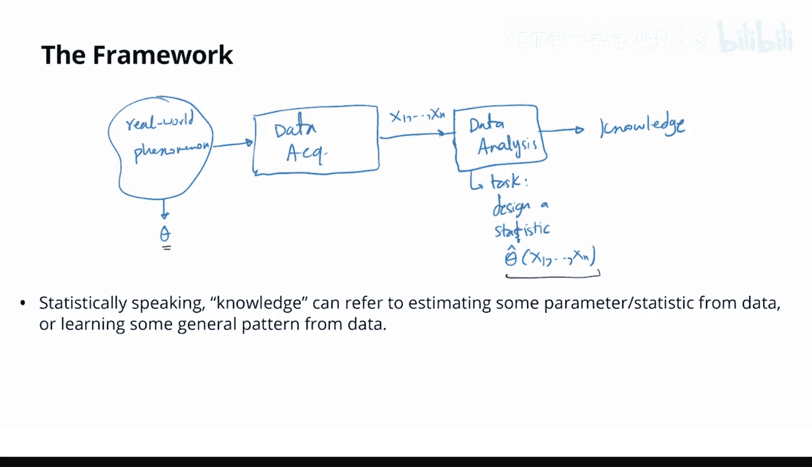

Okay， so these are just the formal definition， a point estimate for a parameter theta is essentially a single number that can be regarded as a sensible value for theta。

😊。

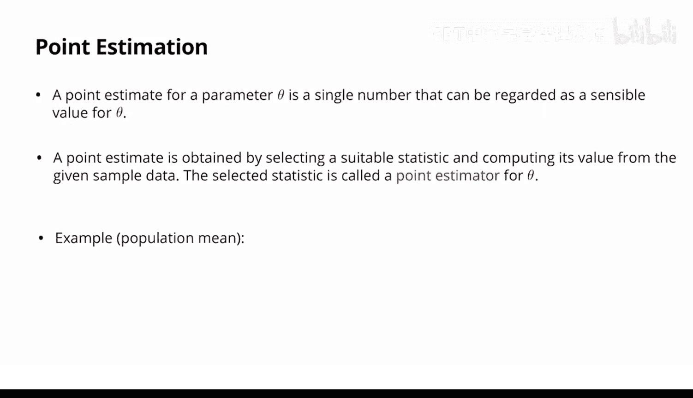

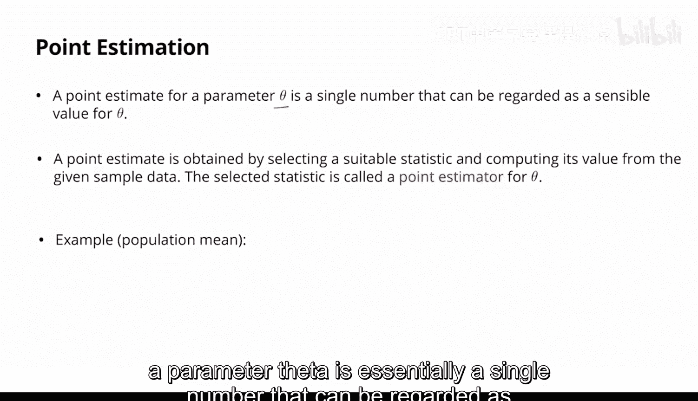

And a point estimate is obtained by selecting a suitable statistics。

 So this statisticteta hat that we have to design and computing is value from the given sample data。

 the seta statistic is called a point estimate for Teta Okay。

 so this is essentially the diagram that I've been talking。

 So let me just give you a few examples here of our estimation problem。

 So going back to our diagram here。 So the simplest example that we have been working on so far is when theta is the mean of the population right So Teta。

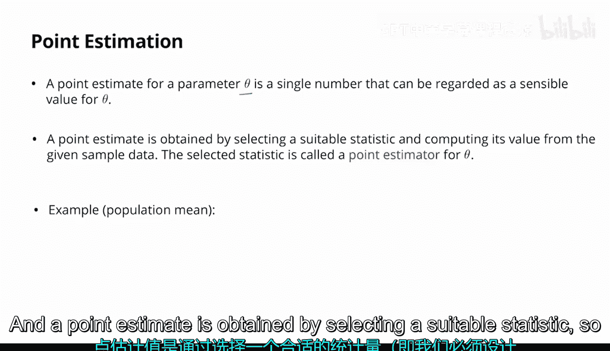

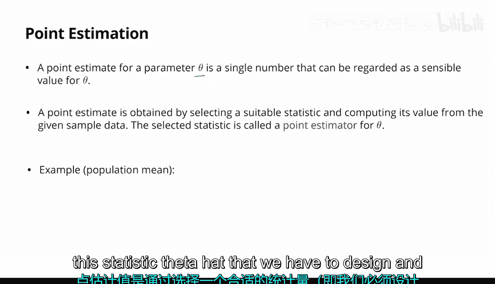

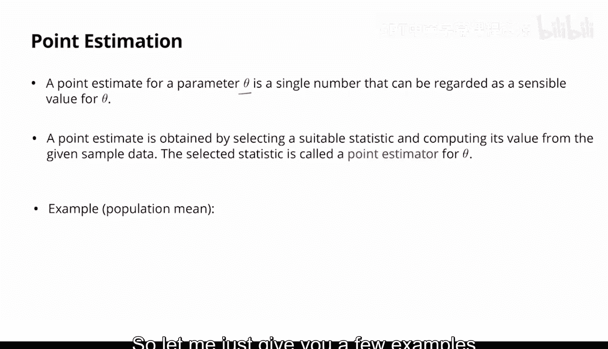

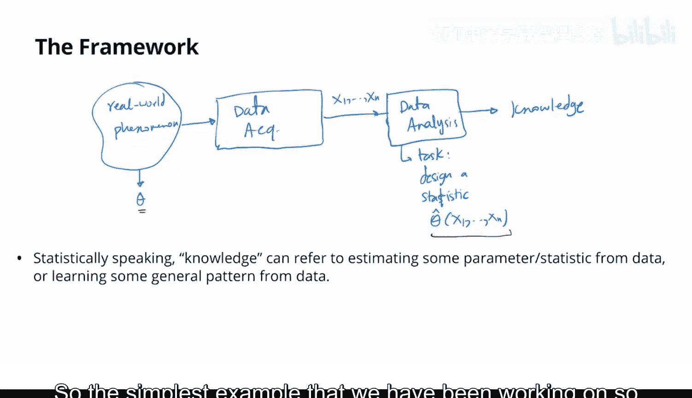

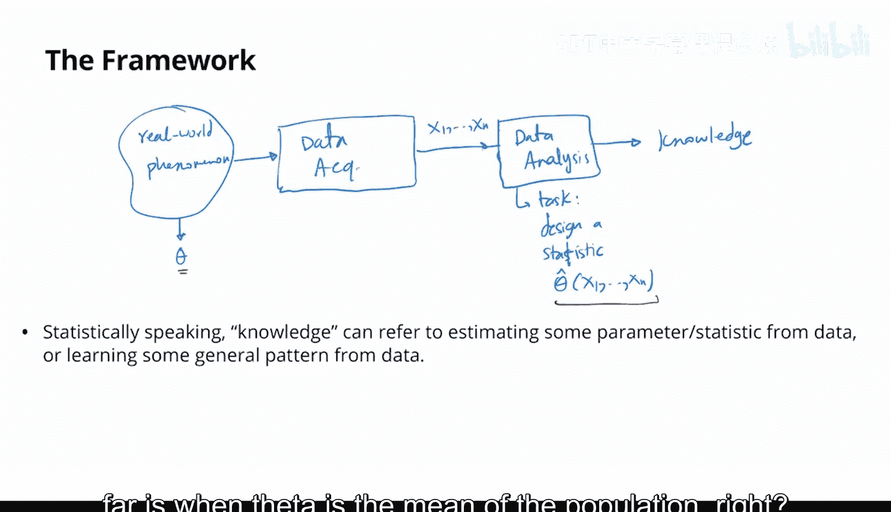

So here is you assume that so your Xs essentially come IID。From distribution。Let's say with mean。

 the mean of the distribution is some value mu and you want to estimate mu okay。

 so mu is essentially the parameter theta and the  estimate would that be designed。

 so let's call it new hat。That takes as input data。

And gives an output an estimate for mu is essentially the sample。

Okay and we essentially now know a lot about this estimator where we know exactly how it behaves。

 We have central limit kind of confidence in barss on its behavior and so on and so forth。

 So that was an example that we have been working out in the last few lectures。

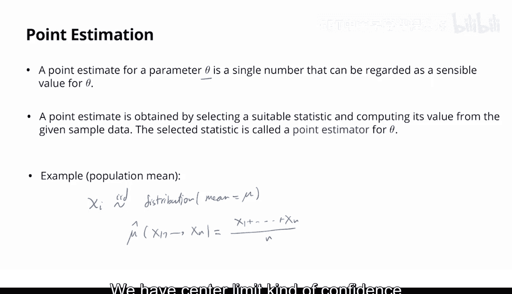

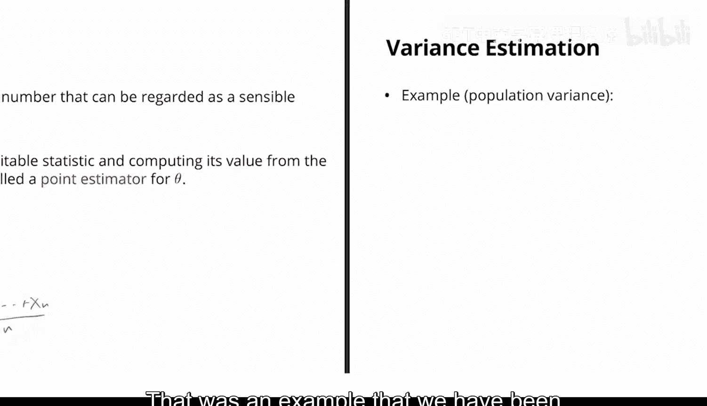

Another example could be divide。😊，Here， again， your data points come from Iidd from some distribution whose mean be dennotote by mu and its variance is denoted by sigma squared。

 and the goal。 So this is this is my parameterteta， essentially that Im want to estimate。

 and the goal is to design。

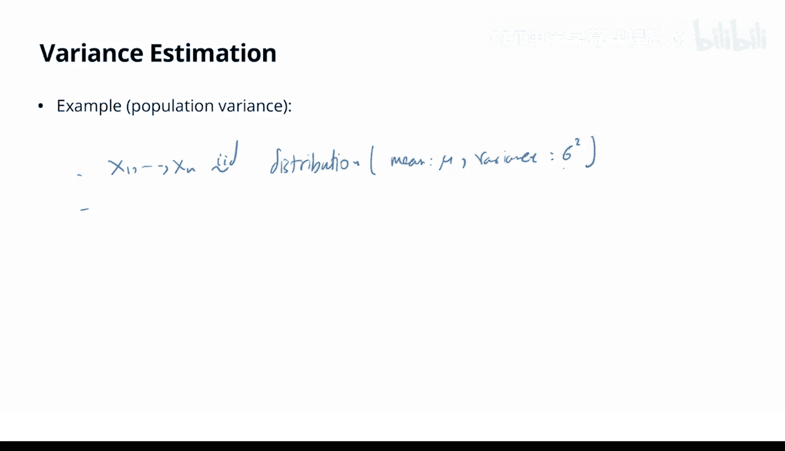

An estimator or the value of Sigma score。

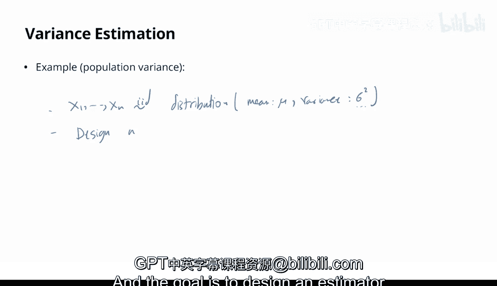

Okay。