# 人工智能和机器学习基础：26：点估计 📊

在本节课中，我们将学习点估计的核心概念。点估计是统计学和机器学习中，利用样本数据来估计未知总体参数的关键方法。我们将从一个更宏观的视角来理解这个过程，并探讨几个具体的例子。

---

## 总体框架与问题定义

上一节我们讨论了如何计算置信区间，这需要从数据中估计总体方差。本节中，我们将这个问题置于一个更普遍的视角下，即**点估计**。

让我们回顾一下我们一直在讨论的总体框架图。我们面对的是某个现实世界的现象。

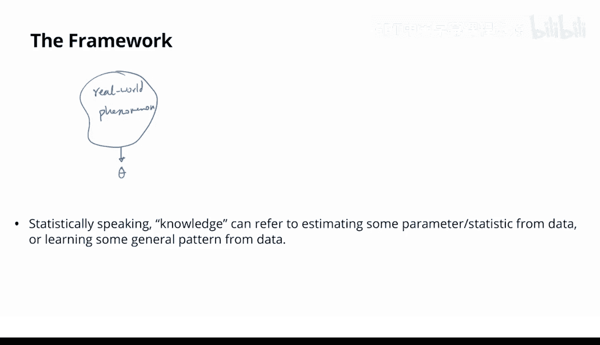

这个现象背后关联着一些参数。我们将其中的一个参数称为 **θ**。我们的核心任务就是去**估计**这个参数 θ。

到目前为止，我们主要讨论的是以**总体均值**作为参数 θ 的例子。但 θ 也可以是**总体方差**，或任何其他描述该现实世界现象的未知参数。这里我们旨在建立一个更通用的视角。

为了估计 θ，我们唯一能接触到的就是这个现象产生的**数据**。数据采集模块会给我们提供 **N** 个独立同分布的数据样本：`x₁, x₂, ..., xₙ`。

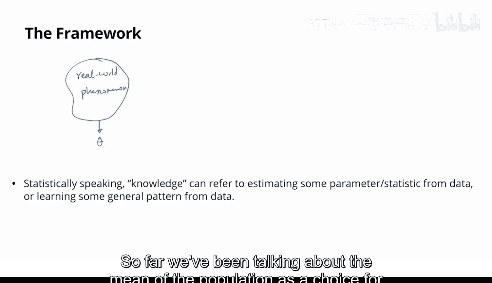

这些数据随后被输入到**数据分析模块**。该模块的目标是设计一个**估计量**，来估计这个潜在的参数 θ。

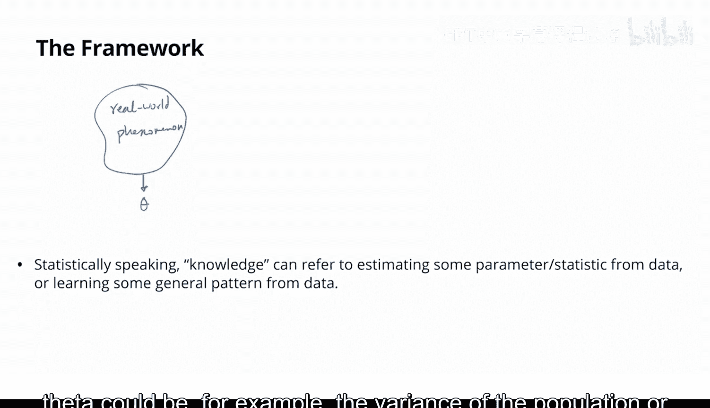

## 估计量的设计

具体来说，我们需要设计一个**统计量**，记作 **θ̂**（读作“theta hat”）。

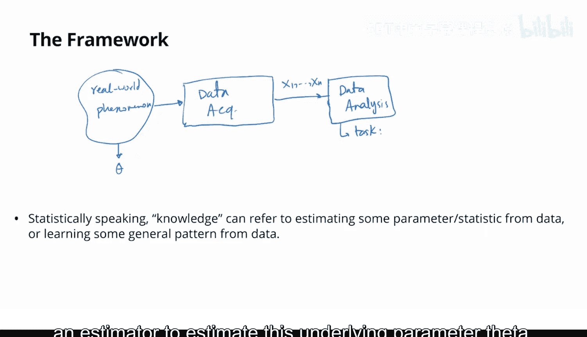

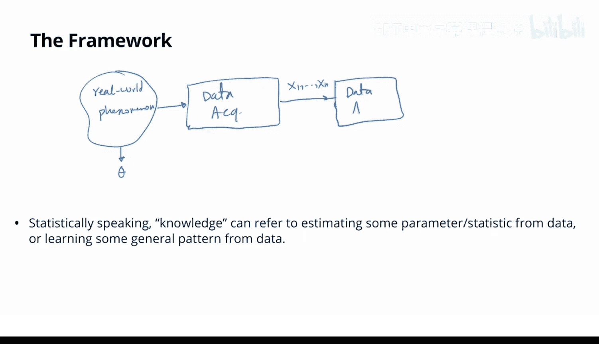

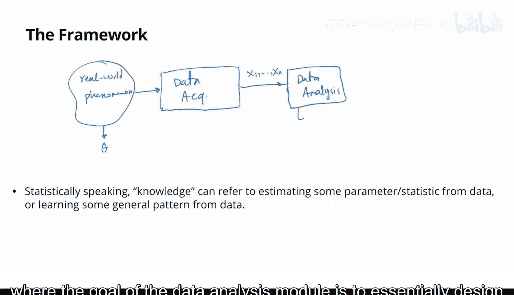

这个统计量 θ̂ 以样本数据作为输入，并输出一个对参数 θ 的**估计值**。

这大致构成了我们知识获取的完整框架。在统计学语境下，“获取知识”通常意味着从底层数据中估计某个参数或统计量，或者更广义地说，是从数据中学习某种普遍模式。

现在，我们有了一个更通用的参数 θ，它不再局限于分布的均值。θ 可以是方差，也可以是任何与底层现象相关的参数。作为数据科学家，我们的任务就是设计一个统计量 θ̂，用它来估计 θ 的值。

我们称这样的统计量 θ̂ 为参数 θ 的一个**点估计量**。这就是**点估计**的核心含义。

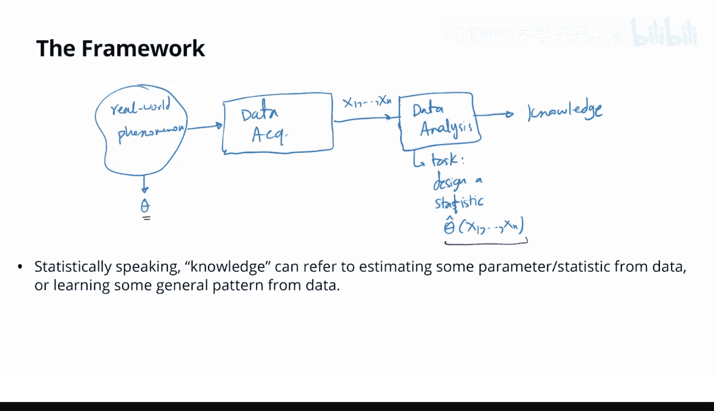

## 点估计的正式定义

以下是点估计的正式定义：

*   **点估计**：参数 θ 的一个点估计，是指可以被视为 θ 合理取值的**单个数值**。
    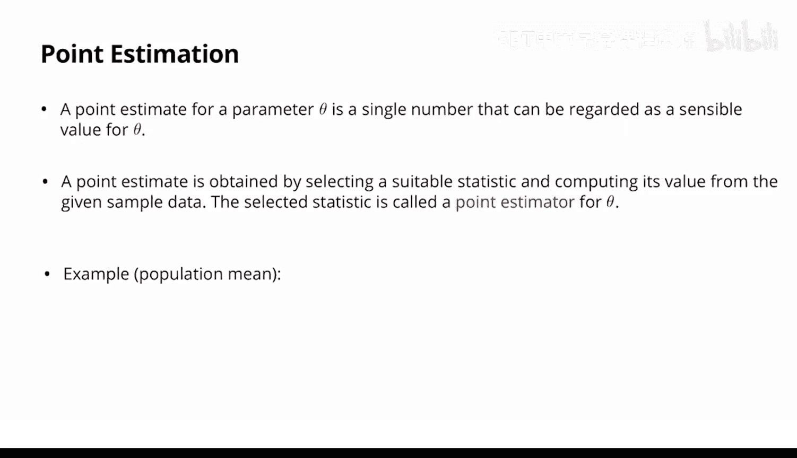

*   **点估计量**：点估计是通过选择一个合适的**统计量**（即我们设计的 θ̂），并根据给定的样本数据计算其值而得到的。这个统计量 θ̂ 被称为 θ 的**点估计量**。
    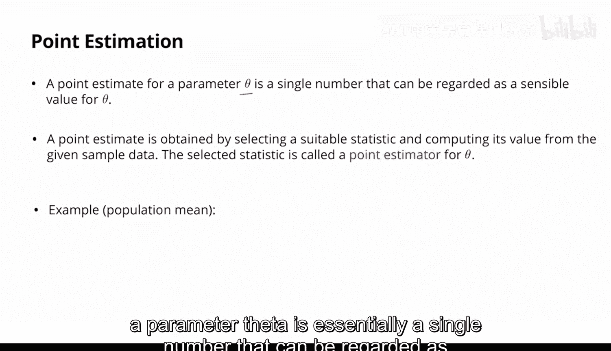

---

## 点估计实例

让我们回到之前的框架图，看几个具体的估计问题例子。

### 实例一：估计总体均值 (μ)

这是我们目前最熟悉的例子。此时，参数 θ 是**总体均值**。

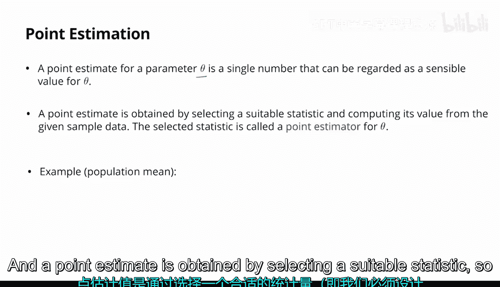

我们假设样本数据 `x₁, ..., xₙ` 独立同分布地来自某个分布，该分布的均值是未知值 **μ**。我们的目标就是估计 μ。

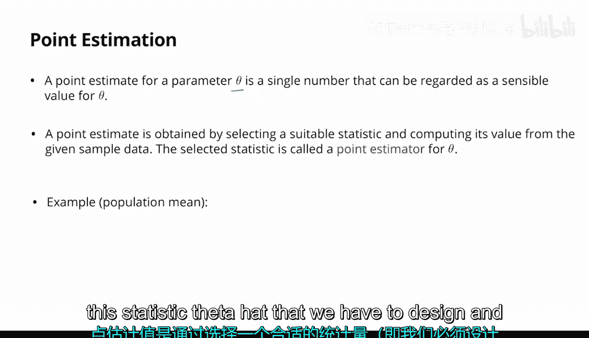

因此，参数 θ = μ。我们需要设计一个估计量，记作 **μ̂**，它以数据为输入，输出对 μ 的估计。

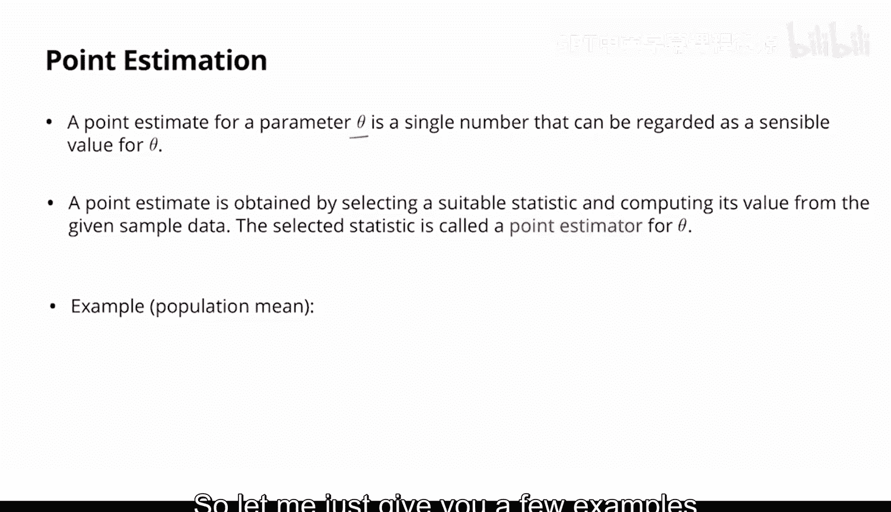

最常用的估计量就是**样本均值**：
`μ̂ = (x₁ + x₂ + ... + xₙ) / n`

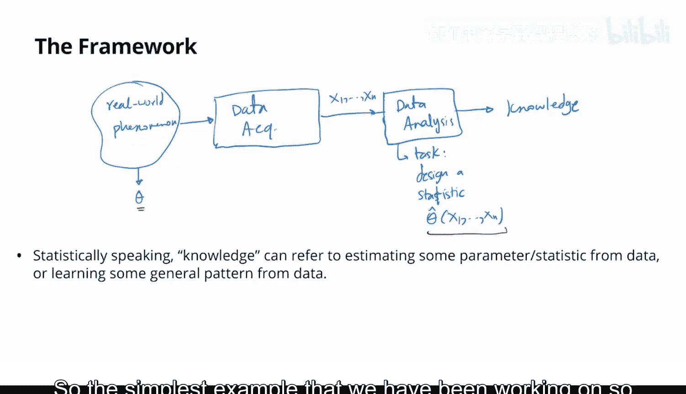

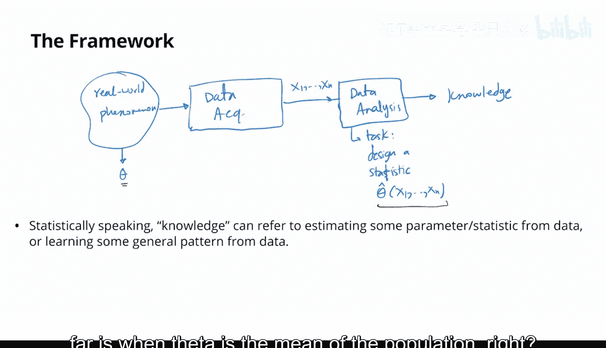

对于这个估计量，我们已经了解很多：我们知道它的行为特性，可以通过中心极限定理来理解，并能构建其置信区间等。这是我们前几节课重点讨论的内容。

### 实例二：估计总体方差 (σ²)

另一个常见的例子是估计**总体方差**。

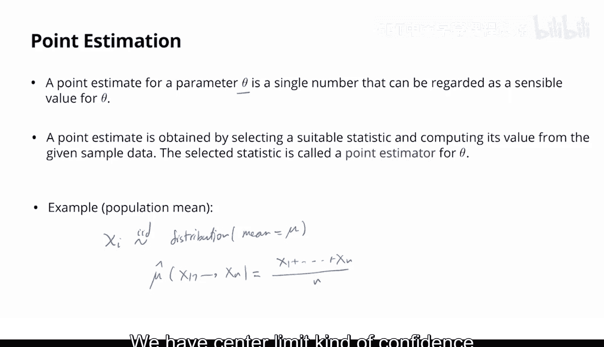

同样，数据点 `x₁, ..., xₙ` 独立同分布地来自某个分布。该分布的均值记为 μ，**方差**记为 **σ²**。

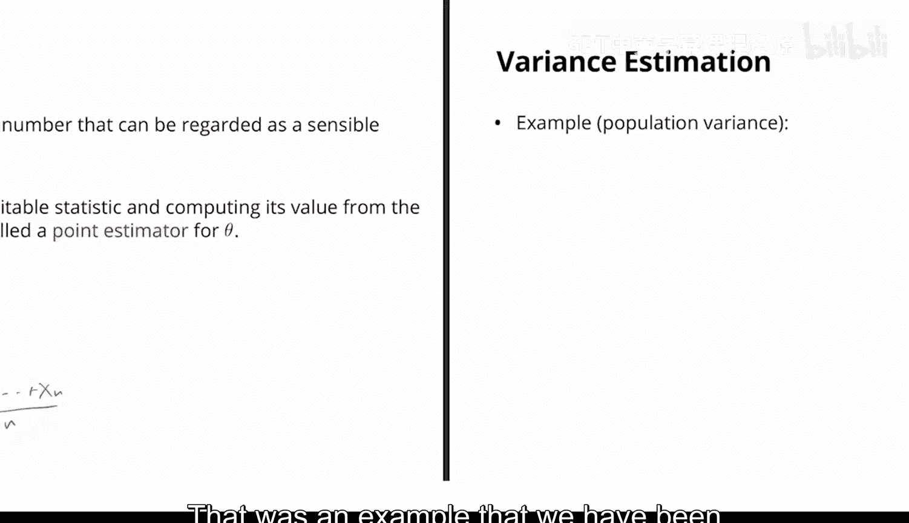

此时，我们的目标参数 θ 就是方差 σ²。

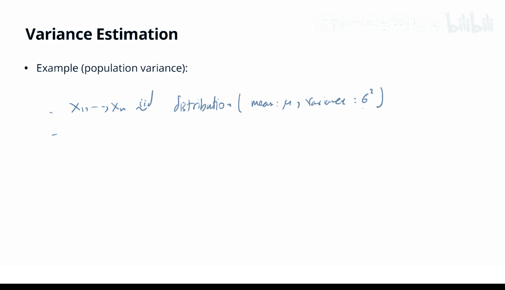

我们的任务是设计一个估计量，来估计 σ² 的值。一个常用的点估计量是**样本方差**：
`σ̂² = Σ (xᵢ - μ̂)² / (n-1)`
其中 μ̂ 是样本均值。

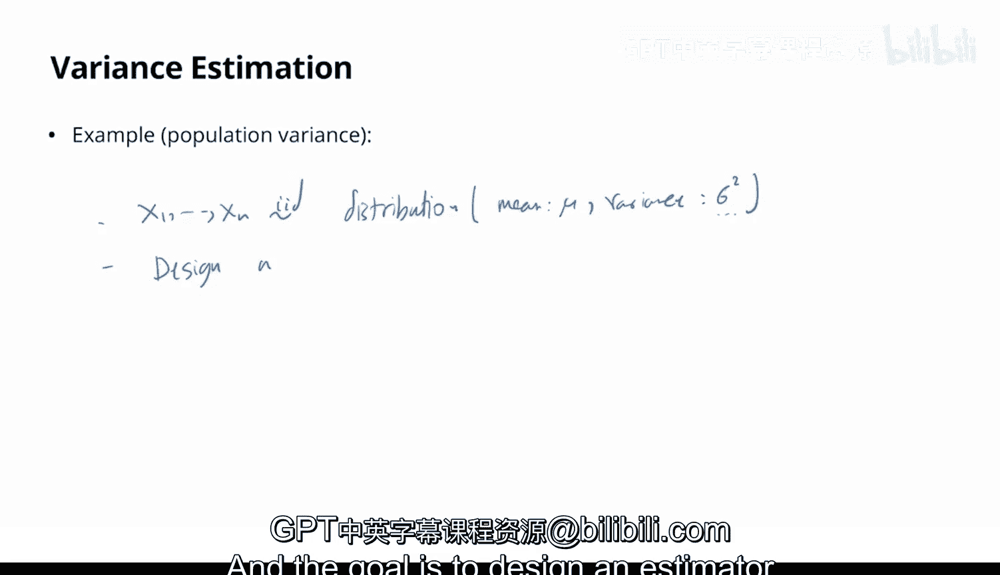

---

## 总结

本节课中，我们一起学习了**点估计**的基本概念。我们从计算置信区间所需的方差估计出发，将问题推广到更一般的参数估计框架。我们明确了参数 θ、样本数据、估计量 θ̂ 之间的关系，并给出了点估计的正式定义。最后，我们通过**估计总体均值**和**估计总体方差**两个经典例子，具体说明了点估计的应用。理解点估计是进行更复杂统计推断和机器学习模型构建的重要基础。