# 宾夕法尼亚大学《人工智能和机器学习基础（AI、数据科学、机器学习）AI and Machine Learning Essentials with Python》 p62 27_04_02_方差估计-有偏与无偏第一部分.zh_en -BV16f421Q72q_p62-

Okay， so now we we're going to essentially talk about how to estimate a variance and whether or not our estimator is good。

 Okay so what we will do is to first design an estimator which is very natural and intuitive and then we'll analyze the different properties of these estimator and then we'll figure out whether or not this estimator could be improved。

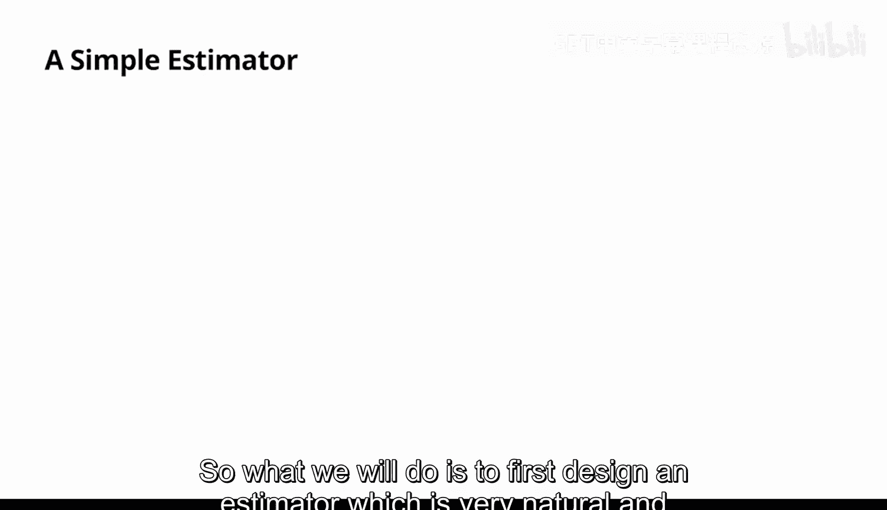

Okay， so let's start with a simple a national estimator。

 so again our setting is that you have n data points x x1 through xn that come II from some distribution。

 which we don't know。But we know that let's just denote the mean of the distribution by mu and the variance。

By sigma squared。 Okay， so right now， what we assume is that the only information that we have is data X1 through X N。

 That's the only thing that as a data scientist， I have access to。 So in other words。

 I don't know what mu is， and I don't know what sig squared is。

 right So whatever that I need to know， I have to approximate it from data。

Now I would like to estimate sigma squared， okay， so let's just write this down so sigma squared by the formula is the expectation。

Of。Am。X minus。A。Yovex。To the power2， right So that's just a formula where x is just a distribution of each of the Xs because X is are I I。

 Okay， so let me just write this as expectation。Of x minus muu squared。

Now let's try to design an estimator here。 So if let's assume for the for the moment that we know the value of mu okay。

 so if we know what mu is designing an estimator for this quantity from data would be quite easy right because。

So we are trying to estimate an expectation of this quantity here okay。

 but samples from this quantity can be computed from data right， So each if you look at X I。

Minus muu。To the power， too。Each of these values so x for I from1 to n。So each of these values。

 X minus mu to the power 2 would be essentially a sample from this random variable x minus mu squared here。

 Okay so if I want to estimate the expectation of this quantity。

 then a good estimator would be just the sample mean right， so and the sample mean would be。And。

The sample mean over these values， X I minus mus to the power 2。 So X I X。

 So it would be just x1 minus mu to the power 2 plus x2 minus mu to the power 2。

All the way to x N minus mu。To the power2 over it， right。

So if we knew what the value mean was exactly if that information was given to us。

 then this estimate here。

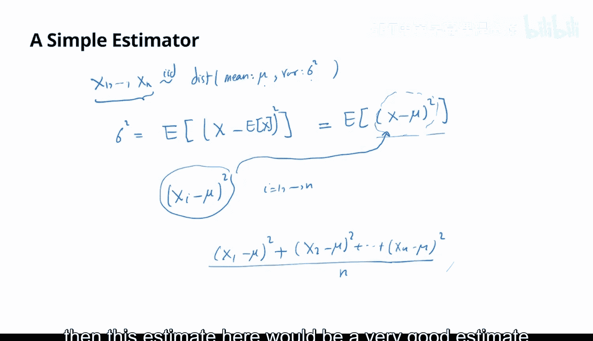

Would be a very good estimate of expectation of x minus mu to the power2 right So even in expectation。

 the expectation of this value would be equal to the expectation of this value here。

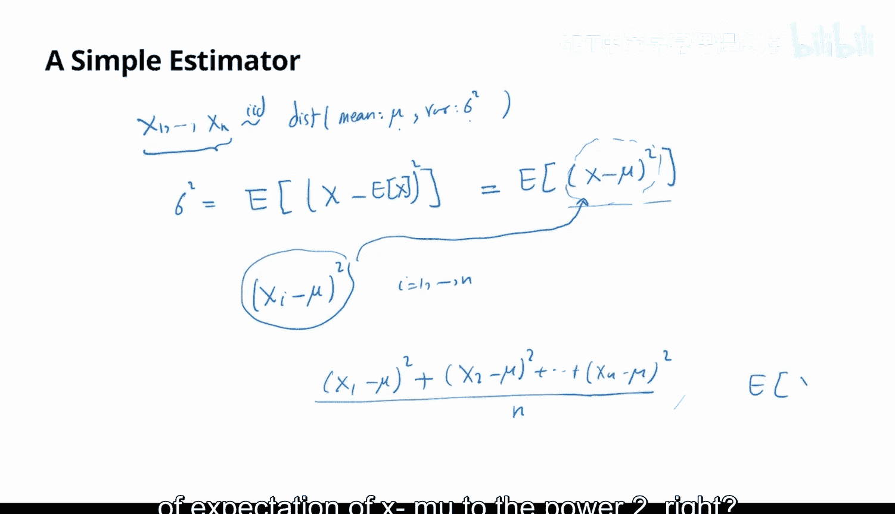

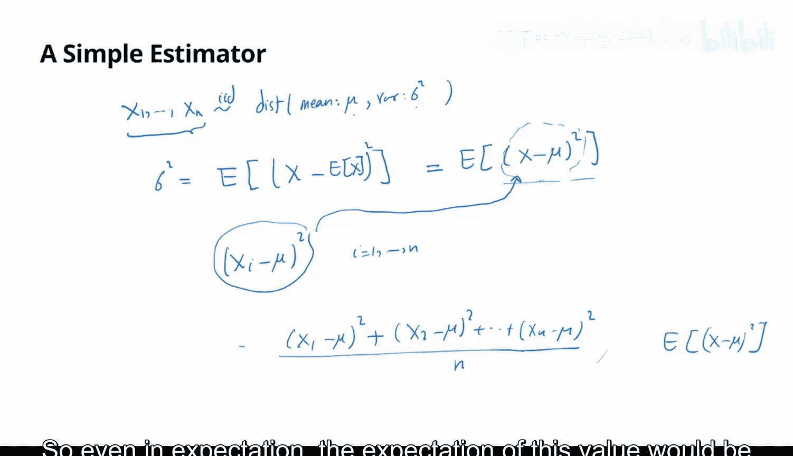

To this value here and each of these X minus mus to the power twos were just a sample from this random variable that you see here。

 now the caveat of this argument here is that the value mu itself is unknown right the only thing that we have access to its data So we don't know what the value of mu is but we've already talked about how to estimate the value of mu right。

 So one way to do that， which was a very good way was to essentially estimate mu。

Using the sample min itself， sample min of the data。

 So mu you can estimate it by some mu is essentially the expectation of x。

 which can be estimated by the sample min X1 for x n over n right。

 and this we also denoted by x bar So the essentially what we what we could do in this estimator that we designed was to essentially replace the value mu by x bar because x bar would be a good estimate for mu。

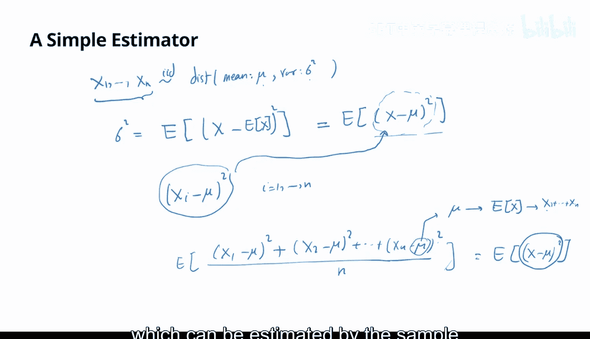

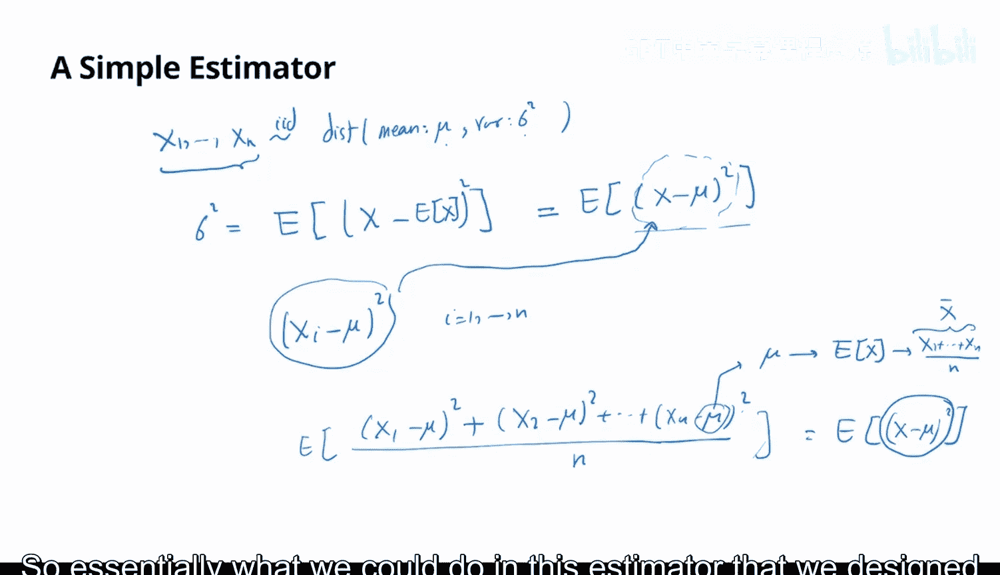

So the final estimate would be just the， the average of。

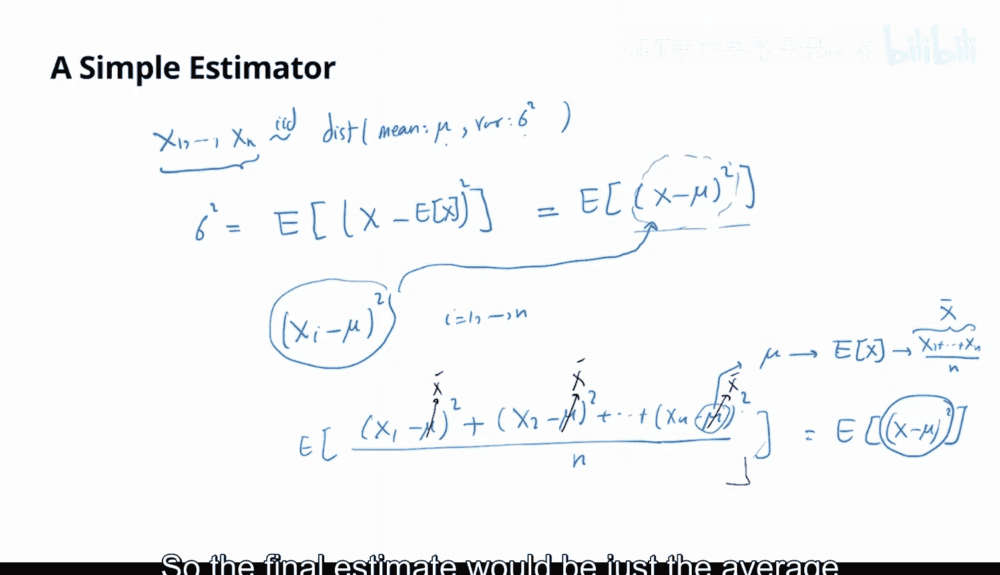

X Is minus x barss to the power to。 Okay， so that was the intuition of what we did。

 Let me just detail these steps that I mentioned in a more principled way。 Okay， so step 1。

 I'm just explaining how we obtained that estimator。 So step 1。

 we noted that the formula for sigma squared was expectation。

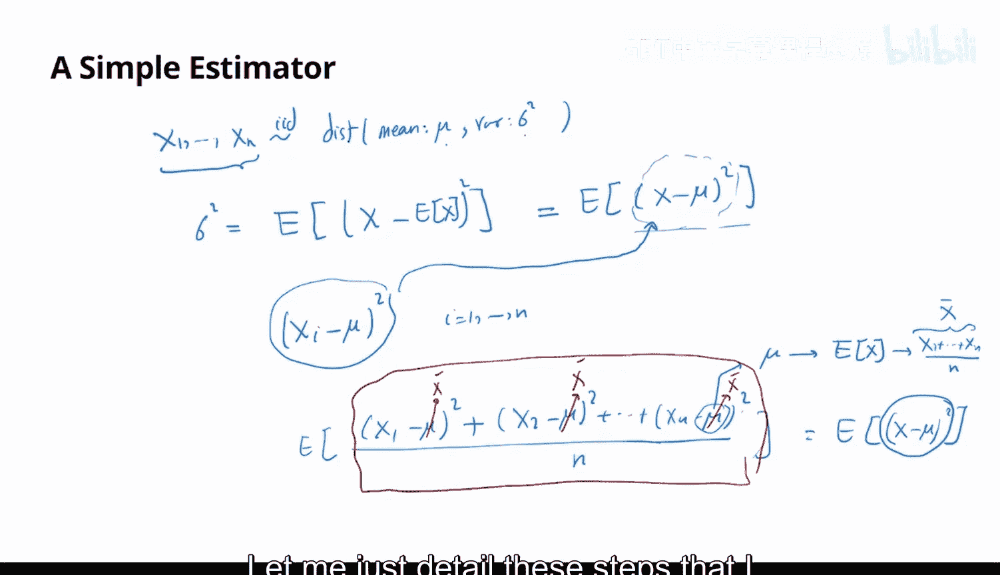

Of let's say， x minus mu squared。Where Miu was。So this expectation of x， right。

So we know that if the information about the value mu was given to us。

 then a good estimator would be the following would be。So this value here would be estimated。S Xing。

That。Me is given。Would be estimated by。The average of X I minus mu to the power to， right。

Plus x 2 minus mu to the power 2。On the way to X N minus mu to the power to。Over okay。

 so if we knew the value of mu， that would be a very good estimate of the quantity sigma squared。

 right， now we don't know the value of mu。 So in a step 2， we would estimate the value mu itself。

 And we already know how to do that but using the sample mean， right。

 So since let me just write this。 So since。Mu is unknown。Will。😔，Have to。Estimated。Using。😔，Data。

And we know how to do that， right， So explore。Which is the sample mean。Is a good estimator。

 So we just， instead of So going back to this formula here。Instead of mu， we just have to use X okay。

 and that would give us an estimator for sigma squared using date so。Hence。We arrive。

At the following estimator。Okay， which is， let me call it sigma。2， let me call it bar。

Which is one over n。Some over the data points， I from 1 to n。X I minus x bar to the power to。 Okay。

 so that's an estimator。 Let's call a sigma 2 bar， which is found exactly。From data。

 So X I is the individual data points and export itself is the average of the data points。

All right， so that's a very intuitive estimator that we designed using whatever we have learned before。

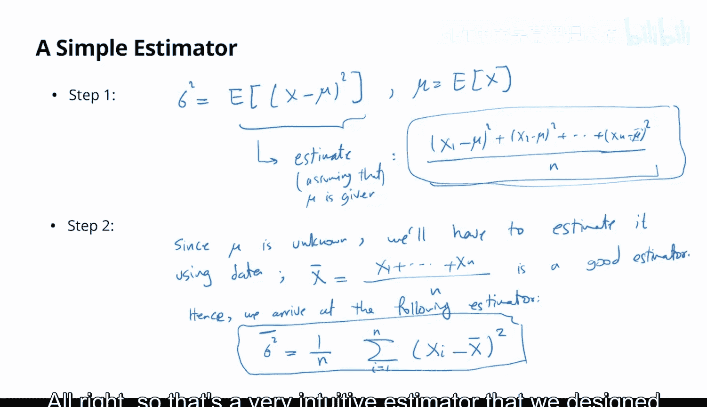

So the next task that that as a data scientist， we always have when we design an estimator is to evaluate how good our estimator is Okay。

 how good this design estimator is。And the first step， this。

 you should always remember the first a step in。Evaluating the performance of the estimator is to see whether or not this estimator is biased。

 Okay， so let me now explain and define what we mean by biased。 by by a biased estimator。

 and then we'll get back to our estimator and investigate whether or not it's biased。 Okay。

 so the first step in evaluating the performance of a design estimator is to see whether or not is biased。

 Okay， so that's good。 what what is， what is the bias of the estimator。

 So given a point estimator theta hat。 Okay， so that's what we are。

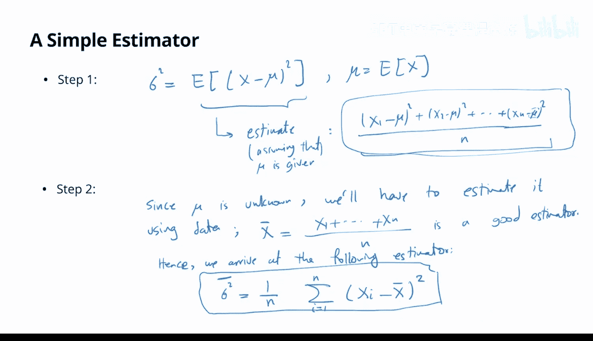

Designing to estimate a parameter theta， the bias of the estimator would be the expected value of theta hat over the randomness of the data。

 So expectation over all the possible values of x1 through Xn because Xs are random variables Theta hat the outcome of theta hat itself is a random variable So expectation of that minus the actual quantity theta that theta hat is aiming to estimate so this difference would be called the bias of the estim and well ideally what we would want to have is that on average our estimator is exact。

 meaning that on average over all the data points or estimator theta hat would give us the exact value theta。

So in other words， the estimator theta hat would be called unbiased if this difference。

 the bias is0 so if on average our estimator would return the exact value of the parameter theta that we are looking for。

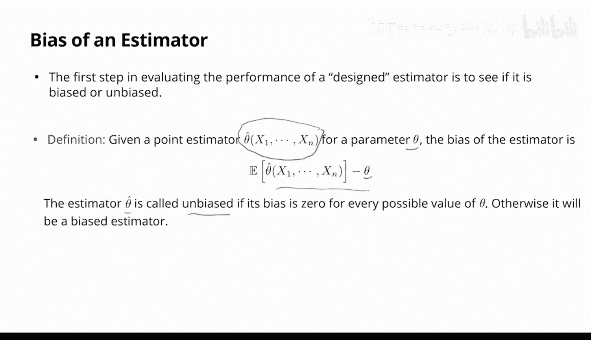

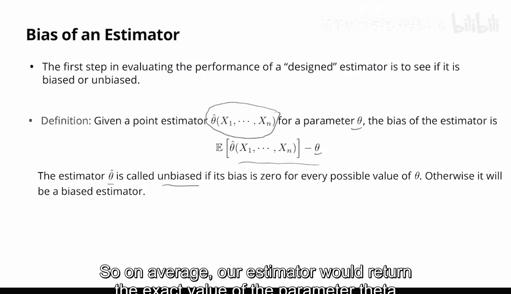

And otherwise， it will be called an a biased estimate。 Okay。

 so it's unbiased if the bias is 0 and otherwise is unbiased。 Okay。

 so in let me just explain this the meaning of bias again。 So if we look at the PF。Of。

The outcome of our estimator theta hat of x1 through x And remember， since X is are random variables。

 the outcome of the hat is also a random object。 So you look at the Pf of the outcome。 Okay。

 so that's one what that's the Pf。And on average， the average of this Pf is some value， right。

 so let's call it the expectation of theta hat。Now， the estimator would be called unbiased。If。

 on average， the expectation of theta hat coincide sizes with the original value。

 Thetahat that is trying to estimate。 Okay， so if I draw。The value thatta hat here。

The actual value of theta， so if this is theta here， so this is the expectation， this is theta。

If these two are different， if theta is here， for example， and expectation of theta is here。

 if there is a gap， then the estimator is biased because this difference is non0 and。

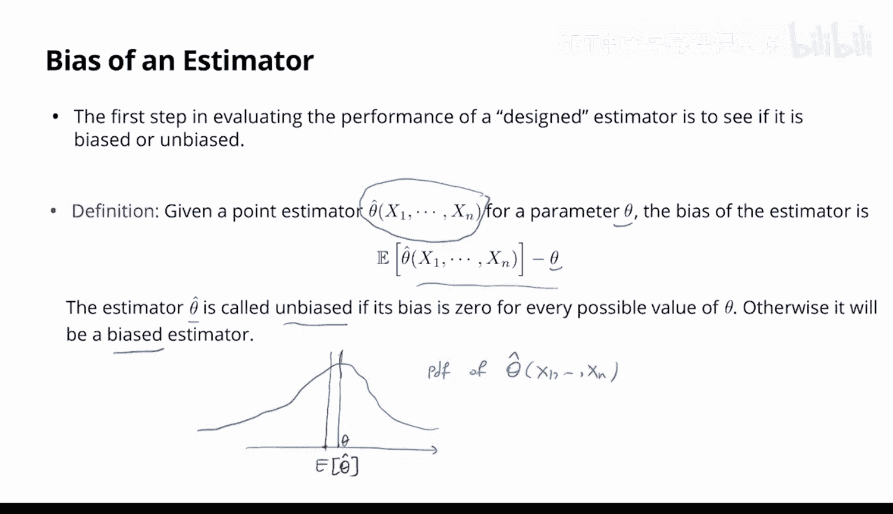

It's called bias if the expectation of the ta is exactly equal to the original value type。

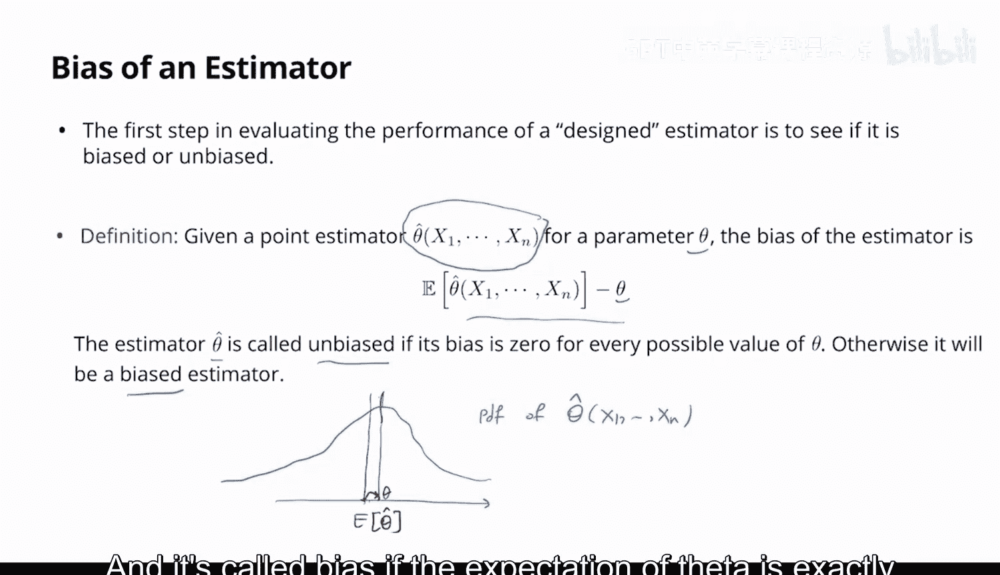

Okay， so that's the essentially an intuitive explanation of the bias of a random worry。

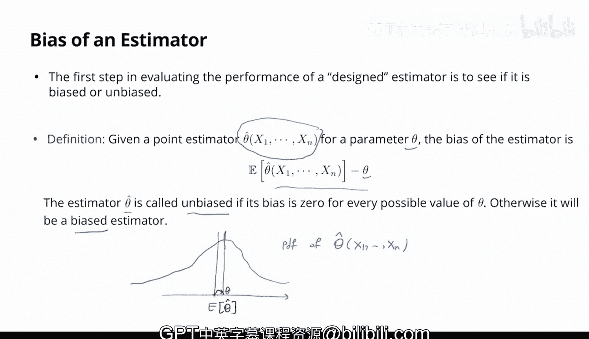