# 人工智能和机器学习基础：27：方差估计-有偏与无偏（第一部分） 📊

在本节课中，我们将学习如何从数据中估计一个分布的方差，并评估我们设计的估计量是否“好”。我们将从一个非常直观的估计量开始，分析其性质，并探讨它是否有改进的空间。

## 概述与问题设定

我们的设定如下：我们有 `n` 个数据点 `x1, x2, ..., xn`，它们独立同分布地来自某个我们未知的分布。我们只知道该分布的均值记为 `μ`，方差记为 `σ²`。作为数据科学家，我们唯一能接触到的信息就是这些数据点 `x1` 到 `xn`。换句话说，我们既不知道 `μ` 的真实值，也不知道 `σ²` 的真实值。因此，我们需要从数据中近似估计出这些参数。

现在，我们的目标是估计方差 `σ²`。

## 设计一个直观的估计量

根据定义，方差 `σ²` 的公式是：
**σ² = E[(X - μ)²]**
其中 `X` 是分布中的随机变量，`E` 表示期望。

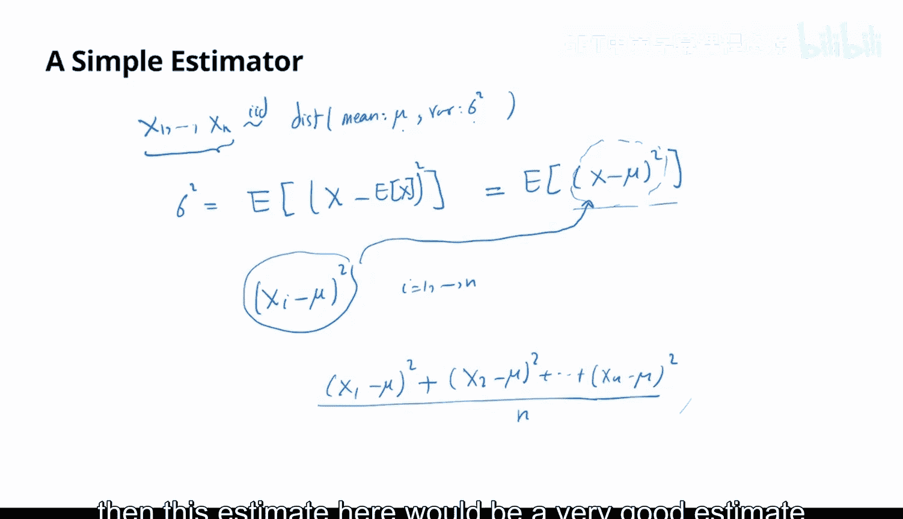

让我们尝试设计一个估计量。首先，我们假设一个理想情况：**我们知道均值 `μ` 的真实值**。

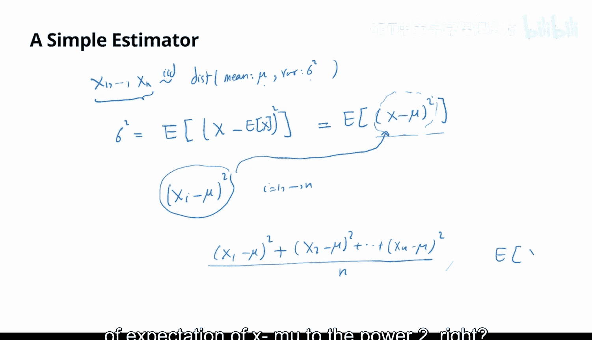

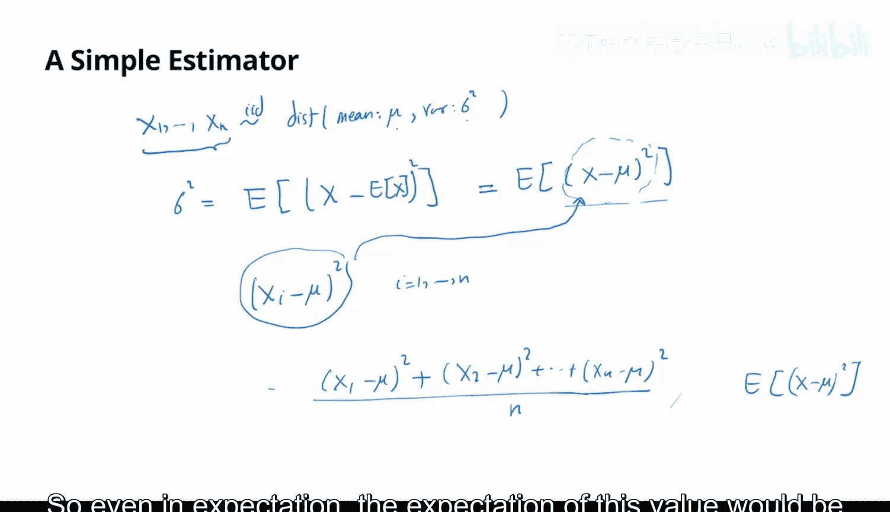

在这种情况下，从数据中估计 `σ²` 会变得非常简单。因为对于每个数据点 `xi`，计算 `(xi - μ)²` 就得到了随机变量 `(X - μ)²` 的一个样本。要估计 `E[(X - μ)²]`，一个很好的方法就是计算这些样本的均值，即样本平均。

因此，如果 `μ` 已知，一个好的估计量是：
**σ²_hat (μ已知) = (1/n) * Σ (xi - μ)²**

这个估计量在期望上等于真实的 `σ²`，因为每个 `(xi - μ)²` 的期望就是 `E[(X - μ)²]`。

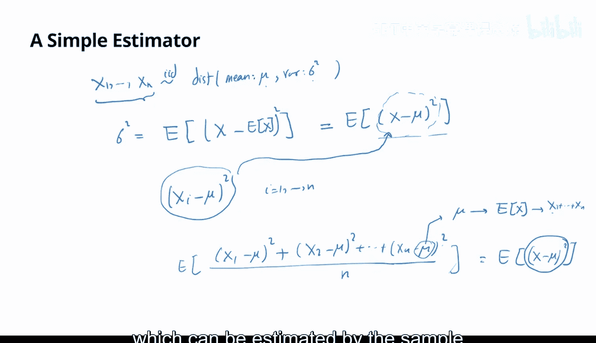

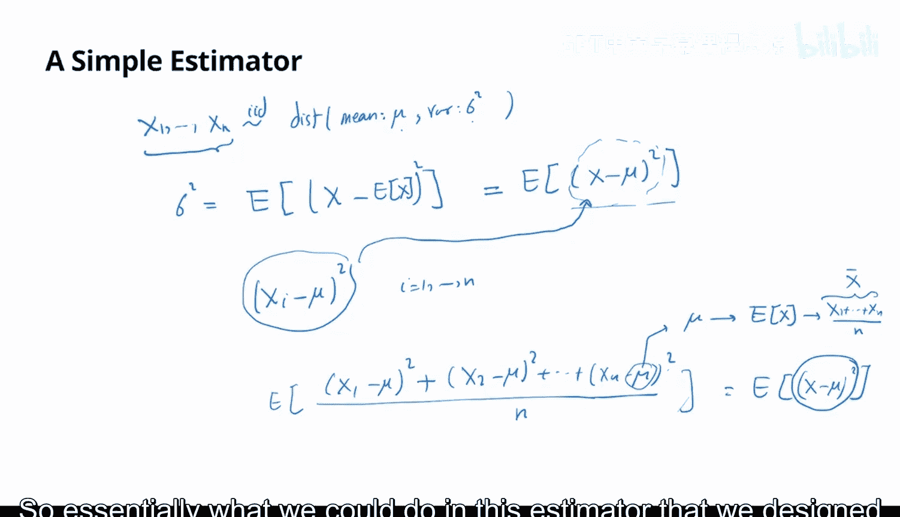

然而，问题的关键在于，**我们并不知道 `μ` 的真实值**。我们只能从数据中估计它。

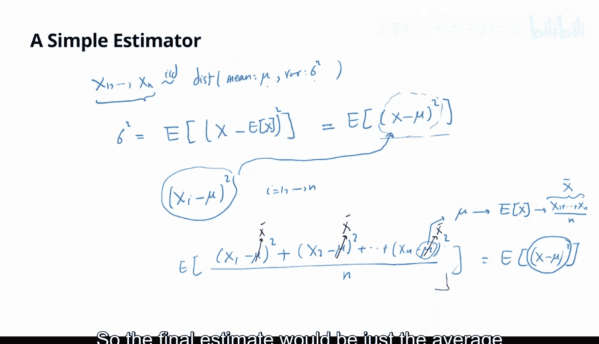

## 用样本均值替代真实均值

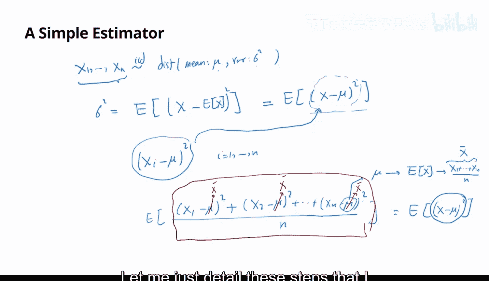

我们已经知道如何估计均值 `μ`：一个非常好的方法就是使用样本均值 `x̄`。
**μ_hat = x̄ = (1/n) * Σ xi**

一个很自然的想法是，在我们设计的估计量公式中，用样本均值 `x̄` 来替代未知的真实均值 `μ`。

因此，我们得到了最终的方差估计量：
**σ²_bar = (1/n) * Σ (xi - x̄)²**

这个估计量完全由数据计算得出：`xi` 是单个数据点，`x̄` 是所有数据点的平均值。这是一个非常直观且基于我们已有知识的估计量。

## 评估估计量：偏差的概念

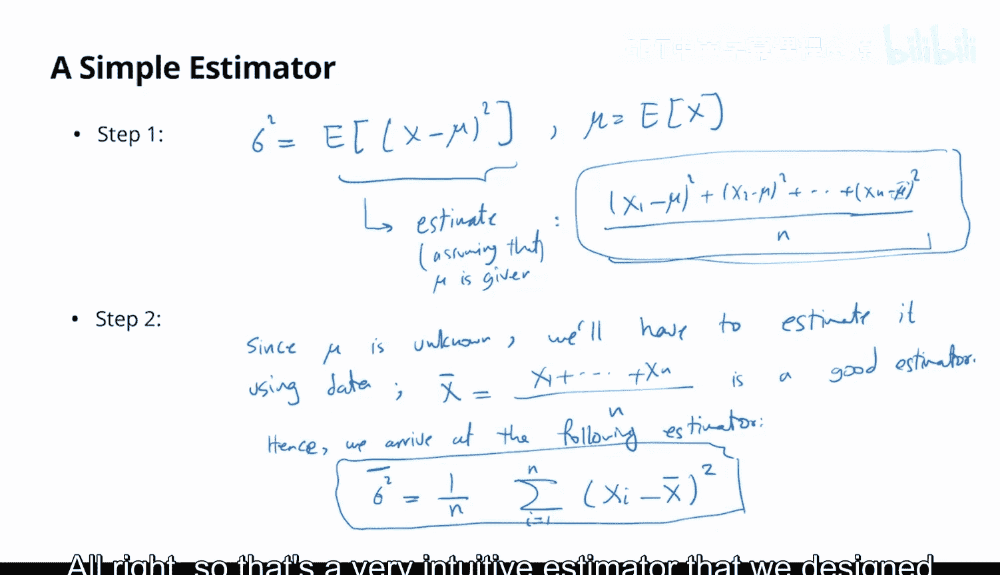

设计出一个估计量后，作为数据科学家，下一步总是要评估它的好坏。评估估计量性能的第一步，就是检查它是否是**无偏的**。

那么，什么是估计量的偏差呢？

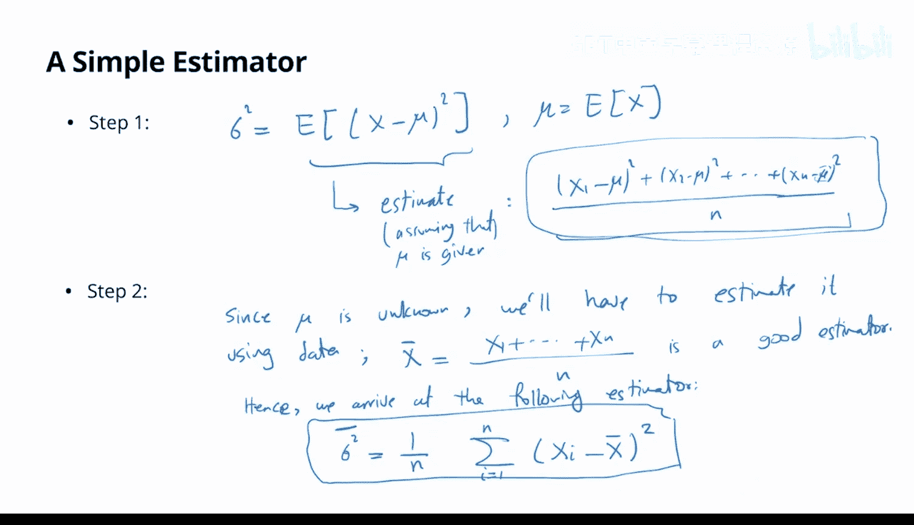

给定一个用于估计参数 `θ` 的点估计量 `θ_hat`，其偏差定义为：
**Bias(θ_hat) = E[θ_hat] - θ**

其中，期望 `E[θ_hat]` 是对所有可能的数据 `x1, ..., xn` 的随机性取的。因为数据是随机变量，所以估计量 `θ_hat` 本身也是一个随机变量。偏差衡量的是估计量期望值与真实参数值之间的差距。

理想情况下，我们希望估计量在平均意义上是准确的。也就是说，平均来看，我们的估计量 `θ_hat` 应该给出真实值 `θ`。

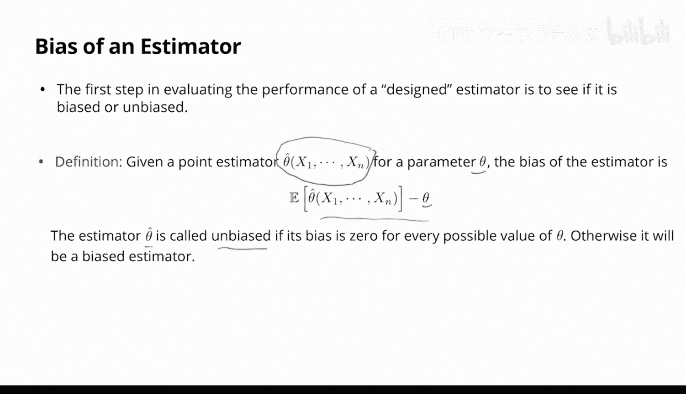

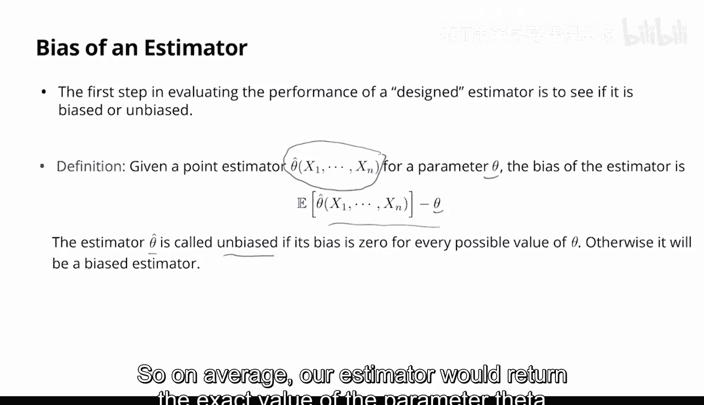

因此：
*   如果 **Bias(θ_hat) = 0**，即 **E[θ_hat] = θ**，则称估计量 `θ_hat` 是**无偏的**。
*   否则，估计量就是**有偏的**。

直观地理解，我们可以想象估计量 `θ_hat` 输出值的概率分布。这个分布有一个平均值 `E[θ_hat]`。如果这个平均值恰好落在真实参数值 `θ` 上，那么估计量就是无偏的；如果存在一个差距，那么这个差距就是偏差。

## 本节总结

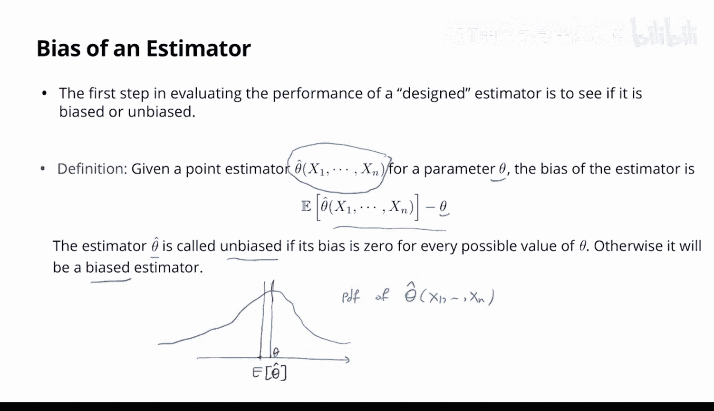

在本节中，我们一起学习了方差估计的起点。我们从一个理想情况（已知均值）出发，设计了一个直观的方差估计量。接着，面对均值未知的现实，我们用样本均值进行了替代，得到了一个完全基于数据的估计量：**σ²_bar = (1/n) * Σ (xi - x̄)²**。

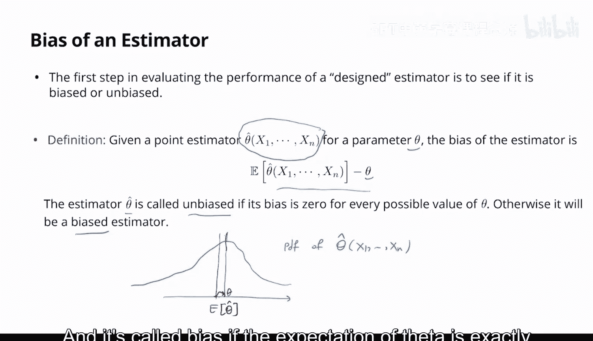

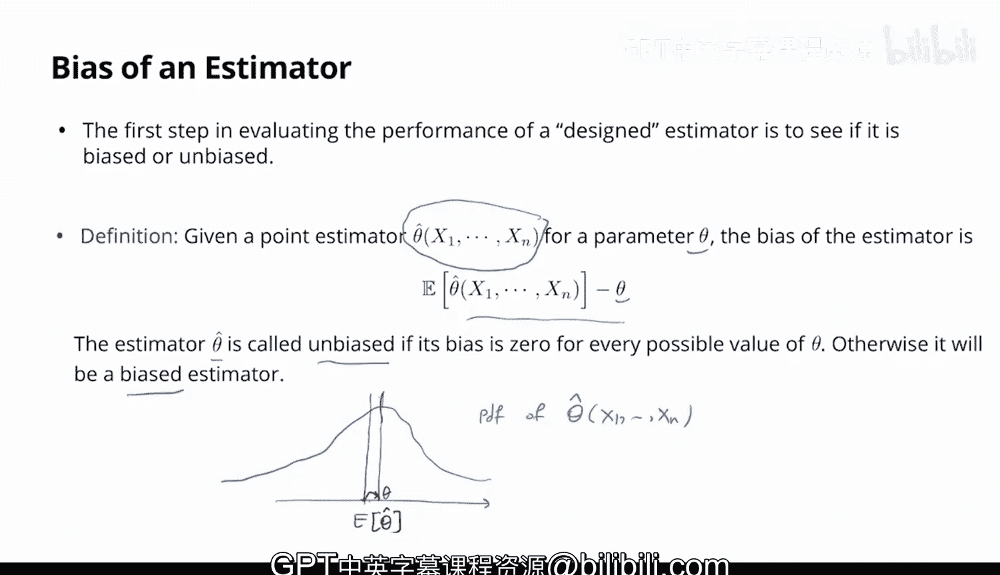

最后，我们介绍了评估估计量好坏的首要标准——**偏差**。一个无偏估计量意味着其期望值等于待估参数的真实值。那么，我们刚刚设计的这个方差估计量 `σ²_bar` 究竟是无偏的还是有偏的呢？这将是下一节我们要深入分析和解答的核心问题。