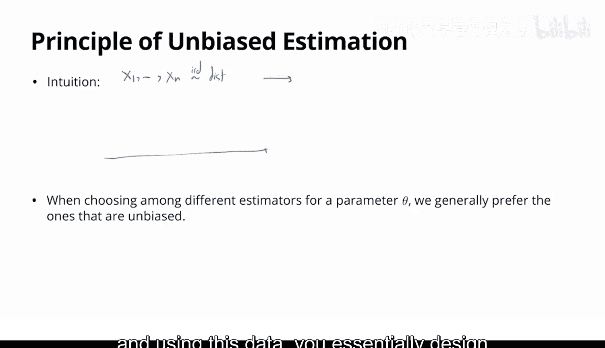
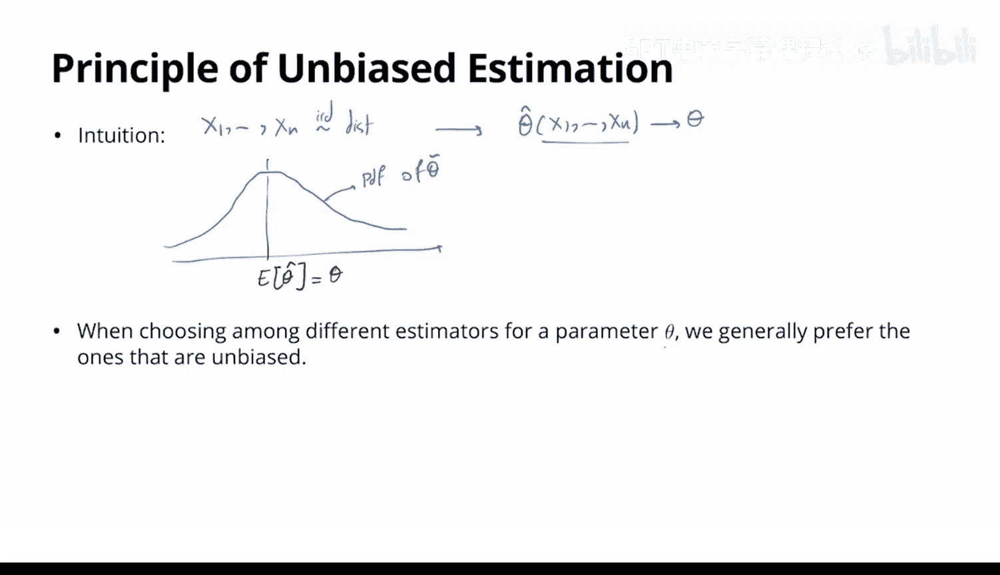
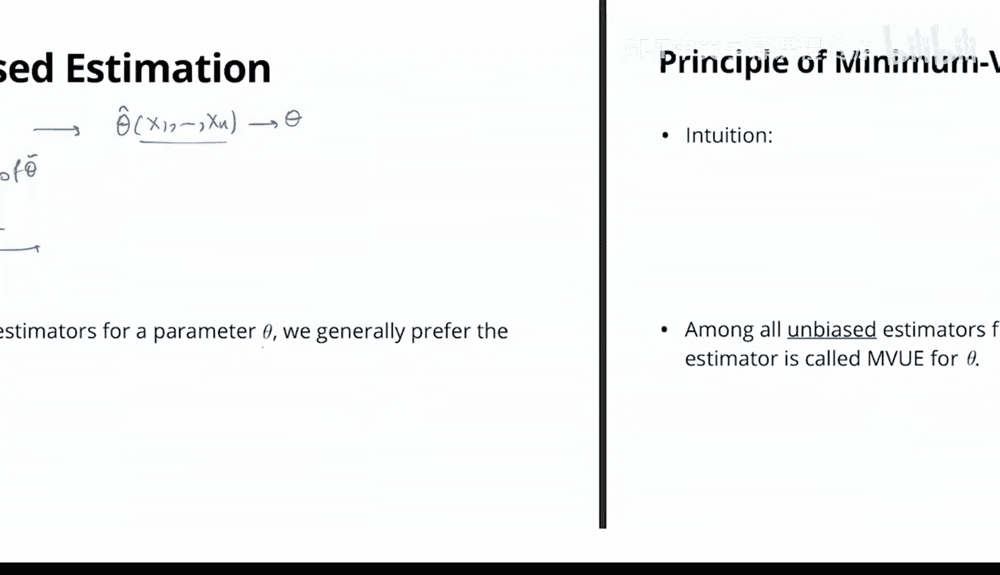
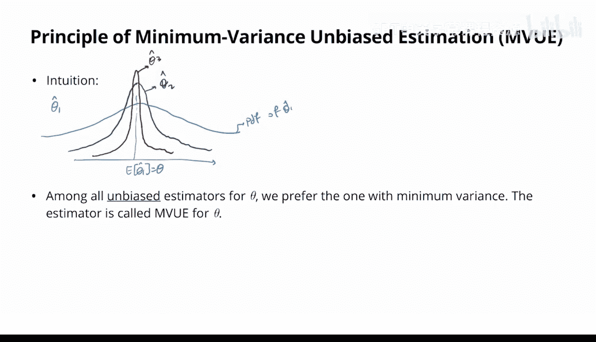
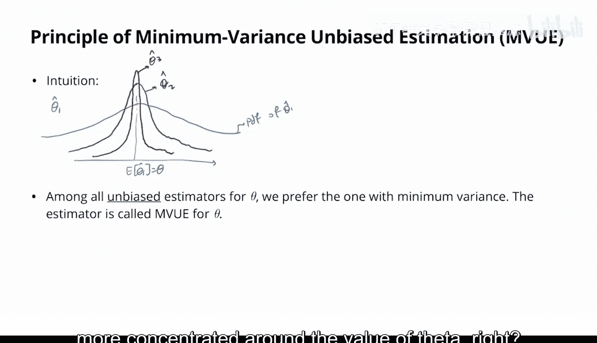
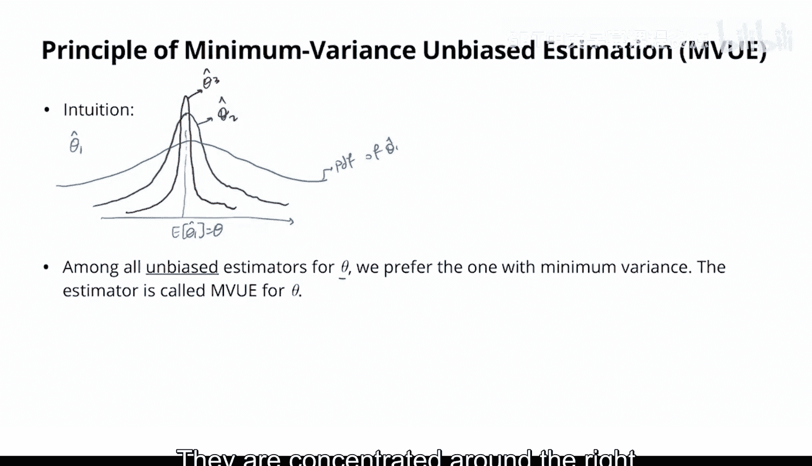
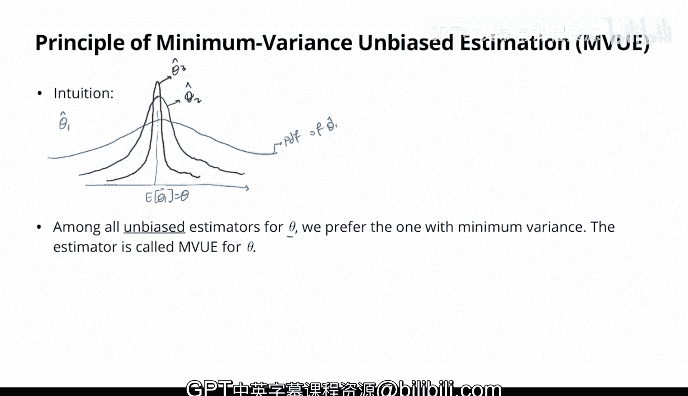

# 宾夕法尼亚大学《人工智能和机器学习基础（AI、数据科学、机器学习）AI and Machine Learning Essentials with Python》 p64 29_04_02_点估计的两个原则.zh_en -BV16f421Q72q_p64-

In the previous section for our estimators， we would generally prefer to make our estimators unbiased。

Why， because unbiasedness is a good property it says that on average。

 our estimate of the underlying parameter theta is exact right so in expectation or theta hat。

 expectation of theta hat is theta。😊，Now in this section we' are going to talk about two main principles for point estimation。

 the first principle is the principle of O bias estimation that we have already covered I'm just explaining this in a more formal term。

And then there is another principle that will be useful for us later on and that's we'll explain that next Okay。

 so intuition here up on by systemation this you already know so this the setting is this you have x1 through xn。

Coming IidD from some distribution。And using this data。😊。

You essentially design an est or theta had x1 through xn。

Which estimates the parameter， the underlying parameter t， right？Now， since X are random variables。

 the outcome of thead is itself a random variable， so it has a PDF， for example。

 Okay so that's let's say the PDF。Of the heart， the random series， the randomness inside the data。

Now。The principles of O biasas estimation would essentially tell you that in expectation。

 what you want is that your estimator theta had an expectation over datax and you want to give you the exact value Te so essentially the bias should be you So that's the principle of O biasas estimation。

 So when you want to choose among different multiple different estimators for a parameter datata we generally prefer the ones that are on bias y because on average these are exact estimates。

So that is principle 1， principle 2 is the principle of minimum variance on bias estimation。

Let me first explain the intuition and then well state the exact formulation of the principle。

 so for intuition let me ask you a question let assume that you have three onbiasedestors。

Who of a parameter Teta， whose PDFfs looked like the font， so estimator 1。

 so let's call it Theta had 1。It's PDF。Looks like the following。 So it's something like this。

And it's。Unbiased O case expectational。Ttaha 1 is exactly equal to the underlying parameter the。

The second estimator looks like this， let me actually plot them in the same plot， so that's PDF。PDf。

Of Tetahat1。The second one are。Looks like this。Its speedier。Okay， so it's still unbiased。

 but it's slightly more concentrated around the value theta。 and the third one。

 So this was this is called。Tta hat， too。And the third one is even more conscentric， so。

All the three estimators are unbiased， so they satisfy the first principle。

But then the question that I'm asking is which one of these free estimator would you prefer？Okay。

 what would be the answer here？Yeah， so the answer is the third one。

 thetata 3 because in general you would prefer an estimator that's more concentrated around the value of theta right so quantitatively being more concentrated means that it has less variance because the formula of the variance is expectation of the random variable minus the average to the power to so it iss essentially the square of the distance to the average to the me right so the less variance an estimator has the more concentrated it is around the value theta because these are on estimator。

Okay， so that's the second principle。 So among all the o biasas estimators for the parameter theta。

 we would typically prefer the one that has the smallest variance。

 and such an estimator is called the minimum variance obias estimator for Te so notice the fact that we are looking through all the o biasas estimators because if we want to minimize the variance。

 we want to minimize we want to make sure that our estimators or o bias。

 they are concentrated around the right value， which is the actual value of the parameter underlying parameter that we are trying to estimate。

