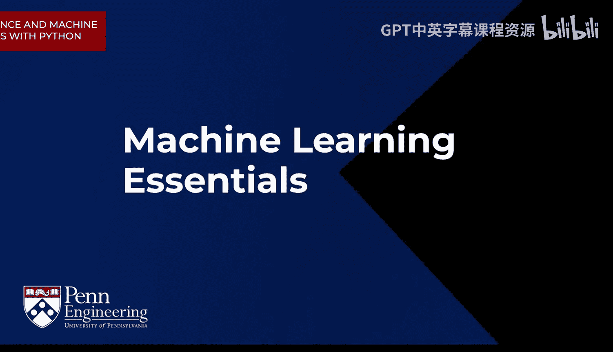

# 宾夕法尼亚大学《人工智能和机器学习基础（AI、数据科学、机器学习）AI and Machine Learning Essentials with Python》 p65 01_01_01_机器学习基础导论.zh_en -BV16f421Q72q_p65-

Welcome back to Penn Engineering specialization in artificial intelligenceence and machine learning with Python。

I'm here with Victor Preciiao， who teaches our machine learning course。 Victor， to get started。

 Could you tell us at a high level， what is machine learning， Sure。

 so machine learning is essentially apts the idea of learning。To the context of computing machinery。

 So learning is the process in which a system improves its performance with experience。

 So in the context of machine learning， the system is a computing machine。

The performance is essentially a measure of the quality of both the predictions by these machines and the experience is fed into the machine using both a structured and unstructured that。

That's great。 That gives us a good high level overview at an abstract level。

 what machine learning is。 Can you give us some concrete applications of machine learning， Sure。

 so machine learning has a very wide array of application， both in science and industry。

 So in industry， you can go to the finance， healthcare， robotics。😊，The natural language processing。

 driving cars， so in all these applications is very hard。

To build an algorithm from scratch that describes the algorithmic steps to solve the problems involved in these fields right so could machine learning does is instead of building the algorithm step by step。

 it proposes a learning architecture and fits data into the learning architecture so that an optimization algorithm tune and improve the performance of that architectureetitively over time。

That's great What kind of topics will learners experience if they take your course Sure。

 so essentially we will start with a broad introduction to the different problems that you can find in machine learning so one is supervised learning problems when the data is provided with labels so maybe you can fit images to a machine where you have labels indicating what's the content of that image you can also provide images without labels and that would essentially be a problem that's called unsupervised problem and in that particular scenario the machine should have or should be able to cluster image based on similarities。

So after we cover these two types of machine learning problems we'll talk about the concept of generalization。

 essentially how can a machine classify an image that have not seen in the past so if you give a machine examples of many types of birds。

 how can a machine recognize a bird that has not seen before and essentially decide that this is a bird right at this point will also cover the topics of underfitting and overfitting essentially what is the right flexibility of the architecture and finally well cover ways to measure the performance of this machine learning architectures。

That sounds really exciting what kind of assignments will you have the learners do alongside your lectures so we'll have a mixture of hands on applied projects in Python and the theoretical questions essentially with the hands up projects we want the students to develop the skills to apply the techniques that were teaching with real data but that's not the end of it we also want to provide the theoretical tools to understand what these algorithms are doing and why they're doing what they're doing。

It seems to me that machine learning is more essential now than it's ever been。 do you agree Sure。

 I mean you can see this in industry even in our daily lives with the araal of GTs right so essentially we are a very important moment in time in which we have the confluence of both very powerful computing architectures and you can see this in the silicon industry with the massive development of CPUUus and GPUs and also the era of big data so we have access to massive amounts of data that can be fed into this machine learning architecture so this is the perfect bidding ground for the aisal of these machine learning architectures。

That's great。 I think almost all engineers in the future are going to need to learn the foundations of machine learning。

 So we invite you to join us in Penn engineering specialization and take Victor's course so that you。

 too， can learn the essentials of machine learning。😊。

