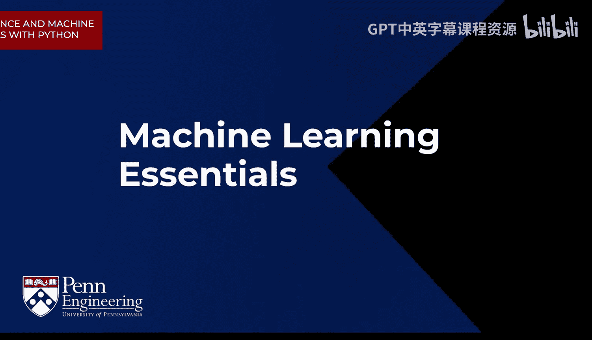

# 宾夕法尼亚大学《人工智能和机器学习基础》课程：01：机器学习基础导论 🧠

在本节课中，我们将要学习机器学习的基本概念、应用领域、课程涵盖的核心主题以及它在当今时代的重要性。

欢迎回到宾夕法尼亚大学与Python结合的人工智能与机器学习专业课程。Victor Preciado教授将为我们讲授机器学习课程。首先，我们从宏观层面来了解什么是机器学习。

机器学习本质上是将“学习”这一概念应用于计算设备的背景下。学习是一个系统通过经验来提升其性能的过程。在机器学习的语境中，系统就是一台计算机器。性能是衡量这些机器所做预测质量的指标。而经验则是通过结构化和非结构化的数据输入到机器中。

上一节我们介绍了机器学习的抽象定义，本节中我们来看看它在现实世界中的具体应用。

机器学习在科学和工业领域有着非常广泛的应用。以下是其主要应用领域：
*   **金融**
*   **医疗保健**
*   **机器人技术**
*   **自然语言处理**
*   **自动驾驶汽车**

在这些领域中，从头开始构建一个描述解决问题步骤的算法通常非常困难。机器学习所做的，不是一步步构建算法，而是提出一个**学习架构**，并将数据输入到这个架构中，以便优化算法能够随时间迭代地调整和提升该架构的性能。

了解了应用之后，接下来我们看看在这门课程中学习者将会接触到哪些主题。

课程将从广泛介绍不同类型的机器学习问题开始。一种是**监督学习**问题，即数据带有标签。例如，你可以向机器输入带有内容标签的图像。另一种是**无监督学习**问题，即提供没有标签的图像。在这种情况下，机器应该能够根据相似性对图像进行聚类。

在介绍了这两种问题类型后，我们将讨论**泛化**的概念。即，一台机器如何分类它过去从未见过的图像？例如，如果你给机器看了许多鸟类的例子，它如何识别一只从未见过的鸟，并判断它是一只鸟？此时，我们还将涵盖**欠拟合**和**过拟合**的主题，探讨架构的合适灵活性。最后，我们将介绍衡量这些机器学习架构性能的方法。

课程内容听起来很丰富，那么学习者将完成哪些类型的作业来配合这些讲座呢？

我们将结合使用Python的实践应用项目和理论问题。通过实践项目，我们希望学生培养应用所教技术处理真实数据的技能。但这并非全部，我们还希望提供理论工具，以理解这些算法在做什么以及它们为何这样做。

在我看来，机器学习现在比以往任何时候都更加重要。你同意吗？

当然。你可以在工业界甚至我们的日常生活中看到这一点，例如GPT的出现。我们正处在一个非常重要的时刻，强大的计算架构（从硅谷产业中CPU和GPU的大规模发展可见一斑）与**大数据**时代交汇。我们可以获取海量数据并将其输入到这些机器学习架构中。这为机器学习架构的兴起提供了完美的土壤。

确实如此。我认为未来几乎所有的工程师都需要学习机器学习的基础知识。因此，我们邀请你加入宾夕法尼亚大学的专业课程，学习Victor教授的课程，这样你也能掌握机器学习的精髓。

本节课中我们一起学习了机器学习的核心定义、其多样化的应用场景、课程将深入探讨的关键主题（如监督/无监督学习、泛化、过拟合与欠拟合），以及结合实践与理论的学习方法。我们认识到，在强大算力与海量数据汇聚的当下，掌握机器学习基础对未来工程师至关重要。