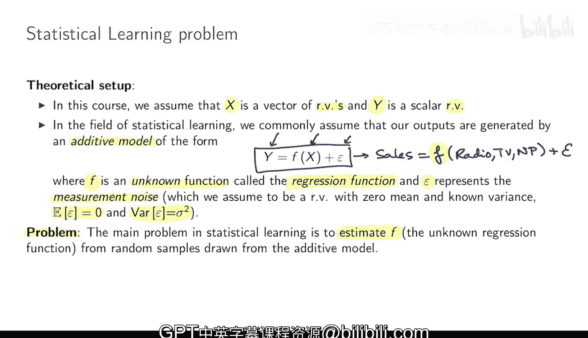

# 宾夕法尼亚大学《人工智能和机器学习基础（AI、数据科学、机器学习）AI and Machine Learning Essentials with Python》 p67 03_01_01_统计学习入门.zh_en -BV16f421Q72q_p67-

Yeah。We're going to start this chapter by briefly introducing the concept of statistical learning。

To understand this idea， let me introduce you a very simple example。

So consider that we have historical data containing information about 200 marketing campaigns。

For each campaign， we have the amounts invested in radio， TV and newspaper advertisements。

 and also for each campaign， we know the resulting total number of cells。

So in this particular example， what we have is an output cells that we would like to predict using the three inputs。

 radio TV and newspaper advertisement。In other words。

 what we are trying to answer is the following question， how can we predict cells。

 the output variable using as input， the amounts invested in the three sources that I mentioned before？

In other words， we would like to have a function that approximates the output cells as a function of these three arguments in here。

In the picture below， you can see how cells。In the Y axis relate to TV。

 radio and newspaper advertisement。 So， for example， in the first figure。

 we can pick a particular amount of investment and look at the resulting。

Average value of sales for all the historical marketing campaigns that were around that particular investment level。

Let me now introduce some of the notations we' are going to use in the rest of this course。

We're going to denote the vector of inputs by the capital letter x。

 This is going to be a vector containing x1 to Xp inputs。

These are going to be the input features that we will use to make predictions。

Also we will use the small bold letter case x to denote a particular value of these vector of inputs again。

 this is going to be a p dimensional vector with x1 to Xp entries。So in the previous example。

 we have three particular inputs， so the value of p。

 meaning the number of features or the number of inputs that were using to solve our prediction is going to be equal to 3。

Now we can also look at the particular structure that the vector x is going to take。

 so in particular we're going to have x1 x2 and x3 inputs。

 so again p is equal to 3 x1 can be assigned to the level of TV investment x2 can be the radio investment and x3 can be the newspaper investment。

So notice that the capital vector x contain the variables that were using as inputs。

 these are different than concrete values。To clarify the difference between the capital x and the small x。

 we can now look into a particular example so we can define a vector a small x containing three values。

Therefore， if we say that capital x is equal to a small x。

 what this is indicating is that the first component of capital x， which is equal to TV。

 will be the same as 1000， meaning what investing in 1000 units in TV。

 the second entry of capital x which is radio is equal to 800。

 so this is indicating that the investment in radio is 800 units。

 and finally the third entry of x is equal to the third entry of a small x， which is 900 units。

So by equating capital x to small x， what we' are really indicating is a particular value of all the inputs that we have in the vector x。

Similarly， we will use the capital letter y to denote the output variable。

 and a particular value of the output will be indicated by small y。So in the previous example。

 our output variable is cells and we going to assign the variable capital y to cells if we say that the small y is equal to 2500。

And we equate capital y to small y， what we are really saying is that cells is equal to 2，500 units。

 as we indicate at the end of this line。Let's now move on to a proper theoretical setup to study the statistical learning problem。

In this course， we' are going to assume that x is a vector of random variables and y is a scalar random variable。

In the field of statistical learning， it's common to assume that the output variables are generated using what's called an additive model。

So this model has the form in this equation， essentially what this is saying is that the output y。

 the value that you observe as the output of an experiment is some function of the inputs plus an epsilon value。

 so let me go into the explanation of each one of these elements。

F is an unknown function that is called the regression function。

 This regression function will be a very important ingredient in this course。

 and epsilon is what we call a measurement noise。This is going to be a random variable that we know has see mean and variance sigma squared。

So for example， in the advertisement example that we had before， according to this model。

 what we have is that sell。Is equal to a function of the vector of inputs。

 so we can essentially put them here together as radio。Dvi。

A newspaper right plus some measurement noise now something that's very important for you to notice is that this regression function is something that's unknown to you。

 This is something that nature is using to generate the data that you observe in your experiments。

Now， the statistical learning problem， which is stated before。

 is to estimate this unknown regression function using historical data。

 meaning random samples drawn from the additive model。RightSo essentially F is unknown。

 you only have access to a data set and what you really want to determine is what's this function F。

 what's the function that nature is using to generate the data。

 and this is a function that's unknown to you。 so a big part of this course will be to try to develop techniques in order to estimate F。

