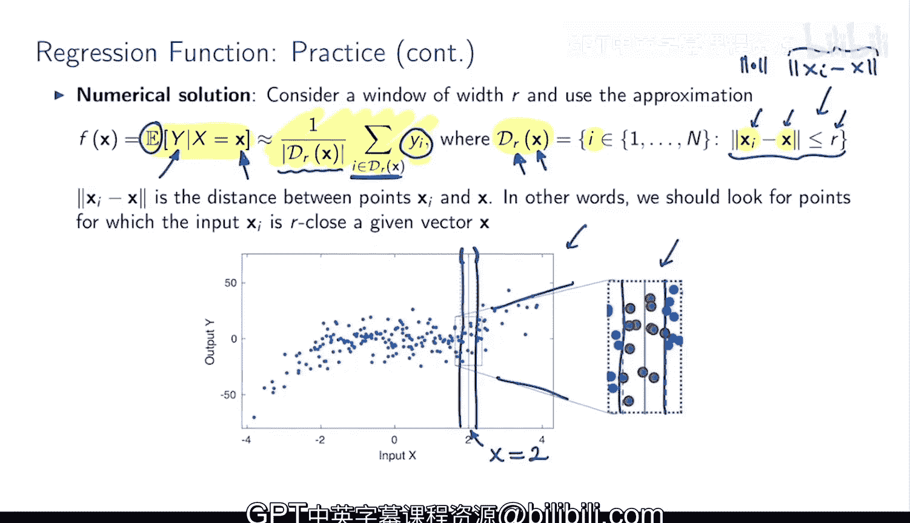

# 宾夕法尼亚大学《人工智能和机器学习基础（AI、数据科学、机器学习）AI and Machine Learning Essentials with Python》 p68 04_01_02_回归函数.zh_en -BV16f421Q72q_p68-

In this video， I'm going to talk about some of the theory and practice involving the regression function using tools from statistics。

 one can prove that the regression function is equal to this conditional expectation。

 essentially the expectation of y given x。And if we have access。

To the conditional Pdf f of y given x， we could compute this expectation by using the explicit formula that we introduced before。

 So essentially we need to compute the integral of y。

Times f of y given x and the integration goes over y。

 So notice that once you do the integration over y， this is a function of the bold x。

 the vector of concrete values of inputs Now something that you should realize is that in practice is typically impossible to have an explicit access。

To this conditional Pdf。Also using tools from optimization。

 one can prove that the regression function F。It's a function that is the solution to the following optimization program。

Essential， we want to minimize。The expectation between the output variable and a particular function G and we are going to look for a solution over the space of all function G。

Now， it turns out that the argument that solves this minimization is equal to the regression function。

So something that's important to realize is that this expectation in here is called a minus square error if you think about it。

 the difference between y and g of x when g of x is some prediction function is the error between the output and your prediction using the inputs if you do the square of this。

This is nothing but the square error， and if you do the expectation。

 what you're going to get is the mean square error。And as I mentioned before。

 the solution of this optimization problem can be proved to be。This optimal regression function。

 which is equal to this conditional expectation。So in the previousVC slides。

We introduced some theoretical results concerning the regression function。 Now。

 we're going to move on about some practical details that are important while estimating the regression function。

In our practical setup， what we're going to assume is that we do not have explicit access to the conditional P F of y given x。

However， were going to have sample data from the additive model。😊。

Therefore we can pose a statistical learning problem in practice as follows。

 so we are given a dataset set D where this data set contain n pairs of inputs and outputs essentially this would be the first pair these would be the n pair and these are going to be the inputs and these are going to be the output values so these are going to be random samples that are drawn from the additive model so also notice that X is a vector so we're going to have p components。

And this is a notation we're going to use， essentially the case component of X is going to be equal to x of IK。

 so the first index will indicate the sample that we are dealing with。

 the second index will indicate the entry of that vector。

Our problem is then to find an estimate of the regression function F and will denote our estimation by F hat。

Now， let's look into the figure below。In this figure， I'm going to represent a data set。

 assuming for simplicity that p is equal to 1。In other words， I have a single input X。

The value of these inputs is represented in the x axis of the figure。

And the corresponding output y are in the y axis of the figure。

So what we have in here is a scatter plot where each point represents a data point in our data D in particular if we take a particular point like the one mark in the figure。

 we're going to have that this point I will have an x component X。And a y component。

 Y I in this particular case， X is a scholar， but in general， Xi should be a vector。 Now。

 throughout this course， we're going to assume that this data set D is generated according to the generative model that we describe below in particular。

 we're going to have。That the output Y I is generated according to some unknown function。

Of X plus a noise， so we will typically have access to the statistical properties of this noise in particular will know that the expectation of this noise is 0 and that the variance of this noise is equal to sigma squared。

 but we will not know the particular form of this function f。So therefore。

 our job will be to get an estimate of F， which we call F hats using the data set alone。

Let's not look into a particular way in which one may be tempted to solve the statistical learning problem in practice。

In this approach， we use the fact that the regression function F。

Is given by the conditional expectation of y given x。

Now notice that the theoretical expectation can be numerically approximated using an empirical mean now how would this empirical mean look like well since we're conditioning on a particular value of x。

 something we can look at is the set of points for which the input X I is exactly equal to x and then compute the empirical mean of the outputs yi corresponding to that set of points so this is essentially what we formally define at the right so I'm going to define a set of points dx these are going to be the indexes in our data sets for which the input X is exactly equal to the value of x for which we want to make a prediction。

Now something that we can look at is the average of the outputs corresponding to the set of indexes in dx how do we compute that well this is essentially what we have in this summation so we're going to do a summation for all the indexes in this set dx and I will sum over all the outputs Yi corresponding to inputs for which。

Xi is equal to x。To compute the empirical mean， I'm going to finalize just by normalizing over the total number of points。

 satisfying the condition in the x。However， this approach is not very practical because if you look at a data set。

 the probability of finding points in D for which X is exactly equal to x is going to be very low。

In particular， it is going to be very unlikely that you will find any point at all for which Xi is equal to an exact real value x。

So we can zoom in into this picture， so if you consider a value of x equal to 2， for example。

And you try to find points in the dataset for which Xi is exactly equal to 2。

 you will notice by looking into this zoom part of the image that you will not be able to find any point for which Xi is exactly equal to2 you may be able to find points that are very close。

To X equal to 2， but none of them will be exactly2。

So we need to come up with another approach to overcome this limitation。

This approach is based on the technique presented in this slide。

 in particular what we are going to do is augment our definition of the set of points that we will use to compute the empirical mean。

 so instead of considering in points that are exactly a value x。

 we're going to consider points in our data set that are close enough to the value of x。

 So what this expression is telling you is the following the distance between a point X and a given point x is less or equal than R。

 So using this double word delimiters to denote the length of a vector。

So if you look into the length of the vector X minus x。

 this is nothing but the distance between X and x。And the expression below will indicate that X minus x is less or equal than some distance r。

Now we're going to define the set of points。This move r of x to the set of indexes representing input pointsxii that are a distance less or equal than r to a desired point x。

Now you can notice that in this new average。What I do is a simple extension of what I had before。

 I'm going to compute the empirical mean of the outputs Yi in this set of points that are close enough  to x。

 and then I will normalize over the number of points in that set。Now， using this approach。

 we can overcome the issue of not having any point for which Xi is exactly X。In other words。

 if we choose an appropriate value of r， we will be able to find points in the data set that are are close to a given vector x for which we want to make a prediction。

 so you can look at this figure as we did before， we want to make a prediction for x equal to 2。

In order to do that， instead of looking at the points for which x is exactly equal to 2。

 we're going to take a window。The width of this window is going to be 2r。

 so essentially add units to the right and our units to the left。

 and we're going to select those points that are inside this window here。So if we zoom in。

You can look in here that in this case， we will have many points。

Encircle by a red line that will be part of this set this sub R of x。Therefore。

 the empirical mean that we obtain should be close to the conditional expectation of y given x。

Let me finalize this slide by providing some intuition of what we just done。

 Remember that the regression function is nothing but the expected value of y。

Corresding to a given value of x。So what this windowwin process is really doing is looking at the set of points for which the input is close to this value of x。

And looking at the empirical mean of the value of y。So in summary。

 all we are doing is try to find an approximation of the theoretical expectation by using an empirical mean。

