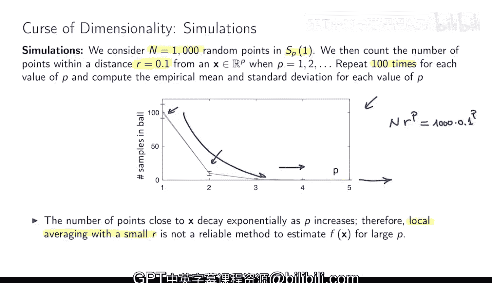

# 宾夕法尼亚大学《人工智能和机器学习基础（AI、数据科学、机器学习）AI and Machine Learning Essentials with Python》 p69 05_01_01_维度灾难.zh_en -BV16f421Q72q_p69-

Yeah。Welcome back。In the previous set of slides， we saw how using local averaging we could estimate the regression function F using local empirical average。

 So this is something that were illustrated in this picture。

 So if we want to estimate the value of f of x。The regression function for a particular input x equal to 2。

 Something that we can do is consider a narrow window of with2 R around that point。

 Look at the points that are contained in that particular。Window and then compute the average value。

 so if you look the average value of the ys meaning the height of all these points。

 you'll get a prediction that will be somewhere in here。

 so looking back into the figure we' get a point that's somewhere in the middle of that cloud of points。

So if we repeat this process for a moving window， what we're going to get is essentially a function that crosses the cloud of points somehow in the middle of the cloud。

So using this local averaging， we could estimate the regression function f of x。

 just using this empirical average that is here represented by a green line。

The next question is therefore are we done with this course， so as I mentioned at the beginning。

 the main problem to tackle in a statistical learning theory is to find the function f of x。

 so are we done？So we're going to argue that this is not the case because a phenomenon called the course of dimensionality。

 the course of dimensionality is an issue that appears when the number of inputs in your problem is much greater than one。

 so this is something that cannot be illustrated in the example we've been plotting in these slide。

 because in that case p is equal to 1， however we'll see that when p is much greater than one points in the data set tend to be far away from each other。

 therefore local averaging is not going to be a feasible option。

To illustrate the course of dimensionality， we're going to consider different scenarios for the increasing values of p。

 So will it start with p equal to 1 and we'll consider n points randomly distributed over a set S1。

 So this is a one dimensional set that is the interval between minus-1。Hwan。So these points。

 we're going to represent as blue dots。 So we'll have n of those points uniformly distributed。

 We will also consider a particular value of x in that set。That we are representing as a red dot。

Now we want to answer the following questions， which is how many points would you expect to have？

In the window Dr x whenar is a small number。 So remember that Drx is essentially a window of width2 R。

Around the point x。Now notice that since we're throwing blue dots uniformly at random。

 the number of points falling into this set is going to be a random number。

In order to get a concrete answer， we'll deal with the expectation of that number of points that we'll have in that set。

This is what we describe in this particular expression。So this is going to be the expectation。

 the expected value of the number of points in the addx。

Since points are uniformly distributed in the set minus1 to 1。

 we have that the expected number of points on the line per unit length is going to be equal to n divided by 2。

 meaning the number of points on the segment， divided by the length of the segment。

To compute the expected number that we obtain in the window Drx。

 we can multiply that value by the length of the segment Drx， which is equal to2 R。

 so this is essentially the answer that were getting in here and after simplification we obtain that the expected number of points that we get in the window Drx is in expectation n times R。

In what follows， we can increase the value of p， so let's consider now p equal to 2。

In the case of p equal to 2， were going to look into n points that are randomly distributed on a circles of radius 1 and were going to denote that set by S2。

 so I'm going to very quickly plot that set in the slide so this is a circle where the radius is equal to1 and we will consider n points randomly distributed inside this circle。

As we did before， we will take an arbitrary value of x any point inside the circle。And also。

 will build the set。Drx， which in this case， is a small circle surrounding the red dot。

The question is now what is going to be the expected number of points that will fall within that green circumference？

As we did before we can look into the density of points。

 so the density of points inside the blue circle call is essentially the number of points divided by the area and this is the expression that we have in here。

 essentially n points divided by pi which is the area of the blue circuit confidence。

Now we can multiply that density of points per unit area by the area of the green circle which is equal to pi r square where r is the radius of the small circle。

 after simplifyiming expression we find that the expected number of values inside that circumference the green circumference is nr square。

 so when we go from p equal to 1 to p equal to 2 we go from Nr to nr square。

We can now keep asking the same question for the large genetic value of P。

So in this situation we're going to define a p dimensional hypererphere of radius r sentence around 0 and this is essentially defined by the set SP。

 which is just all the points such that the magnitude of x is the than R。

 so this is equivalent to the circumference that we had before but in high dimensions。

Something that we should know about the volume of this hypersphere is that is given by an expression of this form。

 essentially it's a constant case of P that depends on P。

 the particular form of this constant is not relevant for us， so we are going to put under the rug。

Something that is important， though， is that the volume scales as r to the power of P。

So this is something that's going to be very relevant in our mathematical deris。As we did before。

 we' are going to consider n points distributed uniform at random in the set S1。

 so this is the hypersphere of radius 1 center around0。

 and we will consider a particular point x inside that hypersphere。So， for example， for p equal to 3。

We would have a sphere。So let me draw it this way， so this would be a plot of the sphere with a radius equal to 1。

 and we will also consider a point x inside that ha sphere。As we did before。

 we will build another hypersphere center around the red dot。Wwhichch is x for us。

 and we will build a hypersphere of a small radius R around that point。

 So the radius of that hypersphere is going to be R。 Now the question is。

 if we have n points distributed uniformia random in the large hypersphere how many points do we get in expectation inside the small hypersphere。

To answer this question we can follow the same logic as we had before。

 the first step would be to find the density of points in the large hypersphere so this is going to be equal to the number of points n divided by the volume of the hypersphere of radius 1 which we know is equal to Kp times 1 to the power of p。

 so this is essentially just KP， and we will multiply by the volume of the small hypersphere which is KP times r to the power of p。

So you can see that the constant KP is not important because it cancels out。

 and now the answer of the expected number of points inside the small hypersphere is nothing but n times r to the power of P。

So you can see that this is consistent with the previous results for which for p equal to 1。

 we got n times r， for p equal to 2， we got n times r square， and for the genetic p。

 we get n times r to the power of p。In other words， we have n random points in the large hypersphere。

 we have n times r to the power of P points in the small hypersphere。

This is going to be very important in our following analysis。

We're going to illustrate our results with the following simulation。

Consider 1 thousand00 random points。In the sphere S sub P1。

 meaning the p dimensional hypersphere of radius 1。

And then count the number of points within a distance are equal 0。

1 from any point x inside the hypersphere and repeat this process for p 12 dimension 5。

In order to estimate the expected value， we' are going to repeat 100 times for each value of p and compute the empirical mean and the standard deviation。

In the figure below， you have the results of this simulation and we compare the empirical mean with the equation that we had before。

So essentially， if you remember， the expected number of points was given by n times。

R to the bargo of P。So if we have10 points， this is going to be 1000 times r0。1 to the power of P。

Which is a function that decays exponentially as P increases。

This function is plot as a red line in this figure。

In the same figure we also plot the result of our numerical validation in the blue line。

 so you can see that both the blue line， meaning the empirical mean and the red line which is the theoretical values。

 are very close to each other。The most important part of this experiment though is not to check that our empirical value matches the theory。

 but to see how as P increases。The number of points inside a ball of radius R decreases dramatically at an exponential rate。

 therefore， when we are dealing with a problem in which the number of dimensions p is very。

 very large， meaning the number of inputs in our problem is very very large。

 the number of points contained in any small hypersphere center at a point x is going to be extremely low。

In practice for p very， very large， the number of points will be practically0。As a conclusion。

 if we want to do local averaging with a small R， we won't have any point inside our local window。

 which in the p dimensional case will be a local hypersphere；

 therefore we won't have data to average around any point x。

