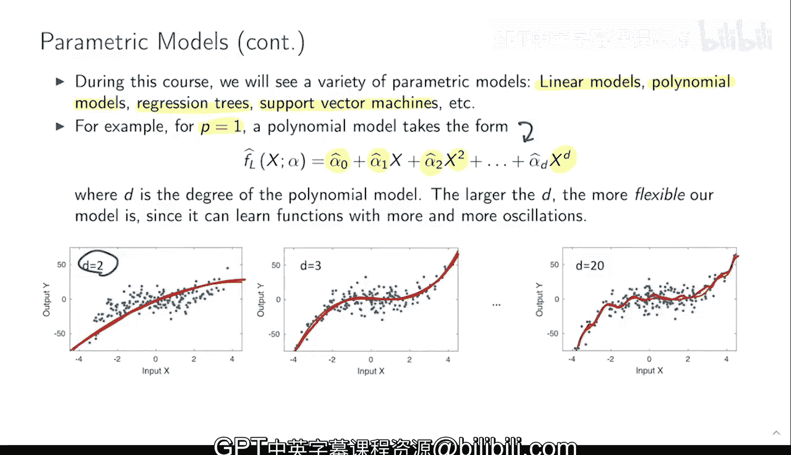

# 宾夕法尼亚大学《人工智能和机器学习基础（AI、数据科学、机器学习）AI and Machine Learning Essentials with Python》 p70 06_01_01_参数化模型.zh_en -BV16f421Q72q_p70-

Welcome back in the previous video we discuss the curse of dimensionality。Briefly。

 when the number of inputs being in your problem is large。

 the cur of dimensionality does not allow you to use local averaging around the0 x to estimate the regression function F ofx。

The mathematical description of this phenomenon can be observed in this figure。In particular。

 we can see that as P increases， the number of samples in any ball would shrink exponentially。

 therefore for P very very large， which are most real problems。

 we won't have any sample to use for local aver。In this situation。

 well need to come up with alternatives in order to beat the course of dimensionality。

A particular approach that will be used in this course is the use of parametric models。

In a parametric model， we will approximate the regression function F of x using a function F X hat。

Where we will have some free parameters data， this is a vector of parameters that we will need to learn from data。

A classical example of parametric model are linear models。So， in a linear model。

We have a function F sub L that takes us an argument x and as a collection of three parameters we're going to have beta。

 so beta plays the role of fair above and the shape of this function is equal to a constant plus a constant time。

 the first feature in our entry times another constant times the second feature in our entry and we keep going until we get to the last feature in our vector of entries。

Remember that our vector of entries has p dimensions， x1 to Xp。Therefore。

 Xi in the equation above are not samples， but the components of the input vector x。

Once we have a parametric model such as the linear model above。

 we can estimate the parameters be using the observations in the dataset set D。

We will denote the estimated parameters that we obtained from data as beta sub I super hat。Therefore。

 we can approximate the regression function using the estimated linear model。

 which we will denote by F sub L superhat。The only difference between f sub L and F sub l super hatt is that the parameters beta 0 to beta p are substituted by beta 0 hat to beta P hat。

 essentially the parameters that group obtain from data。

The main reason why this model does not suffer from the cur of dimensionality is that to estimate the parameters beta I。

 we need to make use of the whole data set D， not only a small number of samples containing a bowl of radius r surrounding the point x。

Apart from linear models， we have a large variety of parametric models。

So in here we have a short list starting from the linear models that you probably already know。

 polynomial models， regression trees that we will cover in this course as well as super vector machines。

For example， for p equal to1， we can simply build a polynomial model using the expression that you have below。

 So in this model we have a constant alpha s。Plus， another constant multiplying the input x。Plus。

 another constant multiplying the square of the input x plus we keep going until we get to the depth power of the input。

So in this particular case， what we really have is a polynomial fitting of the。In the figures below。

 I show a polynomial fitting using a cloud of points that we saw before。

 so we see that for the equal to 2， we essentially fit a parabolic shape passing through the cloud of points。

For d equal to 3， we fit a cubic function that makes a better job at passing through the middle of the cloud of points。

 so this seems to be a good candidate to approximate the true regression function that nature is using to generate that cl of points。

For the equal to 20 we'll get a function that's very wly。

 essentially it will go somehow through the middle of the cloud of points。

 but it will goiggle around those points， which is an undeciirable effect called overfitting。

