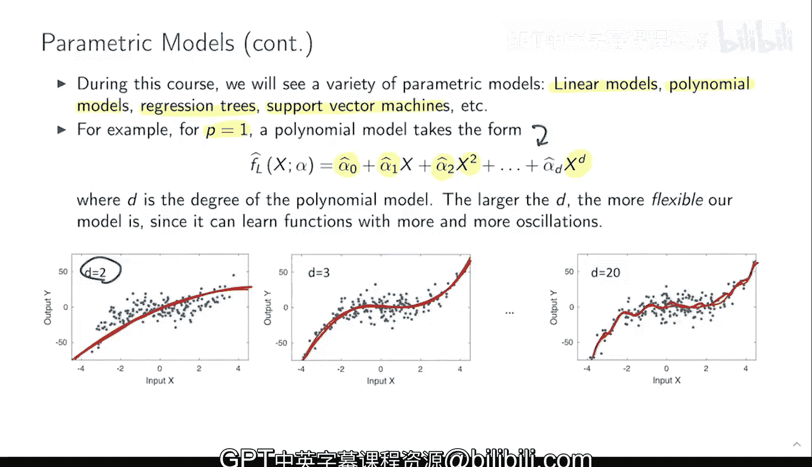

# 人工智能和机器学习基础：06_01_01：参数化模型 📊

在本节课中，我们将学习如何通过参数化模型来应对高维诅咒，并介绍几种常见的参数化模型，如线性模型和多项式模型。

## 概述

上一节我们讨论了高维诅咒。简而言之，当问题中的输入维度很高时，高维诅咒使我们无法在目标点 `x` 周围进行局部平均来估计回归函数 `F(x)`。从数学描述上看，随着维度 `P` 的增加，任何球体内的样本数量会呈指数级减少。因此，对于大多数现实世界的高维问题，我们将没有足够的样本来进行局部平均。在这种情况下，我们需要寻找替代方法来克服高维诅咒。

## 参数化模型简介

本节中，我们将探讨一种特定的方法：使用参数化模型。在参数化模型中，我们使用一个函数 `F_hat(x)` 来近似回归函数 `F(x)`。这个函数包含一些自由参数 `θ`（一个参数向量），我们需要从数据中学习这些参数。

一个经典的参数化模型例子是线性模型。在线性模型中，我们有一个函数 `F_L`，它以 `x` 为参数，并包含一组参数 `β`（`β` 扮演了上述 `θ` 的角色）。这个函数的形状等于一个常数加上第一个特征乘以一个常数，再加上第二个特征乘以另一个常数，依此类推，直到我们处理完输入向量中的所有 `P` 个特征。

记住，我们的输入向量有 `P` 个维度：`x1` 到 `xP`。因此，上述方程中的 `Xi` 不是样本，而是输入向量 `x` 的分量。

## 参数估计

一旦我们有了一个参数化模型（例如上述的线性模型），我们就可以利用数据集 `D` 中的观测值来估计参数 `β`。我们将从数据中获得的估计参数记为 `β_i_hat`。因此，我们可以使用估计的线性模型（记为 `F_L_hat`）来近似回归函数。`F_L` 和 `F_L_hat` 之间的唯一区别在于，参数 `β0` 到 `βP` 被替换为从数据中获得的 `β0_hat` 到 `βP_hat`。

这个模型之所以不受高维诅咒影响，主要原因在于，为了估计参数 `β_i`，我们需要利用整个数据集 `D`，而不仅仅是围绕点 `x`、半径为 `r` 的小球内的少量样本。

## 其他参数化模型

除了线性模型，我们还有多种参数化模型可供选择。

以下是几种常见的参数化模型：
*   **线性模型**：你可能已经熟悉的模型。
*   **多项式模型**：我们将在课程中介绍。
*   **回归树**：我们将在课程中介绍。
*   **支持向量机**：另一种强大的模型。

例如，对于 `P = 1`，我们可以简单地使用下面的表达式构建一个多项式模型。在这个模型中，我们有一个常数 `α0`，加上另一个常数乘以输入 `x`，再加上另一个常数乘以输入 `x` 的平方，依此类推，直到达到输入的 `d` 次幂。实际上，我们得到的是一个对数据的多项式拟合。

在下面的图表中，我展示了使用之前见过的点云进行的多项式拟合。我们可以看到：
*   当 `d = 2` 时，我们本质上拟合了一个穿过点云的抛物线形状。
*   当 `d = 3` 时，我们拟合了一个三次函数，它能更好地穿过点云的中心，这似乎是近似真实回归函数的一个良好候选。
*   当 `d = 20` 时，我们会得到一个非常波动的函数，它虽然大致穿过点云中心，但会在这些点周围剧烈摆动，这是一种称为**过拟合**的不良效应。

## 总结

本节课中，我们一起学习了如何利用参数化模型来克服高维诅咒。我们介绍了参数化模型的基本概念，即使用带参数的函数 `F_hat(x; θ)` 来近似回归函数。我们重点探讨了线性模型和多项式模型作为例子，并解释了如何从数据中估计模型参数。最后，我们简要列举了其他类型的参数化模型，并通过图示说明了多项式模型中阶数选择的重要性，高阶模型可能导致过拟合。参数化模型通过利用整个数据集进行全局学习，有效避免了高维空间下样本稀疏的问题。