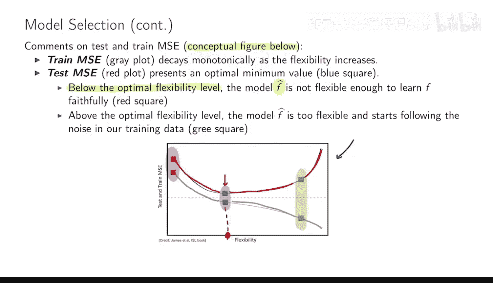

# 宾夕法尼亚大学《人工智能和机器学习基础（AI、数据科学、机器学习）AI and Machine Learning Essentials with Python》 p71 07_01_02_模型质量.zh_en -BV16f421Q72q_p71-

Welcome back， we start this video by mentioning a few points about the process of assessing model quality。

When working on a practical learning problem， for example， a machine learning problem。

 we should differentiate between two types of data。On the one hand。

 we have the training data set that with the node by D sub TR。

 this data set contains n training points that are available while estimating the unknown parameter theta of the parametric model under consideration。

 remember with the note this parametric model by F hat。Once we train the parameters of this model。

 the training mean square error is given below， in particular。

 the mean square error of the training process。Is defined according to this formula substantially we have n points。

 So we're going to normalize with the factor1 over n。

 and then we're going to have a summation over all the pair of points X I Y I in the training data set of the terms included inside the summation。

 So this is。An error。Between the real value of the output Yi and the predicted value that my parametric model makes for this particular value I。

We then take those errors， square them， and compute the empirical average。

 which we call the mean square error。In contrast， we also have a testing data set that we denote by DS sub T。

In this case we have M testing points and this is data that your learning algorithm has not seen during training。

 and we can use this data to estimate the performance of future predictions using what we call the test MSc。

 so the test MSc。Is defined in the expression below。In this case， since we have m testing points。

 we're going to normalize by the factor 1 over m。The summation is going to be over all the points in the testing data set and the expression inside the parenthsesis is going to be identical that the guang we had before。

 essentially is going to be the error between the actual value of the output and the predicted value of the output for a given input X after squaring these values。

 the summation and normalization spits out the mean square error for the testing dataset set。

In practice， the SMSC is a better reflection of the performance of our model。

In this slide we illustrate the difference between the training and the testing MSC in particular we're going to consider two different cloud of points on the left hand side we have a cloud of points representing the training data set while on the right hand side we have the testing dataset set。

 so both cloud of points have been obtained from the same additive model in particular we're going to assume that each sample X I Yi in any of these two figures are coming from the same joint PDF。

In the figure at the bottom， we compute the train and test MSC for the family of polynomials of degree 1 to8。

In this figure， we plot in blue the evolution of the train MSC as the degree of the polynomial increases。

 we can observe that this function decreases monotonically as the degree increases。

This is a universal feature of the training MSC that can be explained from the fact that as we increase the degree of a polynomial。

 we are able to fit better and better a given training set。

In the same figure we plot in red the evolution of the testing MC as we increase in the degree of the polynomial feeding。

We observed that in this particular case， the function is not monotonically decreasing。

 but it presents at minimum for a degree d equal to 3。

This indicates that a cubic polynomial could be the best choice out of the hierarchy of polynomial functions considered in this experiment in this slide we have a few comments about the training and test MSE in particular we have a conceptual figure below describing the evolution of both training and test MSE as a function of the flexibility of a hierarchy of models。

In the gray plot below。We plot the evolution。Of the training MSC as a function of the flexibility of the model。

So this flexibility is a generalization of the degree of a polynomial。

 essentially is a measure of how flexible a function is to follow a collection of points in a data set in the same figure。

 we also plot the test MSc in red。As we had before the test MSC is not monotonically decreasing。

 but it presents a minimum at a particular value of flexibility since the test MSC is a measure of the performance of our model for future predictions。

 this is the exact level of flexibility that we should choose to train our model in particular when we have a level of flexibility below the optimal level。

 the parametric model F hat is not flexible enough to learn the regression function F faithfully。

 so this could be the situation of these two points in here。In contrast。

 when we are above the optimal flexibility level， the Model F is too flexible and starts following the noise in our training data。

 essentially the wiggle that we observe in the polynomial of the grid 20 in an example we saw a few slides ago this would be the case of the green squares in this part of the curve。

Finally， the blue squares represent the values for the train and test MSC at the optimal level of flexibility when the test MSC is minimized。

Again， this is the level of flexibility that we should use to train our model。

