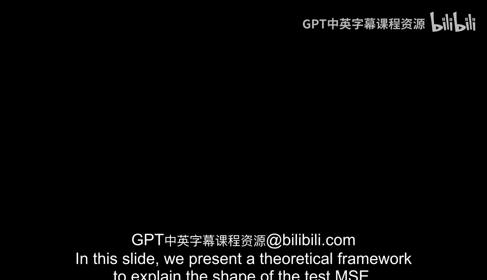
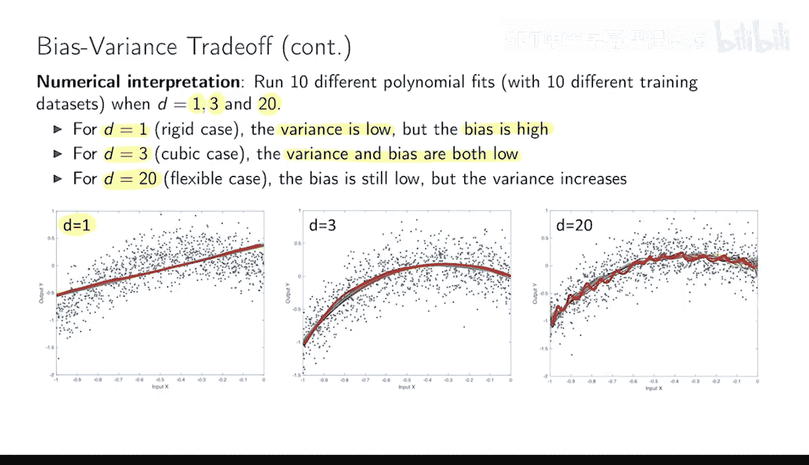

# 宾夕法尼亚大学《人工智能和机器学习基础（AI、数据科学、机器学习）AI and Machine Learning Essentials with Python》 p72 08_01_03_偏差-方差权衡.zh_en -BV16f421Q72q_p72-

In this slide， we present a theoretical framework to explain the shape of the test MS。

We start with a training dataset set， D TR formed by n pointss drawn uniformly at random from an additive model described in the equation below。

 essentially we're going to have points Xi that are drawn uniformly from a marginal distribution f of x and then we compute the corresponding output y sub I as a function f of X so this is essentially the evaluation of the regression function at the random point Xi and we will add a measurement error epsilon where this error follows a Pdf f sub epsilon。

Again， remember that the function F is unknown and nature uses this function to generate the data set。

In order to estimate this unknown regression function。

 we are going to consider a parametric function F hat where we have a vector of three parameters Thera and our task is to find the optimal values Thera hat that minimize the training MSc describe in the equation below in particular。

 this part of the expression。It's nothing but the train MSC and this part of the equation。

 tell us that we need to pick the value of Theta that minimize this train MSC and will save that value in Theta star。

Using that particular value of Thera star， you obtain a trained model by substituting Thera by Thera star in the parametric function that we had before。

Using this strain model， we want to analyze the corresponding testimacy。In particular。

 consider a new data point that is drawn uniform at random from the joint Pf induced by the additive model。

 and this point has not been used in the training process。

An alternative way to theoretically write the test MSC。Is the expectation that we had below。

Essentially， we can look at the expectation for any random point x0 y0 drawn from the additive model of the square error between the actual value of y0 and the predicted output using the trained model F hat evaluated with a parametric vector The hat。

Notice that since x0 is a random variable， this function is also a random variable and the quantity inside this bracket is a random variable。

 therefore we need to use the expectation to obtain a particular value of the testt。

Using the statistical tools。One can prove that this test MSC can be expanded in three terms。

Hevaian term。 Hebaas term。And a variance of the measurement noise。

We have below explicit expressions for the bias term and the variance term。

 in particular the bias term is the difference between the expected value of f hat evaluated with the star meaning the optimal trend model minus f at xdo which should be the predicted value if we somehow were able to know the regression function that nature is using to generate the data points。

We also have an expression for the variance at the bottom of the slide。

 and the variance follows the exact definition of the variance that we saw in the probability review slidesEssential we're going to have the expectation。

Of the random variable。For which we want to compute the variance。Minus the expectation x squared。

 so remember again that the function F hat evaluated a theta star。

Is a random variable because x0 is a random point。The sum of the first two terms。

In the expansion of the test MSC is what's called the Reducable error since this error can be reduced by choosing a good parametric function F hat In other words。

 this error depends on what function F hat we choose to fit our model and can be minimized if we use F hat equal to the true regression function that nature is using to generate the data。

In contrast， the last term in the expansion of the test error is called the irreducible error because that term will always be there。

 even if we choose an F hat exactly equal to the regression function that nature is using to generate the data。

An important observation is that the two terms in the reducible error depend on the flexibility of the parametric model used to train from data。

 In particular， the bias term decreases monotonically as the flexibility of the model increases。

 We can see this evolution in the can plot。At the bottom of this slide。In contrast。

 the variance term increases monotonically as the flexibility of the model increases。

This evolution is represented in the orange plot at the bottom of the figure。Finally。

 this dash line represents the variance of the measurement error。Which we call the irreducible error。

Finally， the red line is the result of summing these three terms。

 and we observe that we obtain a convex function with a minimum at an optimal value of flexibility indicated by this arrow。

We can illustrate the bias variance straight of using different polynomial fittings in particular we're going to consider polynomials of degree 1。

 3 and 20。And for each degree， we will generate 10 independent cloud of points and fit the polynomials to those cloud of points。

We observe that for the equal to1， which is the figure in the left。

 all the linear polynomial fittings are very close to each other。

This is the result of having a very rigid model that's unable to change as the cloud of point changes。

As a result， the variance of this model is low but the variance is high。

If we go to the QB case for the equal to 3。We obtain a good fit to the middle of the cloud。

Indicating that the level of flexibility for cubic polynomials is at the right amounts。 Also。

 we have that the variance and the bias of the cubic case are above low。Finally。

 we can consider a very flexible model of degree20 in that case we can observe in the figure that the fitting wiggles around the cloud of points。

 this is an indication of too much flexibility in our model corresponding to the case in which the bias is low but the variance is high。

So this week we have covered some very important topics in a statistical learning theory。

We started with a definition of the regression function。

And the illustration of the course of dimensionality。Then we move on to the use of parametric models。

And ways to assess model uncertainty， as well as the bias variance trade of。

