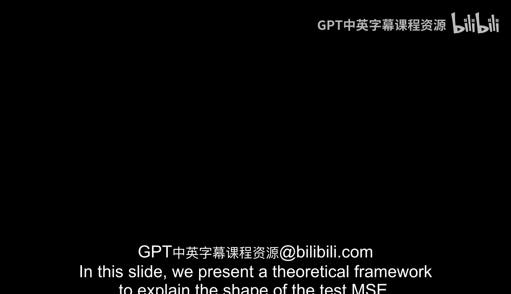
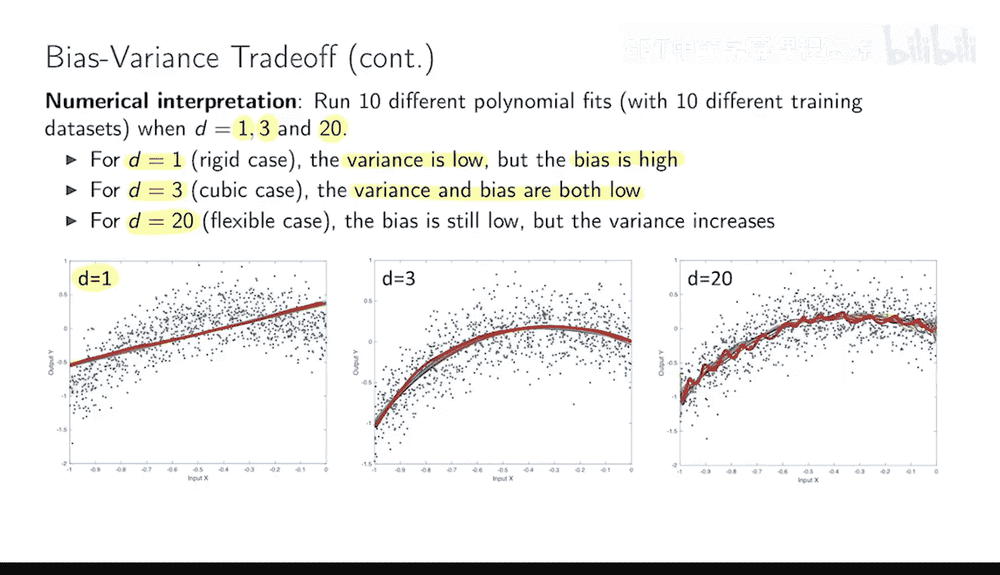

# 人工智能和机器学习基础：08_01_03：偏差-方差权衡 📊

在本节课程中，我们将学习一个核心的理论框架，用以解释测试均方误差的形状。我们将从数据生成模型开始，逐步推导出测试误差的分解，并最终理解模型复杂度（灵活性）如何影响偏差和方差，以及它们之间的权衡关系。

---

## 数据生成模型

我们从一个训练数据集 **D_TR** 开始，它包含 **n** 个数据点。这些点是根据以下加性模型随机均匀抽取生成的：

**y_i = f(x_i) + ε_i**

其中：
*   **x_i** 是从边际分布 **p(x)** 中均匀抽取的。
*   **f(x)** 是未知的回归函数，自然界使用它来生成数据。
*   **ε_i** 是测量误差，服从概率密度函数 **p_ε**，通常假设其均值为0，方差为 **σ²**。

我们的目标是估计这个未知的回归函数 **f**。

---

## 模型训练与参数估计

为了估计 **f**，我们选择一个参数化函数 **f̂_θ**，其中 **θ** 是参数向量。我们的任务是找到最优参数值 **θ̂**，以最小化训练均方误差：

**θ* = argmin_θ (1/n) Σ_{i=1}^n (y_i - f̂_θ(x_i))²**

这个表达式就是训练MSE。我们通过最小化它来得到最优参数 **θ***。将 **θ*** 代入 **f̂_θ**，我们就得到了训练好的模型 **f̂_{θ*}**。

---

## 测试误差的理论分析

现在，我们使用这个训练好的模型来分析其测试误差。考虑一个从未用于训练过程的新数据点 **(x₀, y₀)**，它同样从上述加性模型中抽取。

测试均方误差可以理论上写为以下期望值：

**Test MSE = E[(y₀ - f̂_{θ*}(x₀))²]**

由于 **x₀** 是随机变量，**f̂_{θ*}(x₀)** 也是随机变量，因此我们需要用期望来得到一个确定的测试误差值。

---

## 测试误差的分解

利用统计工具，可以证明上述测试MSE可以分解为三个项：

**Test MSE = Bias² + Variance + Irreducible Error**

以下是偏差项和方差项的具体表达式：

*   **偏差平方 (Bias²)**：
    **Bias² = [E[f̂_{θ*}(x₀)] - f(x₀)]²**
    它衡量了模型预测值的期望与真实回归函数值之间的差异。偏差高意味着模型系统性地偏离了真实关系。

*   **方差 (Variance)**：
    **Variance = E[(f̂_{θ*}(x₀) - E[f̂_{θ*}(x₀)])²]**
    它衡量了模型预测值围绕其自身期望的波动程度。方差高意味着模型对训练数据中的随机噪声非常敏感。

*   **不可约误差 (Irreducible Error)**：
    **σ²**
    这是数据中固有噪声的方差。即使我们知道了真实的 **f(x)**，这个误差也无法消除。

前两项（偏差平方和方差）之和被称为**可约误差**，因为通过选择合适的模型 **f̂**，我们可以减少这部分误差。最后一项（不可约误差）是无论如何都无法消除的。

---

## 模型复杂度的影响

一个关键的观察是：可约误差中的两项都依赖于我们用于训练的参数化模型的灵活性（复杂度）。

*   **偏差** 随着模型灵活性的增加而**单调下降**。更灵活的模型能更好地拟合数据的潜在结构。
*   **方差** 随着模型灵活性的增加而**单调上升**。过于灵活的模型会过度拟合训练数据中的噪声。

下图展示了这种关系：

*   蓝色曲线代表**偏差²**，随灵活性增加而下降。
*   橙色曲线代表**方差**，随灵活性增加而上升。
*   虚线代表**不可约误差 σ²**，是常数。
*   红色曲线是前三项之和，即**总测试误差**。它呈现出一个凸函数形状，并在一个**最优的灵活性水平**（图中箭头处）达到最小值。这体现了偏差-方差权衡。

---

## 多项式拟合示例

我们可以通过不同次数的多项式拟合来直观展示这种权衡。以下是使用1次、3次和20次多项式，在10组独立生成的数据点云上进行拟合的结果。

以下是不同复杂度模型的拟合效果对比：

*   **1次多项式（左图）**：所有线性拟合线彼此非常接近。这表明模型非常“僵硬”，无法随数据点的变化而改变。结果是**方差低，但偏差高**（拟合线无法捕捉数据的真实曲线趋势）。
*   **3次多项式（中图）**：拟合效果良好，能很好地捕捉数据点云中间的趋势。这表明三次多项式的灵活性水平是“恰到好处”的，其**偏差和方差都相对较低**。
*   **20次多项式（右图）**：拟合线在数据点周围剧烈摆动。这表明模型**过于灵活**，过度拟合了每一个数据点（包括噪声）。结果是**偏差低，但方差极高**。

---

## 总结

在本节课中，我们一起学习了统计学习理论中一些非常重要的主题。

我们首先定义了回归函数，并了解了维数灾难的概念。接着，我们探讨了参数化模型的使用，以及评估模型不确定性的方法。最后，我们深入研究了**偏差-方差权衡**这一核心概念。

理解偏差-方差权衡对于机器学习实践至关重要。它告诉我们，在模型选择时，不能一味追求在训练集上的完美拟合（低偏差），而需要找到一个平衡点，使模型既能够捕捉数据规律，又不会对噪声过度敏感，从而在未知数据（测试集）上获得最佳性能。