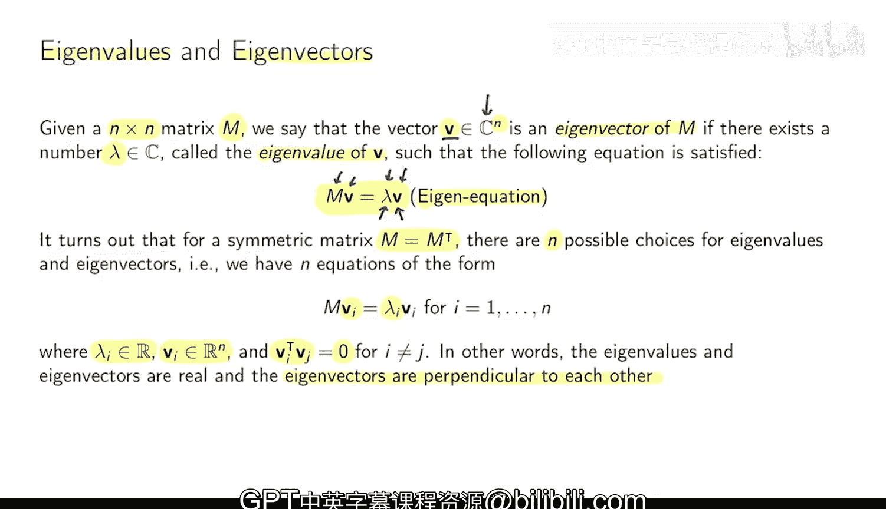

# 宾夕法尼亚大学《人工智能和机器学习基础（AI、数据科学、机器学习）AI and Machine Learning Essentials with Python》 p75 11_02_02_特征值与特征向量.zh_en -BV16f421Q72q_p75-

Let's introduce a few concepts of vector algebra。So with a note by a small bold letter， x。

 a vector with unreal entries， essentially an element of Rn。So bold x。He's going to be。hanee。

Of elements x1 to x N by convention， the n dimensional vector x is going to be a matrix with n rows and one column。

 essentially n will be a column vector， not a row vector。

 so this is different than this vectoring here。We can index elements of the vector x using the notation X I。

 so notice that we include a sub index I and we remove the bolt phase。

We can also define products of vectors， we have two types of products；

 the first one is an inner product of two vectors x and y of the same dimension n。

The result of this product is a sc that is defined below。

 So we use this notation to indicate the inner product of the two vectors。And by definition。

 this is equal to x transpose y。So notice that x is a column vector。

 so x Y is going to be a row vector x1。To X N。Y is also a column vector。

 so it's going to be a vector with elements y1。Do I end。

And now the dimensions of this vector is 1 times n。

 the dimensions of this second vector is n times 1。So the inner indexes match each other。

 so this is a proper multiplication， and the result of this multiplication is a one by one matrix。

 which is nothing by a scholar， a real number。An explicit expression for this metrics multiplication is given in the middle formula。

 but this is nothing but an explicit application of metrics multiplication to the vector case。

Also notice that in the case of the inner product， we can change the order of the vectors。

Instead of having x transpose y， we can have y transpose x and applying this formula。

 we would obtain the same exact value； therefore we have that the inner product of two vectors is commutative。

We have a second type of vector product called the outer product of2 vectors x and y of the same dimension in this case the outer product is defined as x y transpose。

 so notice how the transpose symbol instead of being on the x is on the y。This is a matrix n by n。

 you can easily convince yourself of this just by looking at the dimensions of x and y。

 so x is a column vector of dimension n times 1 and y is a row vector of dimension 1 times n。

 So again the inner indexes match each other so this is a proper matrix multiplication and the result of this product is going to be an n by n matrix as indicated here。

You can also very easily verify that the Ij entry of this n by n matrix is going to be equal to X。

 the I entry of x times yj， the J entry of y。Naturally。

 we also have the product of a metrics and a vector。

So if we have a matrix of dimension m times  n and an n dimensional vector。

 then we can define the product a times x again the dimensions should match。

 so we have that a is m by n and x is n by 1， therefore the inner indexes match and the resulting product is going to be an m by1 vector which is just an m dimensional vector。

 substantially y is going to be a vector of dimension M。

 and again applying the rule of matrix multiplication。

 the eighthh entry of the vector y will be defined by this sum。Finally。

 we're going to move on to the concept of eigenvalues and eigenvectors。

These concepts are related to square matrixrices。 For example。

 let's consider a matrix n of dimension n by n， meaning n rows and n columns。

 we say that a vector v of dimension n and notice in here that the entries of this vector can be complex。

 so this is why I put the fancy in there。 the entries do not have to be real numbers can be complex numbers。

So v is an n dimensional column vector of complex numbers。

 and we say that v is an eigenvector of m if there exist a complex number lambda。

calll the eigenvalue of V， such that the following equation is satisfied。

 substantially this is called the eigen equation and its as follows so if we are able to find a lambda and a V such that the multiplication of V with the matrix is equal to this color Lada times the matrix。

 then this Lada is called an eigenvalue and the associated eigenve is v。

It turns out that forsymmetric matrices。Wwhichch are defined according to this condition。

 there are n possible choices for the eigenvalues and eigenvectors In other words。

 if you look at the eigen equation， there is not just one solution but you have n different solution so you have n different eigenvalues that can satisfy this equation and for each eigenvalue you will have a corresponding eigenvector。

Furthermore， in the case of symmetric matrices， we note that this eigenvalue is a real number。

 the eigenvector is an n dimensionmensional vector of real entries。

 and also the inner products between any pair of eigenvectors is equal to 0。In other words。

 the eigenvectors are perpendicular to each other。

