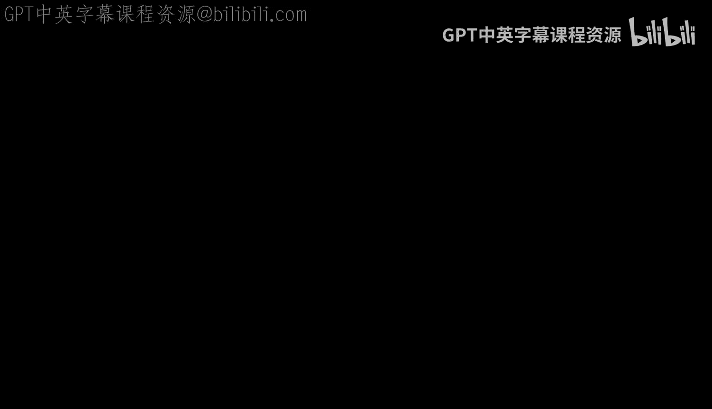
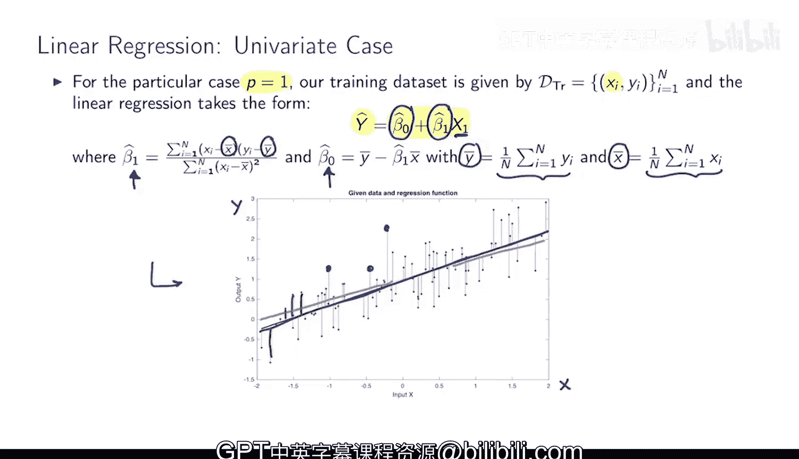

# 宾夕法尼亚大学《人工智能和机器学习基础（AI、数据科学、机器学习）AI and Machine Learning Essentials with Python》 p76 12_02_01_线性回归.zh_en -BV16f421Q72q_p76-

Yeah。Welcome back in this set of slides， we're going to cover the topic of linear regression。

In particular， were going to consider the additive model that we show below。

According to this additive model， the output variable y is going to be generated as a function that depends on a vector of inputs x and a collection of parameters beta plus measurement noise。

So the vector bold x contains the variables x1 x to up to xp。

 These are p random variables representing the p inputs of our problem and the vector beta contain the values beta 0 beta 1 beta 2 up to beta p。

 and these are deter deterministic but unknown coefficients。 So you can read the details below。

 essentially the random vector x is going to be drawn according to a marginal distribution f x。

 the coefficients beta 0 beta 1 beta p， as I mentioned before。

 are deter deterministic but unknown coefficients。And the measurement noise Epsilon follows a Pf E subub epsilon。

Notice that given the marginal of x and the equation of the additive model。

 we can compute a join Pf f of xy。In this setup， the linear regression problem can state it as follows。

 we're going to have a training data set which as we have seen before are collection of n pairs。

 each one of these pairs contains a vector of inputs X and a sc output Yi and we're going to assume that these pairs are drawn independently from a join distribution Fxy。

 this is the joint distribution induced by the additive model。

Our problem is then to estimate the value of the unknown coefficients， beta 0 to beta P。

 and we will denote our estimations by beta 0 hat up to beta P hat。 So in general， these values。

The betas without the hats are only known by nature。

 These are the values that nature uses to generate the training data set that we observe。

Our estimates based on data will always have a hat on it。

 So this is a convention that we're going to use throughout the course。

Once we have these estimates we can make predictions about the output variable corresponding to a new input we haven't seen before。

 so we can call this new input by x， and again this x will be a vector containing P input variables we can make predictions about the output that would correspond to that particular input by simply using the function described in the additive model。

The only difference is that now， instead of beta， which is something we cannot know。

 we use better hats， essentially the values of beta that we estimate from data。

The resulting function is going to be a linear combination of inputs weightd by the beta hats。

Also by convention， whenever we see beta hat without sub indexdex。

 what we will refer to is the column vector of betas。 so notice the transposition。

 make that vector into a column。To find the vector of estimated coefficients be had from data。

 meaning the training data set that were given before。

 we need to solve the following optimization problem。So in this optimization problem。

 we need to minimize a sumation。This sum contains the square of the difference of two terms。

 The first term is Yi。 These are the outputs in our data sets。

The second term is the evaluation of F of L using the input X and a set of parameters theta。

 this is the prediction of the output corresponding to an input X when the parameters beta are equal to a generic value theta。

The difference between these two terms is what's called the error or the residual of the Ih data point。

We can take this error squared。And compute the summation for all data points。

 and this is what's called the residual sum of squares that we will denote by RSS。Now。

 the whole point of this optimization problem is to find the optimal value of thetas。

That will minimize this RSS， and that optimal value will be stored in the vector beta hat。

So just to avoid any confusion， Theta is a vector of unknown coefficients。

 in this case are just Dm coefficients that we use to state the optimization problem instead of Theta we could have used any other letter。

Using metrics vector notation， we can write the optimization that we saw in the previous slide using the equation below essentially。

The RSs can be written as the square norm of the difference of two vectors， the vector y。

 which is nothing but the column vector of outputs， y1 up to yn。

 and the matrix vector product Mx times theta when Mx is defined in this equation here。

So you can easily verify that if you multiply the matrix mx by a vector of parameters theta。

 so this is going to be a vector containing parameters theta 0， theta 1 up to the P。

You're going to obtain an n dimensional vector and the entries of this vector are going to be the evaluation of the function Fl evaluated at the first point using the parameters The。

 essentially a genetic set of parameters， and we can keep going up to the n entry which will be generated using the n input vector。

 Now， it you subtract the vector Y minus。The vector corresponding to this multiplication。

 which you're going to obtain is another vector of n dimensions where each entry is going to be the difference between y1。

And this term， up to Y N and this term。Now you can easily check that if you compute the length of that vector and you square it。

 you're going to get exactly the RSS。This derivation is simply based by the fact that the square of the length of a vector is equal to the sum of the square of the components of this vector。

I'm going to leave this as a simple exercise for you。Using optimization tools。

We can find an explicit solution to the optimization problem stated above。

And this solution is provided at the bottom of these slides。Essentially。

 for those of you that have seen linear regression before， this should be familiar。

 so this matrix is called the pseudo inverse。And you can check that the dimensions of all these multiplications are correct。

Essential the output of those operations will be a vector beta hat of the proper dimensions。

We can now look at the simple case of a univariate regression in that case we're going to have p equal to 1。

 meaning one single input， therefore the vector x becomes a scholar x。

 this is what we represent in this entry， essentially when x I is a sc we can remove the bold phase and then the regression function takes this form。

Forn by a value beta 0， which is called the intercept and a value beta 1 hat。

 which is called the slope， this slope will be multiplying the input x1。

 which is the only input in the system。Using the pseudoimverses and using simple rules of linear algebra。

 you can come up to a close form expressions for beta 1 and beta 0。

 these expressions involve two new terms x bar and y bar defined in here and if you look into the equations。

 this y bar and x bar are nothing but the empirical means of the values yi and X I correspondingly。

In the plot below。We provide a concrete example for a linear regression problem in the Uniivariate case。

We're going to have an input variable x and an output variable y。You see a linear additive model。

 we generate a cloud of points plot in there， the gray line that you can see at the bottom of this plot。

Represents the true regression function that nature is using to generate the data。Essentially。

 beta 0 and beta 1 are used to generate that particular gray line。

Using the data points and the expressions above， we can compute our estimate for the linear regression。

 which is the blue line that I just marked on the screen。

And the red vertical lines correspond to the errors， so at the end of the day。

 what the RSS is doing is collecting the length of all these vertical segments。

And doing a sum of the squares of those residuals。

