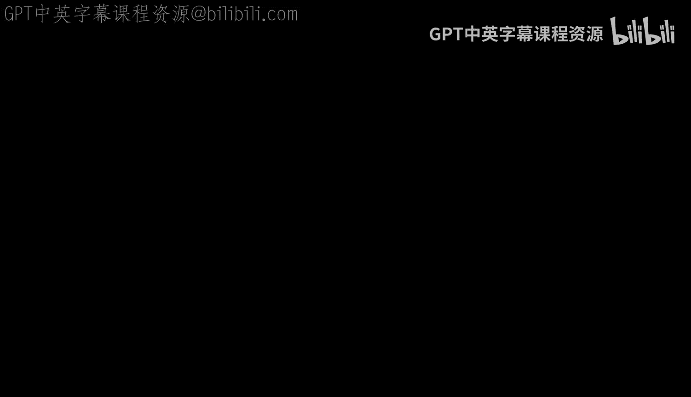
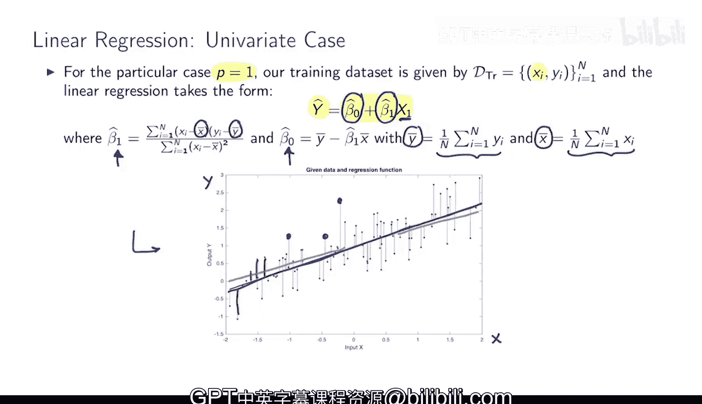

# 人工智能和机器学习基础：12_02_01：线性回归 📈

在本节课中，我们将要学习线性回归。这是一种用于建模输入变量与输出变量之间线性关系的基础方法。我们将从定义模型开始，逐步介绍如何从数据中估计模型参数，并最终利用模型进行预测。

## 模型定义

线性回归基于一个**加性模型**。根据该模型，输出变量 **y** 由输入向量 **x** 和一组参数 **β** 的线性组合，加上测量噪声 **ε** 生成。

**公式**：
`y = β₀ + β₁x₁ + β₂x₂ + ... + βₚxₚ + ε`

其中：
*   **x** = [x₁, x₂, ..., xₚ]ᵀ 是一个包含 **p** 个输入变量的随机向量。
*   **β** = [β₀, β₁, ..., βₚ]ᵀ 是决定性的、但未知的系数。
*   **ε** 是测量噪声。

输入向量 **x** 服从边际分布 fₓ(**x**)，噪声 **ε** 服从分布 f_ε(ε)。通过这个加性模型，我们可以推导出联合分布 f(**x**, y)。

## 问题陈述

在上一节我们定义了模型，本节中我们来看看如何从数据中学习它。

我们拥有一个包含 **n** 个样本的训练数据集，每个样本是一个输入-输出对 **(Xᵢ, yᵢ)**。我们假设这些样本是独立地从上述联合分布 f(**x**, y) 中抽取的。

我们的目标是**估计**未知系数 **β**。我们将用 **β̂**（读作“beta hat”）来表示基于数据得到的估计值。一旦我们获得了估计值 **β̂**，就可以对新的输入 **x** 预测其对应的输出 **ŷ**。

**预测公式**：
`ŷ = β̂₀ + β̂₁x₁ + β̂₂x₂ + ... + β̂ₚxₚ`

## 参数估计：最小二乘法

为了从训练数据中找到最优的系数估计 **β̂**，我们需要解决一个优化问题。核心思想是找到一组参数，使得模型的预测值与真实观测值之间的差距最小。

这个差距通过**残差平方和**来衡量。以下是计算RSS的步骤：

1.  对于第 i 个数据点，计算其**残差**（预测误差）：`eᵢ = yᵢ - (θ₀ + θ₁xᵢ₁ + ... + θₚxᵢₚ)`。这里的 **θ** 代表我们正在尝试的一组通用参数。
2.  将所有数据点的残差平方后求和，得到RSS。

**优化目标**：
`β̂ = argmin_θ RSS(θ) = argmin_θ Σᵢ (yᵢ - (θ₀ + θ₁xᵢ₁ + ... + θₚxᵢₚ))²`

使用矩阵和向量表示法，可以更简洁地表达这个问题。定义设计矩阵 **X**（包含所有输入数据，并添加一列1以对应截距项 β₀）和输出向量 **y**，则RSS可以写为：

**公式**：
`RSS(θ) = || y - Xθ ||²`

其中，||·|| 表示向量的 L2 范数（长度）。这个推导基于一个事实：一个向量长度的平方等于其各分量平方之和。

## 解析解

利用优化工具，我们可以为上述最小二乘问题找到一个**解析解**（闭合形式解）。

**公式**：
`β̂ = (XᵀX)⁻¹ Xᵀ y`

矩阵 **(XᵀX)⁻¹ Xᵀ** 被称为 **X** 的**伪逆**。这个公式直接给出了最优参数估计 **β̂**。

## 一元线性回归示例

现在，让我们看一个最简单的特例：**一元线性回归**，即只有一个输入变量 (p=1)。模型简化为：

**公式**：
`y = β₀ + β₁x + ε`

此时，参数估计 **β̂₀**（截距）和 **β̂₁**（斜率）有更简单的计算公式：

**公式**：
`β̂₁ = Σᵢ (xᵢ - x̄)(yᵢ - ȳ) / Σᵢ (xᵢ - x̄)²`
`β̂₀ = ȳ - β̂₁ x̄`

其中，**x̄** 和 **ȳ** 分别是输入和输出数据的样本均值。

下图展示了一个一元线性回归的实例：
*   灰色直线代表**真实的**回归线（由自然使用的 β₀ 和 β₁ 生成）。
*   蓝色直线是我们**根据数据估计出的**回归线（使用 β̂₀ 和 β̂₁）。
*   数据点散落在直线周围，体现了噪声 ε 的影响。
*   红色的垂直线段代表了每个数据点的**残差**（eᵢ）。RSS正是所有这些红色线段长度的平方和。

## 总结

本节课中我们一起学习了线性回归的核心内容。我们首先介绍了加性模型，明确了输入、输出、参数和噪声的关系。接着，我们定义了从数据中估计参数的问题，并引入了**最小二乘法**作为解决方案，其目标是**最小化残差平方和**。我们看到了该问题的矩阵表示及其**解析解**——伪逆公式。最后，通过一元线性回归的例子，我们直观地理解了截距、斜率、残差以及估计线与真实线之间的关系。线性回归是机器学习中最基础且重要的模型，为理解更复杂的方法奠定了基础。