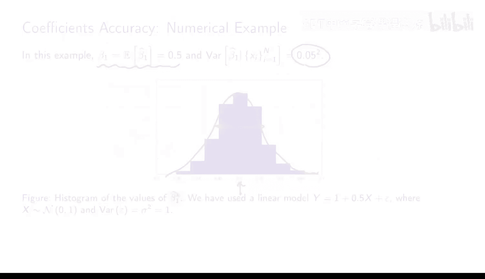

# 宾夕法尼亚大学《人工智能和机器学习基础（AI、数据科学、机器学习）AI and Machine Learning Essentials with Python》 p77 13_02_02_系数不确定性.zh_en -BV16f421Q72q_p77-

Yeah。We're going to start this video by assuming that we observe a data set generated by an additive linear model of the form that you observe in here。

This is just a compact form of the additive model that we describe in the previous slides。

Essential what we have in here are p dimensional data points distributed according to a particular marginal distribution。

We also have a vector of outputs that can be written as the product of the matrix M sub k defined in the previous set of slides times the vector beta plus a vector of measurement noises epsilon so essentially this vector epsilon is going to contain。

Random variables， E 12 E， N， where。EI is distributed according to this particular period。

You can easily verify that performing this product allows you to generate in one shot all the outputs in the vector Y。

We saw in the previous set of slides that we can estimate the linear coefficients beta hat from a data set using this expression。

 so essentially the output values are stacked together into a vector y。

 and the vector of inputs are also stack together into a metrics m sub x。

A very important point to note is that the data points X， I and Y I are random。 Therefore。

 the coefficients be hat are random variables themselves。

You can convince yourself by looking at the expression of beta hat since Mx contain points X and the vector y contain the values Yi and both Xi and Yi are random。

 this expression will result in a random vector。Now， since better I are random variables。

 we can study their expectations and their variances。In particular。

 one can analyze the mean so one can easily prove that the expected value of beta I hat is exactly equal to beta I。

 The thing that beta I hat is trying to estimate when this happens。

 we say that the estimator is unbiased。We can also analyze the covariance matrix of the vector beta hat。

Assuming that we are given the data metrics Mx。The covariance matrix can be written as we have in the expression at the bottom。

Essentially， what we have in here is the matrix Mx that compiles all the input vectors and sigma square。

 which is the variance of the measurement noise。In the following slides we'll show how the entries of the covariance metrics can be explicitly computed for the case of p equal to 1。

 meaning when we have one single input。So assuming that we have one input。

 the linear regression model takes this form， essentially we only have one intercept betacito hat and one estimated slope。

 beta one hat。Notice that the diagonal elements of the covariance metrics are nothing but the variances of the estimated coefficients。

To convince yourself of this fact， remember that if we look at the I J entry of the covariance metrics。

 this was nothing but the expectation。Of the variable X minus the mean of X。

 So I'm going to call the mean of X minus sub I just for simplicity times。

The variable xj minus the mean of xj， which I'm going to call mu sub J。Now。

 the diagonal elements of this metric sigma would correspond to points in which this value J is substituted by I。

Therefore， this term。Becomes a square。 and this is exactly the definition of the variance。Of exi。

In other words， the eighth diagonal element of the covariance metric sigma is equal to the variance of the eighth random variable contained in the eighth entry of the random vector X。

Us in this fact， we can compute the variances of beta 1 hat and beta0 hat given the data set。

These variances take the form in these expressions。Which， as you can notice。

 depend on the values of the input entries and the variances of the measurement noise。

In this course we will use SD to denote the standard deviation of a random variable。

 that's why the variance above can be written as the standard deviation square of each one of the estimated coefficients。

To illustrate the statistical properties of our estimate beta 1 hat。

 let's consider the following numerical example。In this example。

 we consider an unrealistic but illustrative situation。In particular。

 we consider1 thousand independent realizations of the training data set where K will go from  one to 1000。

Notice that in practice， this is something that' is not typical in particular。

 we will have a single realization of the data set， but for this illustration。

 we will assume this unrealistic scenario。We'll also assume that each data set contains n equal 100 samples。

In particular， we consider pairs of inputs outputs from 1 to 100 where the superscript K represent the particular training data set that we consider。

Now， for each training data set， we're going to compute the correspondingent estimates。

 be0 hat and be one hat。Where again the superscript K go from 1 to 1000 representing the different realizations of the training data set。

After performing these computations we show in thisfigu a histogram of the 1000 realizations of beta 1 hat for the 1。

000 different values of k， notice that the histogram is center around 0。

5 which is the theoretical value we should expect since beta 1 is equal to 0。

5 also we have that the standard deviation of this well curve is extremely close to 0。

05 which is the theoretical standard deviation。And it's clear from the histogram that the distribution of Peta 1 hat follows approximately a Gausian distribution。

