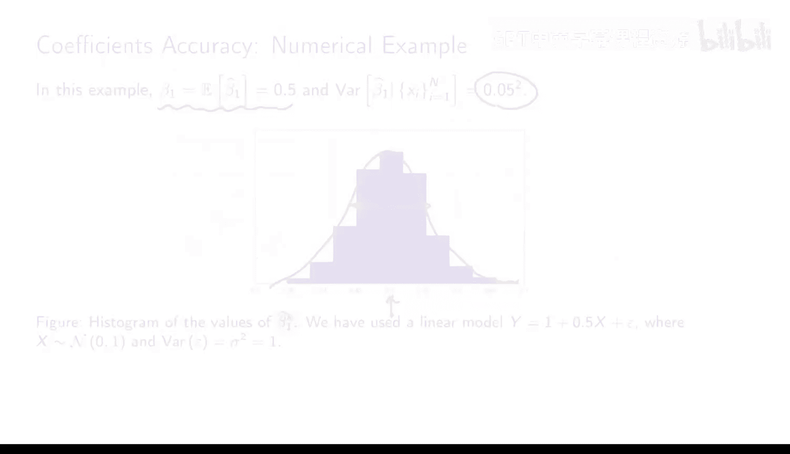

# 人工智能和机器学习基础：13：系数不确定性 📊

在本节课中，我们将学习线性回归模型中系数估计的统计特性。我们将探讨为什么估计出的系数是随机变量，如何计算它们的期望和方差，并通过一个数值示例来直观理解这些概念。

---

上一节我们介绍了线性回归模型的基本形式。本节中，我们来看看模型系数的估计值所具有的不确定性。

我们假设观测到的数据集由以下形式的加性线性模型生成：
`Y = M_x * β + ε`
这是一个紧凑的模型表示形式。其中，我们有 `p` 维的数据点，其输出向量 `Y` 可以写成设计矩阵 `M_x` 与系数向量 `β` 的乘积，再加上一个测量噪声向量 `ε`。向量 `ε` 包含随机变量 `ε_1, ε_2, ..., ε_n`，每个 `ε_i` 都服从特定的分布。

在之前的课程中我们看到，可以使用以下表达式从数据集中估计线性系数 `β_hat`：
`β_hat = (M_x^T * M_x)^{-1} * M_x^T * y`
这里，输出值被堆叠成向量 `y`，输入向量被堆叠成矩阵 `M_x`。

一个非常重要的点是，数据点 `X_i` 和 `Y_i` 是随机的。因此，系数 `β_hat` 本身也是随机变量。你可以通过观察 `β_hat` 的表达式来理解这一点：因为 `M_x` 包含随机点 `X`，向量 `y` 包含随机值 `Y_i`，所以这个表达式的结果是一个随机向量。

既然 `β_hat` 是随机变量，我们就可以研究它们的期望和方差。具体来说，可以分析其均值。可以证明，`β_hat_i` 的期望值恰好等于它试图估计的真实值 `β_i`。当这种情况发生时，我们说这个估计量是**无偏的**。

我们还可以分析向量 `β_hat` 的协方差矩阵。假设给定了数据矩阵 `M_x`，其协方差矩阵可以写成底部表达式所示的形式：
`Cov(β_hat | M_x) = σ² * (M_x^T * M_x)^{-1}`
本质上，这里的 `M_x` 是编译了所有输入向量的矩阵，而 `σ²` 是测量噪声的方差。

---

在接下来的内容中，我们将展示如何为 `p = 1`（即只有一个输入变量）的情况显式计算协方差矩阵的各个元素。

假设我们只有一个输入，线性回归模型采用以下形式：
`Y = β_0 + β_1 * X + ε`
本质上，我们只有一个估计的截距 `β_0_hat` 和一个估计的斜率 `β_1_hat`。请注意，协方差矩阵的对角线元素正是这些估计系数的方差。

为了理解这一点，请记住，如果我们看协方差矩阵的 `(i, j)` 元素，它等于 `E[(X_i - μ_i)(X_j - μ_j)]`。这个矩阵的对角线元素对应 `i = j` 的情况，因此该项变成了 `(X_i - μ_i)²` 的期望，而这正是随机变量 `X_i` 的方差的定义。

利用这个事实，我们可以计算给定数据集下 `β_1_hat` 和 `β_0_hat` 的方差。这些方差的形式如下列表达式所示：
`Var(β_1_hat) = σ² / Σ_{i=1}^{n} (x_i - x̄)²`
`Var(β_0_hat) = σ² * [1/n + x̄² / Σ_{i=1}^{n} (x_i - x̄)²]`
正如你所注意到的，它们依赖于输入数据点的值以及测量噪声的方差。在本课程中，我们将用 `SD` 表示随机变量的标准差，因此上述方差可以写成每个估计系数标准差的平方。

---

为了说明估计量 `β_1_hat` 的统计特性，让我们考虑以下数值示例。

在这个例子中，我们考虑一个不现实但具有说明性的情况。具体来说，我们考虑训练数据集的1000个独立实现，其中 `k` 从1到1000。请注意，在实践中这并不典型，通常我们只有一个数据集实现，但为了说明，我们假设这个不现实的场景。我们还假设每个数据集包含 `n = 100` 个样本。

具体来说，我们考虑从1到100的输入输出对 `(x_i^(k), y_i^(k))`，其中上标 `(k)` 代表我们考虑的第 `k` 个特定训练数据集。

现在，对于每个训练数据集，我们将计算相应的估计值 `β_0_hat^(k)` 和 `β_1_hat^(k)`，其中上标 `k` 同样从1到1000，代表训练数据集的不同实现。

执行这些计算后，我们展示了1000个 `β_1_hat` 实现值（对应1000个不同的 `k`）的直方图。请注意，直方图以0.5为中心，这是我们预期的理论值，因为真实的 `β_1 = 0.5`。同时，该分布曲线的标准差极接近理论标准差0.05。从直方图可以清楚地看出，`β_1_hat` 的分布近似遵循高斯分布。

---

本节课中我们一起学习了线性回归系数估计的不确定性。我们了解到，由于数据是随机的，估计出的系数 `β_hat` 也是随机变量。我们证明了普通最小二乘估计量是无偏的，并推导了其协方差矩阵的表达式。通过一个单输入变量的特例，我们具体计算了斜率和截距估计值的方差。最后，通过一个数值模拟示例，我们直观地观察到了估计系数的抽样分布，验证了其围绕真实值波动且近似正态分布的特性。理解这种不确定性对于评估模型估计的可靠性至关重要。